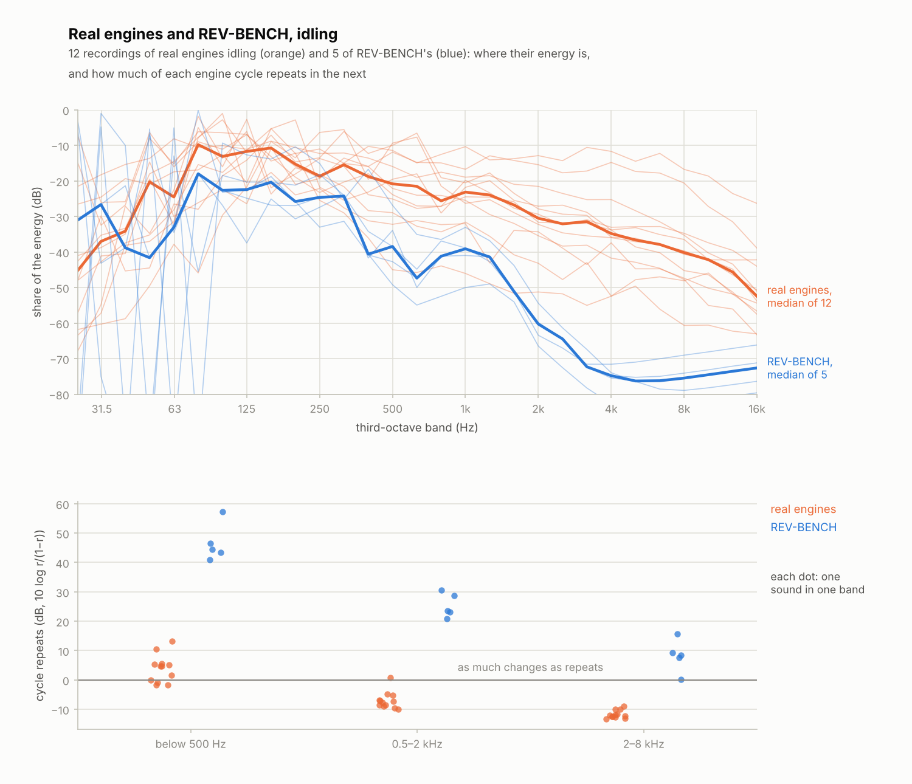
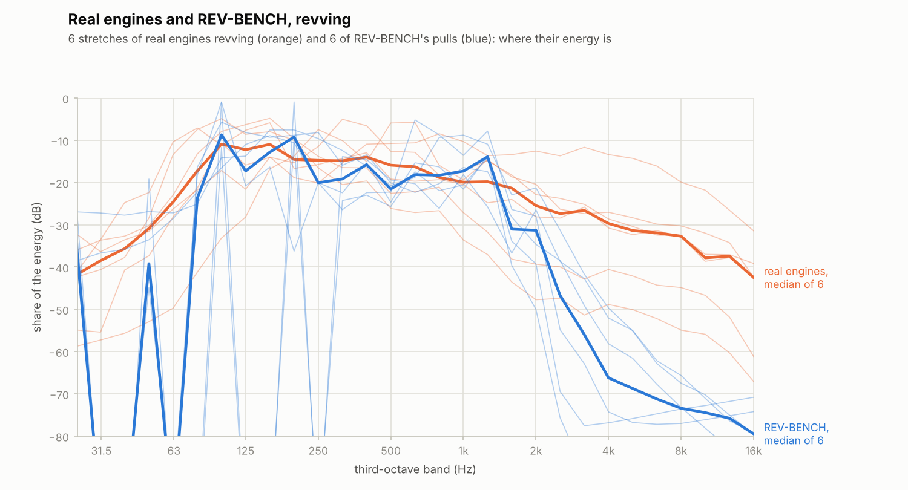

# REV-BENCH — Research notes (stage 0)

## 2026-10-21 — Deceleration and spatial sound continuation

Bernardo's robotic V8/I6 deceleration report remains a listening observation,
not an established single-cause diagnosis. Investigation separated controller
entry, combustion/pumping behaviour and recording/listener context.

- **Verified implementation gap:** the former overrun controller cut fuel
  immediately. Manufacturer ECU documentation supports testing a timed spark
  transition before cut. The new illustrative calibration and controls are
  documented in `docs/stage-S1e.md`; the exact sound improvement remains unapproved.
- **Real-recording evidence:** descending harmonics were inspected in BMW
  250–253 s, Mustang 257–263 s and Ferrari 302–310 s. Camera position, RPM/load,
  gear state and Doppler contributions remain uncertain. They are qualitative
  references, not matched transient calibration measurements.
- **Unresolved S1 physics:** early flame development and residual-gas coupling
  warrant further research. A generic random misfire probability would not be
  justified by the optical-engine evidence cited in `docs/stage-S1e.md`.
- **Additional acoustic mechanisms:** actual-flow intake/baffle sources and an
  optional finer grid are documented in `docs/stage-S2.md`. The grid's added
  cost must be weighed against measured convergence and listening benefit.
- **Perspective:** separate-source stereo, disk-aperture directivity, image
  reflections, retarded-time source motion and a damped orthogonal FDN are
  documented with primary sources and explicit approximations in
  `docs/stage-S4.md`. These are not measured vehicle/room transfer functions.

The checkpoint additionally separates an eight-second in-gear coast from
clutch-in and neutral recovery. Its extended duration comes from retaining the
modeled vehicle inertia, not slowing or pitch-shifting the rendered audio.
Further recordings may be sought or requested from Bernardo as needed. Keep
originals and measurements separate from listening aids; realism takes priority
over processing cost when the benefit is justified.

## How existing engine simulators make sound

| Project | Approach | Notes |
|---|---|---|
| [ange-yaghi/engine-sim](https://github.com/ange-yaghi/engine-sim) (AngeTheGreat) | Full physics sim of gas through cylinders, valves and exhaust; audio derived from it, then convolution | MIT, C++, Windows-only build. README: "designed specifically to produce engine audio and simulate engine response characteristics", **not** accurate for engineering. Reported sim rate ≈ 80,000 steps/s ([The Drive](https://www.thedrive.com/news/hear-this-absurdly-accurate-homebrew-engine-sim-rev-a-chevy-big-block)). |
| [glouw/ensim4](https://github.com/glouw/ensim4) | Isentropic flow equations + 1D CFD for exhaust pipes, real-time audio | MIT, **C23 + SDL3**. Very readable reference for us. Credits Ange for the impulse convolution idea. |
| [enginesound (Rust)](https://github.com/standardgalactic/enginesound) | Physically informed synthesis: pipe/chamber acoustics with speed of sound and end reflections; intake + exhaust + vibration mix | Includes resonance damping. Based on the paper below. |
| [Browser engine sound generator](https://github.com/SpudzzDev/en) | Same paper, Web Audio + AudioWorklet, later ported to C++ → WASM | WASM port was done to remove glitches. |
| [combustionlab.net](https://combustionlab.net) ([HN thread](https://hn.nuxt.dev/item/48795900)) | Web engine "simulator" | Main criticisms: redline unaffected by anything, impossible compression/boost combos allowed, unrealistic presets, LLM-written "how it works". Lessons: add limits (stage 22), validate numbers (stage 9), and write the docs from the real model. |

Key paper: *Physically informed car engine sound synthesis for virtual and augmented environments*
(Baldan, Lachambre, Delle Monache, Boussard). It models ignition, pistons, intake, resonance,
vibration and backfire.

Good physics explainer: [Bartosz Ciechanowski — Internal Combustion Engine](https://ciechanow.ski/internal-combustion-engine/).

## Sound realism (October 2026, after stage 12)

Bernardo listened to stage 12's renders and found them **"dull and really artificial"**. Only the
cross-plane V8's rev sweep came close. The sound is the project's top priority, so this section is
what the plan's sound stages (S1–S5 in PLAN.md) build on.

### Measured against real engines

`tools/compare_real.py` measures recordings of real engines and REV-BENCH's renders the same way.
It compares only the sound's shape, never its level, because the microphones and distances differ.
- **Real recordings:** 12 engines idling and 6 stretches of revving, all from Freesound. The
  128 kbit/s MP3 previews keep everything below about 16 kHz. `tools/real_engines.csv` lists each
  recording with its author and licence: CC0, CC BY 4.0, and one CC BY-NC 4.0.
- **REV-BENCH:** the five presets idling 1 m behind a tailpipe, and stage 12's pulls.

Each cell is the median, with the range in brackets:

| | Real, idling (12) | REV-BENCH, idling (5) | Real, revving (6) | REV-BENCH, pulls (6) |
|---|---|---|---|---|
| Energy above 1 kHz | −18 dB (−42…−3) | −39 (−46…−34) | −14 (−33…−4) | −14 (−19…−8) |
| Energy above 2 kHz | −25 dB (−45…−5) | −59 (−67…−57) | −20 (−42…−6) | −37 (−56…−24) |
| Energy above 4 kHz | −31 dB (−47…−8) | −67 (−74…−60) | −25 (−45…−10) | −61 (−76…−49) |
| Third-octave slope, 0.5–8 kHz | −4.0 dB/oct (−7.9…−0.4) | −10.6 (−14.7…−10.2) | −5.8 (−7.7…−1.8) | −17 (−22…−12) |
| What A-weighting takes off | 11 dB (1…18) | 22 (16…27) | | |
| Crest factor | 12 dB (9…21) | 7 (5…7) | | |
| Cycle repeats, below 500 Hz | +5 dB (−2…+13) | +44 (+41…+57) | | |
| Cycle repeats, 0.5–2 kHz | −7.5 dB (−10…+1) | +24 (+21…+31) | | |
| Cycle repeats, 2–8 kHz | −12 dB (−13…−9) | +8 (0…+16) | | |

"Cycle repeats" compares half a second of sound with the same half second one engine cycle
later. It takes the best correlation r and gives it as 10 log10(r/(1−r)): 0 dB means as much
changes as repeats.

What the numbers say:
1. **Too regular: "artificial".** A real engine at idle repeats from one cycle to the next only
   a little more than it changes (+5 dB below 500 Hz). Above 500 Hz, most of its sound is new
   every cycle (−7 to −12 dB). Ours repeats to +44 dB: each cycle matches the last to about one
   part in 25,000 of its energy, so the ear hears a loop. There are two causes:
   - nothing in the sim varies: no cycle-to-cycle combustion, no turbulence;
   - none of the sound is noise.
2. **Too dull, with a cliff.** Under load, our energy above 1 kHz matches the real engines'
   (−14 dB). Above 2 kHz it falls off a cliff: −17 dB per octave against −6, and 36 dB short
   by 4 kHz.
   - **The cliff is the pipes' grid.** On a staggered grid with time step Δt and CFL number
     c Δt/Δx, the highest frequency is asin(CFL)/(π Δt) ≈ c/(π Δx). That is 2.4 kHz in the
     7.5 cm exhaust cells (hot gas at about 560 m/s) and 2.2 kHz in the 5 cm intake cells.
   - **Below that, waves already run slow.** At 1 kHz they are 3 % slow, and at 2 kHz 11 %.
     That's the dispersion relation sin(ω Δt / 2) = CFL sin(k Δx / 2).
   - **Real engines also have a noise floor.** At idle it runs broad all the way to 16 kHz:
     −25 dB of their energy above 2 kHz, against −59 in ours.
3. **Too smooth.** A-weighting takes 22 dB off ours but 11 dB off the real engines', because
   ours is mostly low thumps. Our crest factor is 7 dB against 12: real firings are sharper and
   carry noise.
4. **Mechanical sound is missing.** The same Honda V6 was recorded at the exhaust and in front.
   In front it has 13 dB more energy above 1 kHz, with steady lines near 3 and 5.5 kHz: the
   engine bay's own sound, which we don't make at all. The Volvo's engine-bay recording is the
   only one whose 0.5–2 kHz band repeats (+0.8 dB): mechanical sound is far more regular than
   flow noise.
5. **The levels look right.** Ours idles at 66–82 dBA 1 m from the tailpipe, and the four pulls
   at 85–109. The recordings can't check this, since their microphones are unknown.

### How others get there

- **engine-sim (AngeTheGreat).** Its audio is not the raw physics
  ([synthesizer.cpp](https://github.com/ange-yaghi/engine-sim/blob/master/src/synthesizer.cpp),
  [synthesizer.h](https://github.com/ange-yaghi/engine-sim/blob/master/include/synthesizer.h),
  [jitter_filter.h](https://github.com/ange-yaghi/engine-sim/blob/master/include/jitter_filter.h)).
  The steps, in order:
  1. The exhaust flow from the sim is resampled to the audio rate through a **1.9 kHz low-pass**.
     Everything above that comes from the steps below, not from its physics.
  2. **Time jitter:** the flow is read back from a short delay line at a random position. The
     position is smoothed noise (strength `inputSampleNoise` 0.5, cutoff 10 kHz). The release
     notes for 0.1.11a call this "HF noise" and made it independent of the sim rate.
  3. A 10 Hz DC blocker.
  4. **Noise multiplied into the flow:** `flow × (airNoise·r + 1 − airNoise)`, where r is uniform
     noise low-passed at `airNoiseFrequencyCutoff` (2 kHz). `airNoise` defaults to 1.
  5. A mix of the flow and its derivative, `dF_F_mix` 0.01, so mostly the flow itself.
  6. **Convolution with an impulse response,** at most 10,000 samples, fully wet by default.
     Each engine names an IR from the bundled library ("smooth", "sharp", "mild exhaust", ...).
  7. A **leveler**, an automatic gain toward 30,000/32,767 with a maximum gain of 1.9.

  So engine-sim's realism above 2 kHz is randomness plus a measured-sounding impulse response.
  [ensim4](https://github.com/glouw/ensim4), whose exhaust is 1D CFD, also credits Ange "for
  impulse convolution".
- **Neural and DDSP engine models.** The model of [arXiv 2603.09391](https://arxiv.org/abs/2603.09391)
  has a pulse per firing, valve envelopes, exhaust resonators, stochastic amplitude modulation
  from turbulence, and a noise bank. Its noise is gated by load: combustion noise on throttle,
  airflow noise on the overrun.
- **Synthesis without randomness sounds wrong.** An analysis-by-synthesis model gives each
  partial random amplitude and frequency modulation, low-passed and only weakly correlated
  between partials
  ([Acta Acustica 2023](https://acta-acustica.edpsciences.org/articles/aacus/full_html/2023/01/aacus220112/aacus220112.html)).
  Repeating one firing's waveform sounds monotone, because each firing of a real engine differs
  ([US 6,859,539](https://image-ppubs.uspto.gov/dirsearch-public/print/downloadPdf/6859539)).
  The cycle-to-cycle differences matter most at idle and low rpm
  ([sample-based synthesis](https://www.researchgate.net/publication/345253375_Sample_Based_Synthesis_of_Car_Engine_Noise)).

### The physics of what's missing

1. **Cycle-to-cycle combustion variation.**
   - **Where it comes from:** the flame kernel's early growth depends on the turbulence and
     mixture at the plug, so each cycle's burn starts and runs differently.
   - **How it's measured:** the COV of IMEP. Spark-ignition engines typically run a few percent
     at load and more at idle, light load, with lean mixtures and with residual gas. Driveability
     suffers above about 10 % (Heywood, *Internal Combustion Engine Fundamentals*, §9.4).
   - **What changes it:** it is smallest near the best spark timing, and larger at part throttle
     because the burn is slower ([Brunel thesis](https://bura.brunel.ac.uk/handle/2438/5143)).
   - **The cylinders differ too:** injectors, air distribution and spark differ slightly between
     cylinders. That gives even-firing engines small half orders.
2. **Flow noise.**
   - **Two kinds of exhaust noise:** order noise, the low-frequency pulses from the valves, and
     flow noise. Flow noise is high-frequency and depends on the gas's velocity, temperature
     and path ([SAE 2018-01-1280](https://saemobilus.sae.org/papers/methods-mitigate-tail-pipe-noise-passenger-vehicles-2018-01-1280)).
   - **In a muffler:** a passenger car's makes broadband flow noise from 1 to 8 kHz, mostly
     under hard acceleration ([SAE 2011-01-1528](https://saemobilus.sae.org/content/2011-01-1528)).
   - **How it scales:** a turbulent jet's noise power grows with the eighth power of its velocity.
     A flow discontinuity's acoustic power follows the pressure drop across it
     ([NASA/BBN](https://ntrs.nasa.gov/api/citations/19690002231/downloads/19690002231.pdf)).
   - **At the tailpipe's mouth:** in expansion-chamber models, tonal resonances and a broadband
     share both rise with the turbulence ([FAU](https://open.fau.de/handle/openfau/21145)).
   - **The muffler's shell** radiates in the middle and high frequencies
     ([KAIST](https://koasas.kaist.ac.kr/handle/10203/100384)).
   - **What REV-BENCH could use:** flow noise driven by the velocities the sim already computes,
     at the tailpipe's mouth, the throttle, the valves and the baffles. It would come in bursts
     with each pulse, which is the rasp.
3. **The engine's own sound,** mostly through the block.
   - **Combustion noise:** each cylinder's pressure rise, filtered by the structure. The usual
     tool is the attenuation curve, mostly diesel work
     ([Purdue](https://docs.lib.purdue.edu/dissertations/AAI1602585);
     [gasoline blocks](https://www.inderscience.com/info/inarticle.php?artid=6601)).
   - **Piston slap:** strongest in the 2 kHz octave band, petrol engines included
     ([TU Graz/AVL](https://graz.elsevierpure.com/files/2915081/MBD_0600-final.pdf)). One
     cylinder's liner rang at about 2.8 kHz
     ([US 9,695,761](https://image-ppubs.uspto.gov/dirsearch-public/print/downloadPdf/9695761)).
   - **The valvetrain and injectors:** their ticks show as the Honda's steady lines.
   - **What REV-BENCH has for it:** each cylinder's pressure, the rod angle (which sets the side
     thrust that slaps the piston across the bore) and every valve event. Physically timed
     impulses into a few block resonances (modal synthesis) are cheap.
4. **The place.**
   - **Mono sounds flat.** Two ears, each hearing every source at its own distance and delay,
     put the twin exhaust and the engine in space.
   - **Surroundings:**
     - Asphalt reflects nearly everything; grass absorbs the highs.
     - A nearby wall adds a strong early reflection.
     - A garage or dyno cell reverberates. A feedback delay network does that cheaply, without
       allocation, in C (Jot & Chaigne 1991;
       [overview](https://dsprelated.com/freebooks/pasp/History_FDNs_Artificial_Reverberation.html)),
       so native renders and the browser would sound the same.
   - **The tailpipe beams its highs.** An open pipe radiates evenly while its radius is small
     against the wavelength, and beams along its axis from about ka ≈ 1, around 2 kHz for a 5 cm
     pipe (Levine & Schwinger, Phys. Rev. 73, 383, 1948).
   - **Standard places to listen:**
     - ISO 5130's stationary test: 0.5 m from the outlet, 45° off its axis, at its height
       ([NTi](https://www.nti-audio.com/en/applications/noise-measurement/vehicle-noise));
     - a pass-by at 7.5 m.
   - **Inside the car:**
     - airborne paths through the firewall and floor;
     - the exhaust through the rear of the body;
     - the engine's orders through the mounts, as force times transfer function
       ([US 8,885,843](https://image-ppubs.uspto.gov/dirsearch-public/print/downloadPdf/8885843));
     - a boom from the cabin's first mode (about c/2L ≈ 70 Hz for 2.5 m);
     - highs strongly cut.
5. **What the ear listens for.**
   - **Roughness** is modulation at 20–300 Hz, strongest near 70 Hz. It reads as sporty and
     aggressive, or as unpleasant.
   - **Fluctuation strength** is modulation near 4 Hz: rhythm, like an idle's lope
     ([JCAA](https://jcaa.caa-aca.ca/index.php/jcaa/article/download/1647/1394/1784)).
   - **Sportiness** follows how much the level rises with load
     ([SAE 2006-01-0098](https://saemobilus.sae.org/papers/psychoacoustic-modelling-sound-attributes-2006-01-0098)).

### What this means for REV-BENCH

- **Stay physical, add layers.** The physics stays the source of the order noise and of
  everything below about 2 kHz. Each missing layer is added driven by quantities the sim already
  computes, not from samples:
  - variation: physics;
  - flow noise: from velocities;
  - mechanical sound: from pressures and events;
  - the place: geometry.
- **Where the highs come from.** engine-sim's own physics also stops near 2 kHz, so randomness
  driven by the physics is a proven route above it. Finer cells where the sound is made (the
  tailpipe, the muffler's outlet) is the other route. Pushing the cutoff to 8 kHz needs Δx ≈ 2 cm
  (CFL 0.5 at 48 kHz, still stable), so it belongs in stage 13's quality setting.
- **Targets from the recordings,** measured with `tools/compare_real.py`. At idle:
  - cycle repeats between 0 and +15 dB below 500 Hz, under 0 dB above 500 Hz;
  - energy above 2 kHz within the real range: −45…−5 dB idling, −42…−6 revving;
  - a slope between −2 and −8 dB per octave;
  - a crest factor of 9 dB or more.
- **Done when Bernardo says so.** Numbers in range are necessary, not sufficient: the stages
  aren't done until he says they sound right.

### After stage 12b: a piano note (stage 12c)

Bernardo found stage 12b's renders "too smooth... like a piano note", the 3000 rpm ones sounding
like an idle should, the limiter's gaps and the deceleration off. More recordings, made as close
to the pipes as could be found (a Ford GT V8, a Porsche 911T flat-6, a Toyota Tercel four, a
bumpy-cammed Chevy 350, a Corvette LS6 held at 3000 rpm), and new measures showed:
- **Real engines' cylinders don't sound alike.** Between their firing orders (for a four: 0.5, 1,
  1.5, 2.5 ...) real engines have −12 to +11 dB of the firing orders' energy; a cross-plane V8's
  strongest order can be a half one (the LS6's 2.5). With every header alike and every cylinder
  identical, REV-BENCH's four had −72 dB idling and −33 to −41 at 3000 rpm: nothing but the firing
  frequency's harmonics, which is what a note is. Production manifolds' unequal runners and each
  cylinder's own mixture and burn are where real engines get theirs (`tools/orders.py`).
- **Each cycle varies.** The cylinders' work varies by 1–3 % of the mean wide open and 4–8 %
  idling (the COV of IMEP; Heywood 9.4): the flame's early growth with the turbulence and mixture
  at the plug, a slow start mostly meaning a slow burn.
- **Idling, a real cylinder still pushes out a pulse.** The four idled at 25 kPa (real engines
  30–40, held there by their alternator and pumps as well as their friction) and opened its
  exhaust valves below the exhaust's pressure.
- **Recordings at the exhaust hear its jet.** A microphone in the tailpipe's puffs (½ρu² of 20 m/s
  is 80 Pa) picks up turbulence a listener a few metres away doesn't: their low band varies
  from cycle to cycle more than the sound does. Orders and spectral balance are safer measures.
- **Limiters bounce.** Soft cuts drop single sparks or injections at random, more nearer the
  limit (Haltech, HP Academy), and real engines on their limiters stutter 10–30 times a second; in
  neutral, released, they fall 1000–4000 rpm a second.

## Browser audio

- **AudioWorklet** runs audio code off the main thread. The old `ScriptProcessorNode` ran on the main
  thread and blocked everything else. ([MDN](https://developer.mozilla.org/docs/Web/API/Web_Audio_API/Using_AudioWorklet))
- **Emscripten Wasm Audio Worklets** let C/C++ run in the worklet with no JS garbage (no GC pauses),
  but they're built on Wasm Workers, which use shared memory and so need COOP/COEP headers.
  ([Emscripten docs](https://emscripten.org/docs/api%5Freference/wasm_audio_worklets.html))
- **Our choice:** a standalone `.wasm` instantiated directly inside our own AudioWorklet processor,
  with no Emscripten runtime. That gives the same performance benefit and needs no special headers.
- Browsers won't start audio before a user gesture, so there needs to be a "Start" button
  ([Red Blob Games notes](https://www.redblobgames.com/x/2147-webaudio-motor/)).

## Hosting (static site, free)

- **Vercel Hobby:** personal/non-commercial use, about 100 GB/month bandwidth. Already used for the portfolio.
- **Cloudflare Pages:** unmetered bandwidth and static requests on the free plan, 25 MiB max per file.
- **GitHub Pages:** also fine.
- No backend needed. If shared memory is ever added, set COOP/COEP via `vercel.json` or `_headers`.

## 3D in the browser (for stages 17–19)

- **Three.js** (npm `three`; 0.186.1, released 2026-09-24, was current when this was written) fits
  a plain TypeScript app. Its `WebGPURenderer` uses WebGPU when the browser has it and falls back to
  WebGL 2 automatically. It needs `await renderer.init()` before the first frame, otherwise the
  canvas can stay black.
- WebGPU covers most browsers in 2026, but Firefox only ships it on some platforms, so the WebGL 2
  fallback matters. Custom shaders should be written in TSL (the Three.js Shading Language), which
  compiles to WGSL for WebGPU and to GLSL for WebGL 2. Plain GLSL `ShaderMaterial` only runs on the
  WebGL 2 path. ([migration notes](https://www.buildmvpfast.com/blog/threejs-webgl-to-webgpu-renderer-migration-2026),
  [WebGPU + Three.js guide](https://www.utsubo.com/blog/webgpu-threejs-migration-guide))
- Picture/sound sync: Web Audio reports how late the speakers are (`AudioContext.outputLatency`,
  `getOutputTimestamp()`), so the 3D view can be delayed by that much to match what's heard.
- Procedural geometry (built from bore, stroke, rod length, layout and crank pin angles) instead of
  imported models: every engine the simulator can run can be drawn, with nothing modelled by hand.

## Bernardo's machine (checked in stage 0)

`gcc`, `make`, `node`, `npm`, `python3` and `git` are available. **Not installed:** `clang`, `cmake`, `emcc`.
Stage 2 installs a WASM toolchain.
