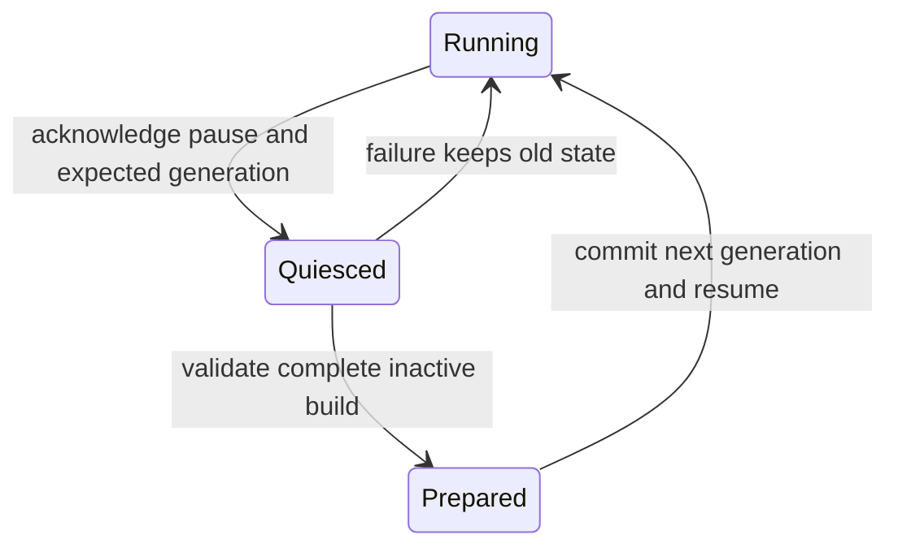

# Event, clock, snapshot and rebuild contract — version 1

Shares [build identity/version rules](README.md) and SI units. These are
normative requirements plus an executable **serial control-plane reference**,
not a production event producer, thread-safety implementation or measured
browser/3D synchronization result. Current core/TS bindings are preserved.

## Clocks and actual events

The physical simulation owns integer `physics_tick`, its fixed `physics_hz`
and actual event time. An event inside a step uses `physics_tick + subtick`,
`0 <= subtick < 1`; producers define the tick as the beginning of the step and
interpolate only where the solver actually identifies an occurrence. Recording
the next callback arrival time does not timestamp a physical event. Crank state
has `cycle_index` (uint64) and `0 <= phase_rad < 4π`. The unwrapped angle is
conceptually `4π*cycle_index + phase_rad`; retain the integer pair rather than
forming an ever-growing imprecise floating angle. Reverse crank is unsupported
in this version. RPM is presentation only, `speed_rad_s*30/π`.

Events contain exactly `schema_version`, `build_id`, `generation`, `build_revision`, `sequence`,
`kind`, `actor_id`, `cycle_id`, `physics_tick`, `subtick`, `cycle_index`,
`phase_rad`. All counters are decimal strings; phase is radians. Cylinder
actors are `<build_id>/cylinder-<slot>`. Supported schema kinds distinguish
spark-command, spark-discharge, flame-start, fuel-injection, intake-open,
exhaust-open, fuel-cut and limiter-cut. A command, a physical discharge and a
later kernel/heat release are different occurrences, including when one never
happens. No injection means no actual injection event. Synthetic placeholders
or random scheduled clicks must not be labeled observed physical events.

`cycle_id` identifies the actor's **target firing TDC occurrence**, independent
of global wrapped phase: its TDC is at `4π*cycle_id + firing_angle[actor]`.
A spark before cylinder-zero TDC can be in global cycle N−1 while targeting
combustion cycle N. This prevents losing causal identity across the wrap.
Sequence IDs increase per generation. Events are ordered by tick/subtick and
sequence; a bounded batch reports any omitted events with an explicit loss
count. At most 256 events / 64 KiB per diagnostic batch is the initial budget.
Loss means a consumer cannot claim a complete causal trace. No callback file
I/O or unbounded queue is permitted. The reference validates individual records;
producer ordering, loss transport and actual spark/fuel/heat causality remain
038/040–042. The checked example events are hand-defined protocol controls,
not traces newly emitted by the current production engine.

## Audio, device and visual clocks

An epoch maps `(physics_origin, audio_origin)` at a safe render boundary:

```text
(physics_tick - physics_origin) / physics_hz
    = (audio_frame - audio_origin) / audio_hz
```

The proof checks this equality by integer cross-multiplication, with 8–1000 kHz
integer clock rates and snapshots on common boundaries. Event subticks map
fractionally within that epoch. A changed rate, reset, suspend/resume mapping
or discontinuity requires a new acknowledged mapping/generation, never an
unannounced reset to frame zero. AudioContext output-frame position persists
across an engine reset. Worklet block sizes must be read from the actual output
buffers; 128 is the present scaffold's block size, not a permanent API guarantee.
The [Web Audio specification](https://www.w3.org/TR/webaudio/) defines its
frame/context clock and device timestamp; do not derive it from animation time.

Separate these delays in metadata and measurements:

| Delay | Owner and synchronization meaning |
| --- | --- |
| Cylinder/valve to acoustic terminal | Physical gas/acoustic solver; actual group/feature travel can depend on frequency, state and path. Use a declared event/feature and qualified transfer or source trace, not one universal pipe delay. |
| Aperture/structure to listener | Physical scene model; moving sources use retarded emission/reception time, not distance at the wrong clock. |
| FIR/decimation/resampling/filter algorithmic delay | DSP implementation; measured at the declared sample rates, separate from physical travel. |
| Queued graph frames, device scheduling/output | AudioContext/device mapping; includes render-ahead delay, not extra engine time. |
| Display/RAF presentation | Browser presentation clock; bounded interpolation/history policy, never a new engine clock. |

For a **declared static-path test pulse**, source event context time `e`, gas
flight `g`, listener flight `l`, DSP delay `d`, and output timestamp
`(contextTime=c, performanceTime=p)` yield expected audible presentation time
`p + 1000*(e+g+l+d-c)` in performance milliseconds. The executable helper uses
seconds throughout. Device/graph queue is already represented by that timestamp:
do **not** add `baseLatency`, `outputLatency` or a guessed block delay again.
If the event is stamped at the aperture, `g=0`; upstream propagation already
occurred. Its 20 ms gas + 10 ms air + 3 ms DSP worked example arrives at
4.033 s for `e=c=1 s`, `p=4 s`; aperture emission at 1.020 s yields the same
arrival. This is a dimensional/time-origin oracle, not new engine flight data.

The expected audible arrival for synchronization is explicitly the selected
`source_id`, `listener/path_id` and event/feature. One display cannot remove
different physical delays for all simultaneous sources; select/document a
focus path and retain other sources' physical relative timing. Use snapshot
history to display the coherent engine state at the corresponding engine time,
not independent cylinders from the latest UI update. Unknown transfer/device
timing means estimated synchronization, with no calibrated accuracy claim.
Suspended or not-yet-started output timestamps are invalid until remapped.
Actual device and motion accuracy is validated at 056/069/073/077/099.

## Coherent live snapshots

The minimal version-1 snapshot contains exactly:

| Fields | Meaning |
| --- | --- |
| `schema_version`, `build_id`, `generation`, `build_revision` | Version 1, active prepared identity and acknowledged immutable build revision. |
| `sequence` | Increasing snapshot uint64 string. |
| `physics_tick`, `physics_hz`, `physics_origin` | One physical boundary and its epoch; integers/string counters above. |
| `audio_frame`, `audio_hz`, `audio_origin` | Corresponding output render boundary and epoch. |
| `cycle_index`, `phase_rad`, `speed_rad_s` | One forward crank state; cycle string, phase `[0,4π)`, speed nonnegative. |
| `cylinders` | Active cylinder-slot order, exactly one record each: positive `pressure_Pa`, positive `temperature_K`, `burn_fraction` in `[0,1]`. |

The entire observation must be captured from **one solver boundary**, including
arrays and counters. The reference rejects stale sequences, wrong generation,
missing cylinders, backward cycle/phase, inconsistent clocks and changed epochs
inside one history. Header validation alone cannot detect a producer that lies
about when it sampled its rows. Such producer atomicity requires the future
native snapshot API and actual worklet stress tests; it is not proven here.

Initial budget: at most 64 KiB per snapshot, 60 snapshots/s, three preallocated
slots (192 KiB maximum payload storage, 3.75 MiB/s maximum copying). Actual
minimal JSON and prospective packed-double costs are reported in the stage
record. JSON is a diagnostic format outside `process()`, not a callback wire
format or measured transfer bandwidth. Larger pipe arrays/subscriptions get
explicit capacities, revisions, decimation and cost qualification in 038/073/076.

The future transport must publish only complete generations, either through
bounded preallocated ownership-transfer buffers or a tested atomic publication
protocol in shared memory with required browser isolation. It may drop a whole
visual snapshot and count that drop; it may not block the sound callback or
overwrite a buffer while the consumer reads it. Do not read a JS double array
concurrently and call a sequence counter alone proof of memory-order safety.
No shared-memory backend is selected here. Consumers stop interpolation across
generation/rate changes and tolerate missing frames without inventing events.
Diagnostic slow motion is a separate future time mode (074), not implicitly
included in this live render-boundary schema.

## Transactional prepare, rebuild, reset and lifetime

Version 1's **initial implementation policy** is quiesced audio during rebuild;
it does not promise seamless real-time hot swapping. A transaction carries
request ID, expected active build/generation/revision, full candidate and desired commit
boundary. Preparation validates the full descriptor, features, capacities,
topology, runtime support and required resources before the active engine changes.
Preparation failure resumes/retains the old engine and all its state; stale
requests reject. Build objects and prepared topology are immutable after acceptance.
Control-plane validation does not authorize bypassing native validity checks.



Commit installs one validated stable-address prepared handle. Do not memcpy an
`rb_engine` into another address: its gas/pipe/orifice pointers refer to its own
storage. No raw pointers/native object memory can cross independent WASM
instances. A paused AudioContext/new worklet instance or an explicitly qualified
shared-memory preparation design must respect that constraint. An `onmessage`
handler on the audio thread is not automatically a safe place for an expensive
rebuild just because it is outside `process()`.

Successful commit advances generation exactly once, clears old snapshot/event
history and starts an acknowledged cold engine state. Cold reset also advances
generation even if the build is unchanged; it retains the configuration revision.
Structural changes increment that revision exactly once. Simulation/crank counters restart
in the new epoch; the audio/device frame clock does not. Initial gas, crank,
burn/controller state, RNG seeds, listener/DSP histories and selected source
mode follow an explicit reset recipe. A deterministic replay records seeds,
model revision, rates and controls; a build alone is not a resumable checkpoint.

The first production reset policy must explicitly acknowledge ignition/starter
off, crank at rest, ambient gas, reset ECU, fixed declared seeds, cleared DSP,
new listener initialization and dyno detached. Native `rb_reset` and field edits
currently differ in retained controls and can detach a dyno without the future
acknowledgment; adapters must not pretend those calls already implement this
transaction. A dyno pointer belongs to its engine generation; reattachment
requires a new validated binding/explicit user action, not a dangling old pointer.
UI/control intent is separate and must be acknowledged before it is reapplied.
Smoothing/presentation fade policy is qualified for audio continuity later;
it must not manufacture physical energy or mix running state between builds.

Live controls (pedal, ignition, starter, load and qualified live tuning) use
ordered commands with active generation, control revision and accepted physical
tick. A live tuning revision updates the immutable saved-build revision without
pretending that gas topology was rebuilt. Drop stale observations and restart
interpolation history at an acknowledged revision change. The cold-transaction
reference model does not implement live tuning or its transport. Structural edits require the full
transaction. Dispose stops publication, quiesces consumers and frees an old
handle only after no callback/reader owns it. Async acknowledgments identify
request, outcome, new build/generation, effective tick/frame and reset flags.

The executable `ReferenceSession` only proves serial schema/stale-generation/
failed-transaction preservation and history invalidation. It is not native
prepare, concurrent commit, a snapshot transport or actual audio reset. The
native proof separately validates complete descriptors and regenerated graphs.
Production API/lifecycle work remains 061/066; actual snapshot delivery and
visual interpolation remain 073. No future feature is marked complete by this
contract proof.
