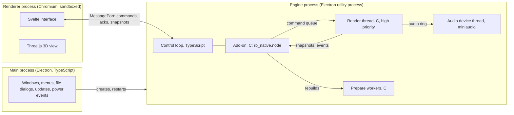

# REV-BENCH as a desktop application — the design

**Status:** the plan of record since 2026-11-08 ([ADR 0004](adr/0004-desktop-application.md)).
Nothing here is built yet. Each part names the stage that builds it ([PLAN.md](../PLAN.md);
specifications in [docs/roadmap/07-app.md](roadmap/07-app.md)). Where a choice depends on a
measurement or on Bernardo, it says so; those are the open decisions at the end.

Bernardo (2026-11-08): a downloadable app for Windows, Linux and macOS instead of a web page,
chosen for what is best for the project, its look and its craft, not for any one language.

## 1. What the app is

One window on Windows, macOS and Linux. In it you:
- pick an engine and its exhaust, change them, and hear the change at once;
- start it, idle it, rev it, pull it on the dyno and coast it down, with the throttle on the
  keyboard, the mouse or a game controller's trigger;
- watch its instruments (rpm, manifold pressure, torque and power, the computer's cuts) and its
  dyno curves, overlaid run against run;
- later, see it run in 3D: cutaway, valves, pulses in the pipes, turbo;
- save builds as files, share them as a file or a short code, and export what you hear as WAV.

### Windows first

Decided 2026-11-08: the app is built and finished on Windows first. Stage 126 ports it to macOS
and Linux once everything else is settled, after phase F and before the release stages
095–102. Until then:
- **Windows is the one full target:** the MSVC build, real audio devices, the installer, the
  end-to-end tests and every qualification run there, on Bernardo's machine.
- **Linux is kept honest by CI:** every push builds the core, the host and the add-on with gcc
  and runs their tests (the host's on the null device and under ThreadSanitizer), and the
  interface's unit tests. No Linux installer, app end-to-end tests or real-device runs yet.
- **macOS is kept honest by a weekly CI run** (and on demand) of the core's tests with Apple
  clang, so a third compiler's differences show up early. Nothing else is built for it yet.
- **The code stays portable:**
  - sound only through miniaudio, builds only through CMake (and the Makefile);
  - anything specific to a system (thread priority, paths, menu conventions) behind one small
    platform file per layer: `host/src/platform_win.c` and `platform_posix.c` (a plain fallback
    with no priority boost), and `app/src/main/platform.ts`, never scattered through the code;
  - paths built with Node's `path` and the C side's own join, never hard-coded separators.
- **What stage 126 adds** is marked in each section below: macOS's and Linux's thread
  priorities, universal macOS builds, their installers, their end-to-end and real-device runs,
  and each system's conventions.

The sound is the physical simulation's, made live on your computer: the same C core that
renders today's WAV files, unchanged in what it computes.

## 2. The stack

| Part | Choice | Why |
| --- | --- | --- |
| Engine | The C11 core (`core/`) | It is the product. One description of the engine feeds sound, controls, saving and 3D. |
| Real-time host | New C11 library, `host/` (stage 123) | Runs the core on its own high-priority thread and feeds the sound card. No Node, no JavaScript: testable on its own. |
| Audio I/O | [miniaudio](https://miniaud.io), one C file, vendored and pinned | WASAPI on Windows, Core Audio on macOS, PipeWire/PulseAudio/ALSA on Linux, and a null device for tests. Public domain / MIT-0. |
| Bridge | Node-API add-on in C (`app/native/`, stage 124) | Node-API is a C ABI that stays stable across Electron versions, so the add-on needn't be rebuilt for each. |
| Application shell | Electron, pinned exactly | Ships its own Chromium, so the interface and the 3D look and behave the same on all three systems. |
| Interface | TypeScript + Svelte 5 + Vite, pinned exactly | A compiled, fine-grained reactive UI: 60 updates a second of telemetry change only what they touch. |
| Charts | uPlot | Fast canvas time series for instruments and dyno curves. |
| 3D | Three.js WebGPURenderer (WebGL 2 fallback), TSL shaders, procedural geometry | As planned since stage 17 (old numbering); unchanged. |
| Packaging | electron-builder | Installers, signing, notarisation and auto-update: Windows first, macOS and Linux from stage 126. |
| Tests | the C suites, Vitest, Playwright's Electron driver | One runner, `tools/run_tests.py`, on every system. |

Every dependency is pinned to an exact version at least two weeks old when adopted (CLAUDE.md's
rule), with its licence recorded in `THIRD_PARTY_NOTICES` (stage 100).

## 3. Processes and threads



- **Main process:** windows, the menu, file dialogs, the update check, sleep and resume. It is
  never in the sound's or the telemetry's path, so a busy dialog can't stutter anything.
- **Engine process:** an Electron utility process (a Node.js child the main process starts). It
  loads the add-on and runs the control loop. If it crashes, the window survives, says so, and
  restarts it with the last build (autosaved).
- **Render thread** (C, inside the add-on): the only thread that touches the running engine. It
  takes commands at block boundaries, renders blocks of sound into a ring buffer, publishes
  snapshots and events. It never allocates, locks, logs or waits on anything but its own
  semaphore (CLAUDE.md: no allocation in the core).
- **Audio device thread** (miniaudio's): copies from the ring to the sound card. It never runs the
  physics, so a slow block can't make the device miss its deadline as long as the ring has sound
  in it.
- **Prepare workers** (C, Node's thread pool): build a new engine for a rebuild, off both the
  render thread and the JavaScript loop.
- **Renderer process:** the interface and the 3D view, sandboxed: no Node, no file access. It
  talks to the engine process through one MessagePort and to the main process through a small,
  typed preload API.

### Why a ring between the render thread and the device

Rendering inside the device callback is the lowest latency, but then any slow block is a
glitch. With a ring the render thread works a little ahead of the sound card:
- **Latency** = the ring's fill target + the device's buffer: 20 ms + about 10 ms by default,
  adjustable from 10 to 80 ms in Settings. Engine sounds don't need instrument-grade latency;
  20–30 ms from pedal to sound feels immediate.
- **Underruns:** if the ring runs dry the device plays silence (faded over 2 ms, never a click),
  counts it and the interface shows it. Underruns are an error to fix, not a mode.
- **The render thread** waits on a semaphore the device thread signals when the ring has room for
  a block, so it never spins.

## 4. Data between the threads

All of it is lock-free and preallocated. Each structure is its own small C module in `host/`
with its own tests (stage 123), including ThreadSanitizer runs in Linux CI (MSVC has none).

| Data | Structure | Direction | Size |
| --- | --- | --- | --- |
| Audio | Single-producer/single-consumer ring of float frames, stereo | render → device | 2^n frames, default 8192 (170 ms at 48 kHz) |
| Commands | SPSC queue of fixed-size records | control loop → render | 256 entries; full means the command is refused with an error, never a wait |
| Acknowledgments | SPSC queue | render → control loop | 256 entries |
| Snapshots | Triple buffer (atomic slot index) | render → control loop | 3 slots of at most 64 KiB (runtime-v1's budget) |
| Events | SPSC ring with a loss counter | render → control loop | 1024 records |
| Retired engines | SPSC queue of pointers | render → control loop | 4 entries, freed by the control loop |

- **Commands** carry an id, the expected generation, a kind and their values: throttle,
  ignition, starter, load, clutch, quality, listener, scene, layers, live engine fields, and
  "swap in prepared build N". Each is applied at the start of a block, and its acknowledgment
  says the physics tick at which it took effect (contracts/runtime-v1.md's ordered commands).
- **Snapshots** are a fixed binary layout:
  - a header (version, build id, generation, sequence, physics tick, audio frame);
  - the crank (cycle index, phase, speed);
  - per cylinder: pressure, temperature, burn fraction, valve lifts;
  - the instruments: rpm, MAP, torque, power, lambda, spark, the cuts;
  - optional pipe-cell arrays, by subscription (stage 073).

  The layout is versioned in `contracts/snapshot-v2.md`. A TypeScript decoder is generated from
  the C struct's offsets, and a test checks the two agree. Snapshots are published about 60
  times a second and dropped whole, never torn, if nobody reads them.
- **Events** are runtime-v1's actual spark, injection, valve and cut events, for the 3D view and
  the diagnostics.

### From the engine to the window

The control loop reads the latest snapshot whenever the window asks (once per animation frame)
and posts it through the MessagePort. At 64 KiB × 60/s that is under 4 MB/s, within budget and
measured in stage 124. The window never waits for the engine: it draws the newest snapshot it
has.

### Lining the picture up with the sound

Every snapshot carries the audio frame it belongs to. The host knows how far ahead of the
speakers it is: the ring's fill plus the device's reported latency. The window shows the state
that is being heard now, not the one just computed (runtime-v1's clock mapping; stage 073).

## 5. Rebuilds, presets and reset

Runtime-v1's transaction, which a native app can do properly:
1. **Prepare.** The control loop asks a prepare worker to build the new engine in fresh memory:
   validate, initialise, optionally settle to idle. The running engine plays on meanwhile.
2. **Swap.** It sends "swap in build N". At a block boundary the render thread:
   - fades the old engine out over 10–20 ms;
   - switches to the new one and fades it in;
   - acknowledges with the new generation.
3. **Retire.** The old engine goes onto the retired queue, and the control loop frees it.

A failed preparation leaves the running engine untouched and says why. Live fields
(`RB_EF_LIVE`: throttle, spark offset and the like) change in place with one command, no
rebuild. Crossfading two running engines (both rendering for a moment, at twice the cost) is a
later option, measured before it's adopted.

## 6. The core's side: the public engine API (stage 121)

Today the browser-facing API plays a test tone; the driving lives in `rb_cli`. The app needs
the core itself to offer:
- **The source:** the engine (default) or the test tone.
- **Driver controls**, as parameters with metadata: throttle, ignition, starter, load torque,
  clutch and the car's inertia and road load (moved from `rb_cli` into the core), the free or
  held crank.
- **Settings:** variation, quality tier, listener place, stereo scene and layers.
- **A dyno the sim owns** (`rb_dyno` attached through the API, not a host pointer): hold,
  sweep, readings.
- **Engine telemetry:** rpm, MAP, torque, power, lambda, spark advance, idle valve, fuel cut,
  limiter cuts, temperatures, mass flows.
- **Snapshots and events** in the layouts above.

`rb_cli` is rewritten on top of this API, which proves it is complete: every drive it scripts
today must be possible through the public calls.

## 7. Performance

The goal is that the default playable quality renders at least 1.5 times faster than real time
on the render thread, for all five presets, with the full sound (noise, listener, scene), on
Bernardo's machine (stage 118). That leaves room for the 3D view and the rest of the computer.
- **Where it stands:** `rb_bench` times only `rb_engine_step`. Even so, the four ran at 0.66× real
  time on Bernardo's machine (2026-11-06, high quality). So the work is real: profile the whole
  render path, speed it up without changing what it computes, and declare a tier that runs in
  real time, stating what it changes.
- **Native advantages over the browser:**
  - link-time optimisation, which every build uses;
  - a wider instruction set: x86-64-v2 for all builds, and possibly AVX2 by runtime dispatch if
    it measurably helps (without FMA contraction, which would change results);
  - Apple Silicon's NEON (from stage 126);
  - a dedicated high-priority thread.
- **Thread priority:**
  - Windows: MMCSS "Pro Audio" (`AvSetMmThreadCharacteristicsW`), from stage 123;
  - macOS (stage 126): a time-constraint policy, and joining the device's audio workgroup
    (macOS 11+);
  - Linux (stage 126): real-time priority through RTKit where the desktop allows it, else a
    raised nice level.

  Each measured and reported in the diagnostics panel. Until stage 126 the POSIX build runs the
  render thread at normal priority, which is enough for CI on the null device.
- **Denormal numbers** can slow the resonators badly. Stage 118 checks whether the core produces
  them, and fixes it in the core (so results stay the same everywhere) rather than flushing
  them to zero on one platform only.
- **More threads?** The physics' sub-steps (192 kHz) are too fine to split across threads; that
  question goes to stage 062 with measurements, not assumptions.
- **WebAssembly** stays a build target for portability tests and a possible later web demo
  (optional stage 125). It no longer gates anything.

## 8. Floating point across compilers

Each system builds with its usual compiler:
- MSVC on Windows (the add-on needs Electron's MSVC import library);
- Apple clang on macOS;
- gcc on Linux.

MSVC is the target from stage 122; gcc builds and runs every test in CI on every push; Apple
clang runs the core's tests weekly until stage 126 makes macOS a full target.

All use strict double arithmetic: no fused multiply-add contraction (`-ffp-contract=off`,
`/fp:precise`), no fast-math. Within one compiler, a refactor must leave renders bit-identical
(stage 119's rule). Across compilers, the same seeded drive must match within a stated tolerance
(stage 122 measures and freezes it from MSVC and gcc, and Apple clang's weekly runs are checked
against it), because libm's `exp`/`pow` differ in their last bits.

## 9. Building it

```
core/          the engine (C11)                  Makefile and CMake
host/          real-time host (C11)              Makefile and CMake
third_party/   miniaudio (pinned, with licence)
native/        rb_cli, rb_bench, fuzz            Makefile
tests/         the C tests (core and host)       Makefile
app/           the Electron app
  native/      the Node-API add-on (C)           CMake via cmake-js
  src/main/    main process (TypeScript)
  src/engine/  engine utility process (TypeScript)
  src/preload/ the window's typed API
  src/ui/      Svelte interface and 3D
  tests/       Vitest and Playwright-Electron
web/           WebAssembly build and its tests (kept)
```

- **The Makefile** keeps building the core, the tools and the C tests, as today: gcc in WSL and
  Linux, w64devkit on Windows, clang on macOS.
- **CMake** builds the core, the host and their tests with MSVC and gcc (stage 122; Apple clang
  for the core's weekly run, everything from stage 126),
  so MSVC is tested as well, and later the add-on (stage 124).
- **Toolchains:**
  - Windows: Visual Studio 2022 Build Tools (C/C++ workload), CMake, Node.
  - macOS (stage 126; until then only CI's): Xcode's command-line tools, CMake, Node.
  - Linux (CI from stage 122, a workstation set-up at 126): gcc or clang, CMake, Node, and the
    ALSA/PulseAudio development headers.

  docs/workspace.md lists exact versions, and `tools/run_tests.py` checks them.
- **macOS builds** (stage 126) are universal: arm64 and x86-64 add-ons merged with `lipo`, then
  @electron/universal.

## 10. Testing

| Level | What | Where |
| --- | --- | --- |
| Core | the existing 251 tests, planted bugs, sound check | Windows (MSVC and w64devkit) and Linux CI (gcc); macOS weekly (Apple clang) |
| Host | ring, queues, triple buffer, swap and fades; deadline harness on the null device; TSan | Windows; Linux CI (with TSan); macOS from stage 126 |
| Parity | the same seeded drive: `rb_cli` offline vs the host's offline render (bit-exact, same compiler); across compilers within the frozen tolerance | Windows and Linux CI; macOS weekly (the core) |
| Add-on | load, metadata, commands, snapshots, errors, device listing, on the null backend | Windows and Linux CI, from Node; macOS from stage 126 |
| Interface | Svelte components, decoders, state, with Vitest | Windows and Linux CI |
| End to end | Playwright drives the real app: start, idle, rev, rebuild, save and load, on the null backend; audio checked through the host's capture tap against the offline render | Windows; macOS and Linux (under a virtual display) from stage 126 |
| Real devices | 15-minute stress drives on real audio: deadline histogram, underruns, memory | Bernardo's Windows machine (stage 069); macOS and Linux where machines exist (stages 126, 099) |
| Listening | Bernardo, per preset and scenario | his machine |

`tools/run_tests.py` gains the `host`, `addon`, `app` and `app-e2e` suites. CI runs on every
push to `main`: everything on Windows, with its unsigned installer; the C, add-on and interface
suites on Linux; and the core's tests on macOS weekly and on demand (stages 122 and 124). From
stage 126 it runs everything on all three systems and builds each one's installers. CI has no
sound cards, so it uses the null device; real-device evidence is Bernardo's.

## 11. The interface

The UI is designed as a product, not a debug page (stages 124, 067, 068, 097). It has a design
system: colour tokens, Inter as the typeface, spacing and type scales, a dark default and a
light theme, and components built once and used everywhere.
- **Layout:**
  - a top bar with the engine's state, the throttle, ignition and starter, the preset, and the
    listener and scene;
  - an editor on the left: engine, intake, exhaust, fuel and spark, each section from the core's
    metadata;
  - the centre: the instruments now, the 3D view from phase C;
  - a bottom panel with the dyno and time charts.
- **Input:** the keyboard (throttle on a key, held or latched), the mouse and wheel, and a game
  controller's analogue trigger through the Gamepad API, for a real pedal feel.
- **Units:** metric and imperial. Every number shows its unit.
- **Accessibility:** keyboard navigation and focus everywhere, screen-reader labels, reduced
  motion, UI scale from 100 to 200 %, high-DPI.
- **Diagnostics panel:** render speed, ring fill, underruns, thread priority obtained, device and
  rate. "Copy diagnostics" for bug reports.
- **No hidden quality changes:** if the computer can't keep up, the app says so and offers a
  lower tier; it never switches one silently.

## 12. Files, settings and privacy

- **Builds** are `.rbbuild` files: versioned JSON under contracts/, validated by the core on load.
  The app registers the file type.
- **Sharing:** the file, or a "build code": the build compressed and base64url-encoded, a few
  hundred characters, pasteable into a chat. An `rbench://` link opens one (stage 096).
- **Session:** the current build autosaves, and the app reopens where it was.
- **Settings:** audio device, latency, quality, theme, units, update channel. Stored in the app's
  user-data folder.
- **WAV export** of what you hear, from the host's capture tap (optional stage 104, now cheap).
- **Privacy:** no analytics and no telemetry. The only network use is the update check (GitHub
  Releases), which Settings can turn off. Crash dumps stay on the machine unless the user sends
  them.

## 13. Distribution

Windows ships first: its installer is built from stage 124 and qualified at 069. The macOS and
Linux packages come with stage 126.

| System | Packages | Minimum | Signing |
| --- | --- | --- | --- |
| Windows | NSIS installer and a portable zip, x64 | Windows 10 22H2, 11 | Optional Authenticode certificate; without one, SmartScreen warns |
| macOS | DMG and zip, universal (Apple Silicon and Intel) | as the pinned Electron supports (about macOS 12) | Developer ID and notarisation need Apple's Developer Program ($99 a year); without it, System Settings → Privacy & Security → Open Anyway. Tested in CI; real-Mac checks when available |
| Linux | AppImage, .deb, tar.gz, x64 | glibc 2.31 (Ubuntu 20.04) or newer, X11 or Wayland, PipeWire or PulseAudio | none needed |

- **Updates:** electron-updater from GitHub Releases on Windows, macOS (signed builds only) and
  AppImage. The .deb is updated by reinstalling.
- **Size:** about 100–150 MB per installer (Chromium), 150–300 MB of memory while running.
- **arm64 Windows and Linux** builds are possible later; not in the first release.

## 14. What happens to the existing browser work

- **`web/`** keeps the WebAssembly core, its binding and tests, as portability checks. The
  AudioWorklet scaffold is not the product any more.
- **What carries over to `app/`:** the TypeScript binding's metadata-driven design, the Vite and
  Vitest set-up, and the Playwright experience.
- **A browser demo** on the WebAssembly core is optional stage 125. It can share the interface
  through the same engine-client interface, at a lighter quality.

## 15. Decisions

**Taken (2026-11-08):**
- **Windows first** (§1): the app is built, tested and qualified on Windows; Linux CI and a
  weekly macOS core run keep the code portable; stage 126 ports it to macOS and Linux before
  the release stages.
- **The name is Rev-Bench.** The app's window title, menus, installers and bundle id
  (`io.github.bernardovh77.revbench`) use it.
- **The repository stays private for now.** CI minutes are limited: GitHub's free plan gives a
  private repo 2,000 minutes a month, with Windows minutes counted twice and macOS ten times.
  So Linux and Windows run on every push to `main`, and macOS runs the core's tests weekly and
  on demand (stage 122); its full runs from stage 126 keep that schedule, plus every release
  tag.
- **Bernardo's Mac access is limited and unreliable.** macOS is built and tested automatically in
  CI (on the null audio device), and checked on a real Mac only when one is available. Until
  then it is listed as "CI-tested, limited device testing", never as fully qualified, and
  the other systems carry the real-device evidence (stages 126, 099).
- **Sample rates: 44.1 and 48 kHz.** The host renders natively at either, whichever the device
  runs at. A device at any other rate (88.2, 96 kHz...) is fed 48 kHz and converted by miniaudio
  or the system: higher rates carry nothing audible and would double the physics' cost
  (stages 118, 123, 066).
- **A faster tier's tolerances,** against the default quality on the same seeded drives (idle,
  a held pull and a rev, every preset), fixed before measuring:
  - engine figures: torque, power and VE within 1 %; the idle's mean speed within 1 % and its
    swing no larger;
  - sound measures: each `tools/compare_real.py` measure (the band shares above 1, 2 and 4 kHz,
    the treble's slope, the cycle's repetition) and `tools/orders.py`'s between-order levels
    within 1 dB;
  - loudness (A-weighted) within 1 dB;
  - Bernardo's blind A/B listening: if he can hear the faster tier is worse, it fails even with
    every number in range (stage 118).
- **Signing waits until the app works.** Development builds and testers' builds stay unsigned
  (Windows' "unknown publisher" warning; on macOS, System Settings → Privacy & Security → Open
  Anyway). Apple's Developer Program and a Windows certificate are decided at stage 101, not
  before.
- **The visual direction waits while the rest is built.** Stage 124 sets up the design system
  as tokens (colours, type, spacing) and base components with a plain, provisional look, and
  every panel uses only those, so the look can be chosen and applied later without touching the
  panels. Bernardo chooses it when he asks for it, at the latest before the public release
  (stage 101); the 3D view's style (stage 070) goes with it.

**Still open.** Each blocks the stage named, and nothing before it.
1. **The baseline machine** (CPU, GPU, OS) for "1.5× real time", and whether a bare-metal Linux
   machine is available for device tests. WSLg can run the Linux build for development, but it
   isn't bare metal. Stage 118 (the baseline), 126 (Linux).
2. **Where releases are published** while the repository is private (a private repo's
   releases aren't public). Stage 069, 101.
3. **The icon and the licence:** to be looked into later; the repo has no LICENSE file yet.
   Stage 124 (icon drafts), 100 (licence).
4. **Signing** (deferred, above). Stage 101.
5. **The visual direction** (deferred, above). Before stage 101.
