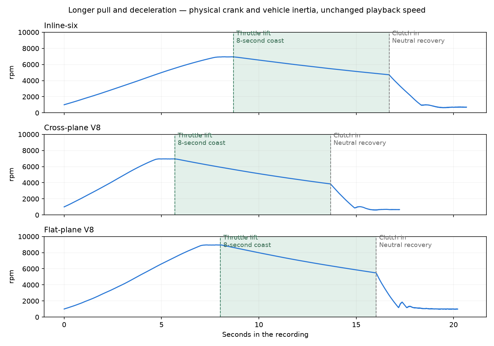

# REV-BENCH — Feedback checkpoint before stage 13b

2026-10-21. Development stops here for Bernardo's consolidated feedback.
**S1, S2 and S4 remain open where acceptance is unmet. Stage 13b's performance
refactor and stage 14's playable browser engine have not started.**

## What has progressed

- Researched the robotic V8/I6 deceleration report and added a controlled
  pedal-lift transition: progressively later ignition, then fuel cut. Its
  0.15-second/12-degree settings are illustrative, not a measured calibration
  of the recorded cars. An immediate-cut control is available. The underlying
  listening complaint is not declared solved. See [S1e](stage-S1e.md).
- Added actual-flow intake and chambered-baffle sound sources, plus optional
  ultra quality with finer pipe cells. Default high quality is retained.
  See [S2](stage-S2.md).
- Added separate-source stereo with ground/wall reflections, approximate head
  shadow and aperture directivity, garage/dyno decay, cabin filtering and a
  moving-source pass-by. These are documented physical approximations, not
  measured room/vehicle responses. See [S4](stage-S4.md).
- Added longer pull/deceleration renders requested by Bernardo, with an
  eight-second in-gear coast before clutch-in. Their duration comes from
  physical vehicle inertia; playback speed and pitch are unchanged.

## Start with the longer deceleration

All three files use the stereo asphalt scene, 3 kg m² combined crank/vehicle
inertia and the same output gain of 0.15. The pull ends one second after
encountering the limiter, or at the 12-second pull limit if earlier. Eight
seconds later the clutch removes vehicle inertia, followed by neutral recovery.

| Engine | Throttle lift | Clutch in | Coast RPM change | Recording length |
|---|---:|---:|---:|---:|
| I6 | 8.69 s | 16.69 s | 6,940 → 4,715 | 20.66 s |
| Cross-plane V8 | 5.69 s | 13.69 s | 6,955 → 3,841 | 17.22 s |
| Flat-plane V8 | 8.03 s | 16.03 s | 8,952 → 5,467 | 20.21 s |



Local listening copies (the ignored `renders/` folder is not uploaded to GitHub):

- [I6 — longer pull/coast](../renders/checkpoint-13b/long-coast/i6-long-pull-coast.mp3)
- [Cross-plane V8 — longer pull/coast](../renders/checkpoint-13b/long-coast/v8-cross-long-pull-coast.mp3)
- [Flat-plane V8 — longer pull/coast](../renders/checkpoint-13b/long-coast/v8-flat-long-pull-coast.mp3)

These are 192 kbit/s stereo MP3 previews without additional gain, filtering,
dynamic compression or time stretching. Original float WAVs and CSVs sit beside them.
`manifest.json` records commands, hashes, lift/clutch times and engine speeds;
`previews.json` records encoding and decoded duration. Measurements use the WAVs.

## Real references and other scenarios

The primary reference remains the supplied real recordings. Inspected falling-
pitch intervals are BMW 250–253 s, Mustang 257–263 s and Ferrari 302–310 s.
Their RPM/load, gear state, microphone placement and possible motion remain
unverified. The BMW is turbocharged while the simulated I6 is naturally aspirated.

The three files under `renders/checkpoint-13b/listening/` play **real reference,
then S1d, then current simulation**, separated by 0.5-second gaps. The two
simulated excerpts share a single listening gain; the reference has its own
uncalibrated gain. Only listening aids receive static gain and 10 ms fades.
`comparison.json` retains exact intervals, hashes, processing and measurements
from the unfiltered inputs. A spectrogram comparison is kept beside it.

`renders/checkpoint-13b/scenes/` contains eight 12-second held cross-plane V8
examples: asphalt, grass, wall, garage, dyno cell, ISO-style geometry, pass-by
and cabin. All hold the same engine at 3000 rpm. The pass-by moves at 15 m/s
past a listener 7.5 m to the side. These help distinguish listener context from
an engine-model defect; selecting a scene does not verify a real recording's
perspective. Details and limits are in the S4 notes.

## Acceptance that is still outstanding

| Engine | Warm idle repetition below 500 Hz | S1 target 0…+15 dB | Full-rev slope, 0.5–8 kHz |
|---|---:|---|---:|
| I4 | +19.89 dB | Outside | −7.85 dB/octave |
| I6 | +11.38 dB | Within | −8.86 dB/octave |
| Cross-plane V8 | +10.20 dB | Within | −7.94 dB/octave |
| Flat-plane V8 | +5.32 dB | Within | −9.03 dB/octave |
| Boxer | +17.71 dB | Outside | −7.54 dB/octave |

The I4/boxer repetition issue is essentially unchanged. V8 idle net-work COV
still reaches 12.27% cross-plane and 30.52% flat-plane. A justified ignition-
kernel failure model remains absent. All presets complete 30-second idles with
zero warm stalls, but stable speed alone does not resolve those issues.

S2's slope target is −2…−8 dB/octave; the I6/flat V8 still miss it. Cross-plane
idle energy above 2 kHz is −46.86 dB, below S2's −45 dB lower bound. Mid/high
idle repetition remains below 0 dB. These are measured gaps, not reasons to
raise noise or EQ without research. Detailed onset/overrun spectral behaviour
and all sound-realism listening checkpoints still need assessment.

## Validation and processing cost

- Native suite: **164 tests / 2574 checks pass**. Focused ASan/UBSan: **11 tests /
  50 checks pass**; leak detection remains disabled for the sandbox's ptrace limit.
- All ten planted faults are caught across S1e/S2/S4. An initial coincident-ear
  mutant escaped a level-difference check; an independent geometry assertion
  now catches the missing ear separation. The final four S4 mutants all fail
  the intended tests.
- Python: **16 tests pass**, including the actual-FFmpeg preservation test.
  WebAssembly: **17 unit tests pass**, production build passes, browser audio
  tests pass in development and production preview. The production test was
  rerun with its own artifact directory after a parallel-output collision.
- All five matched life-enabled dyno sweeps at 250 rpm/s are **byte-identical
  to S1d's accepted sweeps**. The five-preset combustion and idle audits remain
  reproducible. No stage-acceptance thresholds were relaxed.
- The full standard float render set completes: 23 WAVs, 22 engine diagnostics,
  zero limited/non-finite samples. Stereo scenes, matched controls, high/ultra
  and long coasts also have zero limited/non-finite diagnostics. Audio manifests
  preserve the actual renderer command and binary hash where recorded.

The current cross-plane physics benchmark is approximately **0.45× real time
native / 0.39× WebAssembly** on this shared host; stage 13b's 4×/2× targets are
unmet. These are engine-only benchmarks, not browser audio scheduling guarantees.
Before/current native runs and commands are retained under `benchmarks/`.
Scheduling and clock variation preclude claiming an optimization gain from this
single comparison. No SIMD/SoA or implicit-valve refactor is claimed.

The matched four-second cross-plane audio recordings consumed about **8.6 s CPU
at high quality / 26.0 s at ultra**. Ultra therefore costs about three times as
much here. Its extra spatial resolution has not yet earned audible acceptance;
it remains optional. Realism is the absolute priority, and a heavier model is
acceptable when its demonstrated benefit justifies that cost. Efficiency work
must preserve the required realism.

Claude's instructions, hooks and setup are preserved. Dependency/browser tools
used for validation are isolated; source recordings and generated audio remain
ignored. Graphify's code graph is refreshed for this handoff.

## Reproduction and feedback

After building the native CLI and preparing the local reference excerpts:

```sh
make render RENDER_DIR=renders/checkpoint-13b/mono RENDER_FLAGS=--float
python3 tools/checkpoint_13b.py --cli build/rb_cli --render --long-coast --analyze
```

The main listening question is whether the robotic quality persists throughout
the long in-gear coast, mainly at throttle lift, or mainly after clutch-in.
Identify the layout and approximate timestamp when possible. Further reference
recordings may be searched for or requested from Bernardo as needed.
Review this evidence before proceeding with stage 13b or stage 14.
