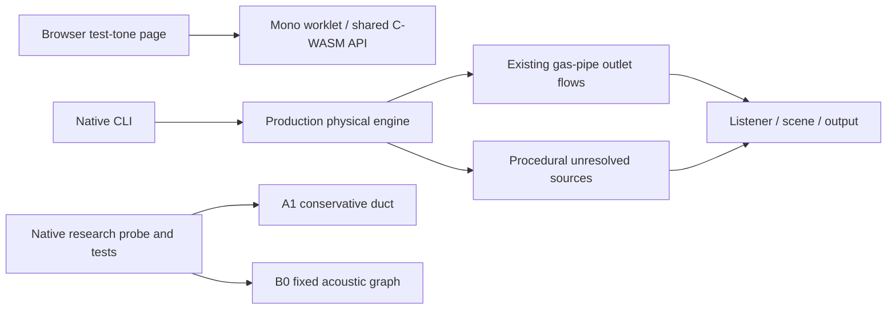

# Acoustic architecture review — 2026-10-23

Review of implementation `79e37ea`, its retained S2c/S2d evidence and the latest
reference import. Requested with `grill-with-docs`; the companion grilling and
domain-modeling instructions were read from their upstream source because they
are not installed locally. This is an evidence review and proposed next scope,
not permission to adopt a renderer or a new sound checkpoint.

## Assessment

The strongest progress is **identifying and measuring the transport problem**,
then separating a promising acoustic component from an inadequate nonlinear
control. The remaining bottleneck is now the **physical integration contract**:
returned pressure must affect the gas on the correct tick, with one accepted
transfer and trustworthy diagnostics. Another exhaust tune, more uniform mesh
refinement or a learned waveform model would not establish that contract.

The next physics work should complete the relevant **S2d-0 interface,
geometry and observability prerequisites**, followed by an isolated
**S2d-B1 common-clock coupling proof**. Repair the result-rebuild workflow
before the next audio checkpoint. **Bernardo accepted both scope recommendations
in this interview.** This review records that agreement; the implementation,
default renderer and production sound are unchanged.

## Progress and actual structure

| Part | Implemented and evidenced | Still unproved |
| --- | --- | --- |
| Production engine and sound, A0 | Nonlinear gas engine, accepted exhausts, pipe-flow radiation, procedural flow/mechanical sources and native listener/stereo scene | Existing causal-source and routing findings, lift-off diagnosis, component calibration, full realism and runtime acceptance |
| Browser product interface | Stage-2 test-tone page and mono AudioWorklet/WASM host; engine capabilities exist in the shared core | Interactive engine controls/integration remain stage 14; native stereo scenes are not the current browser product |
| Conservative prototype, A1 | Constant-gamma uniform-area HLLC/MC/SSP-RK2 duct, conservation and nonlinear fixtures | Useful weak-wave accuracy, mixture EOS/valve/engine adapter and conservative external interface |
| Acoustic prototype, B0 | Static homogeneous zero-flow graph; delay, scattering, cavity, radiation, storage/loss fixtures | Physical engine feedback, mean flow, evolving gas/thermal state, realistic components and engine audio benefit |
| Coupled renderer, B1 | Design and component identities/snapshots | An executable gas/acoustic coupler and complete shared geometry compiler |
| Learned synthesis | Research/design and conditional comparison plan | No trained runtime engine model, fitted-source deployment or validated learned exhaust response |
| Real recordings | Six sources / 18 catalog entries, raw measurement audio and separate listening treatments | Matched RPM/load/hardware sessions, annotated states and calibrated transfer targets |

There is currently **no connection from B0 back to the production engine**.
`Makefile:84–110` isolates candidate objects in the probe/tests;
`core/src/rb_sim.c:174–205` still advances the existing engine and sound paths.
This isolation is useful for controlled comparison, but prototype success
cannot be credited as an audible production improvement or speedup.

Evidence cross-checks support the existing qualified claims:

- S2d has **344 matrix rows: 326 successful observations and 18 explicit
  exclusions**. There are 124 FV rows including those exclusions, and 220
  graph rows. Both aggregate CSV hashes and all 47 recorded source hashes
  match the saved summary/current sources.
- B0's tested homogeneous, zero-flow, 1-m, 200–4000-Hz all-pass paths have
  worst phase error **4.18892183°** and magnitude error below reporting
  precision. Its mean-flow/engine-feedback, realism and real-time promotion
  flags are explicitly false. Static loops run for one second, not arbitrary
  engine service duration.
- At 300 K / zero flow / 2 kHz / finest tested A1 grid, carrier magnitude
  is approximately **0.744**, perturbation-energy retention **56.2%**;
  only 15/24 main finest-grid cases pass the acoustic screen. Conservation
  alone does not qualify this HLLC/MC configuration. This rejects the tested
  configuration, not conservative methods as a class.
- The native production stereo control has median throughput **0.56164×
  real time** on the recorded shared host. It is not a graph speedup, an
  estimate of all removable work, or the browser's measured callback cost.

Source: [S2d measurements](stage-S2d.md) and ignored
`renders/evidence/acoustic-candidates-2026-10-23/{manifest,summary}.json`,
`fv.csv`, `wave.csv`, `baseline-stereo.csv`.

## Structural findings that change the next step

### 1. Same-tick return pressure needs an API boundary

`experiments/acoustics/wave.c:127–207` accepts the drive, reads arriving waves,
scatters nodes and commits delay storage in one operation. The designed gas
interface instead needs **receive current returning waves → solve one gas
boundary transfer → commit outgoing waves** (`stage-S2d-design.md:337–358`).
An external adapter that reads `state.incoming` before calling the existing
step sees the previous step's values. This is an integration hazard, **not a
failure of the current prescribed-drive B0 fixtures**. Expose phased stepping
or a bounded in-step boundary solve before constructing the engine adapter.
Test a deliberately inserted sample of feedback delay against an independent
reference. Do not hide that delay in a whole audio callback.

### 2. Port signs, pressure reference and work ownership must be explicit

`rb_ac_node_flow` is positive into a one-port node (`wave.c:232–236`). At
the source boundary, gas-to-network export has the opposite orientation.
The helper is appropriate for its current outlet use; copying it directly
into a gas export would reverse the sign. Define outward normals and accepted
mass/species/enthalpy/energy transfer before connecting the regions. The
existing acoustic book assumes a rest start, and terminal work includes
radiation-filter storage; it is not a moving-gas energy ledger or separately
measured far-field sound power. Avoid double counting pressure work.

### 3. The background gas cannot be removed with its acoustic grid

`wave.h:28–34` has one global frozen density/sound speed, with no mean-flow,
temperature or species inventory. Preparation caches delays/impedances;
changing the plan later would mix cached and live coefficients. Retaining
mean transport and designing state/coefficient updates is essential before
addressing hot gas, ambient entrainment or reversal. A delay adjustment alone
does not supply this missing physics. The current A1 boundaries/EOS also do
not supply a production gas/acoustic adapter (`euler.h:4–25`).

### 4. Shared geometry is currently a snapshot, not an executable compiler

`tools/acoustic_candidate_probe.c:205–239` exports useful semantic names and
connectivity, and correctly labels its scope. It does not generate graph
plans, bind gas ports or define complete physical component/material data.
Meanwhile `noise.c:167–176` still uses a shorter, collector-selected path and
unconditional catalyst attenuation rather than shared X/Y routing. These
known D03–D05 issues remain relevant after pulse propagation improves.
Compile a bounded, explicitly supported geometry subset first; reject
unsupported components instead of treating a model-specific exhaust name
as a complete physical component description.

### 5. Stable output can conceal modified gas transport

`pipe.c:277–288,441–454,530–546` contains limited transfer, sonic/nonfinite
guards and short-column stabilization without a complete event trace.
S2d-0 must expose the requested and accepted transfer, affected component,
reason and integrated consequence. Otherwise a bounded coupling run may
merely be a frequently repaired solution. Keep S1f's separate pre-spark,
variation, injector and residual-state findings open; correct causal inputs
before engine-level attribution or learned fitting.

### 6. Native stereo and the browser host are different validation targets

`web/src/audio/engine-node.ts:52–56` creates one output channel;
`rb-worklet.ts:61–72` renders mono and copies it if more channels exist.
`web/src/main.ts:1–20,147–156` remains the test-tone interface; it does not
select/control an engine. The core contains engine capabilities, but the
interactive engine UI/integration is still the intentionally unstarted stage
14, not a newly completed engine application.
The native stereo scene and its benchmark therefore do not establish
browser mono/stereo parity or callback-tail behavior. Build and validate the
coupling natively first, then test the actual deployed host and channel path.
Adding a graph while retaining all downstream gas work cannot establish a
runtime saving; measure the complete replacement and any remaining inventories.

### 7. The single results file is not reproducibly rebuildable today

I introduced a packaging regression by retaining experiment artifacts beneath
the standard current-render inventory. `renders/current` now has **76 WAVs**;
`render_results.write_page` requires exactly **34**, rejecting the 42 extras
at `tools/render_results.py:121–127`. A non-writing check reproduces this
failure and verifies that the current page remains unchanged.

The S2c, S2d and reference sections are appended by three independent
publishers. A fresh standard render replaces the page/current folder without
orchestrating those additions (`render_results.py:182–204`). Playback and
per-publisher preservation tests pass, but they do not prove a complete
48-player rebuild. Fix this before the next audio checkpoint: declare one
checkpoint inventory, distinguish accepted engine files from diagnostics and
references, compose all registered sections in one operation, and atomically
preserve the last complete result on failure. Keep all accepted content and
raw evidence while making that change; this review deletes nothing.

### 8. Provenance and reference conditions still limit attribution

The S2d run manifest records the preimplementation design HEAD while actual
measured source hashes match the later implementation. Those hashes preserve
the evidence, but future manifests should identify the measured working-tree
state and runner/analyzer versions explicitly (`run_acoustic_candidates.py:158`).
The two new rear/approximately-3-m clips add valuable viewpoint context; their
RPM, load and exact hardware remain unannotated. `compare_real.py:81–87` still
folds stereo before power analysis. Use the existing per-channel analysis on
their raw float files; neither these clips nor filtered previews supply a
calibrated training or whole-exhaust validation set.

## Agreed next checkpoint and acceptance

**Immediate physics scope: S2d-0 interface completion.** Define and test the
current-tick receive/solve/commit sequence; semantic component/port/source
bindings for a simple supported exhaust; units/normals and one accepted flux
contract; complete guard/repair observability relevant to that path. Keep
unsupported cases explicit and record any remaining S2d-0 requirements rather
than declaring the entire stage complete from a small fixture.

**Following dependent scope: first S2d-B1 proof.** Couple one small retained
nonlinear gas region to a static acoustic duct at the common 192-kHz clock
already proposed. Start with zero mean flow; do not assume that this fixture
represents an engine exhaust. Promotion to subsequent tests requires:

1. Independently predicted return-wave sign and arrival time, plus an upstream
   gas response to changing the terminal load.
2. One closed transfer/storage/work book across the interface, including
   mass/species and correct total-energy/enthalpy ownership where transported.
3. Two boundary placements against the same physical control, amplitude
   sweeps and stated errors; no unexplained source-free growth or guard use.
4. Planted wrong-sign, extra-delay and duplicate-work faults are detected.
5. Existing A0 and B0 controls remain reproducible; record full coupled cost
   without treating a graph microbenchmark as engine throughput.

Only after that proof: frozen nonzero mean flow → fixed thermal gradients →
evolving thermal/species inventories and reversal → source/common-route
validation → whole-engine pulls/lift/long coasts → native/WASM/listening/runtime
decision. Keep the causal-source corrections in S1f ahead of engine-level
attribution and learned-source calibration. Retain A1 as a comparison/research
control; do not spend the next checkpoint on uniform refinement or an
unmeasured replacement training run.

The **results-workflow repair** is an independent bounded task, required before
publishing more audio. Its acceptance is a complete one-command rebuild with
the same 48 selected players/current long coasts, a repeat with no duplication,
and a failed-input case that retains the last good page and accepted assets.

## Decision frontier and documentation

Established preferences are not reopened: realism is first; justified hardware
cost is allowed; the accepted I6/flat/cross selections and Claude setup remain
the baseline; unresolved sound/13b stages remain open. Two independent scope
decisions were presented and answered **yes** by Bernardo:

1. Use the interface-first S2d-0 → small B1 proof sequence as the next physics
   checkpoint, with changed engine audio following the physical gates.
2. Include the independent result-rebuild repair before the next audio
   checkpoint, rather than extending the current append-only workflow.

[GLOSSARY.md](../GLOSSARY.md) records established domain terms without
implementation instructions. The [ADR](adr/0001-coupled-exhaust-ownership.md)
records accepted prototype ownership/scope while leaving production promotion
conditional on the experiments. The current decision frontier is settled;
later architecture-promotion decisions depend on evidence not yet produced.
The review is complete, and neither next implementation task is represented
as already done.

This review changes documentation only. It checks source/evidence hashes,
inventory and the non-writing publisher failure; it does not rerun numerical
experiments or claim new audio improvement. The latest completed checkpoint's
189 native tests / 4820 checks, 38 Python tests, 17 web tests and 48-player
playback verification remain historical validation, not newly rerun suites.
Graphify was queried for the source paths; source topology is unchanged, so
no AST rebuild or semantic document extraction is claimed. User-added
`.agents/` and `skills-lock.json` remain untouched.
