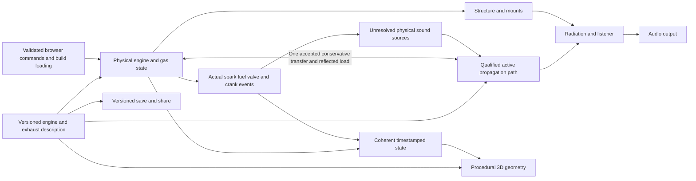
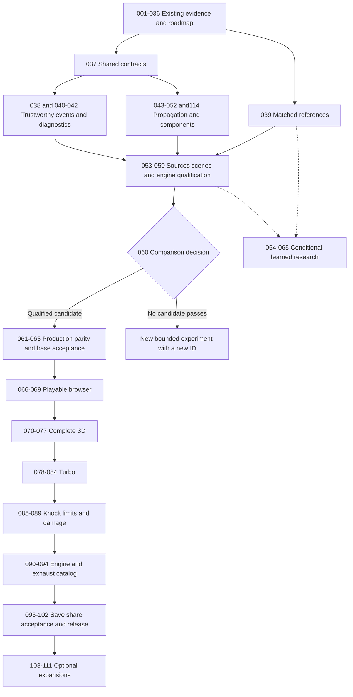

# Roadmap execution and evidence protocol

[PLAN.md](../../PLAN.md) owns stage status and scheduling. The fourteen phase
catalogs specify each stage's deliverable, dependencies, exit evidence and
rejection rule. They are specifications, not a second status tracker.
[Legacy mapping](legacy-map.md) preserves all earlier obligations;
[audit coverage](audit-coverage.md) assigns every D/R finding.

This roadmap was agreed in scope/order with Bernardo on 2026-10-23. It changes
planning and documentation, not engine sound, production physics or deployment.
Stages 001–035 preserve historical implementation/experiment evidence;
036 establishes this roadmap.048 later appends114 for fixed-geometry thermal
transport: execution order is048 →114 →049, without changing existing IDs.
Appended review repairs112/113 precede the
completed contracts stage037 and numerical observation stage038. The039
implemented protocol, unresolved matched-recording acquisition and040 causal
checkpoint are recorded in their execution notes; see PLAN for the current
frontier. Additional recordings may be acquired alongside independent numerical
work. A completed processing protocol does not finish039's missing matched
reference acquisition or qualify an unmatched recording for calibration. Future stage
numbers are not evidence that their work has started.

## What a stage means

A stage has one independently reviewable deliverable and a bounded execution
checkpoint. A larger feature spans several stages: research fixture, component
implementation, engine integration, actual browser delivery and user acceptance.
Every stage includes testing; testing is not postponed until a final catch-all
stage. A rejected candidate may complete its experiment while leaving the
dependent product decision open.

The roadmap is definitive about scope, ownership, dependencies, method and
closure rules. It cannot certify unbuilt software, future research outcomes or
zero rework. Numerical accuracy, real-engine agreement, real-time delivery and
Bernardo's acceptance are distinct claims with distinct evidence.

The current frontier is settled: full original release scope, shared contracts
first, necessary sound/physics gates before browser and 3D, conditional learned
research, and individually optional extras. Choices that depend on future
evidence are explicit gates in their stages: renderer winner (060), hardware
and fidelity policy (062/069/099), visual style (070), diagnostic-audio behavior
(074), knock model validity (085), and public publication (101). They are not
silent assumptions or approvals already obtained.

## Stage lifecycle

1. **Preflight.** Read PLAN/CLAUDE/CODEX, the stage card and predecessor results.
   Query Graphify before code exploration. Resolve any missing scope decision
   against existing user instructions; ask only when it is genuinely unsettled.
   Set the exact physical question, supported operating range and risk being tested.
2. **Design and research.** Use primary technical sources and real evidence for
   every realism problem. Specify equations/assumptions, units, state/event/flux
   ownership, API/schema and alternatives. Freeze independent references,
   test thresholds, hardware/sample-rate conditions and failure criteria before
   evaluating a candidate. A paper is justification, not a test of our code.
3. **Small proof.** Implement the smallest useful fixture, test that it detects
   meaningful deliberately planted faults, then add adverse and integration
   cases. Use native numerical fixtures before dependent browser or visual work.
   Split an oversized stage rather than claim partial work as complete.
4. **Integration.** Verify the actual production boundary and end-to-end path.
   Include all affected engines/components, independent seeds, unseen
   trajectories and configuration changes. A mocked simulator or asset-string
   check cannot establish physical accuracy, actual playback or coherent timing.
5. **Qualification.** Measure accuracy, whole-system cost and limits separately.
   Do not hide guard intervention or reject cases from summaries. For sound,
   preserve unfiltered float originals and produce one consolidated result with
   all current long coasts. Obtain Bernardo's listening or appearance verdict
   when that is part of the stage gate.
6. **Close and hand off.** Write the execution record, update this tracker and
   CODEX/research notes, refresh Graphify after source changes and commit/sync
   authorized work. List unresolved requirements explicitly. A failed gate
   keeps dependent promotion blocked until fixed or the scope is explicitly
   changed with Bernardo. A request to execute one stage does not authorize
   implementing the entire later roadmap.

The stage status is `Complete` only after all applicable gates pass for its stated deliverable. Experiment outcomes and qualified artifacts are different: a completed rejected-arm experiment supplies decision evidence but no artifact eligible for promotion. Arm-specific descendants are marked `Not applicable (recorded rejection)` rather than forcing a rejected architecture to pass. Common physics/component requirements still apply to every surviving arm; an unexplained failure never becomes an exemption. `Complete
(bounded)` preserves a historical scope without claiming later acceptance.
`Ready` is dependency readiness. `Not started`, `In progress`, `Awaiting
feedback` and `Blocked by <stage/evidence>` describe ongoing work explicitly.
`Conditional`/`Optional` stages are outside the default mandatory sequence until
adopted. Rejection/deferment is recorded as an outcome, not an invented success.

## Minimum execution record

New records live at `docs/stage-NNN.md`; create them when execution begins,
not as empty copies for every future stage. Historical records keep their
existing paths. Each new record contains:

| Field | Required content |
| --- | --- |
| Scope and claim | Exact deliverable, hypotheses, excluded/unvalidated regimes and dependencies. |
| Baseline | Revision plus dirty-tree status, hashes of actual measured sources, presets/geometry, rates/grids, listener, trajectory, seed and gain. |
| Research/model | Primary sources, equations, SI/sign/clock conventions, assumptions, calibration constants and uncertainty. |
| Contract | State/flux/event owner, immutable prepared configuration, capacity/error behavior, rebuild/reset/versioning and affected consumers. |
| Frozen gates | Independent reference, quantity-specific tolerances, cases/amplitudes/seeds, runtime hardware/browser/flags and threshold rationale. |
| Experiments | Reproduction commands, observed outputs, excluded/rejected cases and failures, diagnostic overhead versus no-trace timings. |
| Failure detection | Deliberately wrong sign/delay/energy/event/geometry etc., which behavioral check catches it, and any remaining untested fault. |
| Integration | Affected presets, native/WASM, actual worklet/UI, 3D/serialization changes and regressions appropriate to the scope. |
| Acceptance | Numerical, realism, runtime and user judgments separately; pending feedback remains pending. |
| Handoff | Outcome, supported envelope, open findings, evidence paths/hashes, rollback and next dependency. |

Keep raw measurements, generated audio and user recordings ignored in `renders/`.
Commit a useful compact numerical summary, source/command provenance and limits
in the execution record; do not make essential conclusions depend only on a
local ignored JSON file that another checkout cannot access. Do not commit
audio just to make evidence available.

### Required validation commands for code stages

Honor CLAUDE.md's environment/setup instructions; use its external build/web
workspace where needed instead of installing dependencies in the mounted tree.
The existing baseline commands are:

```sh
make test
PYTHONPATH=tools .venv-analysis/bin/python -m unittest discover -s tools -p 'test_*.py'
# After core changes, before testing the web assets:
make wasm
# In the configured web workspace:
npm test
```

Run the full existing unit suites for source changes, then relevant numerical,
mutation, sanitizer and integration checks. Core changes also render and
compare the complete affected checkpoint. Browser work extends actual-behavior
e2e tests and runs them in dev and production-preview modes; use the current
repository scripts and `E2E_PREVIEW=1` convention. Report environment failures
and skips explicitly rather than treating an unavailable required check as a
pass. Broaden/rerun tests when new changes, failures or unresolved concerns
justify it; do not repeat passing suites without a reason.

Documentation-only work validates links, identifiers, dependency/coverage
consistency and preservation. It does not rerun expensive sound experiments or
claim old physics counts as new evidence. For stereo sound measurements, use
per-channel powers; the legacy mono fold in `compare_real.py` must be corrected
or bypassed by the validated stereo analysis path in Stage 039.

## Quantitative validation policy

These are **engineering gates to confirm/freeze in each relevant preflight**,
not universal standards, attained results or permission to retune a threshold
after seeing a failure.

| Area | Starting gate and required interpretation |
| --- | --- |
| Acoustic transport | Existing proposal: at most 1 dB magnitude / 10 degrees phase error on a stated 1-m path, 200–4000 Hz, 300–900 K and tested ±70 m/s conditions. Expand only the bandwidth/domain actually demonstrated. Evaluate weak waves, finite pulses, shocks/contacts, return timing, all-port transfer and source-free stability separately. |
| Conservation | Close mass, each species, momentum and total energy/work with explicit external/interface signs and quantity-specific scales. Include wall, radiation/reactive and mean-flow/coefficient work where modeled. The bounded proof's 1e-10 relative inventory screen is not automatically valid for every future engine fixture. Never mix kg, N·s and J against one dimensionful scalar. |
| Spatial/time convergence | Vary spatial cells, propagation tick and engine tick independently; compare multiple amplitudes and gas/interface partitions. Preserve failed/refined-growth cases. Conservation or energy retention alone does not establish phase accuracy. |
| Digital listener path | Existing proposal: at most 0.5 dB unintended delay/resampling coloration through 12 kHz; test phase and Doppler too. Measured physical attenuation remains part of the model. No claim that 1D plane-wave physics is valid to every audible frequency. |
| Combustion/source causality | Zero heat before actual spark discharge in the normal spark-ignited/autoignition-disabled control and zero injector event when no injection occurs, to declared numerical/event tolerances. Continuity as variation tends to zero; event/fuel/energy books, multi-seed COV/repetition and reference-valid operating states. |
| Engine maps and dyno | Match a named physical configuration and measurement conditions with stated uncertainty; distinguish generic/modified engines from exact factory claims. Stage 068 freezes a browser/native curve tolerance before comparison. |
| Audio runtime | Measure the actual render quantum: at 48 kHz, 128 frames is about 2.67 ms. Existing proposal is p99 callback time at most 70% of the period, with measured maximum and zero observed deadline misses/underruns over a stated 15-minute stress trajectory. Longer/full-product qualification and named hardware are required in 099. A percentile alone is insufficient. |
| Performance goals | Retain unmet legacy 4x-native/2x-WASM objectives. Measure full rendering with identical fidelity and no tap/file overhead. If justified realism cost prevents them, record the measured benefit and obtain an explicit hardware/target decision; renumbering does not retire them. |
| Graphics and sync | Preserve the 60-fps laptop target with audio running; measure frame tails, rebuild latency, GPU/memory and actual audio deadlines together. The old few-degrees-at-6000-rpm goal needs a time/presentation measurement and feasibility decision in 073, not an untested guarantee. |
| UX | Preserve the original observed-trial goal of a new visitor understanding how to start in 30 seconds; test keyboard, units, accessible legends, reduced motion, touch and gauges-only fallback. |

Freeze a gate's exact domain, reference and numerical rationale before its run.
If a target proves inappropriate, retain the failed result, explain why and
review the change; do not move the goalposts inside the analyzer.

### Preserved sound and scenario obligations

The archived plan's numerical goals are retained as starting obligations for
040–063 and final 098, not treated as universal properties of every microphone:

- Legacy S1's idle repetition target is **0 to +15 dB below 500 Hz**, with
  stable idle for **30 seconds per preset** and a few percent IMEP COV at load,
  larger at idle. The earlier 12c assay used −5 to +12 dB and at most half the
  low-band energy on cycle harmonics; retain that assay and its recorded failure
  rather than silently claim it passed. The original calibration ranges of
  1–3% loaded / 4–8% idle COV are checked against matched engine conditions.
- Variation-only corrections retain the original **under 1% mean dyno change**
  control. A justified causal-model correction that changes a buggy mean
  baseline must explain the change and revalidate against physical evidence;
  it cannot call waveform identity proof of correctness.
- Legacy S2 retains idle energy above 2 kHz in the observed **−45 to −5 dB**
  range, repetition **below 0 dB above 500 Hz**, revving 0.5–8-kHz third-octave
  slope **−2 to −8 dB/octave**, and reduced highs on overrun. Confirm the
  recording/state/processing applicability before using these as pass/fail
  targets; brightness alone still does not establish realism.
- Preserve limiter/cut durations, physical neutral fall, loaded long coasts,
  idle-load recovery and per-cylinder/firing behavior in the existing engine
  controls. Loaded overrun and neutral rev-down remain distinct scenarios.
- Preserve all eight documented native stereo scenes: the open/ground,
  wall/room, close-exhaust, pass-by and cabin cases in the existing scene
  evidence. Retain their stated geometries; a standard-inspired microphone
  position is not a claim of formal measurement-standard certification.

Any evidence-based revision of a legacy target is explicit in the relevant
preflight/decision record and reviewed with Bernardo. Renumbering changes none
of these outcomes or remaining listening obligations.

## Shared ownership and architecture sketch



The active propagation path is still selected by experiment. The diagram
specifies ownership, not an already implemented production acoustic graph.
Do not advance duplicate downstream acoustic degrees of freedom or add `p'Q`
twice to a total-energy transfer. With mean flow, include convective energy
and possible transfer of mean-flow work; quiescent passivity alone is not enough.

Core simulation owns mutable physical state. Rebuilds are validated transactions
with explicit history reset/preservation, generations and command acknowledgment.
Prepared coefficients/geometry are immutable until a defined update. Reuse
existing engine metadata and TS/WASM bindings. Real-time C paths allocate no
memory; measure and bound actual JS message/queue/allocation behavior rather
than claiming the whole worklet is allocation-free without evidence.

Shared geometry includes semantic identity, topology, dimensions and spatial
frames/centerlines. Current pipe lengths alone are not 3D routing. Saved builds
serialize versioned configuration; live snapshots carry actual state/time.
The intended AudioWorklet ownership and static hosting remain the baseline;
any measured need to change scheduling/threading must document latency,
ownership and deployment-header consequences before promotion.

## Dependency and milestone sketch



The diagram is a default milestone order, not a replacement for individual
dependency lists. References and diagnostic fixtures can progress independently.
Optional learned work never blocks browser/3D by being placed numerically before
them. Integrating a learned model later reopens all affected sound/runtime gates.
Turbo, knock/damage and new layouts similarly reopen affected qualifications;
base-engine approval does not certify those later operating domains.

## Visual truth and synchronization

The current engine solves lumped cylinders and one-dimensional gas paths. A
burn fraction can drive a labeled illustrative flame, but it does not locate a
resolved 3D flame front. Pipe cells can color pressure/composition, but they do
not provide CFD particle pathlines. Header glow needs metal/wall state or an
explicitly illustrative mapping; hot gas temperature is not metal temperature.
Damage effects explain an engine event, not a solved fracture calculation.

Use unwrapped crank cycles and timestamps: at 6000 rpm the crank turns 100
times per second, so shortest-arc interpolation of two wrapped angles at 60 fps
can show the wrong motion. Define simulation time, emitted audio frames, device
presentation time and display time separately. Separate physical gas-path and
listener flight time from DSP/FIR, buffering and device delay. Name the event
being compared and its expected audible arrival; aligning presentation must not
remove a real propagation delay. Record sequence gaps, output
latency, generation changes and reset behavior. Slow inspection has its own
explicit time/audio policy. A pulse crossing a roughly 1-m exhaust can be
shorter than one display frame; an intentionally slowed explanation is labeled
as such. High-speed blur/alias-aware display is presentation, not new physics.

## Integrated release scenario

For every supported default, load a versioned build, start, idle, throttle to
load/high RPM/limiter, lift into the complete long coast, clutch/neutral fall,
stop and restart. Modify an exhaust and physical parameter, perform an atomic
rebuild, run/overlay the dyno, change listener/camera and save/share the build.
Check the same seeded command trace natively, in WASM, through the actual
worklet and at the deployed URL. Add turbo/knock/damage cases only after their
independent native gates; verify data-driven visuals and genuine stereo.

Repeat with invalid/rapid controls, suspend/resume, background tabs, supported
sample-rate changes, GPU failure, gauges-only mode, long sessions and repeated
dispose/recreate. Record deadline tails, observed underruns, frame behavior,
memory and supported hardware. Browser work tests dev and production builds;
the release includes Chrome and Firefox on the declared desktop baseline and
an actual deployed second-device check. Other device/browser claims require
their own measured support entry.

## Change control and evidence preservation

Keep IDs stable. Append a new stage ID for an unexpected fix/split and insert
its dependency in the schedule; do not recreate letter suffixes or rewrite
historical evidence. If scope changes, update the stage card, dependency index,
legacy/audit mapping and handoff in the same change. Keep only one status source.
Historical documents remain dated evidence, not current scheduling authority.

Preserve CLAUDE.md and .claude/ as active instructions. Their “stage N” workflow
now resolves through PLAN.md's new IDs and mapping; existing `docs/stage-S*`
paths stay valid. User-added .agents/ and skills-lock.json are not incidental
roadmap changes. No new sound render, training, feature implementation or public
deployment is authorized merely by finishing this documentation checkpoint.
