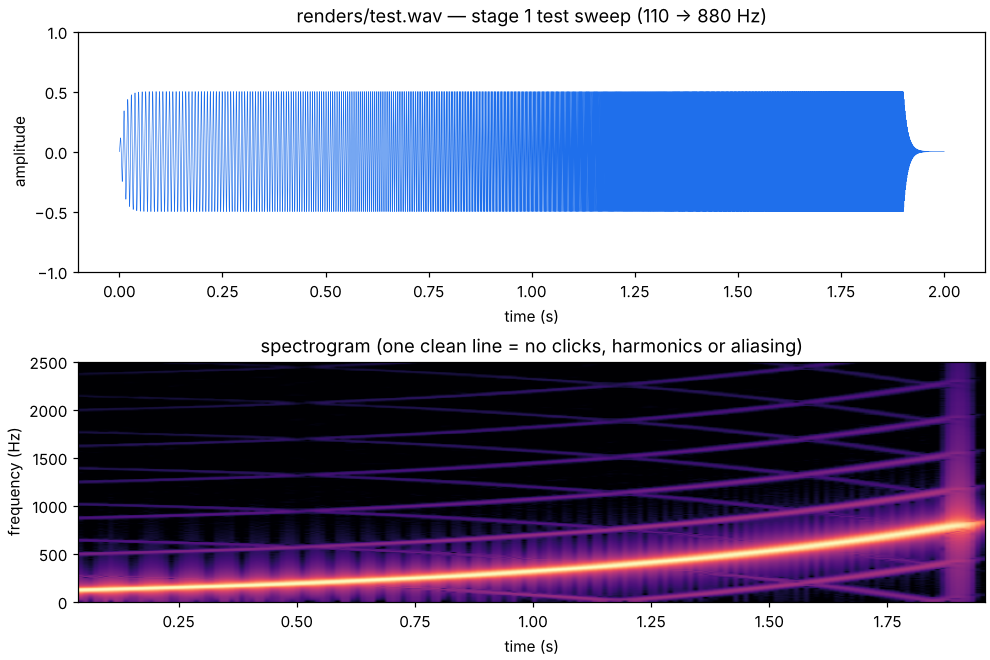

# Stage 1 — Native C scaffold, WAV writer, test runner

**Status:** done (2026-10-15)

## What was built

| Piece | Files | Purpose |
|---|---|---|
| Simulation core API | `core/include/rb.h`, `core/src/*.c` | Lifecycle, parameter + telemetry system, the step/render loop. The "model" is a placeholder sine oscillator until the engine arrives. |
| WAV writer/reader | `native/wav.h`, `native/wav.c` | Writes 16-bit PCM or 32-bit float. The reader is for tests and later analysis. |
| CSV writer | `native/csv.h`, `native/csv.c` | Logs traces for plotting (pressures, rpm, ... in later stages). |
| CLI | `native/rb_cli.c` | `rb_cli info` lists parameters/telemetry; `rb_cli tone` renders the test sweep. It renders in 128-frame blocks, exactly like the browser will. |
| Tests | `tests/` | 14 tests, 161 checks. `make test`, or `make SAN=1 test` with sanitizers. |
| Build | `Makefile` | `make`, `make test`, `make render`, `make clean`, `make help`. |

## How the core runs

```
 host (rb_cli now, the browser's AudioWorklet from stage 2)
   |  rb_set_param(id, value)     any time between blocks; clamped, NaN rejected
   v
 rb_render_block(out, 128)
   for every audio frame:
     repeat `oversample` times:   one physics substep, dt = 1 / (fs * oversample)
       smooth live parameters
       model_step() -> mic        (stage 1: sine oscillator, later: the engine)
     reduce to the audio rate     (stage 1: average, stage 11: anti-alias filter)
     output stage: smoothed gain -> NaN/inf guard -> clamp to [-1, 1]
   v
 float samples -> WAV file / speakers          rb_get_telemetry(id) -> numbers for the UI
```

Design rules set in this stage (they hold for every later stage):

- **The core never allocates.** `rb_init()` works on caller memory (`rb_sizeof()` bytes);
  `rb_create()` is only a malloc wrapper. That makes the core real-time safe and easy to
  run in WebAssembly.
- **Only numbers cross the API.** Parameters and telemetry are integer ids + `double`
  values. Each parameter has a row in `core/src/rb_params.c` (name, unit, min, max,
  default, live/rebuild flag), so the UI can build its controls from the core.
- **Bad input can't break the sound.** Out-of-range values are clamped, NaN/inf are
  rejected, and the output stage replaces any non-finite sample with silence and counts it.
- **Block size doesn't matter.** Rendering in blocks of 128, 100 or 7 frames gives
  bit-identical output (tested), so the CLI and the browser hear the same thing.

## Equations used

1. **Physics substep:** `dt = 1 / (fs * N)`. At 48 kHz with N = 4 the physics runs at
   192 kHz, so dt is about 5.2 microseconds.
2. **Phase-continuous oscillator:** `phi <- (phi + 2*pi*f*dt) mod 2*pi`, `y = A*sin(phi)`.
   The phase carries over, so changing f never makes the waveform jump (a click).
   Computing `sin(2*pi*f*t)` directly *does* jump when f changes. The test
   `test_core_no_clicks_on_frequency_change` catches exactly that bug.
3. **One-pole smoother** for live parameters: `y <- y + a*(x - y)` with
   `a = 1 - exp(-dt/tau)` and `tau = 10 ms`. After a step change the value has covered
   `1 - exp(-t/tau)`: 9.5 % after 1 ms, 63 % after 10 ms, 99 % after 46 ms.
4. **Exponential sweep** (CLI): `f(t) = f0 * (f1/f0)^(t/T)`, the same time per octave.
5. **Averaging decimator** response: `H(f) = sin(pi*f*N/fp) / (N*sin(pi*f/fp))`. Fine for
   a test tone (-0.001 dB at 440 Hz), but it lets high frequencies alias, which would be
   audible with engine sound. Stage 11 replaces it.
6. **16-bit quantisation:** `q = round(32767 * clamp(x, -1, 1))`.

## Results

- `make test`: 14 tests / 161 checks pass, with no compiler warnings
  (`-Wall -Wextra -Wpedantic -Wshadow`), and also under AddressSanitizer + UBSan.
- **The tests catch real bugs.** Four deliberate bugs (sine from absolute time, no
  smoothing, wrong RIFF size, NaN guard removed) each made the matching test fail.
- `make render`: 2 s / 96 000 frames, peak 0.500, about 50x faster than real time.
- **Independent check:** Python's `wave` module reads the file, `file` identifies it as
  "WAVE audio, Microsoft PCM, 16 bit, mono 48000 Hz", and the measured sweep frequencies
  match the expected curve.
- **Spectrum:** the core's own output is clean to -155 dB (float WAV). 16-bit files show
  quantisation spurs at -97 dB on a pure tone. That is inaudible, but use `--float` for
  analysis renders; stage 11 adds dither to the 16-bit export.



## Sources

- WAVE file format: P. Kabal, McGill University —
  <http://www-mmsp.ece.mcgill.ca/Documents/AudioFormats/WAVE/WAVE.html>
- AudioWorklet `process()` and the 128-frame render quantum: MDN —
  <https://developer.mozilla.org/en-US/docs/Web/API/AudioWorkletProcessor/process>
- One-pole filters: J. O. Smith, *Introduction to Digital Filters* —
  <https://ccrma.stanford.edu/~jos/filters/>
