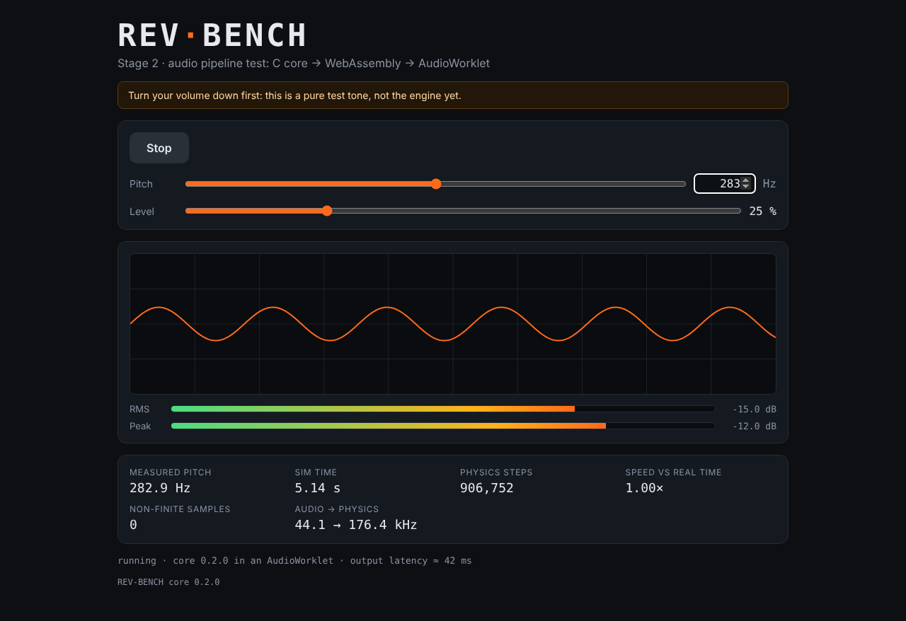

# Stage 2 — Web scaffold: C → WebAssembly → AudioWorklet

**Status:** done (2026-10-15)

## What was built

| Piece | Files | Purpose |
|---|---|---|
| WASM build | `Makefile` (`make wasm`) | Compiles the C core with zig 0.17 into a standalone `web/src/wasm/rb_core.wasm` (15.6 KB, no imports) and records a fingerprint of the C sources next to it. |
| Host helpers in the C API | `core/include/rb.h`, `core/src/rb_alloc.c` | `rb_create_with()`, `rb_alloc_floats()` and `rb_free_floats()`, for JavaScript, which can't build C structs or call malloc. Core version is now 0.2.0. |
| Typed wrapper | `web/src/core/rb-core.ts` | Loads the module and wraps it in `RbCore`/`RbSim`. The same code runs on the main thread, in the worklet and in Node. |
| Audio engine | `web/src/audio/rb-worklet.ts`, `engine-node.ts`, `protocol.ts` | The AudioWorklet processor runs the core on the audio thread; the main-thread node sends parameters and receives telemetry. |
| Test page | `web/index.html`, `web/src/main.ts`, `web/src/style.css` | Start/Stop, pitch (log slider + exact Hz box), level, oscilloscope, RMS/peak meters, measured pitch, sim time, speed vs real time. |
| Tests | `web/tests/unit/core.test.ts`, `web/tests/e2e/smoke.spec.ts` | Vitest checks the WASM core in Node; Playwright drives a real Chromium and checks the sound that actually comes out. |

## How the sound gets out

```
 main thread                                   audio thread (AudioWorkletGlobalScope)
 -----------                                   --------------------------------------
 fetch rb_core.wasm -> RbCore.load()
   (names, units, ranges for the UI)
 click Start -> new AudioContext()
   addModule(rb-worklet.js)
   new AudioWorkletNode(.., {wasmBytes}) -----> constructor: RbCore.loadSync(bytes)
                                                  rb_create_with(sampleRate, 4)
                                       <------- 'ready' {version}
 slider -> {type:'set-param', id, value} -----> rb_set_param()
                                                process(), every 128 frames:
                                                  rb_render_block() -> output
                                       <------- 'telemetry' [time, steps, peak, rms, ...] ~30x/s
 AnalyserNode <-- node output --> speakers
   oscilloscope + measured pitch
```

Design decisions:

- **Standalone module, zero imports.** The core needs nothing from JavaScript, so the worklet
  instantiates it directly: no Emscripten glue, no SharedArrayBuffer, no special server headers.
  If a future libc ever pulls an import in, `makeImports()` stubs it so a call fails loudly.
- **Two instances.** The main thread instantiates the module only to read metadata (names,
  units, ranges) for the UI. The worklet compiles its own copy from the bytes passed in
  `processorOptions`, synchronously, because a worklet constructor can't `await`. (The plan said
  to pass a compiled `WebAssembly.Module`. Passing bytes is simpler and works in every browser,
  and compiling 16 KB twice costs almost nothing.)
- **Nothing is allocated in `process()`.** The view into WASM memory is cached and telemetry
  reuses one array. At 48 kHz a 128-frame block is due every 2.67 ms.
- **Vite does the bundling.** `?worker&url` builds the worklet as its own ES-module file, and
  `?url` gives the `.wasm` a content-hashed file name so browsers can cache it safely.
- **Exact, slightly older versions.** Vite 8.3.1, Vitest 5.0.3, TypeScript 7.0.2, Playwright
  1.63.0 and @types/node 22.20.4, each at least two weeks old when added (supply-chain hygiene).
  npm 10 crashed while resolving Vitest's optional peer dependencies ("reading 'edgesOut'"), so
  `web/.npmrc` sets `legacy-peer-deps=true`.
- **A stale core can't reach the browser.** `make wasm` writes `rb_core.sources.sha256`, a
  SHA-256 of the C sources, and a unit test recomputes it. Change C code without `make wasm`
  and `npm test` fails.

## Equations used

1. **Real-time budget per block:** `128 / fs` = 2.67 ms at 48 kHz.
2. **Logarithmic pitch slider** (the same travel per octave): `f = f_min * (f_max/f_min)^(s/1000)`
   with 40–2000 Hz, so the middle of the slider is `sqrt(40 * 2000)` = 282.8 Hz.
3. **Telemetry rate:** one message every `round(fs / 128 / 30)` blocks, about 30 per second.
4. **Pitch from the output spectrum:** FFT bin `k` sits at `k * fs / N` Hz (N = 16384, so
   2.7–2.9 Hz per bin). A parabola through the peak bin and its neighbours (dB values a, b, c)
   puts the true peak at `k + p`, with `p = (a - c) / (2 * (a - 2b + c))`.
5. **Level in dBFS:** `20 * log10(x)`. The meters show -60 to 0 dB.
6. **Speed vs real time:** `(sim_time - sim_time0) / (wall_time - wall_time0)`. 1.00 means the
   core keeps up with real time.

## Results

- **Native:** 15 tests / 172 checks pass, including the new host helpers.
- **`make wasm`:** 15 657 bytes, 0 imports, 30 exports. Stripping debug info took it from
  955 KB to 15.6 KB. Link-time optimisation added an import, so it stays off.
- **`npm test`:** 7 Vitest tests pass in Node (440 Hz tone, clamping and NaN rejection,
  metadata, no imports, the source fingerprint). The WASM core renders about 300x faster than
  real time.
- **`npm run build`:** under 40 KB in total (JS 10.8 KB, worklet 4.0 KB, CSS 2.7 KB, WASM 15.7 KB).
- **`npm run test:e2e`** in headless Chromium 141, against the dev server **and** the production
  build:
  - the page starts the engine;
  - the pitch measured from the actual audio output lands within 1 Hz + 0.3 % of 440, 880, 150
    and 1234 Hz typed in, and of 282.8 Hz from the slider;
  - speed vs real time is 1.00x and there are no NaN samples;
  - level 0 gives silence, Stop works, and there are no console errors or failed requests.
  The test caught one real bug: the page had no icon, so the browser's automatic
  `/favicon.ico` request failed. The page now has an inline SVG icon.
- Only Chromium was tested here. Firefox and Safari still need a manual check.



## Notes for later stages

- The meters show the RMS and peak of a single 128-frame block, so the RMS wobbles by about
  1 dB on low notes (-15.8 vs -15.0 dB). Stage 16 adds proper meter ballistics.
- `performance.now()` may not exist in the AudioWorkletGlobalScope, so stage 14's CPU-load
  meter has to check what each browser offers.

## Sources

- Using AudioWorklet — MDN:
  <https://developer.mozilla.org/en-US/docs/Web/API/Web_Audio_API/Using_AudioWorklet>
- AnalyserNode — MDN: <https://developer.mozilla.org/en-US/docs/Web/API/AnalyserNode>
- Vite web workers (`?worker&url`) and static assets (`?url`):
  <https://vite.dev/guide/features#web-workers>, <https://vite.dev/guide/assets>
- Quadratic interpolation of spectral peaks: J. O. Smith, *Spectral Audio Signal Processing* —
  <https://ccrma.stanford.edu/~jos/sasp/>
