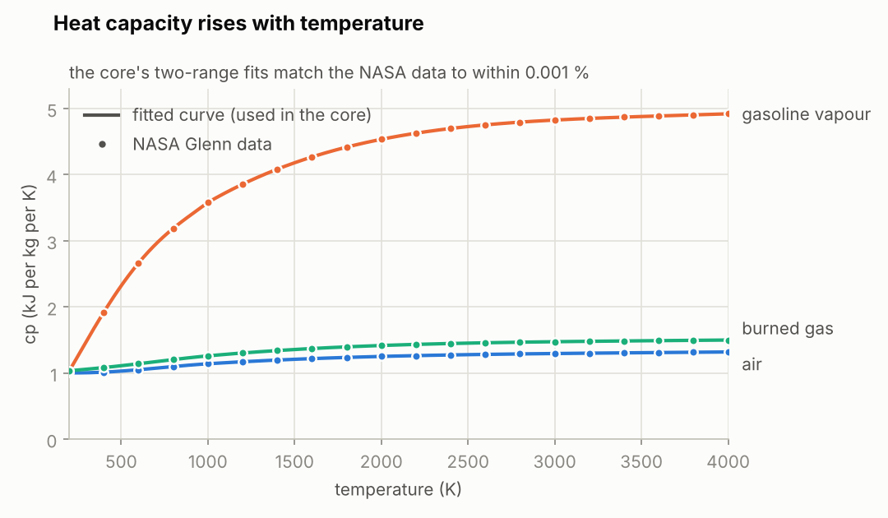
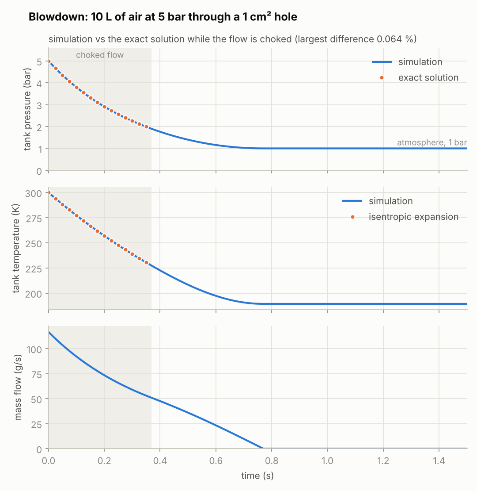

# Stage 3 — Gas & flow primitives

**Status:** done (2026-10-15)

The first real physics: what the gases in an engine are, how a volume of gas responds when gas
flows in or out (the first law of thermodynamics), and how fast gas flows through an opening.
Everything later (cylinders, valves, throttle, manifolds, exhaust pipes) is built from these pieces.

## What was built

| Piece | Files | Purpose |
|---|---|---|
| Gas properties | `core/src/gas.h`, `gas.c` | Three gases with temperature-dependent heat capacity; mixtures; `u(T)` and `T(u)`. |
| Control volume | `core/src/chamber.h`, `chamber.c` | A "chamber": species masses + internal energy → temperature and pressure. Flows are collected as rates, then integrated. Repairs NaN states instead of spreading them. |
| Flow | `core/src/flow.h`, `flow.c` | Isentropic nozzle flow (subsonic and choked), orifices between chambers with an equalisation limit, and a helper that steps a small network. |
| Demo | `build/rb_cli blowdown` | A tank emptying into the atmosphere, written to `renders/blowdown.csv`. |
| Tests | `tests/test_gas.c`, `tests/test_flow.c` | 12 new tests (27 in total, 396 checks). |

## The gases

Three pseudo-species are tracked everywhere. A lean mixture burns into burned gas plus leftover
air, and a rich one into burned gas plus leftover fuel. So these three are enough to follow the
air-fuel ratio through the whole engine.

| Species | What it is | Molar mass | R (J/(kg K)) | cp at 300 / 1000 / 3000 K (J/(kg K)) |
|---|---|---|---|---|
| `RB_AIR` | dry air: O2 20.95 %, N2 78.08 %, Ar 0.93 % (by mole) | 28.96 g/mol | 287.10 | 1005 / 1141 / 1296 |
| `RB_FUEL` | gasoline vapour (see below) | 103.92 g/mol | 80.01 | 1483 / 3580 / 4827 |
| `RB_BURNED` | stoichiometric combustion products: CO2, H2O, N2, Ar | 29.01 g/mol | 286.63 | 1058 / 1260 / 1474 |

**Gasoline** isn't one molecule, so it's modelled the way combustion research usually does it: a
*toluene reference fuel* of 47.85 % isooctane, 15 % n-heptane and 37.15 % toluene (by mole). That
blend has real gasoline's hydrogen/carbon ratio, 1.87 (average formula C7.48H13.98), so its
stoichiometric air/fuel ratio comes out at **14.60**, the familiar "14.7-ish" number. Burning one
mole of it in air gives 7.48 CO2 + 6.99 H2O + 40.91 N2 + 0.49 Ar.

The burned gas has a *frozen* composition, with no dissociation into CO, H2, OH, etc. at very high
temperature. That makes peak combustion temperatures a little high; stage 6 calibrates for it.

> **Update (stage 6):** above 1000 K, `RB_BURNED`'s heat capacity is now the *apparent* cp of the
> equilibrium mixture at 40 bar, which includes the energy that dissociation takes: 1977 J/(kg K)
> at 2500 K and 2753 at 3000 K, against the frozen gas's values in the table above. A constant-volume
> burn now lands within 2 % of Cantera's equilibrium temperature. See `docs/stage-06.md`.

## Equations used

1. **Ideal gas:** `p = m R T / V`. Mixture values are mass-weighted: `R = sum(y_i R_i)` and
   `cp = sum(y_i cp_i)`.
2. **Heat capacity fits:** `cp(T) = a0 + a1 t + a2 t^2 + a3 t^3 + a4 t^4` with `t = T / 1000 K`. Each
   species has one set of coefficients for 200–1000 K and one for 1000–4000 K (the same split the
   NASA database uses). Outside 200–4000 K, cp is held constant.
3. **Sensible internal energy:** `u(T) = integral from 298.15 K to T of (cp - R) dT`, worked out
   exactly from the polynomial. Enthalpy is `h = u + R T`, which is what a flow carries out of a
   chamber (its own energy plus the work done pushing it out).
4. **Temperature from energy:** Newton's method, `T <- T - (u(T) - u) / cv(T)`. Starting from the
   previous temperature it converges in one or two steps.
5. **First law for an open chamber** (the piston's work arrives in stage 4), with `mdot > 0` into
   the chamber: `dm_i/dt = sum(mdot * y_i,upstream)` and `dU/dt = sum(mdot * h_upstream) + Qdot`.
6. **Nozzle flow** through an effective area `Cd A`, from upstream (p0, T0) to pressure p, with
   `r = p / p0`:
   - subsonic: `mdot = Cd A p0 / sqrt(R T0) * sqrt(2g/(g-1) * (r^(2/g) - r^((g+1)/g)))`
   - choked, below `r_crit = (2/(g+1))^(g/(g-1))` (0.528 for air):
     `mdot = Cd A p0 / sqrt(R T0) * sqrt(g) * (2/(g+1))^((g+1)/(2(g-1)))`. The constant is 0.6847
     for g = 1.4, and the flow no longer depends on the outlet pressure.
7. **Time stepping:** explicit (forward) Euler at the physics rate, `dt = 1/192000 s`. All flows
   are computed from the current state, then every chamber is integrated, so the order of the
   connections doesn't matter. Mass and energy leave one chamber and enter the other as exactly the
   same numbers, so they're conserved to rounding error.
8. **Equalisation limit.** A big opening between small volumes makes explicit steps overshoot: the
   pressures cross and oscillate. A 1 cm^3 pocket behind a 5 cm^2 hole would swing by tenths of a bar
   every step. So each connection moves at most half of the mass that would equalise the two
   pressures (to first order):
   - `k = c_up^2 / V_up + R_down (T_down + (h_up - u_down) / cv_down) / V_down` (pressure change per kg moved)
   - `dm_eq = (p_up - p_down) / k`
   - `mdot <= 0.5 * dm_eq / dt`

   The limit only acts when the real gas would equalise faster than one time step anyway. Removing
   it broke 5 of the tests.
9. **Exact solution for a choked blowdown** (constant g): `p(t) = p0 (1 + K t)^(-2g/(g-1))` with
   `K = (g-1)/2 * C A sqrt(R T0) / V`, where C is the choked constant above. The gas left in the tank
   expands isentropically: `T = T0 (p/p0)^((g-1)/g)`.
10. **Filling an empty tank** from a reservoir at T0: all the inflow's enthalpy becomes internal
    energy, `u(T_final) = h(T0)`, so `T_final ≈ g * T0` = 420 K from 300 K.
11. **Two closed tanks** (same gas, constant cv) end at the volume-weighted mean pressure
    `(p_a V_a + p_b V_b) / (V_a + V_b)`, because energy is conserved.

## Results

- **Tests:** 27 tests / 396 checks pass (12 new), also under AddressSanitizer + UBSan, with no
  compiler warnings.
- **Gas data:** the fits match the NASA data to better than 0.001 % from 200 to 4000 K, and match
  textbook air (cp 1005 J/(kg K) and g 1.400 at 300 K; 1142 and 1.336 at 1000 K).
- **Blowdown** (10 L at 5 bar through 1 cm^2):
  - the simulation stays within 0.064 % of the exact solution while the flow is choked, and within
    0.09 K of the isentropic temperature;
  - the flow stays choked until 0.370 s, when the tank is at 1.894 bar (= 1 bar / 0.528);
  - the tank ends at 1.0000 bar and 189.3 K;
  - the time to reach 2 bar matches the exact 0.348 s, and changes by under 0.1 % between a 48 kHz
    and a 384 kHz time step.
- **Two tanks** (2 bar and 1 bar) settle at 1.5 bar (within 0.1 %). The gas left in the first tank
  ends at its isentropic temperature, and mass and energy are conserved to rounding (about 1e-12).
- **Filling** an empty tank from the atmosphere ends at 420 K, the textbook `g T0`.
- **The stiff pocket** (1 cm^3 of 2000 K gas behind 5 cm^2): the limit kicks in, and the pressures
  converge without ever crossing.
- **The tests catch real mistakes.** Six deliberate physics bugs each failed 3 to 6 tests: no limit,
  flow carrying u instead of h, the wrong fit range, a wrong choked-flow exponent, a constant cp,
  and a wrong pressure formula.

## Notes for later stages

- **Stage 5:** the equalisation limit is per connection. When a plenum feeds several runners, the
  limits on one small chamber add up; if its pressure oscillates, scale the limit by the number of
  strong connections.
- **Stage 6:** burning turns AIR + FUEL (14.596 : 1 by mass) into BURNED, and the heat released is
  the lower heating value times the fuel burned, added to U.
- **Stage 13:** each flow costs two or three `pow` calls and each chamber update a Newton step. That's
  fine natively, but it should be measured in WebAssembly; gamma-dependent constants can be cached.

## Sources

- B. J. McBride, M. J. Zehe, S. Gordon, *NASA Glenn Coefficients for Calculating Thermodynamic
  Properties of Individual Species*, NASA/TP-2002-211556 (2002):
  <https://ntrs.nasa.gov/citations/20020085330>. These are the data behind the fits, read through
  Cantera 3.2's `nasa_gas.yaml` (<https://cantera.org>).
- J. B. Heywood, *Internal Combustion Engine Fundamentals*, 2nd ed., McGraw-Hill (2018): gas
  properties, gasoline composition, and filling-and-emptying models of engine manifolds.
- Y. A. Çengel, M. A. Boles, *Thermodynamics: An Engineering Approach*: table A-2, ideal-gas
  properties of air.
- J. D. Anderson, *Modern Compressible Flow*: isentropic nozzle flow and choking.
