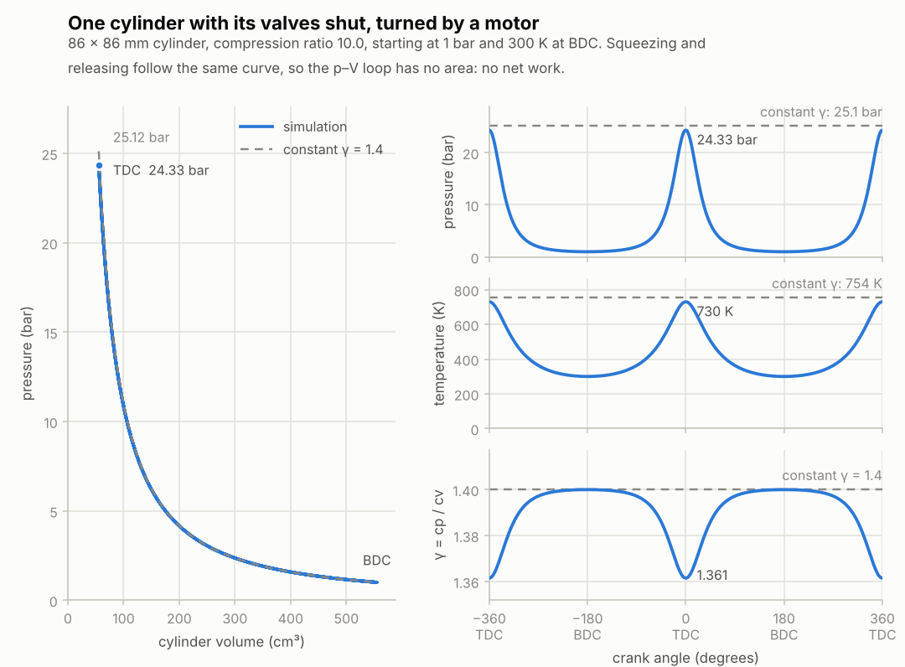

# Stage 4 — Single cylinder: slider-crank + motoring

**Status:** done (2026-10-15)

The first moving part. The crank turns, the connecting rod pushes the piston, and the gas above it
is squeezed and released. With the valves shut and no fuel, this is a *motored* cylinder: an
electric motor turns it, the way engines are tested on a motoring dyno. It's the cleanest possible
check of the cylinder because the answer is known: with no heat loss and no leaks, the gas follows
an isentrope, and every revolution must be exactly the same as the one before.

## What was built

| Piece | Files | Purpose |
|---|---|---|
| Slider-crank | `core/src/cylinder.h`, `cylinder.c` | Geometry from bore, stroke, rod length and compression ratio; piston position, volume and dV/dθ at any crank angle. |
| Moving piston | `rb_chamber_set_volume()` in `core/src/chamber.c` | The piston's work on the gas, `dU = -p dV`, with the trapezoidal rule, so nothing drifts. |
| Cylinder | `rb_cylinder_init()`, `rb_cylinder_move()` | A chamber plus its geometry and crank angle. Moving the crank returns the work done on the gas. |
| Demo | `build/rb_cli motor` | Turns one cylinder at a steady speed and writes the last two revolutions to `renders/motor.csv`. |
| Chart | `tools/plot_cycle.py` | The p–V diagram, and pressure, temperature and γ against crank angle, from that CSV. |
| Tests | `tests/test_cylinder.c` | 7 new tests (34 in total, 442 checks). |

## Crank angle convention

The crank angle θ is measured from top dead centre (TDC). Over the 720° four-stroke cycle:
**0° = TDC at the start of the power stroke ("firing TDC"), 180° = BDC, 360° = TDC between exhaust
and intake ("overlap TDC"), 540° = BDC.** The mechanism itself repeats every 360°. This is used
everywhere from now on, including the 3D view. Charts run from −360° to 360°, so the firing TDC is
in the middle.

## Equations used

1. **Geometry** for bore B, stroke S, rod length l and compression ratio CR:
   - piston area `A = π B² / 4`, crank radius `a = S / 2`
   - swept volume `Vd = A S`, clearance volume `Vc = Vd / (CR - 1)`, because
     `CR = (Vc + Vd) / Vc` is the largest volume over the smallest.
2. **Piston position** below TDC (Heywood, chapter 2):
   `x(θ) = a (1 - cos θ) + l - sqrt(l² - a² sin² θ)`.
   The first term is what an infinitely long rod would give. The second is the extra drop because
   the rod tilts: at 90° the piston isn't halfway down but already at 57.7 % of the stroke (86 mm
   stroke, 143 mm rod). So the piston moves faster in the top half of the stroke than in the bottom
   half. Its peak speed is 14.1 m/s at 74.5° after TDC at 3000 rpm, 1.64 times the mean piston
   speed `2 S N / 60` = 8.6 m/s.
   Near TDC both terms are tiny differences of nearly equal numbers, so the code rewrites them
   without the cancellation: `1 - cos θ = sin² θ / (1 + cos θ)` and
   `l - sqrt(l² - q) = q / (l + sqrt(l² - q))`.
3. **Volume and its rate of change:** `V(θ) = Vc + A x(θ)`, and
   `dV/dθ = A a sin θ (1 + a cos θ / sqrt(l² - a² sin² θ))`.
4. **First law with a moving piston** (valves shut, no heat loss yet): `dU = -p dV`.
5. **The trapezoidal rule.** Each physics step moves the crank by `ω dt` (0.094° at 3000 rpm) and
   the piston work uses the average of the pressures before and after the step:
   `U1 = U0 - (p0 + p1) / 2 · (V1 - V0)`, with `U1 = m u(T1)` and `p1 = m R T1 / V1`.
   That's one equation for T1, solved with Newton's method on
   `f(T) = m (u(T) + k T) - (U0 - p0 (V1 - V0) / 2)`, where `k = R (V1 - V0) / (2 V1)` and
   `f'(T) = m (cv(T) + k)`. It converges in two or three iterations.

   Why this rule: it's **symmetric in time**. Swap "before" and "after" and it's the same formula,
   so compressing through some volumes and expanding back through the same ones lands exactly on
   the starting state. A closed cylinder therefore can't gain or lose energy, however many
   revolutions it runs. It's also second-order accurate: the error grows with the square of the
   step, so doubling the rpm (at a fixed physics rate) makes it four times bigger.

   The simplest alternative, explicit Euler (`U1 = U0 - p0 (V1 - V0)`), isn't symmetric. In this
   cylinder at 3000 rpm it loses 0.29 J per revolution: after 100 revolutions the trapped air would
   have cooled from 300 K to 238 K and the peak pressure fallen from 24.3 to 19.7 bar. Implicit
   Euler (using p1) drifts the other way, to 377 K and 29.7 bar.
6. **Big steps.** The trapezoidal rule only works for small volume changes: squeezed about sixfold
   in one step, it has no solution at all (`f'` turns negative). The piston changes the volume by at
   most 0.3 % per step at 3000 rpm and 1.6 % at 18000 rpm, but `rb_chamber_set_volume()` splits any
   bigger change into steps of at most 2 %, evenly spaced in log V, so going back retraces them.
7. **The reference solutions.**
   - Real air, whose cp rises with temperature: along an isentrope `dT / d(ln V) = -R T / cv(T)`.
     The tests integrate this with 20,000 RK4 steps, independently of the core's own method.
   - The textbook, constant γ: `p V^γ = constant` and `T V^(γ-1) = constant`, so at TDC
     `p = p0 CR^γ` and `T = T0 CR^(γ-1)`.

## Results

For an 86 × 86 mm cylinder with a 143 mm rod and CR 10 (one cylinder of a typical 2.0 L four):
499.6 cm³ swept and 55.5 cm³ of clearance volume. Starting at BDC with air at 1 bar and 300 K:

- **Tests:** 34 tests / 442 checks pass (7 new), also under AddressSanitizer + UBSan, with no
  compiler warnings.
- **Compression to TDC at 3000 rpm:** 24.33 bar and 729.86 K, within 8.5e-7 of the exact isentrope
  for real air. The textbook constant-γ answer is **25.12 bar and 753.6 K, 3.1 % higher**. That's
  real physics, not error: as air heats up its molecules start to vibrate, cp goes up, and
  `γ = cp / cv` falls from 1.400 at 300 K to 1.361 at 730 K. The piston puts 207.5 J into the gas
  on the way up, and the gas gives all of it back on the way down.
- **Accuracy against rpm** (temperature at TDC, relative error):

  | rpm | steps per stroke | error |
  |---|---|---|
  | 1000 | 5760 | 9.5e-8 |
  | 3000 | 1920 | 8.5e-7 |
  | 6000 | 960 | 3.4e-6 |
  | 12000 | 480 | 1.4e-5 |
  | 18000 | 320 | 3.1e-5 |

  Each doubling of rpm multiplies the error by 4.0, as a second-order method should. Even at
  18000 rpm it's 0.02 K.
- **No drift:** after 100 revolutions (384,000 steps) the air is back at 300.000000 K at BDC. Its
  energy is off by 4e-10 J out of the 207.5 J that goes in and out every stroke (2e-12), and the
  peak pressure is the same in the first and the last revolution to 9 digits. After 1000
  revolutions it's still 5e-10 J: rounding noise that doesn't grow.
- **Big jumps:** squeezed tenfold in a single call, the gas lands at 729.92 K (9e-5 from the
  isentrope); expanded back in a single call, it returns to exactly 300 K.
- **The tests catch real mistakes.** Eleven deliberate bugs each failed 1 to 5 tests: explicit
  Euler, implicit Euler, the wrong sign of the work, no rod tilt (`x = a (1 - cos θ)`), clearance
  volume `Vd / CR`, dV/dθ without the rod term, a sloppy Newton derivative, no check that the rod is
  longer than the stroke, no NaN guard on the crank angle, no splitting of big volume jumps, and
  not updating the pressure after a step.
- **Cost:** one cylinder step (new volume + piston work) takes about 150 ns natively (gcc -O2) and
  96 ns as WebAssembly in Node 22, on an i7-1355U. At 192,000 steps per second, the piston work
  of eight cylinders would take about 15 % of one core in the browser. Stage 13 profiles the whole
  engine.



**What to look for in the chart.** The p–V diagram is a single curve. The compression and the
expansion lie exactly on top of each other, so the loop encloses no area: no net work, as there
should be with no fuel and no losses. On the right, the pressure peaks at every TDC because the
valves never open (in a running engine only the firing TDC at 0° would squeeze the charge). The
dashed lines show the textbook constant-γ values, slightly above the real-air peaks, and the bottom
panel shows why: γ dips at TDC, where the air is hottest.

## Try it

```bash
make                                     # builds build/rb_cli
build/rb_cli motor                       # 86 x 86 mm, CR 10, 3000 rpm → renders/motor.csv
build/rb_cli motor --cr 12 --rpm 6000    # any engine: --bore --stroke --rod --cr --rpm --revs
python3 tools/plot_cycle.py              # renders/motor.csv → renders/motor.png
python3 tools/plot_cycle.py --log        # the p–V diagram on log-log axes (straight lines)
```

The plot script needs matplotlib (in WSL: `sudo apt install python3-matplotlib`).

## Notes for later stages

- **Stage 5:** the cylinder becomes an open chamber. Each step: the valve flows first (explicit
  Euler, as in stage 3), then the piston (the trapezoidal step). That's two chamber updates per
  step; merge them if the profile says so.
- **Stage 6:** with wall heat loss, a motored cylinder's peak pressure comes slightly *before* TDC
  and lower (the "thermodynamic loss angle", typically under a degree). That's a good check for
  the Woschni model.
- **Stage 7:** take the gas torque on the crank from the work of each step, `τ = -W / Δθ`, where W is
  what `rb_cylinder_move()` returns. That keeps the energy balance between gas and crankshaft exact.
  (`p A dx/dθ` is the same thing to second order.)
- **Stage 13:** the volume step's first Newton iteration can be done without evaluating u or cv
  (they're known at the old temperature), and sin/cos of the crank angle can be computed once per
  step and rotated to each cylinder's phase offset (`sin(θ + φ) = sin θ cos φ + cos θ sin φ`)
  instead of calling sin and cos for every cylinder.

## Sources

- J. B. Heywood, *Internal Combustion Engine Fundamentals*, 2nd ed., McGraw-Hill (2018), chapter 2:
  slider-crank geometry, cylinder volume, mean piston speed, and typical rod-to-crank ratios (3 to 4
  for small and medium engines; this one has 3.33).
- E. Hairer, C. Lubich, G. Wanner, *Geometric Numerical Integration*, 2nd ed., Springer (2006),
  chapter V: symmetric (time-reversible) methods such as the trapezoidal rule, and why they don't
  drift.
- The gas data are the stage 3 fits to the NASA Glenn database (see `docs/stage-03.md`).
