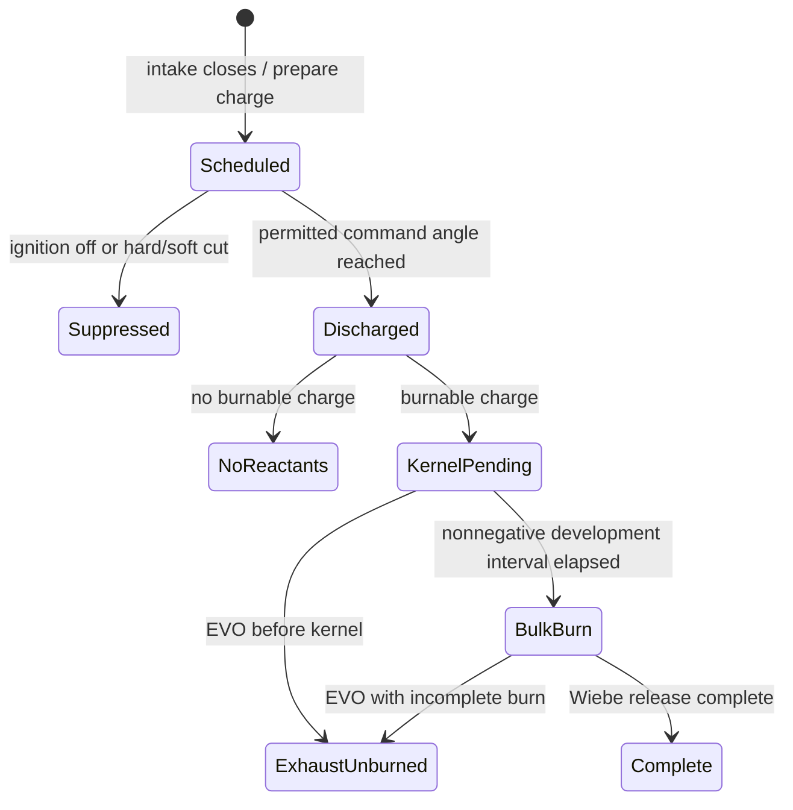

# Stage040 — Spark, ignition and flame-development causality

Executed after review038 and the qualified039 protocol. Baseline1f964f4
physics;039 reference work changes no engine/audio code. User authorizes through
040 and review of each predecessor. Matched039 calibration evidence remains
pending and does not gate independent numerical040 fixtures.

## Frozen physical question and research

The previous engine schedules `spark()` at the randomly shifted burn-start
angle, rather than the commanded spark angle. Negative variation therefore
allows modeled chemical heat before the intended discharge. A baseline-compatible
independent commanded-angle oracle at held3000rpm/.6 throttle/variation1 over0.5s
measures154.44J (I4),247.11J (I6),356.42J (cross V8),276.62J (flat V8),160.54J
(boxer) before command. This is a causality failure; it does not diagnose all
robotic deceleration sound or supply a calibrated timbre correction.

Primary basis: [Schiffmann/Reuss/Sick](https://doi.org/10.1177/1468087417720558)
distinguish discharge and early flame growth; [optical early-flame study](https://doi.org/10.2516/ogst/2017028)
examines early development and subsequent combustion; [ignition-strategy experiment](https://doi.org/10.1021/acs.energyfuels.0c02698)
shows that mixture/flow/discharge conditions matter. These support ordered
spark→kernel→bulk heat, not a universal jitter distribution or an audio-derived
misfire threshold. No explicit autoignition model is introduced.

Minimum causal correction: discharge at the frozen commanded angle, then a
nonnegative development interval. Retain the positive arm of the existing
onset-variation parameter as a bounded surrogate; clip the unphysical negative
arm to zero. Zero-delay means unresolved kernel development within the existing
Wiebe curve, not physically instantaneous complete combustion. State-conditioned
kernel-delay statistics/extinction calibration remain041. Do not invent new
noise, random pops, fuel losses or afterfire to resemble a recording.

## Architecture and predeclared gates

The physical engine owns a uint64 step clock and per-cylinder charge sequence.
Separate scheduled angle, commanded/discharged event, kernel progress and heat.
Native optional caller-owned event records include tick, fractional-step time,
cylinder/charge identity, angle, delay and fuel, with counted bounded overflow.
No callback allocation/I/O. Full public event/snapshot/WASM transport stays061.

The discharge and kernel occur within the actual step interval. Chemical heat
can use only elapsed time after discharge and after nonnegative kernel delay;
no modulo wrap can turn a small negative age into nearly720degrees. Inhibit
new discharge for ignition off or hard/soft cut. A previously lit flame may
continue after switching ignition off. Distinguish no reactants, pending-kernel
cancellation at EVO, and partial burn; remaining fuel stays in species books.
No unsupported thermochemical flammability/extinction threshold is claimed.

Gates: zero pre-command/pre-discharge heat at1e-12J step tolerance; exact event
ordering at zero delay and across cycle wrap; first-step heat bounded by the
post-event interval; closed mass/species/fuel/energy/crank-work books at existing
native tolerances. All five presets: startup, idle, cut/resume, overrun and
retained-fuel scenarios. Exercise zero/nominal/high variation, positive delay,
empty mixture and event overflow. Taps on/off preserve physical state. Plant
an early-heat fault and incorrect scheduling/delay/cut faults in copies; checks
must reject. Rebuild native/WASM and full34 float renders, then publish the one
results page preserving039 controls and all prior research/reference sections.

Review039 first: preserve its freeze, uncertainty and exclusion rules. No use
of its new validation/quarantine sources for fitting or listening-based tuning.

## Implemented causal state and ownership



`core/src/ignition.[ch]` supplies a native, optional, caller-owned256-record tap.
Its tick is the engine-owned interval `[tick,tick+1)`; fraction resolves the
actual event inside that interval. Charge IDs advance per cylinder at IVC.
Records expose the original signed delay draw and accepted nonnegative delay.
Scheduled means IVC preparation; permitted command and discharge currently
coincide because there is no separate coil/discharge circuit model. Suppressed
attempts are separate events, not actual sparks. A discharge into no reactants
is distinct from a modeled flame. No electrical spark energy is included.

`fuel_kg` is event-specific: actual cylinder fuel at command/discharge or
suppression, eligible burnable fuel at kernel, potential unburned eligible fuel
at EVO, and zero on schedule/no-reactants. It is not delivered injector mass
or a uniform event delta. Species inventories remain the physical authority;
Stage042 supplies injection identity and Stage061 types the public event payloads.

Each step advances development by `max(crank_step,6*100rpm*dt)`; the floor
retains the existing time progression when the crank slows or stops. Only the
fraction after an actual discharge contributes in its first step. Kernel age
is accumulated without wrapping crank phase, so a negative age cannot become
a nearly-full720degree burn. The existing Wiebe/species/fuel-energy conversion
owns bulk heat after kernel completion. Woschni's combustion contribution waits
for kernel completion too. At EVO the pending or partially burning charge is
canceled and unburned fuel remains in the normal species transport. Ignition
off prevents new discharges; it does not extinguish a flame already lit.

Observers allocate nothing and perform no I/O while stepping. A full tap drops
new records and counts losses while totals continue; drain only between steps.
Capacity0 is allowed for totals-only monitoring. Reinitializing the engine
clears the pointer and tick: rebind externally and identify the reset epoch.
This internal tap is not the complete Stage061 public event/snapshot transport;
no build UUID, cross-reset generation, concurrent consumer or hardware voltage
measurement is claimed. Existing public C/TS parameter IDs remain unchanged.

## Executed independent proof

The baseline-compatible commanded-angle oracle is unchanged. With identical
3000rpm/.6-throttle/variation1/0.5s controls, pre-command heat becomes **0J in
all five engines**, versus the154–356J baseline above. No reference recording
was used to tune this change. The local baseline executable/probe and source
revision identify the before control.

Four native test families cover all five presets with zero/nominal/high
variation; commanded phase and discharge/kernel ordering across wrap; an
independent pre-command heat oracle; first-step Wiebe heat bounded by actual
post-discharge time; ignition-off/no-reactants/hard-cut/soft-cut/resume;
artificial1000degree pending-kernel expiry; and saturated monitoring versus
an unobserved identical engine. A test initially pinned the obsolete planned
start angle; it now also pins the actual development delay. The high-variation
bound applies to commanded spark plus bounded positive delay, not the old
pre-spark onset. No physical tolerance was relaxed.

`tools/ignition_scenarios_probe.c` separately executes25 cold-start short
controls:5presets × startup(.8s), held idle(.4s), cut/resume(.4s), overrun(.4s)
and low-efficiency retained fuel(.4s). Native taps drain every step. All pass
mass/species/fuel, transported/internal energy and crank-work accounting at the
frozen tolerances. Maximum absolute residuals: mass1.07e-15kg, species1.10e-15kg,
energy3.45e-9J, crank4.46e-8J; the latter subtracts large controlled flywheel
energies. Zero early-heat steps, invalid events and dropped records. Sampled
per-charge event times/delays accompany every scenario. These are short
causal/accounting controls, not a qualified warm-engine operating map.

The scenario fixture first rejected an inertia exactly at the strict100kg·m²
upper limit; it was corrected to50, then all25 were rerun. The isolated
suppression fixture also uses this valid50kg·m² inertia to stay in the cut band.
No engine validation rule was weakened.

Six **compiled, behaviorally rejected** faulty engine copies test:
wrong random-angle discharge, negative kernel delay, a full first-step heat
interval, bypassed hard cut, pending kernel surviving EVO, and genuine chemical
heat enabled at IVC without discharge. The last follows the existing fuel/heat
path and is caught by the independent timing observer/oracle, rather than by
an arbitrary energy imbalance alone. Reproducible definitions are in
`tools/bugs/stage040.py`; only isolated copies were modified.

## Reproduction

```sh
make BUILD=/tmp/rb040 LTO=0 /tmp/rb040/rb_tests \
  /tmp/rb040/ignition_causality_probe /tmp/rb040/ignition_scenarios_probe
/tmp/rb040/rb_tests
/tmp/rb040/ignition_scenarios_probe
python3 tools/plant_bugs.py 040 /tmp/rb040-faults all
make wasm BUILD=build/stage040-wasm ZIG=/path/to/existing/compiler
make BUILD=build/stage040-wasm ZIG=/path/to/existing/compiler \
  build/stage040-wasm/rb_tests.wasm
node tools/bench_wasm.mjs build/stage040-wasm/rb_tests.wasm ignition_ \
  chamber_batch gas pipe_acoustic_transport pipe_conserves_everything pipe_two_rates_agree
make render-standard BUILD=/tmp/rb040 LTO=0 \
  RENDER_DIR=renders/evidence/stage-040/sound/standard RENDER_FLAGS=--float
python3 -S tools/exhaust_feedback.py --cli /tmp/rb040/rb_cli \
  --output renders/evidence/stage-040/sound/feedback
PYTHONPATH=tools .venv-analysis/bin/python tools/ignition_checkpoint.py \
  --before renders/evidence/stage-040/baseline \
  --after renders/evidence/stage-040/sound \
  --out renders/evidence/stage-040/sound-comparison.json
```

Build `all` too before the render commands. The raw comparison uses per-channel
powers, fixed recording gains and the same scenarios; the portable page uses
its existing constant per-clip listening gain. Relative-level conclusions come
from raw measurements, not page loudness. Different crank trajectories are not
matched-RPM timbre comparisons. Preserve hashes/commands/CSV/logs, then remove
duplicate comparison WAVs after replacing the current complete checkpoint.

## Explicit limits and next handoff

The nonnegative projection of the previous onset variation is a causal repair,
not a fitted kernel law. There is no researched universal threshold for weak
mixture extinction, fuel film, late exhaust chemistry or random afterfire in
this implementation. Empty-reactant/cut/pending-at-EVO outcomes are explicit;
state-conditioned development/failure, residual statistics, continuous mean
model at variation→0 and gross/net IMEP remain041. The ECU still estimates
advance from the existing expected burn duration; the causal projection changes
the onset distribution and does not recalibrate mean CA50/torque. That shared
model/calibration work belongs to041/059, rather than compensating by moving
actual discharge away from its commanded angle. Fuel-injection identity and
its acoustic click stay042. Substep event traces constrain integrated release;
they do not turn all operator-split valve/gas updates into exact substep solves.
Custom cam coincidences and the full warm operating envelope remain059 checks.

The optional tap is not enabled by default in the audio callback. No throughput
or sound-realism acceptance follows solely from causal correctness. Propagation,
turbulence, source clocks, mechanical/cabin response, real reference matching,
runtime and Bernardo's listening remain open at their owned stages. S1/S1e/S2/S4
and full13b are not closed. Review039 found no blocking protocol defect but
matched calibration still awaits source metadata; public online research is the
user's chosen next acquisition method. Stop after the040 checkpoint; do not
start041 without further instruction.

## Test execution and evidence inventory

Native full206tests/694027checks pass; after strengthening the soft-cut and
EVO-state assertions, the affected4tests/655335checks pass again. This is
206distinct tests/694149checks using the final versions, not a claim that the
unchanged full suite was run twice. ASan/UBSan19tests/655542checks pass, plus
the final strengthened4/655335; no sanitizer finding. Final SIMD WASM13tests/
655645checks pass. Python64 and cached web17 pass; the copied source tree and
169326byte WASM/fingerprint agree. Public browser engine operation is still the
existing tone scaffold; rebuilt WASM does not imply Stage068 product integration.

Local evidence under `renders/evidence/stage-040/`: independent before/after
causality JSONL,25scenario rows with sampled events, six fault results and exact
mutant logs/runner, build/test logs, protected input hashes, full raw-stereo
sound metrics, source/build fingerprints and final offline playback evidence.
Temporary whole-checkpoint before WAV copies are removed only after comparison
and publication checks, leaving hashes/metrics and the reproducible baseline
revision. Original recordings/reference extracts and historical registered
research sections remain intact. The one portable results page carries the
current complete engine examples and all five long coasts.

## Complete sound checkpoint comparison

All34 raw float clips are finite with headroom and zero reported limiter or
nonfinite samples:337.112s versus337.248s before. The33 engine clips change;
the test tone remains byte-identical. Exhaust selection, rev limits, recording
gains, perspectives and long-coast controls are unchanged. At held3000rpm,
raw RMS changes−0.021…+0.086dB and2–16kHz band share−0.051…+0.160dB across
the five feedback examples. This is a modest spectral change, not evidence of
a large crispness improvement or resolution of the propagation bottleneck.

The pre-lift(-.8…-.2s) to early-coast(.2….8s) raw mean-channel level steps
are I4:+2.99→+4.55dB; I6:−.34→−.33dB; cross V8:−4.94→−5.23dB;
flat V8:−1.39→−1.71dB; boxer:−2.53→−2.17dB. The I4 rise increases1.56dB;
retain it as an explicit Stage058 thermal/flow/trajectory diagnosis target,
not a successful coast-level correction. These windows follow each pedal lift,
not matched RPM/load. No compensating gain or extra sound layer hides it.
The causal engine correction is supported independently of this sound metric;
listening acceptance remains Bernardo's.

Only comments were clarified after the sound build to distinguish bulk duration
from the new kernel interval. The refreshed native CLI executable-code section
and the entire rebuilt WASM are checked byte-identical to the rendered build;
the final source fingerprint and web tests are refreshed. No late functional
change invalidates the recorded comparison.

## Outcome — bounded completion and HOLD

Stage040 completes its declared causal/accounting correction after predecessor
review. Final offline playback of all52players, exclusive playback, four seek
controls and all eight plots passes against the published page fingerprint.
All34 installed raw files match the comparison report. All104protected
reference/audio/Claude files and18non-current-engine embedded examples remain
identical. Verified duplicate before WAVs/page are cleaned after measurement;
current originals and scientific evidence remain in ignored renders/.

Graphify was queried for spark/heat call paths and refreshed from source; its
AST graph is navigation assistance, not validation of physical correctness.
The known rb.h parser warning remains. Claude setup and user-added skill files
are preserved. Save/sync the checkpoint, then hold;041 is not started.039's
matched-data requirement is still open despite the completed protocol and
public-source search. Bernardo's sound acceptance and the parent realism gates
remain open.
