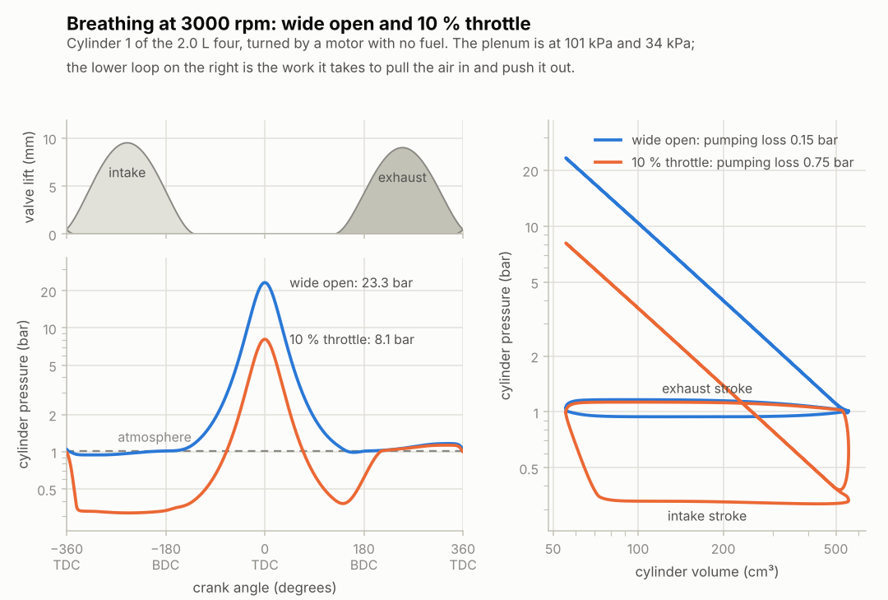
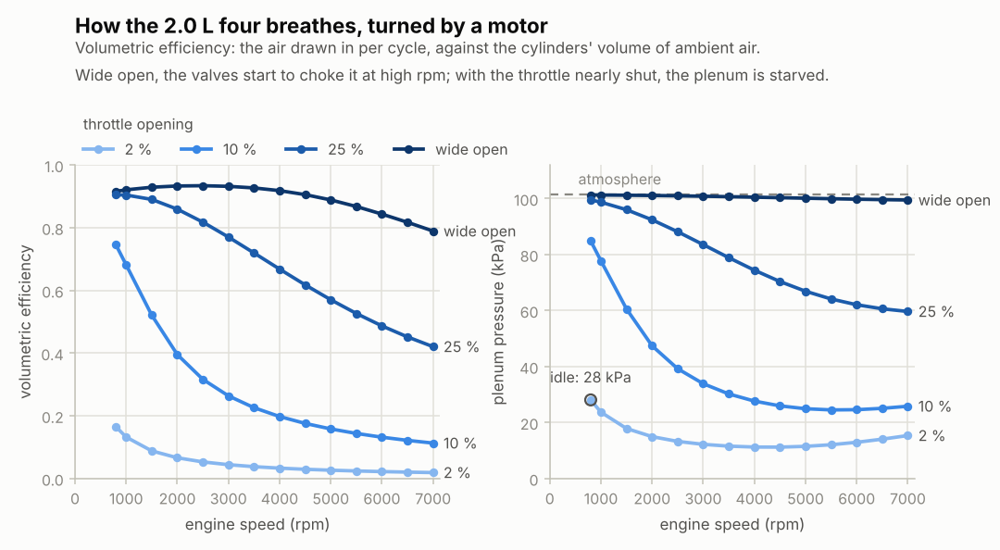

# Stage 5 — Valvetrain, throttle & intake plenum

**Status:** done (2026-10-16)

The engine breathes. Cams open the valves, the throttle meters the air into an intake plenum,
and four cylinders on one crankshaft pull air from it and push it out to the atmosphere. There's
still no fuel, and an electric motor turns the crank at a set speed, so this stage measures one
thing: how well the engine fills its cylinders with air. That's the **volumetric efficiency**,
and most of the engine's power curve will follow from it.

## What was built

| Piece | Files | Purpose |
|---|---|---|
| Cams and valves | `core/src/valve.h`, `valve.c` | Lift at any crank angle from duration, lift and lobe centerline; effective flow area from lift (valve curtain in series with the port). |
| Throttle | `core/src/throttle.h`, `throttle.c` | Open area of a butterfly plate on a shaft, from the pedal position. |
| Engine | `core/src/engine.h`, `engine.c` | N cylinders, the plenum, throttle, valves and the two air reservoirs, stepped together at a fixed rpm, with totals for every 720° cycle. |
| Demo | `build/rb_cli breathe` | One operating point (summary + one cycle as CSV), or `--sweep` for the whole rpm × throttle map. |
| Charts | `tools/plot_breathe.py`, `tools/rbplot.py` | The breathing cycle and the VE map; `rbplot.py` holds the shared chart style. |
| Tests | `tests/test_valve.c`, `test_throttle.c`, `test_engine.c` | 14 new tests (48 in total, 548 checks). |

The default engine is a generic 2.0 L inline four: 86 × 86 mm, 143 mm rods, compression ratio 10,
firing order 1-3-4-2, two 33 mm intake valves and two 28 mm exhaust valves per cylinder, a 60 mm
throttle and a 2.5 L plenum, in standard air (1.013 bar, 25 °C).

## How one step works

```
  ambient air --> throttle --> plenum --> intake valves --> cylinder 1..4
                                                                 |
  ambient air <--------------------------------- exhaust valves <-+
```

1. **Areas.** The throttle's from the pedal; each valve's from its cam at that cylinder's crank
   angle (cylinder i is at `theta - firing[i]`).
2. **Flows.** Gas moves through every opening at once, computed from the current state with the
   stage 3 nozzle formula, then every chamber is integrated (explicit Euler).
3. **Pistons.** The crank turns `6 rpm dt` degrees and each piston moves with stage 4's
   trapezoidal step.

At the end of each 720° cycle the engine totals the air drawn in, the plenum pressure and the
pumping work. A cycle is rarely a whole number of steps (at 7000 rpm it's 3291.4), so the step
that crosses the end of a cycle is shared between the two cycles in proportion to its angle.
Without that, the totals wobble by about 3e-4 from cycle to cycle.

## Equations used

1. **Cam lift.** With `u = 2 (theta - centerline) / duration`, for `|u| < 1`:
   `L = L_max (1 - u²)²`, otherwise 0. The valve leaves and reaches its seat with zero speed, and
   the curve is about as "full" as a real street cam's: at 1.27 mm (0.050 in, the usual cam-card
   point) it's open for 80 % of its zero-lift duration.

   Timing is given the way cam cards give it: duration, lift and lobe centerline, intake in degrees
   after overlap TDC, exhaust in degrees before it. The default cams are 250° with centerlines at
   110°. The intake opens 15° BTDC and closes 55° ABDC; the exhaust opens 55° BBDC and closes 15°
   ATDC, giving 30° of overlap.
2. **Valve flow area.** A barely open valve passes gas through its *curtain*, `π d L`; at high
   lift the port behind it is the bottleneck. In series, their effective areas combine like
   resistances: `1/A² = 1/(Cd π d L)² + 1/(0.9 π d_port²/4)²`, times the number of valves.
   With `Cd = 0.7` and a port 0.85 times the valve's diameter, the discharge coefficient
   (measured against `π d L`) falls from 0.68 at low lift to 0.48 at `L = d/4`. That's the shape
   of the intake valve measurements in Heywood, chapter 6.
3. **Throttle area.** Seen along the bore, the plate is an ellipse of half-height
   `b = R cos ψ / cos ψ0` (ψ0, the angle it closes at, is 7° here; ψ is 90° wide open). The shaft is
   a strip of half-width h. The open area is the circle minus the plate and the shaft, where they
   overlap counted once:
   `A = π R² - π R b - S(R, R, h) + S(R, b, h)`, with
   `S(R, b, h) = 2 R ( (h/b) sqrt(b² - h²) + b asin(h/b) )`, the strip's area inside the ellipse
   (all of it, `π R b`, if `b < h`).
   Heywood (chapter 7) gives an equivalent formula; this one is derived from the geometry and
   checked against a slice-by-slice numerical integration (within 1e-7). The pedal turns the plate
   linearly from 7° to 90°, and the plate's own thickness is ignored. Past 82.4° the plate hides
   behind the shaft and opening it further changes nothing.
4. **Volumetric efficiency** (Heywood, chapter 2): the air drawn into the cylinders per cycle,
   divided by the air the swept volume would hold at ambient density,
   `VE = m_air / (rho_ambient V_d)`. Against the plenum's mean density instead, it measures only
   the valves and ports.
5. **Pumping mean effective pressure.** The work the pistons do on the gas from BDC to BDC through
   the exhaust and intake strokes, divided by the displacement. At low speed, where the valves
   barely restrict the flow, it's just the pressure difference the pistons work against,
   `PMEP ≈ p_exhaust - p_plenum` (Heywood, chapter 5's throttled cycle).
6. **Choked throttle.** With the plenum below 0.528 times atmospheric pressure (53.5 kPa), the flow
   through the throttle is choked, so the air flow depends only on the throttle: `Cd A p0 sqrt(g / (R T0)) (2/(g+1))^((g+1)/(2(g-1)))`,
   237 kg/s per m² of effective area in standard air, whatever the engine speed.

## Results

- **Tests:** 48 tests / 548 checks pass (14 new), also under AddressSanitizer + UBSan, with no
  compiler warnings.
- **Conservation:** over three cycles of a plenum pumping down, every kg and every J is accounted
  for (mass to 1e-12, energy to 1e-9).
- **Wide open, VE is 0.92 at 800 rpm, peaks at 0.93 around 2500 rpm, and falls to 0.84 at
  6000 and 0.79 at 7000 rpm**, where the valves start to choke the flow. That's inside the plan's
  0.8–0.95. The plenum stays within 2 kPa of the atmosphere.
- **Closing the throttle starves the plenum.** At 3000 rpm, VE goes from 0.93 (wide open) to
  0.77 at 25 % throttle, 0.26 at 10 % and 0.04 at 2 %. **At 800 rpm, 2 % throttle leaves 28 kPa
  in the plenum**, the familiar idle vacuum of about 30 kPa.
- **Choked throttle:** at 3 % throttle the plenum never rises above 53.5 kPa, and the air flow
  (3.84 g/s) matches the choked-nozzle formula within 0.2 %, at 1500 and at 4000 rpm.
- **Pumping loss:** 0.145 bar wide open at 3000 rpm, rising to 0.56 bar at 6000 (motored, all
  the air must be pushed out by the piston). Throttled at low speed it matches
  `p_ambient - MAP` within 2 %; at 800 rpm with the throttle shut, 0.866 bar against 0.867.
- **All four cylinders breathe alike** (to 1e-5) once settled, although the plenum pulses by
  several kPa at part throttle.
- **Time step:** halving the 5.2 µs step changes VE by 0.02 % (3000 rpm) to 0.05 % (6000 rpm), and
  the pumping loss by 0.7 %.
- **No step-to-step oscillation** in any chamber at 1200, 3000 or 6500 rpm. This was the plan's
  worry about the stage 3 equalisation limit when one chamber has several openings; the test fails
  if the limit is removed.
- **The tests catch real mistakes.** Sixteen deliberate bugs each failed 1 to 6 tests, among them:
  - the lift curve `(1 - u²)` instead of `(1 - u²)²`;
  - one valve instead of two;
  - a wrong throttle formula;
  - the exhaust valves dumping into the plenum;
  - downstream enthalpy at the boundary;
  - the wrong strokes counted as pumping;
  - all valves timed by cylinder 1;
  - the pistons lagging the crank by one step;
  - the end-of-cycle step not being shared;
  - a chamber whose gas properties don't follow its mixture.
- **Cost:** one step of the whole breathing four takes about 1.0 µs natively and 1.4 µs as
  WebAssembly (Node 22, i7-1355U). At 192,000 steps per second that's 27 % of one core in the
  browser, before combustion and exhaust pipes. See the notes below.



**Reading the cycle chart.** The pressure axes are logarithmic, so the 0.3–1 bar of the gas
exchange shows next to the 23 bar compression peak. Wide open (blue), the cylinder stays near
1 bar while the valves are open. At 10 % throttle (orange), the intake stroke pulls against a
34 kPa plenum. On the p–V diagram the compression and expansion are straight lines (as stage 4
showed, the gas follows an isentrope), and the gas exchange makes a lower loop. Its area is the
pumping work: 0.15 bar wide open, 0.75 bar throttled. That's why part-throttle driving costs fuel.

Two details show the valves working. When the exhaust opens at 125°, the throttled cylinder
(0.35 bar after its expansion) gets air pushed back *into* it from the exhaust. And when the
intake opens near overlap TDC, the cylinder's gas first rushes back into the low-pressure plenum.



**What doesn't look like a real engine yet.** A real 2.0 L peaks around 0.9–1.0 at 4000–5500 rpm,
and is lower at idle speed. Here VE peaks at 2500 rpm and is too high at low speed. Two physical
effects are still missing:
- the inertia of the air in the intake runners, which keeps it flowing in after BDC at the speeds
  the runners are tuned for ("ram" effect, stage 10);
- hot walls and hot residual gas, which warm the incoming charge (stage 6).

## Two things that surprised me

- **The valve's last tenth of a millimetre matters.** Even at 100 rpm (one cylinder on a big
  plenum), VE comes out at 0.87, not the 0.82 the zero-lift valve timing predicts. While the piston rises after BDC, the closing intake
  valve chokes the backflow during its last ~5° of lift, so the charge is trapped a little earlier
  than the nominal closing. That's why engine builders quote valve events at 1.27 mm of lift.
- **A shut throttle can't make a perfect vacuum.** Each cycle, the clearance volume's gas leaves the
  exhaust stroke at atmospheric pressure and expands back into the intake. So with the throttle
  shut the plenum stays at 9–15 kPa, and it rises again at high rpm. A car coasting with the
  throttle shut sees the same thing.

## Try it

```bash
make
build/rb_cli breathe                                   # 3000 rpm, wide open → renders/breathe.csv
build/rb_cli breathe --throttle 0.1 --csv renders/breathe-part.csv
build/rb_cli breathe --rpm 800 --throttle 0.02         # idle-ish
build/rb_cli breathe --intake 280/11/105 --exhaust 280/10.5/105   # a hotter cam
build/rb_cli breathe --sweep                           # the whole map (~35 s) → renders/ve.csv
python3 tools/plot_breathe.py cycle renders/breathe.csv renders/breathe-part.csv
python3 tools/plot_breathe.py map                      # renders/ve.csv → renders/ve.png
```

## Notes for later stages

- **Stage 6:** with combustion, the residual gas is hot (about 1000 K), and Woschni heat transfer
  warms the charge; both should bring low-speed VE down to a realistic 0.80–0.85.
- **Stage 7:** the crank angle will come from the crank's own speed instead of a fixed rpm. The
  gas torque comes from the work each `rb_cylinder_move` returns (stage 4 note), already summed
  per cycle here as `net_work`.
- **Stage 10:** model the intake runners with the same 1D pipes as the exhaust. Without the air's
  inertia in them, VE can't show the mid-range hump that cam and runner choices move around.
- **Stage 13:** the breathing four costs 1.4 µs per step in WebAssembly, about 27 % of a core
  at 192 kHz, before pipes. Options, cheapest first:
  - the valve lift without `fmod`;
  - remixing a chamber's gas only when its composition changes noticeably (exact matches are
    already skipped);
  - a free first Newton iteration in the volume step;
  - shared sin/cos for the crank;
  - 96 kHz as the default physics rate (VE changes by 0.03–0.1 % from 192 to 96 kHz).

## Sources

- J. B. Heywood, *Internal Combustion Engine Fundamentals*, 2nd ed., McGraw-Hill (2018):
  - chapter 2: volumetric efficiency, mean effective pressures;
  - chapter 5: pumping work in the throttled cycle;
  - chapter 6: valve flow, discharge coefficients, VE against speed;
  - chapter 7: throttle flow and its open-area formula.
- The flow through every opening is stage 3's isentropic nozzle (see `docs/stage-03.md`); the
  pistons are stage 4's slider-crank and trapezoidal step (`docs/stage-04.md`).
