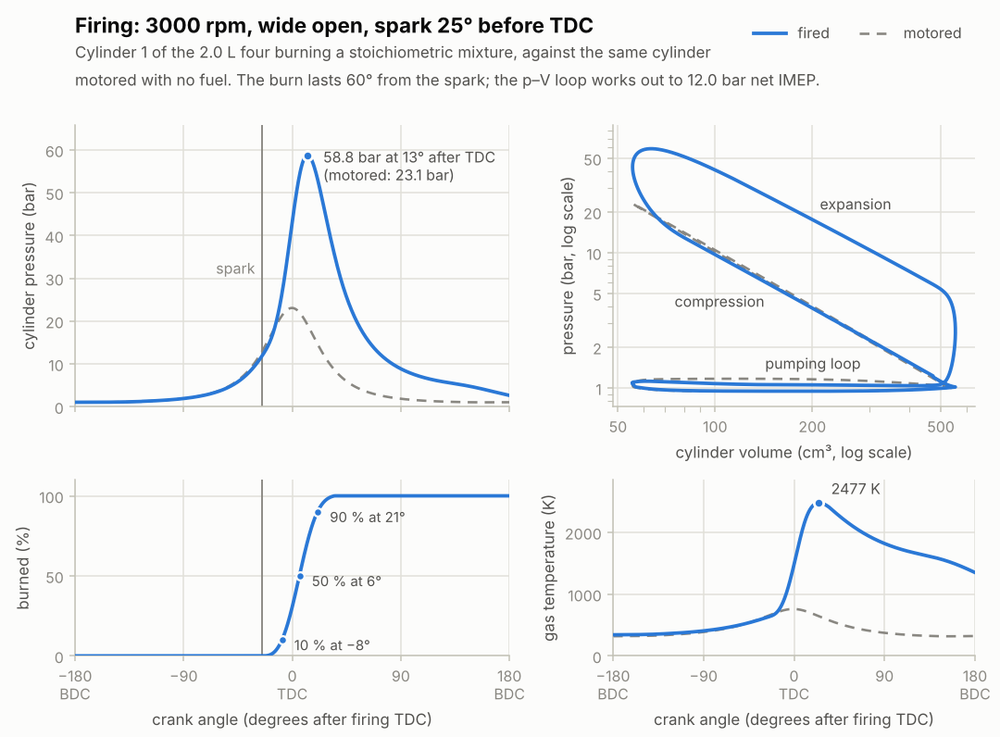
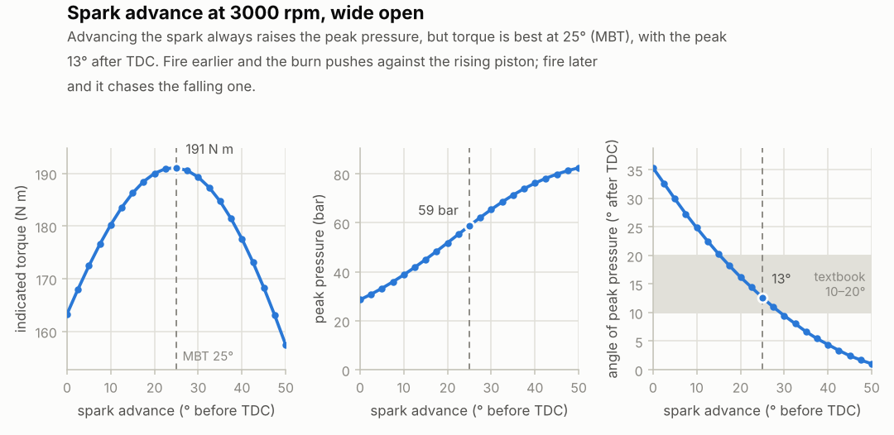
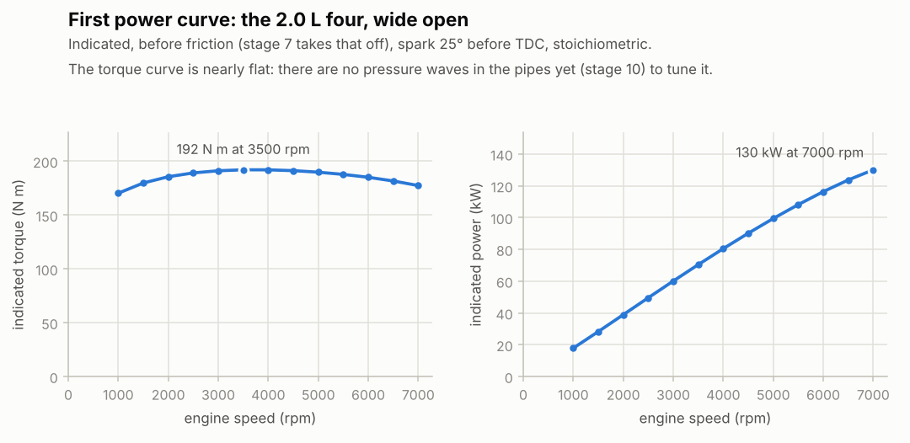

# Stage 6 — Combustion + heat transfer

**Status:** done (2026-10-16)

The engine runs on fuel. Each cylinder gets its fuel when the intake valve closes, a spark
lights it, and a Wiebe curve sets how fast it burns. The hot gas pushes the piston and loses
heat to the walls on the way. A dyno still holds the crank at a set speed (stage 7 lets it turn
itself), so this stage measures what the gas does to the pistons: the **indicated** mean
effective pressure (IMEP), torque, efficiency and peak pressure, before any friction.

## What was built

| Piece | Files | Purpose |
|---|---|---|
| Combustion | `core/src/combustion.h`, `combustion.c` | The fuel's heat release, the Wiebe burn curve, and how much of the fuel can burn at a given air-fuel ratio. |
| Wall heat | `core/src/heat.h`, `heat.c` | Woschni's heat transfer coefficient and gas velocity, and the chamber's wall area. |
| Engine | `core/src/engine.h`, `engine.c` | Fuel at intake valve closing, the spark, the burn and the walls, all in the same step as the flows; an exhaust manifold and muffler; IMEP, torque, efficiency, exhaust temperature and peak pressure for every cycle. |
| Burned gas | `core/src/gas.c` | Above 1000 K, its heat capacity now includes dissociation (equation 8). |
| Demo | `build/rb_cli fire` | One operating point (summary, and one cycle of cylinder 1 as CSV), or `--spark-sweep`, or `--rpm-sweep`. |
| Charts | `tools/plot_fire.py` | The fired cycle against the motored one, the spark sweep and the power curve. |
| Tests | `tests/test_combustion.c`, `tests/test_engine.c` | 14 new tests (62 in total, 627 checks). |

The new settings and their defaults:
- spark 25° before TDC, air-fuel ratio 14.6 (stoichiometric);
- a 60° burn (Wiebe a = 5, m = 2), a mixture spread of 0.07 and 98 % combustion efficiency;
- walls at 430 K.

The exhaust valves now lead into a 2 L manifold (the headers and collector), then through a
21 cm² opening (the catalyst) into a 10 L muffler, and out through a 21 cm² tailpipe.

## How one step works now

```
  ambient --> throttle --> plenum --> intake valves --> cylinder 1..4 --> exhaust valves
                                                                              |
  ambient <-- tailpipe <-- muffler (10 L) <-- catalyst <-- manifold (2 L) <---+
```

1. **Events** the crank passes during the step, for each cylinder:
   - intake valve closing: the fuel for the trapped air goes in, then the trapped charge is noted;
   - the spark: how much of the fuel can burn is worked out;
   - exhaust valve opening: whatever hasn't burned by now leaves unburned;
   - overlap TDC: the last cycle's peak pressure is complete.
2. **Areas** of the throttle and valves, as in stage 5.
3. **Everything that changes the gas** is computed from the current state and integrated together:
   - the flows through every opening;
   - heat to the walls;
   - the burning, which takes air and fuel away, adds burned gas and releases heat.
4. **Pistons:** the crank turns and the pistons move (stage 4's trapezoidal work). Each
   cylinder's peak pressure is noted.
5. **Cycle totals.** The step that crosses 720° is shared between the two cycles (stage 5).

## Equations used

1. **The fuel's heat.** The fuel is stage 3's gasoline surrogate (C7.48H13.98, stoichiometric
   air-fuel ratio 14.596). Its lower heating value as a liquid is **43.12 MJ/kg**, worked out from
   its three components (isooctane 44.34, n-heptane 44.56 and toluene 40.53 MJ/kg).
   - As a vapour it's 43.47 MJ/kg; the difference is its heat of vaporisation, 350 kJ/kg
     (NIST).
   - The fuel goes in as vapour at the charge's temperature when the intake valve closes, and
     burns with the liquid's heating value. So the energy it takes to evaporate is paid when it
     burns instead of in the intake port.
   - The total is right, but the charge isn't cooled before it's trapped, as in a real
     port-injected engine (a note for stage 9).

   A heating value is measured at constant pressure. Burning gives more molecules than it uses:
   14.5 of CO2 and H2O from 12 of fuel and oxygen. So in a closed cylinder a little more heat
   goes into the gas (Heywood, chapter 3):
   `Q = LHV + T_ref ((1 + AFR) R_burned - R_fuel - AFR R_air)` = 43.12 + 0.06 = **43.18 MJ/kg**.
2. **Burning.** Each kg of fuel burned takes 14.596 kg of air with it, becomes 15.596 kg of
   burned gas, and adds `Q` to the gas's energy. A lean mixture leaves air over, a rich one fuel,
   and both stay in the residual gas and the exhaust.
3. **Burn rate: the Wiebe function** (Heywood, chapter 9). With `θ` the crank angle since the spark
   and `Δ` the burn duration, the fraction burned is
   `x(θ) = (1 - exp(-a (θ/Δ)^(m+1))) / (1 - exp(-a))` for `0 < θ < Δ`, and 1 after.
   - The divisor makes the burn end exactly at `Δ`; with a = 5 it's a 0.7 % correction.
   - With m = 2 and Δ = 60°, 10 % has burned about 17° after the spark, 50 % after 31° and 90 %
     after 46°. That's a 10–90 % burn of 29°.
4. **How much of the fuel can burn.** A real charge isn't perfectly mixed: some pockets are richer
   than average, and the fuel beyond stoichiometric in a rich pocket finds no oxygen.
   - The local equivalence ratio is taken as normally spread around the mean `φ` (the fuel/air
     ratio over the stoichiometric one), with standard deviation `s`.
   - What can't burn is then the mean of `(φ_local - 1)` over the rich pockets, which has a
     closed form:
     `burnable = η (m_air / AFR_s) [φ - ((φ - 1)(1 - N(z)) + s n(z))]` with `z = (1 - φ)/s`.
   - `N` and `n` are the standard normal distribution's cumulative and density functions, and
     `η` is the efficiency of the burn itself.
   - With s = 0.07 and η = 0.98, 98 % of the fuel burns lean, 95.3 % at stoichiometric and 81.7 %
     at φ = 1.2. That's the shape of the combustion efficiency curve in Heywood (chapters 3–4),
     and it's why the most power comes slightly rich.
   - This is a simple model of my own, not a textbook formula.
5. **Heat to the walls: Woschni** (Heywood, chapter 12). The heat transfer coefficient, in
   W/(m² K), is `h = 3.26 B^-0.2 p^0.8 T^-0.55 w^0.8`. Here B is the bore in m, p the pressure in
   kPa, T the gas temperature in K and w a gas velocity in m/s:
   `w = C1 S_p + C2 (V_d T_r / (p_r V_r)) (p - p_mot)`.
   - `S_p` is the mean piston speed, and `C1` is 6.18 while a valve is open, 2.28 with both shut.
   - The second term is the turbulence the flame stirs up, from the spark to the exhaust valve
     opening, with `C2 = 3.24e-3 m/(s K)`.
   - Its reference state `r` is the trapped charge at intake valve closing, and
     `p_mot = p_r (V_r / V)^1.3` is the pressure the charge would have without burning.
   - The heat flow is `Q = h A (T_wall - T)`. A is the whole chamber: the piston crown and the head
     (twice the bore's area) plus the liner uncovered at that crank angle. One wall temperature is
     used for everything, 430 K.
6. **The exhaust manifold and muffler.** Stage 5's exhaust valves opened straight into the
   atmosphere. That's fine motored, but now the injectors meter fuel for the air trapped in the
   cylinder, so it matters where that air came from. At part load, cylinders pulled fresh air back
   in through their exhaust valves, and the air-fuel ratio counted at the throttle went rich.
   - Real engines have several litres of pipes and silencer behind the valves.
   - Until stage 10's pipes these are two lumped volumes, as above. At 3000 rpm wide open the
     manifold runs at 104.9 kPa.
7. **What's measured each cycle** (Heywood, chapter 2):
   - **IMEP:** the pistons' net work per cycle over the displacement. The gross IMEP counts only
     compression and expansion (BDC to BDC through firing TDC). PMEP is stage 5's pumping loss,
     and net = gross − PMEP.
   - **Indicated torque and power:** `W_net / 4π` (a cycle is two turns) and `W_net / t_cycle`.
   - **Indicated efficiency and fuel consumption:** `W_net / (m_fuel LHV)`, and its inverse in
     g/kWh.
   - **Exhaust temperature:** averaged over the mass leaving through the exhaust valves.
   - **Residual fraction:** burned gas over the whole trapped charge (fuel included) at intake
     valve closing.
   - **Peak pressure** and its crank angle after firing TDC.
8. **Dissociation in the burned gas.** Stage 3 fitted the burned gas with a frozen composition
   (CO2, H2O, N2, Ar). Above about 2000 K, real burned gas partly splits into CO, H2, OH, O and H.
   That takes energy, so the gas heats up less for the same heat.
   - Above 1000 K, `RB_BURNED`'s cp is refitted to the *apparent* heat capacity of the equilibrium
     mixture at 40 bar, computed with Cantera.
   - It's 1253 J/(kg K) at 1000 K as before, but 1977 at 2500 K and 2753 at 3000 K, against the
     frozen gas's 1474.
   - Its molar mass stays that of the complete products, so the model has slightly fewer
     molecules than the real mixture.

## Checked against chemical equilibrium

A stoichiometric charge burned completely in a closed volume, against Cantera's equilibrium
solver with the NASA species data:

| Start | This model | Equilibrium (Cantera) | Frozen products |
|---|---|---|---|
| 700 K, 20 bar (the end of compression) | 2861 K, 85.6 bar | 2913 K, 88.8 bar | 3224 K, 96.4 bar |
| 298 K | 2700 K | 2644 K | 2940 K |

`test_constant_volume_burn` holds the first row within 2 % in temperature and 4.5 % in pressure.
The pressure comes out 3.6 % low: 1.8 % from the temperature, and the rest from the missing
molecules of dissociation.

## Results

- **Tests:** 62 tests / 627 checks pass (14 new), also under AddressSanitizer + UBSan, with no
  compiler warnings.
- **Conservation:** four fired cycles from a standing start were checked:
  - every species (air, fuel, burned gas) balances to 1e-12 of the mass in the engine;
  - the energy balances to 1e-9 of the heat released (air and fuel in, exhaust out, pistons,
    walls, burning);
  - the heat released equals the fuel burned times `Q`.
- **The plan's checks, at 3000 rpm wide open:**

  | | This model | Plan |
  |---|---|---|
  | IMEP (net) | **12.0 bar** | 11–13 bar |
  | peak pressure at MBT (25°) | **58.8 bar, 12.7° after TDC** | 10–20° after TDC |
  | 50° of advance | peak pressure 82.5 bar, torque 157 instead of 191 N m | more pressure, less torque |
  | motored loss angle | peak pressure **0.2° before TDC** | under a degree |
  | VE at 1000 rpm | **0.87** (0.92 motored, adiabatic) | 0.80–0.85 |

  The last one isn't quite there; see "What doesn't look like a real engine yet".
- **The rest of that operating point:**
  - indicated torque 191 N m and 60.0 kW;
  - indicated efficiency 38.8 % (215 g/kWh);
  - the walls take 15 % of the fuel's energy;
  - exhaust gas at 1262 K;
  - 4.0 % residual gas;
  - VE 0.885.

  With adiabatic walls it would make 13.1 bar at 42 % efficiency, and its exhaust would be at
  1505 K.
- **Spark advance at 3000 rpm wide open:**

  | Spark (° before TDC) | 0 | 10 | 25 | 40 | 50 |
  |---|---|---|---|---|---|
  | torque (N m) | 163 | 180 | **191** | 178 | 158 |
  | peak pressure (bar) | 28.6 | 38.7 | 58.8 | 76.2 | 82.5 |
  | peak at (° after TDC) | 35.3 | 24.8 | 12.7 | 4.4 | 1.0 |
  | exhaust (K) | 1452 | 1363 | 1262 | 1225 | 1236 |

  A late spark heats the exhaust, which is how real engines warm their catalyst after a cold start.
- **Mixture strength at 3000 rpm wide open:**

  | Air-fuel ratio | 12 | 13 | 14.6 | 16 | 18 |
  |---|---|---|---|---|---|
  | IMEP (bar) | 12.02 | **12.13** | 12.02 | 11.48 | 10.54 |
  | indicated efficiency | 32.2 % | 35.1 % | 38.8 % | 40.4 % | **41.4 %** |

  The most power comes slightly rich and the best efficiency lean, the classic pattern (Heywood,
  chapter 15).
- **Part load:**

  | | 2000 rpm, 15 % throttle | 2000 rpm, 6 % | 800 rpm, 2 % |
  |---|---|---|---|
  | plenum | 74 kPa | 32 kPa | 32 kPa |
  | IMEP net (gross) | 7.98 bar (8.27) | 2.00 bar (2.71) | 1.24 bar (1.93) |
  | pumping loss | 0.30 bar | 0.71 bar | 0.69 bar |
  | indicated efficiency | 36.6 % | 27.5 % | 21.1 % |
  | residual gas | 5.9 % | 14.2 % | 23.8 % |
  | heat to the walls | 20 % | 29 % | 45 % |

  The air-fuel ratio stays within 0.2 of 14.6 down to 800 rpm at 2 % throttle.
- **Warm walls and hot residual gas cost air.** Motored at 3000 rpm, warm walls take VE from
  0.932 (adiabatic) to 0.890; firing it, 0.885. At 1000 rpm the drop is 0.921 → 0.866.
- **Power curve (wide open):** torque rises from 170 N m at 1000 rpm to 192 N m at
  3500–4000 rpm, and falls to 177 N m at 7000. Power reaches 130 kW at 7000 rpm. The indicated
  efficiency is 35.4 % at 1000 rpm, where the walls have the most time per cycle, and peaks at
  38.9 % at 3500–4000 rpm.
- **Time step:** IMEP agrees to 0.1 % between 96, 192 and 384 kHz (the pumping loss on its own
  to 3 %).
- **Settling:** the engine reaches a steady state within 8 to 14 cycles wide open. It takes 31
  at 800 rpm and 2 % throttle, where the plenum fills slowly. `rb_engine_settle` now also waits
  for the work to settle, not just the air.
- **The tests catch real mistakes.** All 29 deliberate bugs failed 1 to 4 tests. Among them:
  - leaving out the constant-volume correction to the heating value, or getting its sign wrong;
  - a Wiebe curve that isn't normalised or has the wrong exponent;
  - the unmixedness formula with a wrong sign, or without its efficiency;
  - Woschni with the pressure in bar instead of kPa, a wrong temperature exponent, the two `C1`
    swapped, no combustion term, or one end face missing from the wall area;
  - twice the fuel injected, the fuel's energy or mass left out of the books;
  - burning that uses 10 % too little air or releases half the heat;
  - the spark after TDC instead of before;
  - walls that heat the gas, or wall heat missing from the books;
  - the residual fraction not recorded, a perfectly mixed charge;
  - the exhaust temperature not averaged over the flow;
  - air lost from the throttle's books, a burned-gas cp coefficient 2 % off.

  At first four survived, so three tests and a check were added for them:
  - the burn going on past the exhaust valve's opening (`test_engine_burn_stops_at_evo`);
  - Woschni's reference state fixed at 1 bar (`test_engine_trapped_charge`);
  - `rb_engine_settle` ignoring the work (`test_engine_settles_light_load`);
  - no cap on the burnable fuel when the efficiency setting is over 1.

  While writing `test_engine_trapped_charge` I noticed the trapped charge was being noted *before*
  its fuel went in. It's now noted after, which is how Heywood counts the residual fraction (4.0 %
  instead of 4.3 % at full load).
- **Cost:** one step of the fired four takes 1.8 µs natively and 2.4 µs as WebAssembly (Node 22,
  i7-1355U), up from 1.0 and 1.4 µs in stage 5. At 192,000 steps per second that's 47 % of one
  core in the browser. See the notes below.



**Reading the cycle chart.**
- **Pressure:** after the spark, 25° before TDC, the pressure leaves the motored curve (dashed)
  and peaks at 58.8 bar, 12.7° after TDC, against 23.1 bar motored.
- **Burned fraction:** 10 % about 8° before TDC, half at 6° after, 90 % at 21° after.
- **Temperature:** it peaks later than the pressure, at 2477 K about 25° after TDC, because the
  gas keeps burning while the piston is already moving down.
- **The p–V loop:** both axes are logarithmic, so the strokes are nearly straight lines (`p V^n`
  constant). The fired loop leaves the compression line at the burn and comes down a higher
  expansion line. On the right, the exhaust valve opens and the pressure drops. The thin pumping
  loop runs along the bottom.
- **Cross-check:** integrating `p dV` over the logged trace gives 12.0 bar, the engine's own IMEP.



**Reading the spark chart.** The torque peaks at 25° of advance ("MBT", the minimum advance for
best torque), with the pressure peak 13° after TDC, inside the textbook band.
- Fire earlier, and more of the burn pushes against the rising piston. The peak pressure keeps
  climbing to 82 bar, but the torque falls.
- Fire later, and the burn chases the falling piston. The gas expands less after burning, so
  more of its heat leaves with the exhaust.



**What doesn't look like a real engine yet.**
- **The torque curve is too flat.** A real 2.0 L peaks more sharply where its intake runners are
  tuned. Without the air's inertia in the runners there's no such peak (stage 10).
- **The burn takes 60° at every speed and load.** Real burns take more crank degrees at high
  rpm, and with more residual gas at light load, so a real engine wants more spark advance there.
  Here MBT only moves between 20° (1000 rpm) and 25° (3000 and 6000 rpm), and it's 22.5° at part
  load (stage 9).
- **Low-speed VE is 0.87,** not 0.80–0.85. Hot walls and residual gas took 0.055 off, but there
  is still no fuel evaporation cooling the charge, and no runners (stages 9 and 10).
- **At the very lightest loads the tailpipe still breathes a little.** At 2000 rpm and 3 %
  throttle the air-fuel ratio reads 13.6 instead of 14.6, because some air came in through the
  tailpipe instead of the throttle (stage 10's pipes).

## Three things that surprised me

- **Dissociation is worth 300 K.** Burned at constant volume from the end of compression, a
  stoichiometric charge with frozen products would reach 3224 K. Real chemistry stops at 2913 K,
  because CO2 and H2O start splitting apart and soak up energy. Refitting the burned gas's heat
  capacity brought the model within 2 % of equilibrium.
- **An engine can breathe through its tailpipe.** With the exhaust valves opening straight into
  the atmosphere, throttled cylinders sucked fresh air back in through them during the valve
  overlap. The injectors metered fuel for that air too, so the engine looked rich. A 2 L manifold
  and a 10 L muffler in the way fixed it everywhere except the lightest loads.
- **Perfectly mixed fuel makes rich mixtures pointless.** With every molecule of fuel finding its
  oxygen, a rich mixture just wastes the extra fuel, and the most power came at exactly 14.6.
  Real engines make their best power around 12.5–13.5. A small spread of richer and leaner
  pockets (equation 4) is enough to move it there: here it's 13.

## Try it

```bash
make
build/rb_cli fire                          # 3000 rpm, wide open → renders/fire.csv
build/rb_cli fire --motored               # ignition off → renders/fire-motored.csv
build/rb_cli fire --spark 40               # too much advance
build/rb_cli fire --afr 13                 # slightly rich: the most power
build/rb_cli fire --rpm 2000 --throttle 0.06    # light load
build/rb_cli fire --no-walls               # adiabatic walls
build/rb_cli fire --spark-sweep            # spark 0-50° → renders/spark.csv
build/rb_cli fire --rpm-sweep              # 1000-7000 rpm → renders/power.csv
python3 tools/plot_fire.py cycle           # renders/fire.csv + fire-motored.csv → renders/fire.png
python3 tools/plot_fire.py spark           # renders/spark.csv → renders/spark.png
python3 tools/plot_fire.py power           # renders/power.csv → renders/power.png
```

`rb_cli breathe` stays as in stage 5 (motored, adiabatic walls); add `--walls` for wall heat.
Its numbers moved slightly with the new exhaust system: wide open at 3000 rpm the pumping loss is
now 0.154 bar (0.145 before), and VE is unchanged.

## Notes for later stages

- **Stage 7:** `torque` here is the indicated torque, the gas's net work over 4π. Friction (FMEP)
  comes off it for the brake torque. The burn, walls and exhaust volumes are already per cylinder,
  so a free crank only has to replace the dyno's fixed rpm.
- **Stage 9:** the calibration knobs from this stage:
  - burn duration and Wiebe shape (and how they should change with rpm and residual gas);
  - mixture spread and combustion efficiency;
  - wall temperature;
  - an evaporative cooling term for the fuel.

  The targets: low-speed VE, MBT advance rising with rpm, and real engines' torque and power.
- **Stage 10:** the pipes replace the lumped manifold and muffler. Check the air-fuel ratio at the
  lightest loads (13.6 at 2000 rpm, 3 % throttle), where the tailpipe still lets air in.
- **Stage 13:** the fired four costs 2.4 µs per step in WebAssembly, 47 % of a core at 192 kHz,
  before any pipes. The gas properties (mixing and the Newton step for T) dominate. Options,
  cheapest first:
  - precomputed mixing constants per chamber;
  - `pow(bore, -0.2)` computed once, not every step;
  - remixing only when the composition changes noticeably;
  - 96 kHz as the default rate (IMEP changes by under 0.1 %).
- **Stage 22:** with 50° of advance the peak pressure reaches 82 bar. A real engine would knock
  long before that. The knock model needs the unburned gas's state, which the burned fraction here
  gives.

## Sources

- J. B. Heywood, *Internal Combustion Engine Fundamentals*, 2nd ed., McGraw-Hill (2018):
  - chapter 2: mean effective pressures, efficiencies, specific fuel consumption;
  - chapters 3–4: heating values at constant pressure and volume, combustion efficiency against
    equivalence ratio;
  - chapter 9: spark timing, MBT, the Wiebe function;
  - chapter 12: Woschni's correlation and engine heat transfer;
  - chapter 15: power and efficiency against air-fuel ratio.
- G. Woschni, "A Universally Applicable Equation for the Instantaneous Heat Transfer Coefficient
  in the Internal Combustion Engine", SAE Technical Paper 670931 (1967).
- D. G. Goodwin et al., *Cantera* (cantera.org): the equilibrium burns and the apparent heat
  capacity of the burned gas, with the NASA Glenn thermodynamic data (B. J. McBride, M. J. Zehe,
  S. Gordon, NASA TP-2002-211556).
- NIST Chemistry WebBook: heats of formation and vaporisation of isooctane, n-heptane and toluene.
