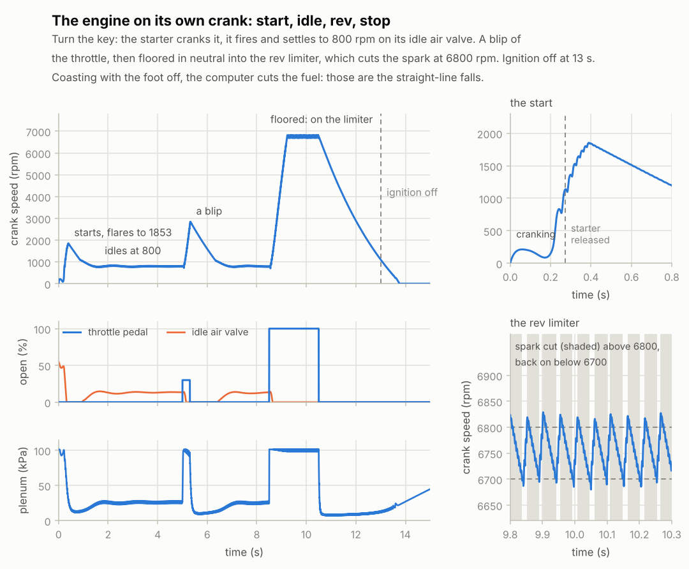
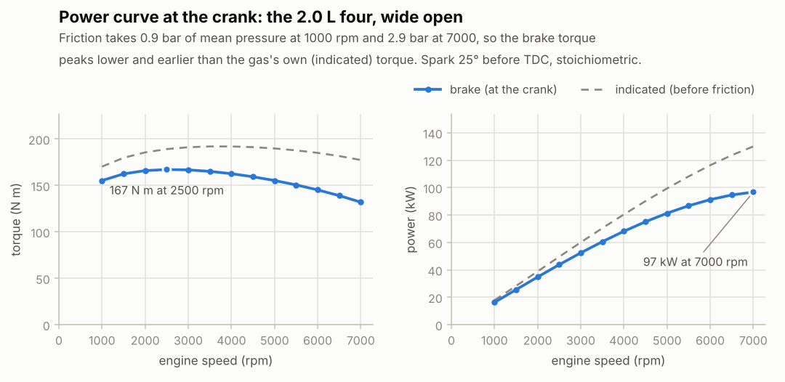

# Stage 7 — Crankshaft dynamics, multi-cylinder, self-running

**Status:** done (2026-10-16)

The crank is free. Until now a dyno held it at a set speed; now it turns under its own torques:
- the gas pushing on the pistons;
- friction;
- the starter motor;
- whatever it drives.

A small engine computer holds the idle speed with an idle air valve, cuts the fuel when coasting,
and cuts the spark at the rev limit. You can turn the key and watch the engine crank, start,
idle, rev, bounce off the limiter and stop.

## Review of stage 6

One real bug, latent until this stage: the spark timing was read from the setting while the
cylinder burned.
- **The symptom it would have caused:** changing the spark advance mid-burn would have moved the
  Wiebe curve (a jump in the heat released), and moving it later would have lit the cylinder a
  second time.
- **Why it mattered now:** stage 6 only changed the spark between runs, so nothing showed. This
  stage changes it while the engine runs (a late spark while cranking), and so will the browser's
  spark slider.
- **The fix:** each cylinder's spark timing is now fixed at intake valve closing, as an engine
  computer does, and kept within 90° of TDC. `test_engine_spark_change_mid_burn` changes the
  setting mid-burn both ways; the old code fails it.

## What was built

| Piece | Files | Purpose |
|---|---|---|
| Free crank | `core/src/engine.h`, `engine.c` | Each step, the crank's kinetic energy changes by exactly the work done on it; how far it turns comes from its speed and the torques on it. `hold_speed = 1` keeps stages 5–6's dyno-held crank. |
| Friction | `engine.c` (`rb_engine_fmep`) | Chen and Flynn's friction mean effective pressure. Every cycle now also reports FMEP, BMEP, brake torque and brake power. |
| Starter | `engine.c` | A DC motor geared to the crank, with a one-way clutch. |
| Engine computer | `engine.c` | Idle air valve, fuel cut on overrun, rev limiter and a late spark while cranking. It only runs with the crank free and the ignition on. |
| Demo | `build/rb_cli run` | The drive in the chart below, with a printed timeline. `rb_cli fire` now prints the brake numbers, and its rpm sweep writes them. |
| Charts | `tools/plot_run.py`, `tools/plot_fire.py` | The drive; the power curve, brake against indicated. |
| Tests | `tests/test_engine.c` | 8 new tests (70 in total, 701 checks). |

The new settings and their defaults:
- crank, flywheel and clutch: 0.16 kg m²;
- friction: Chen and Flynn's commonly used coefficients (equation 3);
- starter: 200 N m at the crank when stalled, nothing at 250 rpm;
- idle speed 800 rpm, with an idle air valve of up to 40 mm² (about a 7 mm hole) beside the
  throttle;
- rev limit: spark cut above 6800 rpm, back on below 6700;
- cranking (below 400 rpm): spark at 5° before TDC.

The inertia is an estimate for a 2.0 L car engine: a single-mass flywheel of about 9 kg (0.09 kg m²),
the clutch (0.04) and the crankshaft with its pulley and the rods' big ends (0.03).

## Equations used

1. **The crank's energy.** The crank, flywheel and clutch store `½ J ω²`. Each step that changes by
   exactly the work done on them:
   `ΔKE = W_gas − p_amb ΔV_total + W_starter − W_friction − W_load`.
   - `W_gas` is the work the gas did on the pistons, from stage 4's trapezoidal step.
   - The undersides of the pistons push on the crankcase air, at ambient pressure. That costs
     `p_amb` times the change in all the cylinders' volume, which adds up to nothing over a cycle.
   - So the crank's books are exact: the tests check them to 1e-9.
   - The plan suggested taking the gas torque as `−W/Δθ`; using the work directly is the same thing,
     without the division.
2. **How far it turns in a step.** `Δθ = ω dt + ½ α dt²`, with `α = (τ_gas + τ_starter −
   τ_friction − τ_load) / J` from the torques at the start of the step.
   - The gas torque is each piston's net force times how fast its cylinder grows,
     `τ_gas = Σ (p_i − p_amb) dV_i/dθ`.
   - Friction and the load only resist motion. A crank at rest stays there until the gas and the
     starter overcome them, and it never turns backwards.
   - If it would stop within the step, it turns `ω² / 2|α|` and stops.
   - At running speeds the `α dt²` term is tiny. It matters when starting from rest, where `ω` is 0.
3. **Friction** (Chen and Flynn, 1965):
   `FMEP = 0.4 bar + 0.005 p_max + 0.09 bar·s/m × S_p + 0.0009 bar·s²/m² × S_p²`.
   - `p_max` is the last cycle's peak cylinder pressure (it presses the rings on the liner), and
     `S_p` the mean piston speed.
   - As a torque, `τ_friction = FMEP V_d / 4π`.
   - It comes to 0.66 bar at idle, 1.53 bar wide open at 3000 rpm, and 2.9 bar at 7000.
   - **Brake** = indicated − friction: brake torque, BMEP and brake power.
   - The coefficients are the commonly used defaults. Patton, Nitschke and Heywood's model splits
     friction into bearings, pistons and valvetrain, a later refinement (stage 9).
4. **The starter** is a DC motor's straight line, `τ = 200 N m × (1 − n / 250 rpm)`.
   - Its one-way clutch lets the engine run away from it above 250 rpm.
   - That's a 1.3 kW starter, geared roughly 50:1.
5. **The engine computer.** It watches the crank speed smoothed over 0.05 s (a few firing pulses),
   and over 0.5 s for its trend.
   - **Idle air valve:** opening = 0.15 + learned + 0.0005 per rpm below 800.
     - The learned part grows by 0.001 per rpm of error per second, counting at most 100 rpm.
     - It only learns while the engine idles: running, foot off the pedal, speed steady (the two
       smoothed speeds within 50 rpm). Coasting down from high rpm therefore doesn't unlearn the
       idle position.
   - **Fuel cut on overrun:** foot off and more than 700 rpm above idle, the injectors stop until
     the engine is back within 400 rpm of idle.
   - **Rev limiter:** spark cut above 6800 rpm until the crank slows below 6700. The injected
     fuel goes out unburned.
   - **Cranking spark:** below 400 rpm the spark comes at 5° before TDC, so the first firings
     don't kick back. Like all spark timing, it's fixed for each cycle at intake valve closing.
6. **Below 100 rpm the gas sets its own pace.** The burn's clock never runs slower than at 100 rpm,
   and neither does Woschni's gas velocity. A crank that stalls with a burn under way still
   finishes it, and the hot gas still cools. At running speeds this changes nothing.

## Results

- **Tests:** 70 tests / 701 checks pass (8 new), also under AddressSanitizer + UBSan, with no
  compiler warnings.
- **The books:** starting from rest with the starter, ignition and a load, the crank's kinetic
  energy matches the work done on it to 1e-9. The gas's books (every species, energy, the idle
  valve's air) still balance as in stage 6.
- **The plan's checks**, on the default 2.0 L four in neutral (`rb_cli run`):

  | Check | Result |
  |---|---|
  | cranks | 238 rpm with the ignition off, between 168 and 304 as each compression slows it |
  | starts | first firing 0.19 s after the key; starter released at 0.27 s (1125 rpm); flares to 1850 rpm |
  | idles stably at about 800 rpm | 800 rpm, 780–814 within each cycle; plenum 26 kPa, idle valve 13 % open, 0.13 g/s of fuel |
  | revs up and down with the throttle | 30 % throttle for 0.3 s: up to 2840 rpm, back at idle 1.5 s later (lowest 759 rpm) |
  | bounces off the limiter | floored: 6000 rpm after 0.64 s, the limiter after 0.73 s, then 6680–6830 rpm |
  | shuts down when the ignition is cut | from about 1100 rpm, stopped 0.76 s later, and it stays stopped |

- **At idle, all the work goes to friction:**
  - net IMEP 0.66 bar is exactly the FMEP;
  - gross 1.41 bar, of which 0.75 bar goes to pumping against the 26 kPa plenum;
  - indicated efficiency 15 %;
  - 28 % of the trapped charge is old exhaust.
- **Brake numbers.** Wide open at 3000 rpm:
  - friction takes 1.53 bar (24 N m), leaving 167 N m and 52 kW at the crank (BMEP 10.5 bar);
  - over the rpm range, brake torque peaks at 167 N m at 2500 rpm, and brake power reaches 97 kW
    at 7000 (the gas's own figures were 192 N m and 130 kW).
- **The free crank agrees with the held one.** The test holds the engine at 3000 rpm wide open with
  the dyno and measures its brake torque. It then lets go with a fan-like load that takes exactly
  that torque at 3000 rpm, and the crank stays at 3000 ± 15 rpm.
- **A load at idle:** a sudden 10 N m, about what an air conditioner's compressor takes at idle,
  pulls the idle down to 560 rpm. It's back within 30 rpm of idle 1.2 s later, with the valve
  22 % open.
- **Time step:** at 96 kHz the idle and the load response are the same to the last digit printed.
- **The tests catch real mistakes.** 29 deliberate bugs: the 2 for the spark fix and 27 in the
  crank and the computer. All but one failed 1 to 4 tests, among them:
  - the gas's work with the wrong sign;
  - friction, the load or the crankcase left out;
  - a starter whose torque rises with speed, or one without its one-way clutch (it brakes the
    engine);
  - the mean piston speed halved in the friction;
  - `ω` from the energy without the factor 2;
  - no `α dt²` term (the crank never starts);
  - the dyno's work left out of the books;
  - the limiter never cutting, cutting without hysteresis, or its cut ignored;
  - the idle valve shut or working backwards, and its air left out of the books;
  - no cranking spark;
  - no gas pace below 100 rpm;
  - the computer learning with the foot on the pedal, or while coasting;
  - no fuel cut, or a fuel cut the injectors ignore;
  - the gas torque predicted with the wrong sign.

  Seven survived at first; five more checks catch them now. Of the other two:
  - one was a line of code that did nothing, now removed;
  - the other is equivalent in practice: the energy that the stop correction books comes to
    about 1e-13 J, because the stopping step is predicted so well.

  One planted bug stopped the crank, and the test suite hung waiting for an event. Every loop in
  the tests now has a limit.
- **Cost:** a step with the crank free costs 15–25 % more than a held one (the torque prediction
  needs every cylinder's dV/dθ). Timings on this laptop varied by up to 1.6 times between runs:
  stage 6's fired step measured 1.8 µs natively then, and 1.1 µs here. In WebAssembly a free step
  took 1.6 µs while idling (31 % of a core at 192 kHz) and a held one 1.5 µs, in the same run.



**Reading the drive chart.**
- **The start (top right):** the starter spins the crank up to about 200 rpm, and the first
  compression slows it. The first firings then take it past 1000 rpm, and the starter is released
  at 0.27 s.
- **The flare:** the plenum is still full of air from standstill, so the first cycles make
  nearly full torque. The engine flares to 1850 rpm, where the fuel cut stops it climbing further.
- **Coasting:** the straight-line falls are the fuel cut. With no fuel, the only torques are
  friction and pumping, both nearly steady.
- **Idle:** the idle air valve (orange) opens as the speed comes down to idle, and holds it there.
- **The rev limiter (bottom right):** each time the speed passes 6800 rpm the spark is cut
  (shaded), and the crank coasts down to 6700 before it fires again: about 20 bounces a second.



**Reading the power curve.** Friction grows with piston speed: from 0.9 bar of mean pressure at
1000 rpm to 2.9 bar at 7000. So the brake torque peaks lower and earlier than the gas's own: 167 N m
at 2500 rpm against 192 N m at 3500. Brake power still climbs to 7000 rpm, where it reaches 97 kW
(130 hp), about right for a simple 2.0 L. Its peak would come below 7000 rpm once stage 10's pipes
shape the breathing.

**What doesn't look like a real engine yet.**
- **The idle mixture reads 13.2 instead of 14.6** by the throttle's count. Some air still comes in
  through the tailpipe at idle, the stage 6 effect at light load (stage 10's pipes).
- **The crank is one rigid inertia.** There's no torsional twist along it, and no inertia torque
  from the pistons and rods speeding up and slowing down every stroke. All the speed ripple comes
  from the gas.
- **The computer knows nothing about loads in advance.** A real one opens the idle valve when the
  air conditioner switches on, and also trims the spark to hold the idle. Here a 10 N m load dips
  the idle by 240 rpm.
- **The idle controller was tuned on this engine.** A 4.0 L eight (`rb_cli run --cylinders 8`)
  with the same 40 mm² valve still hasn't settled after 4 s (775 rpm).

## Three things that surprised me

- **A 1 kW starter with a 90 N m stall torque couldn't start it.** The first compression pushes back
  with more than 130 N m, so the crank stopped there. A real starter is geared to deliver much more
  torque at the crank than it seems to need, so it can push a cylinder through compression from
  standstill.
- **The first idle controller stalled the engine after a blip.** It kept learning while the engine
  coasted down from 3000 rpm and closed the idle valve, so the engine fell through idle. Learning
  only while the speed is steady fixed it. Stronger gains made it hunt instead: the plenum delays
  the air by about a quarter of a second.
- **Fuel cut does more than save fuel.** Coasting from the rev limiter back to idle got 20 % faster,
  and the landing at idle got gentler (lowest 762 rpm instead of 721).

## Try it

```bash
make
build/rb_cli run                       # the drive in the chart → renders/run.csv
build/rb_cli run --load 10             # an air conditioner's worth of load
build/rb_cli run --idle 1000 --limit 6000
build/rb_cli run --inertia 0.08        # a light flywheel: revs faster, dips deeper
build/rb_cli fire                      # held at 3000 rpm by the dyno: now with brake numbers
build/rb_cli fire --rpm-sweep          # brake and indicated → renders/power.csv
python3 tools/plot_run.py              # renders/run.csv → renders/run.png
python3 tools/plot_fire.py power       # renders/power.csv → renders/power.png
```

In C: `rb_engine_init`, then `e.hold_speed = 0`, then set `e.ignition`, `e.starter`, `e.throttle_pos` and
`e.load_torque` between steps; `e.rpm` is the result.

## Notes for later stages

- **Stage 8 (presets):** each preset needs its own inertia, starter, idle valve size (roughly in
  proportion to displacement) and idle controller gains. Those were tuned on this four, and an
  eight with the same settings hunts.
- **Stage 9 (dyno):** the dyno becomes a controller acting on `load_torque`, with the crank free.
  Calibrate friction against real engines: a brake mean effective pressure of 10.5 bar is low for
  a modern 2.0 L.
- **Stage 10:** check the idle mixture (13.2 by the throttle's count, from air through the
  tailpipe).
- **Stages 11 and 12 (sound):** the speed ripple and the limiter's cut pattern are ready to be
  heard. Overrun with the fuel cut should be quiet. The limiter's unburned fuel could pop in the
  exhaust once the pipes have temperature and oxygen.
- **Stage 13:** the free crank adds 15–25 % per step. Benchmark with repeated runs, because this
  laptop's step times varied by up to 1.6 times between runs (hybrid performance and efficiency
  cores).
- **Stage 14:** the browser runs the engine free. The key (ignition and starter) and the load
  become live parameters; telemetry adds rpm, the idle valve, the spark cut and the fuel cut.

## Sources

- J. B. Heywood, *Internal Combustion Engine Fundamentals*, 2nd ed., McGraw-Hill (2018):
  - chapter 2: brake and indicated quantities, mean effective pressures;
  - chapter 13: engine friction, its parts and how it grows with speed.
- S. K. Chen and P. F. Flynn, "Development of a Single Cylinder Compression Ignition Research
  Engine", SAE Technical Paper 650733 (1965): the form of the friction correlation.
- The coefficients (0.4 bar, 0.005, 0.09 bar·s/m, 0.0009 bar·s²/m²) are the defaults commonly used
  with it, as listed for example by the [Engine Friction Loss Calculator](https://automotive.ezvirtualtools.com/calc/engine-friction-loss.html).
  R. Reitz's Princeton CEFRC lecture notes (2012) give 0.25 bar, 0.005, 0.1 and 0 for another
  engine.
- K. J. Patton, R. G. Nitschke and J. B. Heywood, "Development and Evaluation of a Friction Model
  for Spark-Ignition Engines", SAE Technical Paper 890836 (1989): the component friction model
  (stage 9).
- The inertia, starter and idle valve sizes are estimates, explained above. The idle controller
  is my own design, tuned in simulation.
