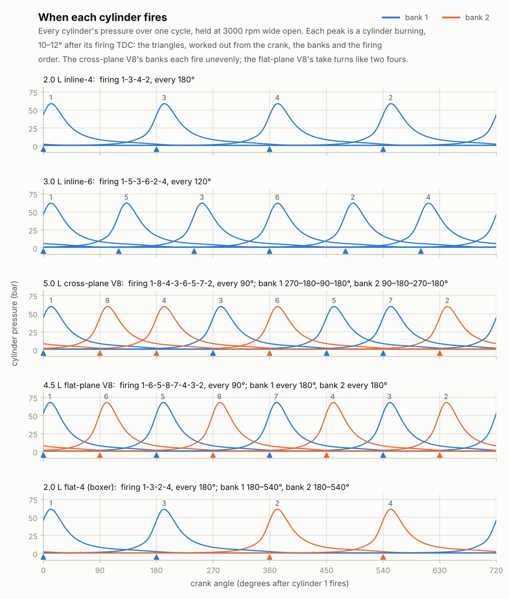
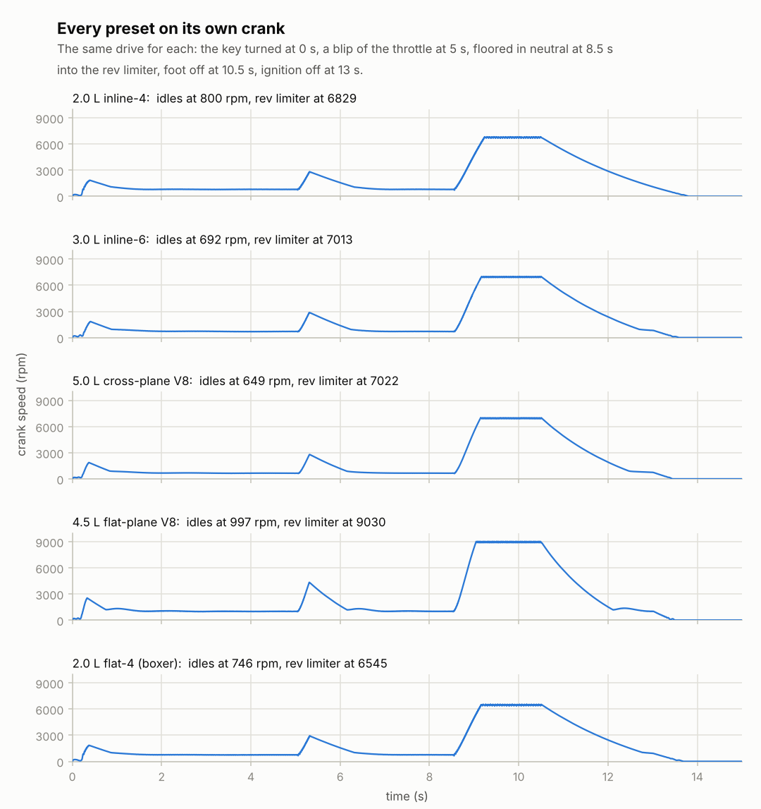
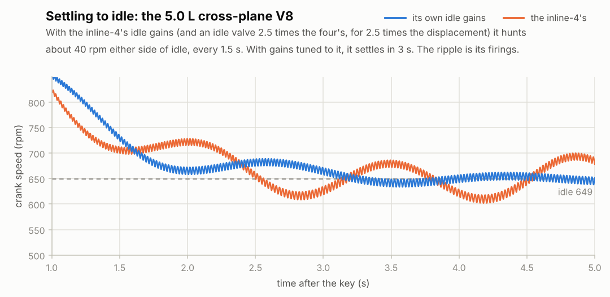

# Stage 8 — Engine layouts & presets

**Status:** done (2026-10-16)

Until now there was one engine, the 2.0 L four, and its firing order was a list of angles typed in
by hand. Now an engine is described the way it's built:
- its cylinders stand in a row, in a V or flat (boxer);
- each cylinder's crank pin sits at its own angle on the crank;
- a firing order says which cylinder fires next.

The core works out from that when each cylinder fires, and refuses layouts that can't work.

Five presets come with it: the 2.0 L four, a 3.0 L straight six, a 5.0 L cross-plane V8, a 4.5 L
flat-plane V8 and a 2.0 L flat four. Each has its own valves, cams, intake and exhaust sizes,
flywheel, starter, idle speed, idle controller and rev limit, and each starts, idles and revs on its
own crank.

The engine is now part of the public API too, as numbers with names and units. The browser can list
the presets, load one, read and change its description field by field, and read every cylinder's
state. The control panel (stage 15) and the 3D view (stages 17–19) will build themselves from it.

## Review of stage 7

Two bugs, both in what happens when the crank switches between held (by the dyno) and free:
- **Held again after the rev limiter, the engine never fired.** The engine computer only runs with
  the crank free, and it's the computer that lifts the spark cut. So an engine that hit the limiter
  running free and was then held by the dyno stayed cut, and the dyno measured a motored engine.
  Stage 9's dyno will switch between the two, so this would have bitten.
- **Let go after being held, the computer thought the engine was stopped.** Its smoothed speeds
  started from 0. For the first tenth of a second it saw an engine 800 rpm below idle, and opened
  the idle valve to 55 %.
- **The fix:** while the crank is held, the computer's cuts are off and its view of the speed
  follows the held speed. `test_engine_free_matches_held` now checks both; the old code fails it.

## What was built

| Piece | Files | Purpose |
|---|---|---|
| Layouts | `core/src/engine.h`, `engine.c` | Banks and their angles; each cylinder's bank, crank pin and place along the crank; the firing order. `rb_engine_layout` works out when each cylinder fires, and refuses layouts that can't work. |
| Presets | `core/src/presets.c`, `presets.h` | The five engines below. |
| Idle gains | `engine.c` | The idle controller's two gains are now part of the engine's description, tuned for each preset. |
| The engine in the API | `core/include/rb.h`, `core/src/rb_engine_api.c`, `rb_sim.c` | The sim holds an engine: presets, 34 fields of its description with names, units and flags, and 8 numbers of each cylinder's state. |
| Browser | `web/src/core/rb-core.ts` | The same in TypeScript: `presets()`, `engineFields()`, `sim.loadPreset()`, `sim.engine()`, `sim.setEngine()`, `sim.readCylinders()`. |
| Demos | `build/rb_cli` | `presets` lists the engines and how they fire, `presets KEY` prints every field of one through the API, and `info` lists the fields. `breathe`, `fire` and `run` take `--preset KEY`; `run` also takes `--idle-valve` and `--idle-gains`. `fire --rpm-sweep` now goes up to the rev limit. |
| Charts | `tools/plot_presets.py` | When each cylinder fires; every preset's drive; settling to idle with two sets of gains. |
| Tests | `tests/test_presets.c`, `web/tests/unit/core.test.ts` | 7 new C tests (77 in total, 1417 checks) and 5 new web tests (12 in total). |

## The layout

Angles are measured in the direction the crank turns.

1. **Where each piston reaches TDC.** Each bank has an angle: the direction its cylinders point,
   measured from vertical. That's 0 for an inline engine, ±45° for a 90° V and ±90° for a boxer.
   Each cylinder's crank pin sits at an angle `φ` on the crank. A piston is at TDC when its pin
   points along its bank, at crank angle `β − φ`. Relative to cylinder 1:
   `TDC_i = (β_bank(i) − φ_i) − (β_bank(1) − φ_1)   (mod 360°)`.
   - Two cylinders sharing a pin reach TDC as far apart as their banks: 90° in a 90° V. In a boxer,
     opposite pistons on pins 180° apart reach TDC together.
2. **When each fires.** A piston reaches TDC twice a cycle, 360° apart, and fires at one of them.
   - Cylinder 1 fires at 0°. Going down the firing order, each cylinder fires at its first TDC after
     the one before it fired. That gives every cylinder's firing angle, and its angle in its own
     cycle is `θ − firing_i`, as in stages 5–7.
   - A layout is refused if its firing order doesn't list every cylinder once, doesn't start with
     cylinder 1, or needs more than 720° (1-4-2-3 on a four's flat crank, for example).
   - `rb_engine_desc_check` also refuses a description whose firing angles disagree with its layout.
3. **An inline engine firing evenly** in the order 1, 2, …, n has its pins at
   `φ_i = −i × 720°/n (mod 360°)`. `rb_cli ... --cylinders N` uses it.

## The presets

They are generic engines of common designs, not copies of any maker's. Cylinders count from the
front. In the V8s and the boxer the odd cylinders are on bank 1 and the even ones on bank 2.
Cylinders 1 and 2 are at the front: on one pin in the V8s, opposite each other in the boxer.

| | 2.0 L inline-4 | 3.0 L inline-6 | 5.0 L cross-plane V8 | 4.5 L flat-plane V8 | 2.0 L flat-4 |
|---|---|---|---|---|---|
| key | `i4` | `i6` | `v8-cross` | `v8-flat` | `boxer4` |
| bore × stroke | 86 × 86 mm | 84 × 90 mm | 92 × 94 mm | 94 × 81 mm | 84 × 90 mm |
| rod, compression | 143 mm, 10.0 | 145 mm, 10.5 | 155 mm, 10.5 | 135 mm, 12.5 | 130 mm, 10.5 |
| banks | 1 | 1 | 2, 90° apart | 2, 90° apart | 2, 180° apart |
| crank pins | 0, 180, 180, 0 | 0, 240, 120, 120, 240, 0 | 0, 90, 270, 180 (a pair on each) | 0, 180, 180, 0 (a pair on each) | 0, 180, 180, 0 |
| firing order | 1-3-4-2 | 1-5-3-6-2-4 | 1-8-4-3-6-5-7-2 | 1-6-5-8-7-4-3-2 | 1-3-2-4 |
| valves, intake and exhaust | 2 × 33 mm, 2 × 28 mm | 2 × 32, 2 × 27 | 2 × 36, 2 × 31 | 2 × 38, 2 × 32 | 2 × 32, 2 × 27 |
| cams: duration, lift, centerlines | 250°, 9.5/9.0 mm, 110° | 250°, 9.7/9.3 mm, 110° | 260°, 11/10.5 mm, 112° | 270°, 12/11 mm, 108° | 250°, 9.5/9.0 mm, 110° |
| throttle, plenum | 60 mm, 2.5 L | 70 mm, 4 L | 80 mm, 6 L | 90 mm, 6 L | 60 mm, 2.5 L |
| exhaust manifold, muffler | 2 L, 10 L | 3 L, 15 L | 4 L, 20 L | 4 L, 18 L | 2 L, 10 L |
| crank, flywheel, clutch | 0.16 kg m² | 0.20 | 0.30 | 0.18 | 0.15 |
| starter: stalled, free | 200 N m, 250 rpm | 250 N m, 250 rpm | 350 N m, 220 rpm | 300 N m, 250 rpm | 200 N m, 250 rpm |
| idle, idle valve | 800 rpm, 40 mm² | 700 rpm, 55 mm² | 650 rpm, 80 mm² | 1000 rpm, 90 mm² | 750 rpm, 36 mm² |
| idle gains: per rpm, per rpm·s | 0.000375, 0.001 | 0.00015, 0.0005 | 0.0002, 0.0005 | 0.00025, 0.0006 | 0.00025, 0.0007 |
| rev limit | 6800 rpm | 7000 rpm | 7000 rpm | 9000 rpm | 6500 rpm |

- **The straight six** pairs its throws 1-6, 2-5 and 3-4, 120° apart, and fires every 120°.
- **The cross-plane V8** has four throws at 0°, 90°, 270° and 180°. It fires every 90°, but each
  bank on its own fires 90-180-270-180° apart: the uneven pattern behind the American V8's burble.
- **The flat-plane V8** has two inline fours sharing one flat crank. Its banks take turns and
  each fires evenly every 180°. It has a short stroke, a light flywheel, bigger cams and 12.5:1
  compression.
- **The flat four** fires every 180°, but its banks don't take turns: each fires twice, 180° apart,
  then waits 540°.
- **The idle valves** are sized in rough proportion to displacement, 18–20 mm² per litre, so that
  each engine idles with its valve about 13 % open.

## Idle tuning

Stage 7's controller opens the idle valve to `0.15 + learned + K_p × (idle − speed)`, where the
learned part grows by `K_i × error` per second while the engine idles. How much a change of opening
changes the speed depends on the engine:
- the valve's size, which sets how much air each % of opening lets in;
- the idle speed, which sets how much of that air each cycle gets;
- the flywheel, which sets how much the speed changes for that torque.

Relative to their flywheels, the six and the eights get more air per % of opening than the four.
The response also arrives late:
- the plenum takes about 0.2 s to fill;
- air drawn in on an intake stroke burns one cycle later (0.18 s at 650 rpm).

With the four's gains, the loop overshoots: the cross-plane V8 hunts about 40 rpm either side of
idle (chart below), and the six about 30.

Each preset was tuned on the same three tests, at 96 kHz (where the idle comes out the same as at
192 kHz to the rpm): a start from the key, a blip to 30 % throttle for 0.25 s, and a sudden 10 N m
load at idle. The gains had to settle the idle quickly, and the idle must still not hunt with both
gains 1.5 times stronger (each cycle's average speed then stays within 2 rpm of the others).

| | settles after the start | after a blip: lowest, back within 25 rpm | 10 N m load: lowest, back within 30 rpm |
|---|---|---|---|
| i4 | 1.4 s | −34 rpm, 1.2 s later | −259 rpm, 2.3 s later |
| i6 | 3.0 s | −25 rpm, 1.4 s | −239 rpm, 2.9 s |
| v8-cross | 2.8 s | −15 rpm, 1.4 s | −132 rpm, 2.4 s |
| v8-flat | 2.5 s | −17 rpm, 2.3 s | −160 rpm, 1.8 s |
| boxer4 | 1.6 s | −33 rpm, 1.5 s | −325 rpm, 4.0 s |

"Settles" means every cycle's average speed stays within 25 rpm of idle from then on.

The four's own proportional gain came down from 0.0005 to 0.000375 per rpm. With it, the four:
- settles after the start in 1.4 s instead of 2.3;
- dips 34 rpm after a blip instead of 53;
- recovers from the load in 2.3 s instead of 3.3.

## The engine in the API

The sim now holds an engine: 13.6 KB of its 13.8 KB. `rb_init` builds it from preset 0, and
`rb_reset` rebuilds it at rest. It isn't in the sound yet. Until stage 14, `rb_step` and
`rb_render_block` still play the test tone, and the engine stays at rest.

- **Presets:** `rb_preset_count`, `rb_preset_key` ("i4", …), `rb_preset_name`, `rb_preset_find`,
  `rb_load_preset`, `rb_get_preset`.
- **The description:** `rb_get_engine(sim, field, index)` and `rb_set_engine(sim, field, index,
  value)`. Each field has metadata like the parameters': `rb_engine_field_count`, `_name`, `_unit`,
  `_flags` and `_find`. `rb_engine_field_size` says how many values it has: 1, the banks or the
  cylinders.
  - **The 34 fields:**
    - cylinders, bore, stroke, rod, compression ratio, displacement;
    - banks and bank angles;
    - each cylinder's bank, pin, position and firing angle, and the firing order;
    - for the intake and the exhaust valves: count, diameter, port, lift, duration, center, and
      where they open and close;
    - throttle diameter, plenum volume, inertia, idle speed and rev limit.
  - **Units:** SI (m, m³, kg m²), except angles in degrees and speeds in rpm. Cylinders and banks
    count from 0.
  - **Flags:** read-only (worked out, or fixed by the preset, like the numbers of cylinders and
    banks); whole numbers; one value per bank, per cylinder or per place in the firing order; live.
  - **Changing a field** changes a copy of the description. If that makes an impossible engine, the
    change is refused with `RB_ERR_VALUE` and nothing changes. Otherwise the engine is rebuilt, at
    rest, except for the live fields (idle speed and rev limit), which change the running engine.
    Setting a field to the value it already has does nothing.
  - **Two special cases:**
    - Putting cylinder c at place k of the firing order swaps it with the cylinder that was there,
      so the order always lists every cylinder once.
    - Changing the rev limit moves the speed where the spark comes back by the same amount.
- **Each cylinder's state:** `rb_get_cylinder(sim, cylinder, field)` gives:
  - its angle in its cycle;
  - the piston's distance below TDC;
  - pressure and temperature;
  - the burn, which rises from 0 to 1 between the spark and the exhaust valve opening and is 0 the
    rest of the cycle;
  - the share of burned gas;
  - both valves' lift.
- **In TypeScript:**
  - `core.presets()` and `core.engineFields()`;
  - `sim.loadPreset(core.presetId('v8-cross'))`;
  - `sim.engine()`, an object by field name with arrays for the per-bank and per-cylinder fields;
  - `sim.setEngine(core.engineFieldId('bore'), 0, 0.09)`;
  - `sim.readCylinders(into)`, which copies every cylinder's state into a `Float64Array` without
    allocating, for the worklet.
- The WebAssembly core grew from 15.7 KB to 33.6 KB: now that the sim holds the engine, the physics
  is linked in.

## Results

- **Tests:** 77 C tests / 1417 checks (7 new) pass, also under AddressSanitizer + UBSan, with no
  compiler warnings. The 12 web tests (5 new) and the browser test in both modes also pass.
- **The plan's checks:**
  - **Every preset starts, idles and revs natively.** This is `rb_cli run --preset KEY`, stage 7's
    drive, at 192 kHz:

    | | first firing | starter released | flare | idle at 4 s (range within a cycle) | a blip: up to, then lowest | on the limiter | stopped (ignition off at 13 s) |
    |---|---|---|---|---|---|---|---|
    | i4 | 0.19 s | 0.27 s, 1124 rpm | 1847 rpm | 796 rpm (775–817) | 2814, 771 rpm | after 0.74 s, 6680–6829 rpm | 13.80 s |
    | i6 | 0.22 s | 0.30 s, 1047 rpm | 1838 rpm | 703 rpm (675–715) | 2877, 683 rpm | after 0.67 s, 6890–7013 rpm | 13.58 s |
    | v8-cross | 0.19 s | 0.28 s, 1063 rpm | 1871 rpm | 650 rpm (638–662) | 2796, 639 rpm | after 0.65 s, 6885–7015 rpm | 13.44 s |
    | v8-flat | 0.18 s | 0.25 s, 1261 rpm | 2540 rpm | 1000 rpm (979–1011) | 4335, 989 rpm | after 0.55 s, 8880–9031 rpm | 13.49 s |
    | boxer4 | 0.20 s | 0.27 s, 1160 rpm | 1845 rpm | 749 rpm (722–766) | 2915, 725 rpm | after 0.66 s, 6377–6546 rpm | 13.68 s |

    `test_presets_run_on_their_own` drives each preset the same way at 96 kHz, and checks that:
    - it holds its idle within 10 rpm on average;
    - its cycles' average speeds stay within 15 rpm of each other (with the four's gains the six
      and the eights spread 20–60 rpm);
    - it dips less than 55 rpm after a blip;
    - it reaches its limiter, lands back at idle and stops.
  - **The firings are correctly spaced.** Held at 3000 rpm wide open, every cylinder's pressure
    peaks 10–12° after its firing TDC. The peaks come every 180° in the fours, every 120° in the six
    and every 90° in the eights (chart below). The test also watches the sparks: every preset sparks
    in its firing order, each within one step of where its layout says.
- **At 3000 rpm wide open** (`rb_cli fire --preset KEY`):

  | | brake torque | brake power | BMEP | peak pressure | indicated efficiency |
  |---|---|---|---|---|---|
  | i4 | 166.7 N m | 52.4 kW | 10.5 bar | 58.8 bar | 38.8 % |
  | i6 | 254.5 N m | 79.9 kW | 10.7 bar | 62.0 bar | 39.2 % |
  | v8-cross | 406.2 N m | 127.6 kW | 10.2 bar | 60.0 bar | 39.3 % |
  | v8-flat | 365.2 N m | 114.7 kW | 10.2 bar | 68.2 bar | 40.8 % |
  | boxer4 | 168.1 N m | 52.8 kW | 10.6 bar | 61.4 bar | 39.3 % |

  Over the rev range (`rb_cli fire --preset KEY --rpm-sweep`):
  - brake torque peaks at 2500 rpm in every preset except the flat-plane V8 (3500);
  - power peaks at the rev limit in all of them;
  - the peaks, torque and power: four 167 N m and 97 kW, six 257 N m and 140 kW, cross-plane V8
    408 N m and 226 kW, flat-plane V8 366 N m and 258 kW, boxer 169 N m and 93 kW.

  These all have the low BMEP stage 7 found for the four. Stage 9 compares them with real engines.
- **The engine through the API.** The tests check that:
  - every field of every preset, read through `rb_get_engine`, matches its description;
  - setting each field to its own value is accepted (refused for the read-only ones) and rebuilds
    nothing;
  - refused changes leave the engine exactly as it was;
  - the cross-plane V8 with its banks moved 60° apart fires unevenly, 60–120° apart, as it should;
  - each cylinder's state matches the engine's own at every step of a cycle, and the burn rises
    from 0 to 1 between the spark and the exhaust valve opening.
- **The tests catch real mistakes.** 32 deliberate bugs went in. 26 failed tests at once, among them:
  - the pin angle's sign flipped;
  - a cylinder allowed to fire at the same TDC as the one before it, or past 720°;
  - the layout check left out of `rb_engine_desc_check`;
  - the presets' own idle gains or idle valve ignored;
  - the boxer's banks only 90° apart;
  - the firing order's swap missing;
  - the live fields rebuilding the engine, or the others not rebuilding it;
  - the limiter's resume speed not following the rev limit;
  - a fraction accepted as a valve count;
  - the burn still showing after the exhaust valve opens;
  - the piston's position worked out from degrees instead of radians;
  - the exhaust lift taken from the intake cam;
  - `rb_reset` not rebuilding the engine.

  Six more checks now catch the other six:
  - a twin with cylinder 1 twice, or firing 2-1;
  - refused layouts left exactly as they were;
  - the inline helper refusing a row longer than 10 m without touching the engine;
  - the presets' firing orders as documented;
  - the dip after a blip.

  One of those six is worth telling. Swapping cylinders 3 and 5 in the flat-plane V8's firing order
  changes nothing the physics can see: they're on the same bank with their pins at the same angle,
  so they're always at the same point of the cycle, one revolution apart. Only the documented order
  catches it. In a real engine, which of them fires first changes how the exhaust pulses meet, but
  that needs stage 10's pipes.
- **Cost:** a step costs 1.1 µs natively for the fours, 1.6 µs for the six and 2.0 µs for the
  eights, so the time grows with the cylinders. That's about 40 % of a core at 192 kHz for an eight,
  before pipes. Times varied by up to 1.4 times between runs.



**Reading the firing chart.** Each panel is one preset over one cycle, from cylinder 1's firing TDC.
- **The triangles** are the firing TDCs the layout works out; each peak follows its triangle.
- **The cross-plane V8's banks:** bank 1 (blue) fires at 0, 270, 450 and 540°: twice 90° apart
  after a 270° wait. Bank 2 does the same, shifted.
- **The flat-plane V8's banks** alternate, blue then orange, every 90°.
- **The boxer:** bank 1 fires twice, then bank 2 twice.
- **The peaks:** the flat-plane V8's are highest (68 bar), from its 12.5:1 compression. All of a
  V8's cylinders peak at the same pressure because they share one plenum and one exhaust manifold.



**Reading the drive chart.** It's the same drive for every preset.
- **The flat-plane V8** has a light flywheel and a short stroke. The blip takes it to 4300 rpm
  where the others reach 2800–2900, and it reaches its 9000 rpm limiter in 0.55 s.
- **Its bump on the way back to idle** is the fuel coming back on at 1400 rpm (see below).
- **The four** is still coasting down when the ignition goes off: it has the least friction to slow
  it.



**Reading the idle chart.** With the four's gains the cross-plane V8 overshoots and swings about
40 rpm either side of idle, every 1.5 s. With its own it settles in about 3 s. The fast ripple on
both is its firings, four per revolution.

**What doesn't look like a real engine yet.**
- **All the cylinders share one plenum and one exhaust manifold.** The cross-plane V8's burble
  comes from each bank's uneven pulses meeting in that bank's exhaust. The boxer's rumble comes from
  unequal-length headers. Both wait for stage 10's pipes.
- **No balance or vibration.** The crank is one rigid inertia, so the forces that make a flat-plane
  V8 shake and a straight six run smoothly aren't modelled.
- **The flat-plane V8 bumps up about 100 rpm** when the fuel comes back at 1400 rpm on its way down
  to idle. Real engine computers bring the fuel back gradually and retard the spark to hide it.
- **The same friction, burn duration and wall temperature for all.** So the five have nearly the
  same BMEP (10.2–10.7 bar), and all make their peak power at the rev limit. Real engines differ
  (stage 9).
- **The flat-plane V8 idles with 54 kPa in its plenum** (the others 26–36 kPa). Its big cams'
  overlap lets exhaust back in at idle, so it needs more air for the same work. Real engines with
  big cams do the same, which is why they idle lumpy.

## Three things that surprised me

- **The eights hunt with the four's gains for a reason other than size.** Their idle valves feed
  them more air per % of opening, relative to their flywheels. The air also takes a while to make
  torque: the plenum fills in about 0.2 s, and an intake stroke becomes a power stroke one cycle
  later.
- **A weaker proportional gain made the return from a blip better.**
  - Coming down from a blip, the speed is far above idle. A strong proportional term shuts the idle
    valve completely, the plenum empties, and the engine arrives at idle starved of air and
    undershoots.
  - A weaker one starts reopening the valve on the way down.
  - Real engine computers do this on purpose: it's called a dashpot.
- **The boxer fires every 180°, but its banks don't take turns.** The well-known Subaru rumble comes
  from unequal-length headers merging these pulses, something stage 10 can try.

## Try it

```bash
make
build/rb_cli presets                     # the five engines and how they fire
build/rb_cli presets v8-cross            # every field of one, as the API gives it
build/rb_cli info                        # the API's fields, with units and flags
build/rb_cli run --preset v8-flat        # the drive with the flat-plane V8 → renders/run.csv
build/rb_cli run --preset v8-cross --idle-valve 100 --idle-gains 0.000375/0.001   # it hunts
build/rb_cli fire --preset i6 --rpm-sweep    # power curve up to the rev limit → renders/power.csv
build/rb_cli presets --csv renders/presets.csv
python3 tools/plot_presets.py firing     # renders/presets.csv → renders/presets.png
for p in i4 i6 v8-cross v8-flat boxer4; do build/rb_cli run --preset $p --csv renders/run-$p.csv; done
python3 tools/plot_presets.py runs renders/run-i4.csv renders/run-i6.csv renders/run-v8-cross.csv \
    renders/run-v8-flat.csv renders/run-boxer4.csv
build/rb_cli run --preset v8-cross --idle-valve 100 --idle-gains 0.000375/0.001 \
    --csv renders/run-v8-cross-four.csv
python3 tools/plot_presets.py idle renders/run-v8-cross.csv renders/run-v8-cross-four.csv
```

In C, through the API (the same calls the browser makes):

```c
rb_sim *sim = rb_create(NULL);
rb_load_preset(sim, rb_preset_find("v8-cross"));
double bore = rb_get_engine(sim, RB_ENG_BORE, 0);       /* 0.092 m */
rb_set_engine(sim, RB_ENG_BANK_ANGLE, 0, 30.0);         /* a 60-degree V */
rb_set_engine(sim, RB_ENG_BANK_ANGLE, 1, -30.0);
double fires = rb_get_engine(sim, RB_ENG_FIRING_ANGLE, 7);   /* cylinder 8: 120 */
double p = rb_get_cylinder(sim, 0, RB_CYL_PRESSURE);    /* Pa */
rb_destroy(sim);
```

## Notes for later stages

- **Stage 9 (dyno):** switching between held and free is safe now. Calibrate the presets against
  real engines of their kind; all five share the low BMEP and the power peaking at the rev limit.
- **Stage 10 (pipes):** give each bank of the V8s and the boxer its own primaries and collector,
  with each cylinder's primary length (unequal for the boxer). The `bank` and `position` fields
  are there for it.
- **Stage 13:** the eights cost about 1.8 times the four per step: 2.0 µs natively at 192 kHz,
  before pipes.
- **Stage 14:** load presets with `rb_load_preset` through the worklet's messages. Live fields can
  change while the engine runs; the others rebuild it (crossfade).
- **Stage 15:** the panel can build its controls from the field metadata, showing lengths in mm.
  Changing bore, stroke or inertia keeps the preset's idle gains, so a big change can make the idle
  hunt or wander. That's what really happens when a light flywheel goes in without retuning, but
  the panel may want to expose the idle gains as advanced settings.
- **Stage 17 (3D):** the API already gives everything the bottom end needs: bank angles, each
  cylinder's bank, pin and position, bore, stroke and rod. Valve sizes and lifts cover the top end,
  and `readCylinders` gives the motion.
- **Stage 23 (more layouts):** odd-firing and split-pin engines (V6, V10) only need their pins and
  bank angles; a 60° V12 needs nothing new.

## Sources

- Wikipedia, ["Crossplane"](https://en.wikipedia.org/wiki/Crossplane): cross-plane V8s fire every
  90° but unevenly within each bank (180-90-180-270), and their burble comes from the exhaust
  manifolds.
- Motor Authority, ["That Subaru rumble? Here's why that happens"](https://www.motorauthority.com/news/1104225_that-subaru-rumble-heres-why-that-happens):
  the flat four's rumble comes from unequal-length headers.
- J. B. Heywood, *Internal Combustion Engine Fundamentals*, 2nd ed., McGraw-Hill (2018), chapter 2:
  engine geometry and the slider-crank.
- The presets' dimensions, firing orders and idle speeds are typical of engines of their kind. The
  inertias, starters and idle settings are estimates, and the idle gains were tuned in simulation.
