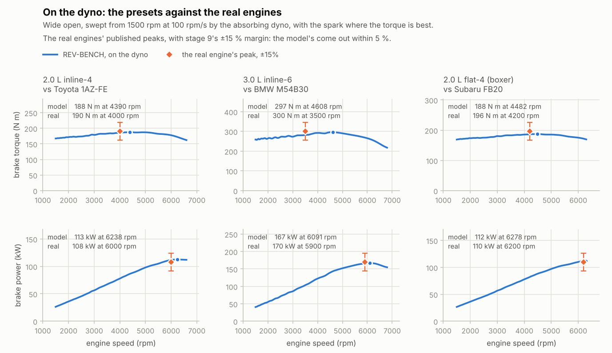
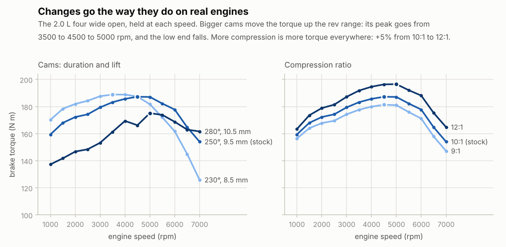
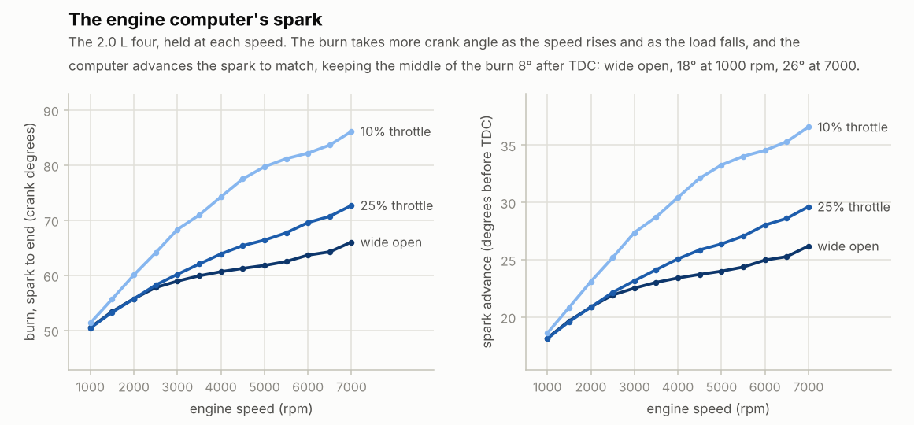

# Stage 9 — Dyno + validation against real engines

**Status:** done (2026-10-19)

Until now the engine sat on an ideal dyno that held its speed exactly, and its numbers rested on
stage 6's first guesses:
- the same 60° burn at every speed and load;
- the spark fixed at 25° before TDC;
- friction coefficients from an older engine;
- no intake runners, so no ram effect to fill the cylinders at their best speed.

Stage 9 puts the engine on a dyno that brakes the free crank the way a real one does, and calibrates
it against three real engines. The four, the six and the boxer now make within 5 % of the torque and
power their real counterparts are rated at. Bigger cams and more compression change the curves the
way they change a real engine's.

The changes behind that:
- **The burn** now takes longer at high speed and at light load.
- **The engine computer** puts the spark where the torque is best, and holds some back at idle.
- **Friction** is a modern engine's.
- **Each cylinder has an intake runner**, a column of air whose inertia rams the cylinder full at
  mid-range speeds.

## Review of stage 8

- **The API took any value the core's sanity check let through.** A slider could set a 300 mm bore
  or a 50:1 compression ratio if the rest still fitted together.
  - Every field that can be set now has a range a control should offer: wide enough for any car or
    motorcycle engine, narrow enough that nothing silly gets in.
  - A value outside it is clamped to the nearest end, and `rb_set_engine` returns `RB_CLAMPED`
    (the change was made, but not as asked).
  - Crank pin and bank angles wrap around instead: a pin at −180° is at 180°, a bank at 330° is at
    −30°. A pin of −0 or −1e-17 becomes 0, so it counts as "the same" and doesn't rebuild the engine.
  - Whole-number fields refuse fractions before clamping: 2.5 valves is an error, not 2 or 3.
- **Where it shows:** `rb_engine_field_min`/`rb_engine_field_max` (in the WASM exports and as
  `min`/`max` in the TypeScript `FieldInfo`), and `rb_cli info` lists them.

## What was built

| Piece | Files | Purpose |
|---|---|---|
| Absorbing dyno | `core/src/dyno.h`, `dyno.c` | Holds a speed by braking the free crank with a PI controller, the way an eddy-current dyno does. It takes a reading every engine cycle, with the inertia correction, and can sweep. |
| The burn and the spark | `core/src/engine.c` | The burn's length from the speed and the trapped charge. The engine computer's spark: the best torque's, with a reserve at idle. `spark_map = 0` goes back to a fixed spark. |
| Friction | `engine.c` | Recalibrated to a modern engine's. |
| Intake runners | `core/src/flow.h`, `flow.c` (`rb_duct`), `engine.c`, `presets.c` | Each cylinder's runner: a column of air with inertia, from the plenum to a small port chamber at the valve. |
| Idle retune | `engine.c`, `presets.c` | Idle valves sized so each engine idles at about 15 % open; idle gains retuned for the new engine; below idle, the computer learns the valve's position even while the speed changes. |
| API | `core/include/rb.h`, `rb_engine_api.c`, `web/src/core/rb-core.ts` | Ranges and clamping (above). Two new fields, `runner_length` and `runner_diameter` (36 in all). |
| Demos | `build/rb_cli` | `dyno`: the free engine on the dyno, swept or held at each speed (CSV). `fire` now uses the engine computer's spark unless `--spark` fixes it; it takes `--cr`, `--throttle` works with `--rpm-sweep`, and it prints the spark and the burn's length. |
| Charts | `tools/plot_dyno.py` | The presets against the real engines; cams and compression; the burn and the spark. `plot_fire.py power` labels a varying spark. |
| Tests | `tests/test_dyno.c`, `test_flow.c`, `test_presets.c` | 10 new tests (87 in all, 1542 checks): the dyno, the calibration, the runner's air ringing like a Helmholtz resonator, and a load thrown on at idle. |

## The dyno

A real dyno for a car engine is a brake: an eddy-current or water brake whose controller absorbs just
enough torque to hold the speed it's asked for. Stage 9's does the same to the free crank of stage 7,
through its `load_torque`. The ideal hold (`hold_speed = 1`) stays for quick sweeps and the tests.

**The controller.** A PI controller on the crank speed, smoothed over 0.02 s (a few firings):

```
T_load = I + k_p (n − n_target)        dI/dt = k_i (n − n_target)        0 ≤ T_load ≤ 10 000 N m
k_p = J ω_c π/30        k_i = ω_c k_p / 4        ω_c = 2π × 1.5 Hz
```

- `J` is the engine's crank, flywheel and clutch inertia, so every engine gets the same response.
  Asked for 100 rpm more, the four gets 90 % of the way there in 0.15 s and overshoots by 27 rpm.
- It can only absorb. When the engine can't reach the speed asked for, the dyno lets go. The
  integral then stops changing, so it remembers the load it held and brakes again at once when asked
  for less.
- It starts out absorbing what the engine made in its last cycle, so taking over from the ideal hold
  barely disturbs the speed.

**The reading.** Over each engine cycle the dyno notes the angle `Δθ` the crank turned, the time
`Δt` and the work `W_load` it absorbed. The crank's kinetic energy changed by `ΔKE`:

```
T_absorbed = W_load / Δθ        T_brake = (W_load + ΔKE) / Δθ        P_brake = (W_load + ΔKE) / Δt
```

- **Holding a speed**, `ΔKE` is zero and the two torques are the same.
- **In a sweep** the crank speeds up: `ΔKE / Δθ = J dω/dt`. The dyno absorbs that much less than the
  engine makes, and adding it back is the inertia correction real sweep dynos make.

**Checks** (`tests/test_dyno.c`, the four wide open):
- **Taking over at 3000 rpm**, it holds within 1 rpm after 1.5 s and within 0.01 rpm after 2.5 s.
- **It reads 0.3 % less** than the ideal hold measured (0.5 % less at 1500 rpm). On a free crank the
  speed ripples with every firing, about 70 rpm at 3000, and the engine breathes and burns a little
  worse for it (VE 0.916 instead of 0.918). With a flywheel 60 times heavier the difference all but
  goes (0.005 %).
- **Sweeping at 100, 200 or 500 rpm/s**, the brake torque around 3000 rpm is within 0.07 % of the
  held engine's. The inertia correction is within 2–6 % of `J dω/dt`.

## Calibration

### Friction

The plan noted that 10.5 bar of BMEP is low for a modern 2.0 L. Stage 7's Chen-Flynn coefficients
(0.4 bar, 0.005 × p_max, 0.09 bar per m/s, 0.0009 bar per (m/s)²) are an older engine's: 2.5 bar of
FMEP at 6000 rpm. Knauder et al. (2019) measured the friction of modern gasoline engines part by part.
The highest values for one of them, at 5000 rpm with the oil at 70 °C:
- piston group 0.35 bar;
- main bearings 0.31 bar and big-end bearings 0.23 bar (fired, 70 bar peak pressure);
- valve train 0.32 bar.

That's 1.2 bar before the oil and water pumps (another 0.1–0.2 bar). The new coefficients, with the
mean piston speed `c_m` in m/s:

```
FMEP = 0.38 bar + 0.005 p_max + 0.053 bar × c_m + 0.0004 bar × c_m²
```

For the four, that's 0.6 bar at idle, 1.2 bar at 3000 rpm wide open, 1.55 bar at 5000 and 1.7 bar at
6000.

### The burn

A spark-ignition flame burns through the cylinder in two steps (Heywood, chapter 9; the
entrainment-and-burn-up picture of Blizard, Keck and Tabaczynski):

- **The turbulent flame front is swept through the charge** by its turbulence, which grows with
  piston speed. So that part takes about the same crank angle at any speed.
- **Each eddy the front swallows then burns from the inside** at the laminar flame speed `S_L`. That
  takes about `λ / S_L`, where the eddies' Taylor microscale `λ` goes as `√(ν L / u′)`. It's longer
  when the charge is thin (high kinematic viscosity `ν`) or diluted with burned gas (low `S_L`). In
  crank degrees, it goes as `√(rpm ν) / S_L`.

The burn's length scales from 60° for the four's wide-open charge at 3000 rpm:

```
Δθ_burn = 60° × f        f = (1 − s) + s √((n / 3000) (ν / ν_ref)) / (S_L / S_L,ref)        s = 0.4
S_L = S_L0(φ) (T / 298 K)^(2.18 − 0.8(φ−1)) (p / 1 atm)^(−0.16 + 0.22(φ−1)) (1 − 2.1 x_b)
S_L0 = 27.58 − 78.34 (φ − 1.13)² cm/s                ν ∝ T^1.7 / p
```

- `T`, `p` and the burned-gas share `x_b` are the charge's at intake valve closing (the reference:
  360 K, 1.22 bar, 4 % burned gas). Compressed to the spark, their ratios to the reference stay
  about the same.
- `S_L` is Metghalchi and Keck's fit for a gasoline (RMFD-303), with their correction for burned
  gas (Turns, eq. 8.33).
- With 40 % of the burn in the second part, the burn's crank angle grows about as rpm^0.2 near the
  reference (with the same charge): slowly, as real engines' burn angles do (Heywood).
- `f` stays between 0.5 and 2. With more than about a third burned gas a real engine starts to
  misfire, which this model doesn't do. Only a wild cam with the throttle shut gets there (320°:
  over half the charge is burned gas).

Each cycle's burn length is fixed at intake valve closing, together with its spark. A burn under
way never changes.

### The spark

**Best torque.** The engine computer puts the middle of the burn (50 % burned, "CA50") 8° after
TDC. That's the best-torque phasing Klimstra found to hold whatever the conditions (SAE 852090:
7–8°). On the Wiebe curve the middle comes `Δθ_burn (ln 2 / a)^(1/(m+1))` after the spark, so:

```
spark advance = Δθ_burn (ln 2 / a)^(1/(m+1)) − 8°        (a = 5, m = 2: 0.52 Δθ_burn − 8°)
```

- The burn takes longer at high speed and light load, so the spark advances there, as on a real
  engine's map.
- Swept by hand at 3000 rpm wide open, 5° either side gives 0.7–0.9 % less torque.

**At idle** the computer holds the spark back, to 15° before TDC at the idle speed: a torque reserve
of about 10°. It advances the spark by 0.1° for every rpm the engine sags below idle, up to the best
torque's.
- This works on the very next cycle, far sooner than the idle valve's air reaches the cylinders.
- It applies with the foot off and the crank free, within 400 rpm of idle. With any throttle, the
  spark is the best torque's.

### The intake runners

Stage 5's valves draw from the plenum directly, so the volumetric efficiency had no mid-range hump.
That hump comes from the inertia of the air in each runner: it keeps flowing into the cylinder after
the piston has stopped pulling it. Stage 10 will make the runners 1D pipes. Stage 9 gives each one
the simplest model that has that inertia, a column of air between the plenum and a small chamber at
the valve (the port):

```
d(ṁ)/dt = (A / L) (p_plenum − p_port − K ρ u|u| / 2)        K = 0.6        V_port = A L / 4
```

- **The loss `K`**, in velocity heads: about 0.3 for the entry from the plenum, and 0.2–0.3 of
  friction over 10–15 diameters.
- **The air's momentum is integrated with symplectic Euler.** The flow moves gas with this step's
  `ṁ`; once the chambers are integrated, the new pressures update `ṁ`. Without losses that
  neither adds energy nor takes it away.
- **The port holds a quarter of the runner's air.** Exhaust pushed back past the intake valve
  during overlap fills the port nearest the valve and is drawn back in first. Mixing it into a
  whole runner's worth of air kept it there for several cycles, and that memory made the idle
  hunt.
- **The runner rings at about `ω = 2c / L`** with its port. `test_duct_rings_like_a_helmholtz_resonator`
  checks a runner on a 0.1 L chamber against the Helmholtz frequency `c √(A / (L V))` (within 0.5 %).

The presets' runners:

| | i4 | i6 | v8-cross | v8-flat | boxer4 |
|---|---|---|---|---|---|
| length × bore | 330 × 40 mm | 420 × 40 mm | 450 × 45 mm | 300 × 50 mm | 320 × 40 mm |

Shorter than 2 cm, a runner's air rings faster than the physics step can follow, so
`rb_engine_desc_check` refuses it. Through the API the range is 5–80 cm.

## Results

### Against the real engines



Swept on the dyno from 1500 rpm at 100 rpm/s, wide open (`rb_cli dyno`):

| | REV-BENCH | Real engine (makers' figures) | Difference |
|---|---|---|---|
| **2.0 L four** | 188 N m at 4390 rpm, 112.5 kW at 6240 | Toyota 1AZ-FE (86 × 86 mm, 9.6:1): 190 N m at 4000, 108 kW at 6000 | −1 %, +4 % |
| **3.0 L six** | 297 N m at 4610 rpm, 167.1 kW at 6090 | BMW M54B30 (84 × 89.6 mm, 10.2:1): 300 N m at 3500, 170 kW at 5900 | −1 %, −2 % |
| **2.0 L boxer** | 188 N m at 4480 rpm, 111.8 kW at 6280 | Subaru FB20 (84 × 90 mm): 196 N m at 4200, 110 kW at 6200 | −4 %, +2 % |

All within the plan's ±15 %, at sensible speeds.
- **The torque peaks a little late:** 300–1100 rpm after the real engines'. The M54's flat torque
  from 2500 rpm comes from its two-stage intake, which switches runner lengths; one fixed runner
  can't do both.
- **The four's peak brake mean effective pressure** went from 10.5 to 11.8 bar (the 1AZ-FE's is
  11.9).
- **The eights aren't calibrated:** no test pins them to a real engine.
  - The cross-plane V8 makes 493 N m at 4300 rpm and 272 kW at 5840.
  - The flat-plane V8 has the bore, stroke and compression of Ferrari's 4.5 L in the 458 (94 × 81 mm,
    12.5:1), but makes 435 N m at 6330 and 327 kW at 7730.
  - The 458's engine makes 540 N m at 6000 rpm and 570 CV (about 420 kW) at 9000, on tuned intake
    and exhaust pipes (stage 10), direct injection and variable cams.

**Where the four's torque came from.** Held at each speed, wide open, each change added on top of the
last:

| | Peak brake torque | BMEP | Peak power | Peak VE |
|---|---|---|---|---|
| Stage 8: fixed 60° burn, 25° spark, stage 7 friction, no runners | 167.2 N m at 2500 rpm | 10.5 bar | 94.8 kW at 6500 | 0.89 |
| + modern friction | 172.8 at 3000 | 10.9 | 104.3 at 6500 | 0.89 |
| + the burn model and the computer's spark | 173.0 at 2750 | 10.9 | 103.1 at 6500 | 0.89 |
| + intake runners (stage 9) | 187.4 at 4500 | 11.8 | 112.7 at 6250 | 1.00 |

### Changes go the right way



- **Bigger cams move the torque up the rev range**, as the plan asked. The torque peaks at 3500,
  4500 and 5000 rpm with the 230°, 250° (stock) and 280° cams. The low end falls: −15 % at 2000 rpm
  with the 280° cam, whose intake closes late and pushes charge back out. At 7000 rpm it makes the
  most.
- **More compression is more torque everywhere:** +2.4 % from 10:1 to 11:1, and +5.0 % to 12:1.
  The Otto cycle's efficiency, `1 − r^(−0.3)`, says +2.8 % per point at 10:1. Nothing knocks yet
  (stage 22).

### The engine computer's spark



- **Wide open**, the burn grows from 50° at 1000 rpm to 66° at 7000, and the spark from 18° to 26°.
  At 3000 rpm the middle of the burn comes 8.06° after TDC (measured; the computer aims at 8°).
- **At light load** (10 % throttle) both grow faster: 37° of spark at 7000 rpm. At low speeds even
  a quarter of the throttle fills the cylinders nearly full, so the lines meet there.
- **At idle** the spark sits at 15° with a 64° burn, 10° short of the best torque's 25°.

### The idle, retuned

The stage 9 engine burns, breathes and rubs differently, so stage 8's idle gains no longer fit:
- **With their old gains**, the four and the six wander 20 rpm, and the four hunts 30 rpm with
  gains 1.5 times stronger.
- **They now need less idle valve:** 11 % open instead of the 15 % the computer starts from.

So each idle valve is now sized for the engine to idle at about 15 % open, and the gains were tuned
again with stage 8's three tests: a start from the key, a blip to 30 % throttle for 0.25 s, and a
sudden 10 N m load at idle.

The computer also learns differently now. Stage 8's learned only while the speed was steady, to keep
a coast-down from high rpm from unlearning the idle position. Thrown a load, the engines swung around
idle for seconds before they learned anything: the six took 10 s to come back. Below the idle speed
the computer now learns even while the speed is still changing, since sagging below idle always calls
for more air. Above it, it still waits.

| | idle valve | gains (per rpm, per rpm s) | settles after the start | after a blip | 10 N m load |
|---|---|---|---|---|---|
| i4 | 30 mm² (was 40) | 0.0004, 0.0006 (0.000375, 0.001) | 1.6 s | −26 rpm, back in 1.6 s | −314 rpm, back in 4.3 s |
| i6 | 40 mm² (55) | 0.0002, 0.0003 (0.00015, 0.0005) | 1.7 s | −22 rpm, 1.4 s | −315 rpm, 5.4 s |
| v8-cross | 68 mm² (80) | unchanged (0.0002, 0.0005) | 1.8 s | −15 rpm, 1.6 s | −122 rpm, 1.8 s |
| v8-flat | 82 mm² (90) | unchanged (0.00025, 0.0006) | 1.8 s | −34 rpm, 2.2 s | −118 rpm, 0.9 s |
| boxer4 | 27 mm² (36) | 0.0003, 0.0004 (0.00025, 0.0007) | 1.7 s | −27 rpm, 1.6 s | −396 rpm, 6.6 s |

"Settles" and "back" mean every cycle's average speed stays within 25 rpm of idle from then on (30
rpm with the load).
- **Every engine now settles after the start in under 2 s.** In stage 8 that took 1.4–3.0 s.
- **The fours and the six recover from a load more slowly:** 4.3–6.6 s, against 2.3–4.0 s in stage 8.
  That's the price of the gentler gains the new engine needs to idle steadily. Without the new
  learning it would be 4.7–9.7 s. The eights are quicker than before (0.9–1.8 s, from 1.8–2.4).
- **With both gains 1.5 times stronger, four of the engines stay steady:** 25–35 s after the start,
  each cycle's average speed is within 0.1 rpm of the others.
- **The six has the least room.** Even with its own gains, after about 15 s its idle settles into a
  swing of ±2.5 rpm every 2 s, too small to hear (±3 rpm with gains 1.5 times stronger).
  - Its idle valve's air reaches the cylinders late: a big plenum, and a long wait from intake to
    power stroke at 700 rpm.
  - Gains low enough to remove the swing (half of them) take 11 s to recover from a load, so the
    swing stays.
- **A derivative term on the idle valve might help the loads further.** Opening the valve in
  proportion to how fast the speed falls, `0.5 k_p (n_trend − n_smooth)`, brought the four's
  recovery to 2.7 s but made its returns from a blip slower (2.5 s). It didn't remove the six's
  swing. That's left for when the browser can throw loads at the engine (below).

### Tests that can fail

All 87 C tests pass, also under AddressSanitizer and UBSan, and so do the 12 web tests and the
browser test (on the dev server and the production build). 41 bugs were planted, one at a time, in a
copy of the code; 39 fail at least one test.
- **The dyno:** wrong gains or units, no integral, a cold start, no inertia correction, a sweep too
  fast or unbounded, the integral winding down, a dyno that drives, no smoothing, power per angle,
  the first part-cycle read, the crank left held, the error's sign, the instantaneous speed as the
  reading's.
- **The burn and the spark:** no eddy part, no speed or burned-gas effects, no clamp, no `p` in
  `ν`, CA50 at 0°, the map ignored, a flat or uncapped idle spark, the idle spark with the foot on
  or only below the idle speed, and the description's 60° used instead of the cycle's own burn (in
  the burn, the spark or the cycle's result).
- **The runners:** a full-volume port, the downstream gas, no flow cap, the loss's sign, half the
  inertance, the ports never integrated, too-short runners accepted, the API's minimum.
- **The idle:** the four's idle valve back at its stage 8 size; learning only when the speed is
  steady (stage 8's rule: `test_presets_idle_takes_a_load` catches it), or always.
- **The two that pass:**
  - the runner's loss coefficient set to 0 (it's worth about 1 % of VE at 6000 rpm, calibrated
    rather than pinned);
  - the loss computed with the downstream chamber's density instead of the upstream's (they differ by
    a few % in a runner).

### What doesn't look like a real engine yet

- **The light-load spark is low.** At 3000 rpm and 10 % throttle the computer wants 27° of advance,
  where real engines' maps run 35–40° at that load. The burn model lengthens the burn too little in
  a thin charge: it has no separate phase for the flame kernel, which grows slowly there.
- **The idle burns are long** because the lumped exhaust leaves a lot of burned gas in the
  cylinders at idle: 28–32 % in the fours and the six (a 64–68° burn), 40 % and 55 % in the V8s
  (85° and 99°). Real engines have 10–20 %. Stage 10's exhaust pipes should bring it down, and the
  idle gains will need another look then.
- **The idle spark is an absolute 15°.** For the fours and the six that's about 10° short of the
  best torque's, a reserve like a real computer's. The V8s' idle burns are long (85–99°), which puts
  them 20–28° short, so they need more air to idle. A reserve counted from the best spark instead
  made the cross-plane V8's idle hunt with its gains; that belongs with stage 10's retune.
- **Nothing knocks**, so the spark is the best torque's everywhere. Real engines at full load and
  low speed are held back by knock (stage 22).
- **The fuel doesn't cool the charge** as it evaporates. The plan listed it, but on a port-injected
  engine much of the fuel evaporates off the hot port walls and valves rather than from the air, so
  it would mostly shift the calibration. It belongs with direct injection, where it matters more.
- **Unchanged from stage 6:** the mixture spread, combustion efficiency and wall temperature. The
  low-speed VE is still 0.87 at 1500 rpm. Without the real engines' full curves there's nothing to
  calibrate them against, and stage 10's pipes will change the VE anyway.
- **The runners are lumped:** one resonance each. A 1D pipe has a series of them, and its pressure
  waves are what tuning really works with.
- **They're also expensive.** Each port is a chamber with its own gas. They cost 30 % more per step
  for the four (1.09 → 1.42 µs at 192 kHz natively) and 38 % for the cross-plane V8 (1.92 →
  2.64 µs), and they grow the engine from 13.6 to 19.6 KB (the WebAssembly core from 33.6 to
  35.3 KB).

## Three things that surprised me

- **The burn model and the spark map hardly moved the full-load numbers.** Stage 6's fixed 25° was
  within 2–3° of the best torque's spark at full load, and a few degrees near the best cost almost
  nothing. The extra torque came from friction (+3 %) and the runners (+8 %), and the extra power
  from friction (+10 %) and the runners (+9 %). The spark map matters at part load and at idle.
- **The first runners made the idle hunt.** They had a full runner's worth of air at the valve. At
  idle the overlap pushes exhaust back into the port. Mixed into that much air, it came back for
  several cycles, so each cycle's torque depended on the ones before. Keeping the port to a quarter
  of the runner gets the exhaust drawn back in on the next stroke, as in a real port.
- **A literature dilution law nearly broke the idle.** The V8s idle with 40–55 % burned gas in the
  cylinders, under the lumped exhaust. With Rhodes and Keck's `1 − 2.06 x^0.77` the burn took 180°
  and the spark ran 85° advanced. The linear `1 − 2.1 x` (Turns), and a burn no longer than twice the
  reference, keep it sane until the pipes bring the residuals down.

## Try it

```bash
make
build/rb_cli dyno                         # the four swept on the dyno → renders/dyno.csv
build/rb_cli dyno --preset i6 --csv renders/dyno-i6.csv   # any preset; --rate, --from, --to
build/rb_cli dyno --step 500 --throttle 0.3               # held at each speed instead, part throttle
build/rb_cli dyno --cr 12 --intake 280/10.5/110 --exhaust 280/10/110   # a modified four
build/rb_cli fire                         # 3000 rpm wide open with the computer's spark
build/rb_cli fire --spark 30              # a fixed spark, as in stages 6-8
build/rb_cli fire --rpm-sweep --throttle 0.1 --csv renders/power-t10.csv
for p in i4 i6 boxer4; do build/rb_cli dyno --preset $p --csv renders/dyno-$p.csv; done
python3 tools/plot_dyno.py curves renders/dyno-i4.csv renders/dyno-i6.csv renders/dyno-boxer4.csv
build/rb_cli fire --rpm-sweep --csv renders/power-stock.csv
build/rb_cli fire --rpm-sweep --intake 230/8.5/108 --exhaust 230/8.0/108 --csv renders/power-cam230.csv
build/rb_cli fire --rpm-sweep --intake 280/10.5/110 --exhaust 280/10.0/110 --csv renders/power-cam280.csv
build/rb_cli fire --rpm-sweep --cr 9 --csv renders/power-cr9.csv
build/rb_cli fire --rpm-sweep --cr 12 --csv renders/power-cr12.csv
python3 tools/plot_dyno.py changes renders/power-stock.csv renders/power-cam230.csv \
    renders/power-cam280.csv renders/power-cr9.csv renders/power-cr12.csv
build/rb_cli fire --rpm-sweep --throttle 0.25 --csv renders/power-t25.csv
python3 tools/plot_dyno.py spark renders/power-stock.csv renders/power-t25.csv renders/power-t10.csv
```

In C, the dyno on a running engine (`core/src/dyno.h`):

```c
rb_dyno y;
rb_dyno_init(&y, &engine, 1500.0);      /* takes over the crank: holds 1500 rpm */
rb_dyno_sweep(&y, 6500.0, 100.0);       /* then climbs at 100 rpm/s */
while (y.target_rpm < 6500.0) {
    if (rb_dyno_step(&y, &engine))      /* a cycle ended: y.reading has it */
        printf("%.0f rpm: %.1f N m, %.1f kW\n", y.reading.rpm, y.reading.brake_torque,
               y.reading.brake_power / 1e3);
    rb_engine_step(&engine);
}
```

## Notes for later stages

- **Stage 10 (pipes):**
  - The lumped runners become 1D pipes: the runner fields are already in the API.
  - Check the three real engines again afterwards (the tests hold them to ±15 %).
  - Tuned exhaust primaries are what the flat-plane V8 lacks against the 458.
  - With the exhaust's waves, the idle residuals (28–55 % now) should fall. The burn at idle will
    get shorter and the idle gains will need retuning, with stage 8's three tests and the check
    with both gains 1.5 times stronger.
- **Stage 13 (performance):** the runners cost 30–38 % per step, mostly the port chambers' gas
  updates. They could share the plenum's gas properties, or go once the pipes replace them.
- **Stage 15 (control panel):** `runner_length` and `runner_diameter` are new controls. `spark_map`
  could become an "advance offset" control, retarding or advancing from the computer's spark, as a
  tuner's laptop does.
- **Stage 16 (live dyno chart):** `rb_dyno` lives in the core but isn't in the public API yet.
  Expose it through `rb_sim`, so the browser's sweep is the same code as `rb_cli dyno`; the plan's
  "within a few %" check can compare the two.
- **Stage 16 and later (loads in the browser):** the fours and the six take 4–7 s to recover from a
  sudden 10 N m load at idle. A derivative term on the idle valve, or a feed-forward when the
  browser knows a load is coming (air conditioning, a gear), would help.
- **Stage 22 (knock):** the computer's spark is the best torque's everywhere, 18–37°. Knock should
  limit it at full load and low speed, the way a real engine's knock-limited spark does.

## Sources

- J. B. Heywood, *Internal Combustion Engine Fundamentals*, 2nd ed., McGraw-Hill (2018):
  - chapter 9: burn angles against speed and the entrainment model;
  - chapter 7: intake tuning and the ram effect;
  - chapter 13: friction.
- S. R. Turns, *An Introduction to Combustion*, 3rd ed., McGraw-Hill (2012), section 8.6, Table 8.3
  and eq. 8.33: Metghalchi and Keck's laminar flame speed fits for gasoline (RMFD-303), and the
  burned-gas dilution correction.
- J. Klimstra, ["The Optimum Combustion Phasing Angle — A Convenient Engine Tuning Criterion"](https://saemobilus.sae.org/papers/optimum-combustion-phasing-angle-a-convenient-engine-tuning-criterion-852090),
  SAE 852090 (1985): at the best-torque spark, half the heat is released 7–8° after TDC, whatever
  the conditions.
- C. Knauder, H. Allmaier, D. E. Sander, T. Sams, ["Investigations of the Friction Losses of Different
  Engine Concepts. Part 2"](https://www.mdpi.com/2075-4442/7/12/105), *Lubricants* 7(12), 105 (2019):
  friction of modern gasoline engines by sub-assembly.
- The real engines:
  - Wikipedia, ["Toyota AZ engine"](https://en.wikipedia.org/wiki/Toyota_AZ_engine): the 1AZ-FE
    (Camry), 108 kW at 6000 rpm and 190 N m at 4000.
  - Wikipedia, ["BMW M54"](https://wikipedia.classicistranieri.com/en/articles/b/m/w/BMW_M54_a3d2.html):
    the M54B30, 170 kW at 5900 rpm and 300 N m at 3500.
  - CarExpert, ["Subaru Impreza 2013"](https://www.carexpert.com.au/subaru/impreza/2013/base/powertrain-and-performance):
    the FB20, 110 kW at 6200 rpm and 196 N m at 4200.
- The 458's engine: Ferrari, ["458 Italia"](https://www.ferrari.com/auto/458-italia) (570 CV,
  540 N m at 6000 rpm, 12.5:1), and PistonHeads, ["Ferrari 458 Italia"](https://www.pistonheads.com/news/general-pistonheads/ferrari-458-italia/20627)
  (570 CV at 9000 rpm, 94 × 81 mm).
