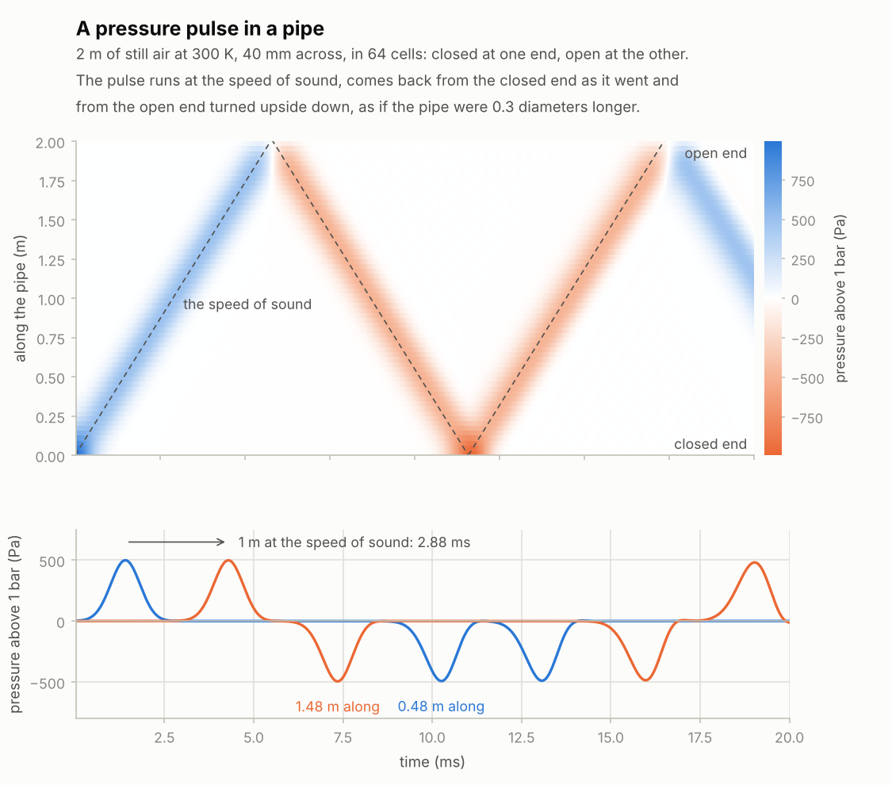
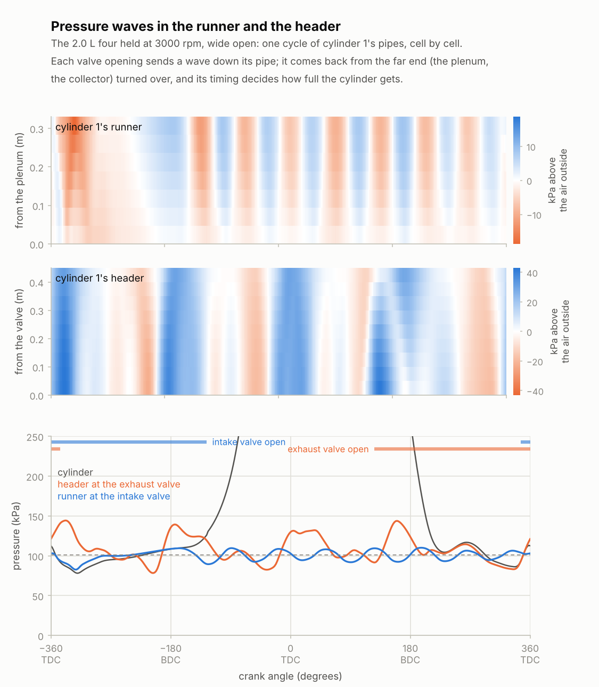
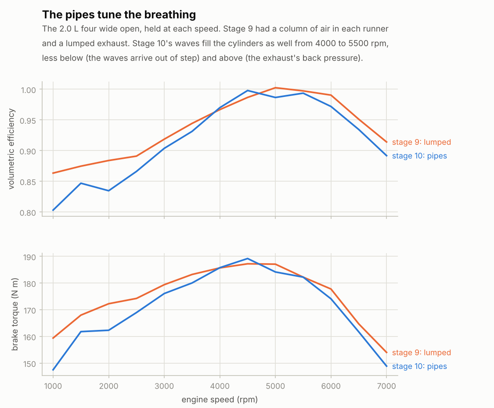

# Stage 10 — 1D pipes: runners, headers, collectors, tailpipes

**Status:** done (2026-10-19)

Until now the exhaust was two volumes, a 2 L manifold and a 10 L muffler, joined by orifices, and
each intake runner was stage 9's column of air with a small port at the valve. Stage 10 replaces
both with 1D pipes, where pressure waves run up and down at the speed of sound:
- every cylinder has an intake runner, from the plenum to its intake valve;
- and an exhaust header, from its exhaust valve to one of up to two collectors;
- each collector has an exhaust pipe, through the catalyst into a muffler;
- each muffler has a tailpipe out into the open air.

The V8s have a collector, exhaust pipe, muffler and tailpipe per bank (a twin exhaust), the six two
collectors of three cylinders into one system, and the boxer unequal-length headers. Those waves
are what tune a real engine's breathing, and from stage 11 what it sounds like.

The plan's check passes: a pressure pulse runs at the speed of sound (0.16 % slow), comes back from
a closed end as it went and from an open end inverted, 15 mm beyond the pipe's end (the end
correction says 12 mm). The engine still runs, idles and makes its dyno numbers. Getting there
took three things that weren't in the plan:
- **coupling two rates** carefully: the pipes step at 48 kHz, the cylinders at 192 kHz;
- **a new idle control:** the runners make an idling engine unstable on its own, and the engine
  computer now acts on where the speed is heading, with a stronger spark;
- **a catalyst with a laminar loss**, which damps the exhaust's 40 Hz ring.

## Review of stage 9

- **Two of rb.h's functions weren't in the WebAssembly build:** `rb_preset_find` and
  `rb_engine_field_find` were missing from the Makefile's `WASM_EXPORTS`. A new web unit test reads
  rb.h and checks that the module exports every function it declares.
- **Stage 9 expected the pipes to bring the idle residuals down** (28–55 % of the charge burned gas
  under the lumped exhaust). They hardly moved: 31–34 % in the fours and the six, 40 % and 52 % in
  the V8s (stage 9: 28–32, 40 and 55), the idle burns 72–110° long. At idle most of the residual is
  exhaust pushed back into the intake during the valve overlap, not exhaust left in the cylinder,
  and the pipes don't change that (see "The idle" below).
- **`rb_duct`** (stage 9's runner) is gone, with its test. `test_pipe_rings` checks the new runner
  on a volume instead (below).

## What was built

| Piece | Files | Purpose |
|---|---|---|
| 1D pipe | `core/src/pipe.h`, `pipe.c` | A pipe cut into cells (chambers) joined by faces whose mass flow is a state: momentum, friction, kinetic energy, walls, open and closed ends, restrictions, a laminar loss, and two step rates. |
| The engine's pipes | `core/src/engine.h`, `engine.c`, `presets.c` | Runners, headers, collectors, exhaust pipes, catalysts, mufflers and tailpipes; each preset's exhaust. The fast and slow gas, stepped at two rates. |
| Idle control | `engine.c`, `presets.c` | The engine computer acts on the speed half a second ahead, and its idle spark is three times as strong. Every preset's idle valve and gains retuned. |
| Faster gas | `core/src/gas.c`, `gas.h`, `chamber.c`, `chamber.h` | The mixture's properties without divisions, a looser stop for the temperature's Newton iteration, remixing only when the composition moves, and the per-step helpers inlined: each cell is a chamber, so their cost is the pipes' cost. |
| API | `core/include/rb.h`, `rb_engine_api.c`, `web/src/core/rb-core.ts`, `Makefile` | Nine engine fields for the exhaust (45 in all). The pipes: what each is, where its ends open, and every cell's pressure, temperature, velocity and burned gas, for stage 19's 3D exhaust. |
| Demos | `build/rb_cli` | `pipes --pulse`: the pulse in a 2 m pipe, with its measured speed and echo. `pipes`: one cycle of an engine's runner, header, exhaust pipe and tailpipe, cell by cell (CSV). `fire`, `breathe` and `dyno` report the exhaust collector's pressure. |
| Charts | `tools/plot_pipes.py` | The pulse; the waves in the four's runner and header; its breathing against stage 9's. |
| Tests | `tests/test_pipe.c`, `test_engine.c`, `test_presets.c`, `test_dyno.c`, `web/tests/unit/core.test.ts` | 11 new C tests (97 in all, 1714 checks): the pipe (8), the engine on two rates, the pipe API, the six idling on its spark alone; stage 9's duct test went with the duct. 4 new web tests: every rb.h function exported, and the pipes through the API. |

## The pipe

### The scheme

A pipe is cut into cells of equal length, each a chamber (stage 3) with its own pressure,
temperature and mix of gases. Neighbouring cells are joined by faces. A face is stage 9's runner
made short: a column of gas a cell long whose mass flow `ṁ` is a state of its own:

```
d(ṁ)/dt = [ A (p_L − p_R) + F_L − F_R − K A ρ u|u| / 2 ] / Δx        K = f Δx / D
F = ṁ u   (the momentum through a cell's centre, u from its upstream side: "donor cell")
```

This is a staggered grid, as in 1D engine codes such as GT-Power: masses and energies at the cells'
centres, flows at the faces between them.
- **A step** moves the gas through every face with its current `ṁ`, integrates the cells, then
  updates every `ṁ` from the new pressures: symplectic Euler, as stage 9's runner. A pressure wave
  then crosses the cells at the speed of sound with hardly any numerical damping. It's stable while
  a wave crosses less than a cell per step, `(c + |u|) Δt < Δx`.
- **Each face carries its upstream cell's gas**: its composition, and its energy, enthalpy plus
  kinetic energy (`h + u²/2`).
- **A cell's internal energy pays for its gas's kinetic energy.** Gas speeding up cools, and the
  speed friction takes away comes back as heat. Mass, every species and the total energy are
  conserved exactly. Without this, a wave rides a flow about 1.2 `u` fast instead of `u`.
- **Cells:** about one every 5 cm in the runners and headers, which tune the engine's breathing,
  and every 7.5 cm in the long exhaust pipes and tailpipes (still ten to a wavelength at 700 Hz).
  Never so short that a wave at 1000 m/s crosses one in a 48 kHz step (2.6 cm), and at most 64 to a
  pipe.

### The ends

- **Closed:** a wall. A wave comes back as it went.
- **Joined to a volume** (the plenum, a collector, a muffler, the open air) through a face half a
  cell long plus the end correction, 0.3 diameters, where the moving air really ends. Gas flowing
  in from the volume's still gas speeds up, which takes `1 + K_in` velocity heads (the entry loss:
  0.3 from the plenum into a runner, 0.5 into a plain tailpipe end). Flowing out, its jet's speed is
  lost in the volume, which holds the end at the volume's pressure: a pressure wave comes back from
  an open end inverted.
- **A restriction** at a joined end (a catalyst, a muffler's baffles), an effective area `A_e` in a
  pipe of area `A`, costs `(A/A_e)² − 1` more velocity heads flowing out (the jet through it is
  faster) and `(A/A_e − 1)²` more flowing in (speeding up, then the Borda–Carnot loss as it spreads).
- **A laminar loss**, a pressure drop in proportion to the speed: a catalyst's narrow channels. The
  velocity heads vanish for small flows; this damps even the smallest swings. It's taken at the new
  flow (implicitly), so it can't overshoot however strong it is.
- **Through an orifice** (a valve): the engine computes the valve's flow (stage 5) and the pipe
  takes it in.

### The walls

Heat flows between the gas and the pipe's wall by Reynolds' analogy with Colburn's Stanton number:

```
q = St c_p |ṁ|/A × (π D Δx) (T_wall − T)        St = (f/8) Pr^(−2/3)
```

The walls stay at fixed temperatures: 330 K in the runners, 650 K in the headers, 550 K along the
exhaust pipes, 400 K in the tailpipes. They trade heat even when the cylinders are adiabatic
(`heat_transfer = 0`): motored with the throttle shut, the pumping work would otherwise heat the
little gas that flows to nearly 5000 K.

### Checks



`tests/test_pipe.c`:
- **A pulse** (half a 1 kPa bump against a closed end, in 2 m of air at 300 K in 64 cells) takes
  `L/c` to go a metre, within 0.5 % (0.16 % slow). It comes back from the closed end as it went
  and from the open end inverted, as if the pipe were 0.3 diameters longer, within a centimetre.
  Six cells across a pulse, it runs 0.3 % slow: in this scheme a wave of wavenumber `k` travels at
  `c cos(k Δx / 2)`.
- **A steady flow** loses its entry, its dynamic head and Darcy–Weisbach's friction:
  `Δp = (1 + K_in + f L/D) ρ v²/2`, within 0.3 %, the same through every face on 6 cells or 40. With
  a laminar loss of 10 Pa per m/s on top, the flow solves `a v² + 10 v = Δp`.
- **Waves ride a flow** of 70 m/s at `c + u` downstream and `c − u` upstream, within 1 %.
- **The walls** cool burned gas from 1000 K towards 500 K as Colburn's analogy says
  (`T − T_wall` falls as `exp(−St 4L/D)`), within 1.5 %.
- **Mass, every species and the energy** are conserved to 1e-14 (1e-11 for the energy, the walls'
  heat counted) in a blowdown through a pipe, on one rate and on two.
- **A pipe closed at one end and open at the other** rings at `c / 4(L + δ)`, as an organ pipe does,
  within 0.5 %. **With a 0.1 L volume on its end** (a runner on its port and cylinder) it rings where
  `tan(k(L + δ)) + kδ = A / (kV)`: 146 Hz for this one, where stage 9's lumped column, with no room
  of its own, rang at 277 Hz.

### Two rates

Every cell is a chamber, as costly to step as a cylinder's gas, and the pipes don't need 192 kHz:
48 kHz is enough (a wave crosses a 5 cm cell in about three of those steps). The cells at the valves can't wait that long:
the valve's flow changes too fast, and its small cell would see a 4-step sawtooth. So a pipe's end
cell can be **fast**, stepped with the cylinders every physics step, while the rest of the pipe is
stepped every `pipe_every` steps (4 at 192 kHz). A slow step is a block of fast ones:

1. when the block begins, the slow pass collects the slow cells' rates (the gas through the faces
   between them, and into the collectors and mufflers);
2. every step, the fast pass moves the gas through the faces that touch a fast cell or volume and
   integrates the fast cells; gas reaching a slow cell goes straight into its masses and energy;
3. when the block ends, the slow cells are integrated over the whole block, and their faces get
   their new flows;
4. then, every step, the fast faces get theirs. Where one side is a slow cell, they see **the
   pressure it has by now**: with the gas it has taken in or given, and its rates running since the
   block began (`rb_chamber_pressure_now`).

Each of these mattered. The four, motored and wide open at 1500 rpm, its volumetric efficiency with
the physics at 384, 192 and 96 kHz and the pipes at 48 kHz:

| The fast faces' flows ... | VE at 384 / 192 / 96 kHz |
|---|---|
| updated before the slow pass, seeing the slow cells as last stepped | 0.9146 / 0.9114 / 0.9064, each cycle different, the cylinders unlike |
| updated after it | 0.9188 / 0.9216 / 0.9260 |
| ... seeing the gas the slow cells have taken in since | 0.9285 / 0.9302 / 0.9316 |
| ... and their rates running since the block began | 0.9315 / 0.9318 / 0.9311 |
| everything at one rate, for comparison | 0.9315 / 0.9318 / 0.9311 |

On two rates the engine now breathes as it does on one, to 1e-5. `test_engine_pipes_two_rates` holds
192 and 384 kHz within 0.05 % (they're 0.03 % apart), every cylinder alike to 1e-6.

## The engine's pipes

```
air --> throttle --> plenum --> runner i --> intake valve --> cylinder i
                                                                  |
air <-- tailpipe <-- muffler <-- catalyst <-- exhaust pipe <--    |
                                       collector <-- header i <-- exhaust valve
```

- **The runners** join the plenum through a rounded entry (0.3 velocity heads). Their last cell, at
  the intake valve, is fast.
- **The headers'** first cell, at the exhaust valve, is fast. They join their collector (0.5 heads
  flowing back in).
- **A collector** is a volume where its headers meet its exhaust pipe through a cone about two pipe
  diameters long: `D_pipe × (n A_header + A_pipe)`, 0.3 L for the four.
- **Each exhaust pipe** opens into its muffler through its catalyst: a restriction of the catalyst's
  effective area, and a laminar loss of 25 Pa per m/s of the pipe's gas. A 400-cell substrate 12 cm
  long and five times the pipe's area across costs about that (Darcy for its square channels):
  2.5 kPa at 100 m/s, near full power.
- **Each tailpipe** leaves its muffler through the muffler's baffles (a restriction) and opens into
  the air (0.5 heads for air drawn back in).
- **Darcy friction factors:** 0.02 in the runners, 0.025 in the exhaust.

The presets' exhausts (runners as in stage 9):

| | Headers | Collectors | Exhaust pipe | Catalyst | Muffler | Tailpipe | Cells |
|---|---|---|---|---|---|---|---|
| **i4** | 4 × 450 mm, 36 mm | one | 1.8 m × 50 mm | 21 cm² | 10 L, 21 cm² | 0.6 m × 50 mm | 96 |
| **i6** | 6 × 400 mm, 36 mm | front three, rear three | 2 × 1.6 m × 50 mm, into one muffler | 16 cm² | 15 L, 28 cm² | 0.7 m × 60 mm | 147 |
| **v8-cross** | 8 × 400 mm, 40 mm | one per bank | 2.0 m × 55 mm | 20 cm² | 2 × 10 L, 20 cm² | 2 × 0.8 m × 60 mm | 212 |
| **v8-flat** | 8 × 600 mm, 42 mm | one per bank | 1.4 m × 60 mm | 23 cm² | 2 × 9 L, 23 cm² | 2 × 0.5 m × 70 mm | 196 |
| **boxer4** | 450, 750, 450, 750 mm, 36 mm | one | 1.6 m × 50 mm | 21 cm² | 10 L, 21 cm² | 0.6 m × 50 mm | 101 |

- **The cross-plane V8** keeps each bank's uneven pulses (90-270-180-180°) in its own exhaust.
- **The six's** front and rear three fire 240° apart each, so one cylinder's exhaust pulse doesn't
  push against the next one's overlap.
- **The boxer's second bank's headers are 30 cm longer** (they cross under the engine): its pulses
  reach the collector unevenly, the flat-four rumble.

### Waves in the runner and the header



At 3000 rpm wide open (`rb_cli pipes`):
- **The header:** its exhaust valve opens at 126° and the blowdown sends a pressure wave of about
  40 kPa down it. The collector, an open end for it, sends it back as a rarefaction. The other
  cylinders' blowdowns come in from the collector every 180°, a little weaker.
- **The runner** rings at about its quarter-wave frequency once the intake valve shuts, ±10 kPa:
  closed at the valve, open at the plenum.
- **Where the waves are while a valve is open** decides how full the cylinder gets: the ram and
  scavenging effects 1D codes exist for.

### What the pipes change



The four wide open, held at each speed (`rb_cli fire --rpm-sweep`):
- **The mid-range is where stage 9's runner put it:** 189 N m at 4500 rpm (stage 9: 187).
- **The low end lost 7 %** (148 N m at 1000 rpm instead of 159). At low speed the waves reach the
  valves out of step with them, and the exhaust's leave more burned gas behind (5.8 % of the charge
  at 2000 rpm instead of 4.2 %).
- **The top end lost 3 %** (110 kW at 6500 rpm instead of 113 at 7000): the exhaust's back pressure,
  121 kPa in the collector at 6000 rpm.
- **The dips and humps** are where the waves arrive at the valves with the wrong or the right
  timing: VE 0.85 at 1500 rpm, 0.83 at 2000, 1.00 at 4500.

### Light load

| 2000 rpm | Stage 9 | Stage 10 |
|---|---|---|
| **3 % throttle**: air-fuel ratio | 13.6 | 14.6 |
| burned gas in the charge | 22 % | 26 % |
| **6 % throttle**: burned gas | 14 % | 14 % |
| **800 rpm, 2 %** (about idle): burned gas | 24 % | 24 % |

- **The lumped tailpipe drew fresh air in** at the lightest loads, when the muffler's pressure
  dipped below the air's. Some of it reached the cylinders through the exhaust and the injectors
  fuelled it too, so the air-fuel ratio, counted from the air through the throttle, read 13.6. A real
  tailpipe draws in only what a wave pulls in at its end, and the ratio now comes out as injected:
  14.6.
- **The pumping loss is no longer just `p_ambient − MAP`** at light load. Motored with the throttle
  nearly shut, the cylinder is at about a quarter of a bar when its exhaust valve opens (27 kPa at
  2000 rpm and 4 % throttle). The header's gas rushes in, and the piston has to push it back out
  against the header's inertia. At 2000 rpm and 4 % throttle that costs 8 % more than
  `p_ambient − MAP` (88 kPa instead of 81), at 1000 rpm 4 %, and at 500 rpm and 1.5 % nothing
  (0.2 %). `test_engine_pumping_loss` checks stage 5's relation at 500 rpm now.

### The exhaust's ring

The exhaust system rings at about 40 Hz: the muffler's volume on its tailpipe's air, a Helmholtz
resonator (the four's: 10 L on 0.6 m of 50 mm pipe, with hot gas). With the catalyst and the baffles
only restrictions, it lost 30 % of its swing per cycle (`Q` about 9). The four fires at 40 Hz at
1200 rpm, where it would boom, and a quadratic loss can't damp it: velocity heads vanish for small
flows. The catalyst's laminar loss can, and it's real: the substrate's channels are a millimetre
across. With it the ring loses 40 % per cycle (`Q` about 6).

## The idle

With the pipes every preset failed stage 8's idle checks. They idled high, hunted (the six and the
cross-plane V8 by 80–110 rpm), dipped after a blip (the four by 150 rpm, then overshot by 125) and
came off the rev limiter slowly. Two things had changed.

### The intake fills more slowly

The runners are now gas at the plenum's pressure: 1.7 L in the four, 4.2 L with its plenum, where
stage 9's quarter-runner ports made it 2.9 L. Air through the idle valve takes 1.4 times as long to
raise its pressure, about 0.35 s at the four's idle. After a blip the fuel cut pumps it down to
11 kPa; the valve, waiting for the speed to reach idle before opening, was then too late.

### The engine is unstable on its own

With its idle valve and spark held still, stage 9's six idles at 702.4 rpm, cycle after cycle.
Stage 10's swings between 640 and 770 rpm every 3.4 s, for ever. Held at a fixed plenum pressure of
27 kPa, it shows why:

| | 620 rpm | 680 | 740 | 800 |
|---|---|---|---|---|
| burned gas in the charge | 32 % | 30 % | 28 % | 26 % |
| VE against the plenum | 0.41 | 0.43 | 0.45 | 0.48 |
| IMEP | 60 kPa | 67 | 76 | 85 |

During the valve overlap the cylinder pushes exhaust back into the runner, roughly 15 cm of it at
idle, and draws it straight back in. How much depends on how long the overlap lasts, so the faster
the engine turns, the less burned gas each cycle gets and the more torque it makes, 41 % more from
620 to 800 rpm. (Heywood shows the same: at a given intake pressure the residual falls as the speed
rises.) A few rpm faster means more torque before the plenum's pressure can follow, and against the
plenum's lag the idle swings. Stage 9's runner, one column of air and a small mixed port, didn't
show it.

### The engine computer looks ahead

Real engine computers steady the idle with the spark, which acts on the very next cycle. Two changes:
- **Both the idle valve and the idle spark act on the speed the engine is heading for:** the speed
  half a second on, at the rate it changed over the last 0.15 s. Falling towards idle, the valve
  opens before the speed gets there, and the spark advances. (Over the 0.5 s of the existing trend,
  a long coast down from the rev limiter still looked steep when the fuel came back on, and held the
  valve wide open above idle.)
- **The idle spark moves 0.3° per rpm, three times stage 9's 0.1°**, still from 15° before TDC at
  the idle speed, up to the best torque's.

The six, its idle valve still held still, on the idle spark alone:

| Spark per rpm | 0.1° | 0.2° | 0.3° | 0.5° |
|---|---|---|---|---|
| on the speed now | swings 96 rpm | 54 | 14 | 0.1 |
| on the speed half a second ahead | 57 | 5 | steady | |

### The retune

Each preset's idle valve is sized again to idle about 15 % open, and its gains tuned with stage 8's
checks (a start, a blip of 30 % for a quarter second, the rev limiter and back, a 10 N m load) and
a 30 s watch, at 96 kHz:

| | Idle valve | Gains P / I (per rpm, per rpm s) | Idle swing | Blip: dip | From the limiter, 4.5 s on | 30 s swing | 10 N m load: sag, back |
|---|---|---|---|---|---|---|---|
| **i4** | 38 mm² (30) | 3 / 3 × 10⁻⁴ (4 / 6) | 0.8 rpm | 35 rpm | −10 rpm | 0.0 | 282 rpm, 3.9 s |
| **i6** | 44 (40) | 5 / 4 (2 / 3) | 3.0 | 43 | +3 | 0.0 | 217, 2.4 s |
| **v8-cross** | 81 (68) | 6 / 3 (2 / 5) | 0.3 | 35 | +3 | 0.0 | 104, 0.8 s |
| **v8-flat** | 114 (82) | 5 / 4 (2.5 / 6) | 0.5 | none | +4 | 0.1 | 53, 1.1 s |
| **boxer4** | 33 (27) | 3 / 4 (3 / 4) | 1.1 | 42 | −8 | 0.0 | 346, 4.4 s |

Stage 9's values in brackets. "Idle swing" is the spread of the cycles' mean speeds 4.5–6.5 s after
the start (the test allows 15 rpm), "30 s swing" the same from 15 s to 30 s. With both gains 1.5
times as strong none of them hunts (30 s swings of 0.0–0.1 rpm). The fours and the six are back
from the load in 2.4–4.4 s, where stage 9's took 4–7 s.

## Results

### Against the real engines

Swept on the dyno from 1500 rpm at 100 rpm/s, wide open (`rb_cli dyno`):

| | Stage 10 | Stage 9 | Real engine (makers' figures) | Difference now |
|---|---|---|---|---|
| **2.0 L four** | 189.7 N m at 4590 rpm, 110.1 kW at 6470 | 188 N m at 4390, 112.5 kW at 6240 | Toyota 1AZ-FE: 190 N m at 4000, 108 kW at 6000 | 0 %, +2 % |
| **3.0 L six** | 294.9 N m at 4420 rpm, 160.6 kW at 6320 | 297 N m at 4610, 167.1 kW at 6090 | BMW M54B30: 300 N m at 3500, 170 kW at 5900 | −2 %, −6 % |
| **2.0 L boxer** | 187.5 N m at 4130 rpm, 108.3 kW at 6200 | 188 N m at 4480, 111.8 kW at 6280 | Subaru FB20: 196 N m at 4200, 110 kW at 6200 | −4 %, −2 % |

All still within the plan's ±15 % (`test_calibration_*`), the power a few % lower: the exhaust's
back pressure (20 kPa in the four's collector at 6000 rpm). The eights aren't pinned to real engines:
- **The cross-plane V8** makes 477 N m at 4240 rpm and 270 kW at 6170 (stage 9: 493 N m at 4300,
  272 kW at 5840).
- **The flat-plane V8** makes 450 N m at 6070 rpm and 346 kW at 8200 (stage 9: 435 N m at 6330,
  327 kW at 7730). Stage 9 thought tuned headers were what it lacked against the 458's engine
  (540 N m at 6000 rpm, about 420 kW at 9000): with its 60 cm ones it makes 6 % more power at the
  top. The rest would take the 458's tuned intake, direct injection and variable cams.

### Cost

Callgrind's count of instructions for 40,000 steps at 192 kHz, held at 3000 rpm wide open:

| | Stage 9 | Stage 10 | |
|---|---|---|---|
| **i4** (96 cells) | 713 M | 1648 M | 2.3 × |
| **v8-cross** (212 cells) | 1258 M | 3441 M | 2.7 × |

On this machine (a cloud VM, not Bernardo's laptop) a step takes 4.1 µs for the four (stage 9:
1.85), 4.9 for the boxer, 7.1 for the six, 7.9 for the flat-plane V8 and 9.2 for the cross-plane V8
(3.7): real time at 192 kHz is 5.2 µs, so only the fours keep up. Stage 13 has its work cut out.
- **Where it goes** (the four): the pipes' own work, moving gas through the faces, their flows and
  the cells' heat, 28 %; rebuilding a gas mixture's properties when a cell's mix changes, 15 %; the
  internal energy and temperature (`u_and_cv`, `rb_gas_T_from_u`), 13 %; the cells' updates, 10 %;
  the nozzle's `pow`, 5 %.
- **What's already done:** the pipes step at 48 kHz, only the valves' cells at 192; the gas
  mixtures' properties are blended without divisions; the temperature's Newton iteration stops at
  1e-6 of `T` instead of 1e-12; a cell rebuilds its mixture only when a mass fraction moves by 1e-8;
  and the per-step helpers are inlined.
- **The engine** grew from 20 KB to 317 KB, nearly all of it the pool of 512 pipe cells; the
  WebAssembly core from 35 KB to 43 KB.

### At 96 kHz

The tests that run whole engines on the dyno or on their own crank step at 96 kHz, to save time
(stage 9: "the numbers come out the same"). With the pipes they come out close, not the same:
- **A 5 cm cell at a wide-open valve** equalises with the cylinder in about two 96 kHz steps. Stage 5's
  cap on a step's flow (never more than half the equalising mass) holds the intake valve's flow on
  69 % of its open steps at 96 kHz (88 % of the air), 36 % at 192 kHz (31 %) and 15 % at 384 kHz
  (4 %). The capped flow is a numerical resistance in proportion to the step.
- **What it costs:** motored at 1500 rpm wide open, the four's net work is 10 % more negative at
  96 kHz (−20.6 J a cycle instead of −18.6); fired, the torque is within 0.4 % of 192 kHz's wide open
  and 0.9 % at idle throttle. A backward-Euler valve flow, and the exact mean flow of an orifice
  between two volumes, did no better at 96 kHz: the error is the valve's cell, not the cap.
- **At 192 kHz, the default,** the net work is within 0.5 % of 384 kHz's. Stage 13's quality
  setting (a lower physics rate) will need bigger cells at the valves, or a valve flow solved
  together with its cell.

### Tests that can fail

All 97 C tests pass (1714 checks), also under AddressSanitizer and UBSan, and so do the 16 web
unit tests and the browser test (on the dev server and the production build). 21 bugs were planted,
one at a time, in a copy of the code; 20 fail at least one test:
- **The pipe:** the moved gas without its kinetic energy, or the cells not paying for it; no end
  correction; twice the friction; no dynamic head flowing in, or the jet lost twice flowing out; no
  momentum flux; no laminar loss; twice the walls' heat; a restriction free flowing in, or the
  Borda–Carnot loss instead of the faster jet's flowing out (`test_pipe_*`).
- **Two rates:** the fast faces seeing the slow cells as last stepped, or without their rates since
  the block began (`test_engine_pipes_two_rates`).
- **The engine:** the tailpipes' outflow left out of the books; stage 10's first share of the cell
  pool (sixteen cylinders' worth of pipe overflowed it: a crash); every header into the first
  collector (`test_api_pipes` now checks the joins, not only what the API reports).
- **The idle:** no look-ahead; the rate taken over the trend's 0.5 s; the spark on the speed now
  (`test_presets_run_on_their_own`); stage 9's idle spark of 0.1° per rpm. That one the valve's
  look-ahead covers within stage 8's checks, so a new test holds the six's idle valve still:
  `test_presets_idle_on_the_spark_alone`.
- **The one that passes:** the catalyst's restriction left out. Most presets' catalysts are no
  narrower than their pipes (the four's is 21 cm² in a 19.6 cm² pipe); the six's costs it a few % of
  power at the top, well inside the calibration's ±15 %.
- **Not a bug any more:** updating the fast faces before the slow pass. It was the first cause of the
  two-rate trouble, but now that they see the slow cells' pressure as it is by now, the order hardly
  matters.

### Tests that changed

The pipes changed what some of the older tests measure. Each change, and why:

| Test | Was | Now | Why |
|---|---|---|---|
| `test_engine_pumping_loss` | 1000 rpm, 4 % throttle | 500 rpm, 1.5 % | the header's gas pushed back and forth adds 4 % at 1000 rpm (above) |
| `test_engine_throttle_response`, `_choked_throttle` | settled to 1e-5 | 1e-4 | throttled, the 17 L of exhaust take over 100 cycles to warm through |
| `test_engine_walls_and_residuals` | throttled residual over 2.5 × wide open's | 2 × | the headers keep 5.8 % at 2000 rpm wide open, 4.2 % before |
| `test_engine_pressures_dont_zigzag` | any three turns in a row | turns under 1e-5 of the pressure don't count | the 0.2 Pa ripple at the valves' cells (above) |
| `test_engine_drives_itself` | idling 4 s after the limiter | 4.5 s | the fuel cut lasts down to 1200 rpm, about 2.9 s |
| `test_dyno_sweeps` | the ideal hold's torque | the dyno's own hold's, 0.3 % less | the free crank's speed ripple, as `test_dyno_holds_a_speed` expects |
| `test_dyno_only_absorbs` | 2000 rpm ± 50 after 1 s | after 1.5 s | the larger intake refills more slowly after the brake |
| `test_presets_table` | the V8's idle P gain under the four's | over it | the cross-plane V8's 12 L of intake to fill |
| `test_mixing_tracks_species` | the mixture's `R` and `c_v` a fresh mix's to 1e-12 | to 1e-7 | a chamber rebuilds its mixture only when a mass fraction moves by 1e-8 |

### What doesn't look like a real engine yet

- **The idle residuals are high:** 31–52 % of the charge burned gas, where real engines have 10–20 %.
  Nearly all of it is exhaust pushed back into the runners during the valve overlap. Real engines
  shrink the overlap at idle by turning their cams (variable valve timing); the presets' cams are
  fixed.
- **Burned gas creeps up the runners into the plenum:** 5 % of the plenum's gas at idle. The cells
  pass on their upstream neighbour's gas whole (donor cell), and the gas sloshing back and forth with
  the runner's waves smears it out, a numerical diffusion of about `|u| Δx / 2`. A second-order
  transport (limited, MUSCL-style) cut it to 1.5 % but didn't change the idle, so it stays simple
  for now.
- **The collector is a volume:** each header's gas loses its momentum there. A real merge collector
  keeps some, and a header's pulse can pull on the others ("scavenging") more than a volume lets it.
- **The muffler is a volume too**, damped only by its baffles and the catalyst. Real mufflers absorb
  sound in packing and perforated tubes (stage 12).
- **The pipes' walls don't warm up:** fixed at 330–650 K. A cold engine's exhaust would lose more
  heat for its first minutes.
- **Only the fours keep up with real time** on this machine (above).

## Three things that surprised me

- **The runners made the idle unstable on its own.** Stage 9's six held a fixed idle valve and spark
  to the tenth of an rpm; stage 10's swings 130 rpm. Not numerics: the exhaust pushed back into the
  runner during the overlap is less the faster the engine turns, and that's worth 40 % more
  indicated work at 800 rpm than at 620. Real engine computers steady the idle with the spark for that
  reason.
- **Two rates were harder than one pipe.** The pulse test passed on the first day. Getting the fast
  and slow cells to agree took four tries, and each wrong one still looked fine on its own: a
  per-cent of volumetric efficiency is more than the runner's tuning moves at some speeds.
- **The quadratic losses can't damp anything small.** Each velocity head is `ρ u²/2`: for a small
  swing about no flow, nothing. The exhaust rang at 40 Hz until the catalyst got the laminar loss
  its channels really have.

## Try it

```bash
make
build/rb_cli pipes --pulse                 # the pulse: its speed and its echo (renders/pulse.csv)
python3 tools/plot_pipes.py pulse renders/pulse.csv
build/rb_cli pipes                         # one cycle of the four's pipes at 3000 rpm (renders/pipes.csv)
python3 tools/plot_pipes.py engine renders/pipes.csv
build/rb_cli pipes --preset v8-cross --rpm 1500 --csv renders/pipes-v8.csv
build/rb_cli fire --rpm-sweep --csv renders/power-pipes.csv     # the four's curve with pipes
python3 tools/plot_pipes.py compare OLD.csv renders/power-pipes.csv   # OLD: a stage 9 build's sweep
build/rb_cli run --preset i6               # the six's idle, blip, limiter (renders/run.csv)
build/rb_cli dyno --preset boxer4 --csv renders/dyno-boxer4.csv
```

Through the API, every pipe and its cells (`core/include/rb.h`):

```c
for (int k = 0; k < rb_pipe_count(sim); k++) {
    const int cells = (int)rb_get_pipe(sim, k, RB_PIPE_CELLS);
    printf("pipe %d (kind %g) from place %g to place %g:", k, rb_get_pipe(sim, k, RB_PIPE_KIND),
           rb_get_pipe(sim, k, RB_PIPE_FROM), rb_get_pipe(sim, k, RB_PIPE_TO));
    for (int c = 0; c < cells; c++)
        printf(" %.1f", rb_get_pipe_cell(sim, k, c, RB_CELL_PRESSURE) / 1e3);   /* kPa */
    printf("\n");
}
```

## Notes for later stages

- **Stage 11 (audio):** the sound comes from the tailpipes' open ends, `tailpipe[s].end_face[1]`.
  Its flow is updated once per slow step, at 48 kHz: the audio rate, so the microphone can read it
  once per sample. The cells at the valves carry a ripple of a few tenths of a Pa at 48 kHz from
  their slow neighbours' steps (`test_engine_pressures_dont_zigzag`); it doesn't reach the tailpipe.
- **Stage 12 (mufflers):** the muffler is one volume. Its ring with the tailpipe (40 Hz in the four)
  is damped only by the catalyst's laminar loss (`Q` about 6). Absorptive packing would damp more.
- **Stage 13 (performance):** the four costs 2.3 times stage 9 and the cross-plane V8 2.7 times
  (above). Rebuilding cells' gas mixtures is 15 %: cells could share their neighbours' or a table's.
  `u(T)` and `T(u)` are 13 %. A lower physics rate needs the valves' cells reworked (above), or
  96 kHz gives 10 % more pumping work. The engine is 317 KB.
- **Stage 15 (control panel):** nine new fields: per-cylinder header lengths (the boxer's unequal
  pair), the collectors, the exhaust pipe, one or two systems, the muffler and the tailpipe.
- **Stage 19 (3D exhaust flow):** the API gives each pipe's kind, length, diameter, cells, where its
  ends open, and every cell's state. It doesn't route the pipes in space: the 3D view lays them out
  from their lengths and connections (or a later stage adds routing to the description).
- **A cam with variable timing** would bring the idle residuals down and steady the idle on its own
  (above).

## Sources

- J. B. Heywood, *Internal Combustion Engine Fundamentals*, 2nd ed., McGraw-Hill (2018):
  - chapter 7: the gas dynamics of intake and exhaust pipes, ram and tuning;
  - chapter 6: the residual gas, and how it falls with speed at a given intake pressure.
- H. Levine, J. Schwinger, "On the Radiation of Sound from an Unflanged Circular Pipe", *Physical
  Review* 73, 383 (1948): the end correction of an open pipe, 0.61 of its radius (0.3 diameters).
- T. L. Bergman, A. S. Lavine, F. P. Incropera, D. P. DeWitt, *Fundamentals of Heat and Mass
  Transfer*, 7th ed., Wiley (2011), chapter 8: Colburn's analogy, `St Pr^(2/3) = f/8`.
- R. K. Shah, A. L. London, *Laminar Flow Forced Convection in Ducts*, Academic Press (1978): laminar
  friction in square channels, `f Re = 57` (Darcy), for the catalyst's substrate.
- Gamma Technologies, *GT-SUITE Flow Theory Manual*: 1D engine codes put scalars (pressure,
  temperature, composition) at the cells' centres and flows at their boundaries, the staggered grid
  used here.
