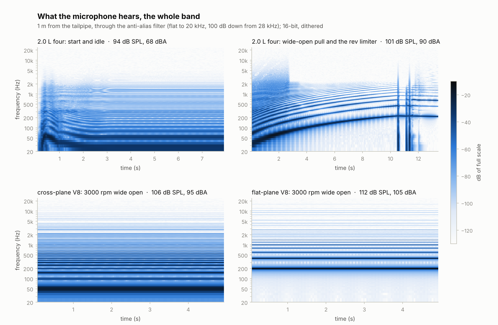
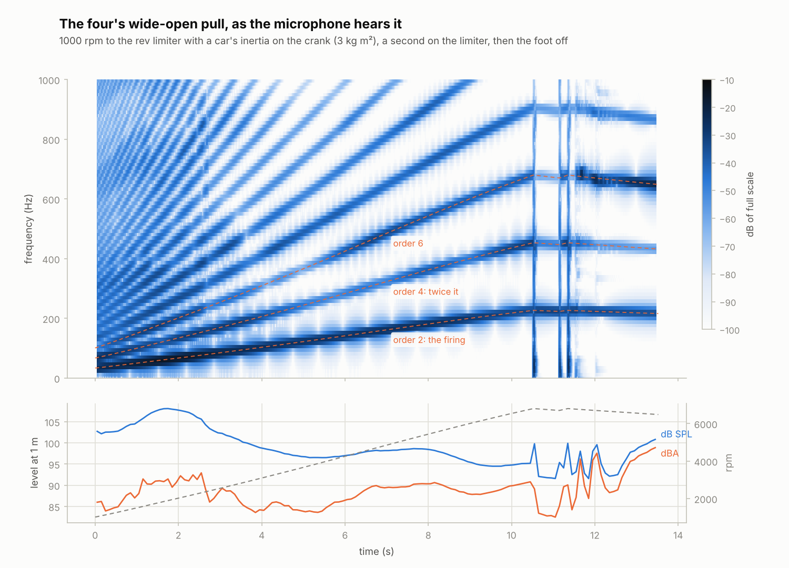
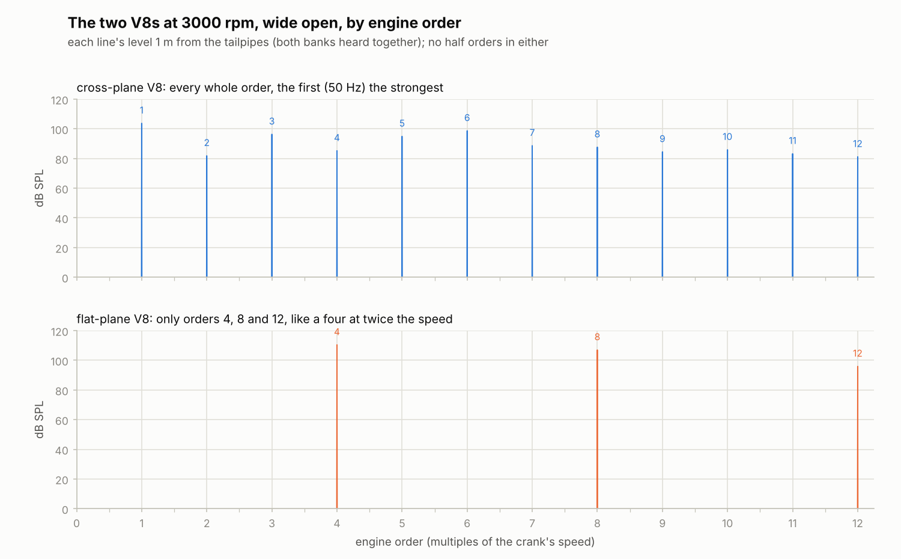

# Stage 11 — The sound: a microphone and the first WAV renders 🎧

**Status:** done (2026-10-19)

Until now the core made one sound, stage 1's test tone, and took it from the physics rate to the
audio rate by averaging. Stage 11 makes the engine's own sound:
- **a microphone** 1 m from the tailpipes hears the gas leaving them, the way a microphone would:
  the pressure a pulsating source radiates;
- **an anti-alias filter** takes that from the physics rate (192 kHz) down to the audio rate (48 kHz):
  flat to 20 kHz, 100 dB down from 28 kHz;
- **an output stage** blocks DC and limits softly, never past full scale;
- **16-bit WAVs are dithered** (TPDF), so their rounding is a steady hiss, not distortion.

`make render` now renders the plan's four sounds: the four starting and idling, the four pulling
wide open from 1000 rpm into its rev limiter, and the cross-plane and flat-plane V8s at 3000 rpm.
The plan's check passes. The WAVs are clean: no clicks, no DC, no aliasing whine. Their
spectrograms are below. Getting there turned up one click in the physics: a click at every firing,
whenever a tailpipe's flow turned round. It's fixed (see "Volume, not mass" below).



## Review of stage 10

- **Its figures were checked once more before it was committed.** Nine had gone stale during its
  own tuning and were corrected in that commit:
  - the four's back pressure at 6000 rpm: 20 kPa, not 17 (121 kPa in the collector, not 118);
  - the light-load pumping loss: 8 % over `p_ambient − MAP` at 2000 rpm and 4 % throttle, not 13 %;
  - the cylinder at exhaust opening: a quarter of a bar, not a third;
  - the fuel cut after the limiter: 2.9 s, not 2.8;
  - the six on stage 9's spark: it swings 95 rpm every 2.8 s, not 130 every 3.4 (that was with
    the spark held still too);
  - adiabatic pipes: nearly 5000 K, not 5000;
  - the two-rate VE error: up to 0.9 %, not 1.3;
  - PLAN.md called the old light-load mixture lean: it read rich (13.6).
- **The tailpipe's open end draws in outside air the moment its flow turns round.** That's the
  usual 1D boundary, and right for the engine's books. For the sound it isn't (see "Volume, not
  mass").
- **The cross-plane V8's banks fire 90-180-270-180° apart, not 90-270-180-180°** as the preset's
  comment (since stage 8) and stage 10's doc had it. Stage 8's doc and `test_presets` were right.
- **The engine's step wasn't in the WebAssembly module.** Nothing the browser could call reached
  `rb_engine_step`, so the linker left it out: stage 10's 43 KB core was the API and the tone. The
  render loop now calls it, and the module is 84 KB.

## What was built

| Piece | Files | Purpose |
|---|---|---|
| The microphone and the chain | `core/src/audio.h`, `audio.c` | The microphone (a monopole, from the tailpipes' volume flow), the anti-alias filter and decimator, the DC blocker and the soft limiter. No allocation; 30 KB of filter state in the sim. |
| The sound in the render loop | `core/src/rb_sim.c`, `rb_internal.h`, `engine.c`, `engine.h`, `rb_engine_api.c` | `rb_render_block` runs the chain on whichever source the sim has: stage 1's tone (the default, so the browser still plays it until stage 14) or the engine. The engine keeps the tailpipes' volume flow (`tail_flow`); a rebuilt engine resets the microphone. New telemetry: `limited`, the samples the soft limiter bent. |
| Dither | `native/wav.h`, `wav.c` | TPDF dither on 16-bit WAVs, from a fixed seed (the same samples make the same file); `wav_set_dither` turns it off. |
| Renders | `native/rb_cli.c`, `Makefile` | `rb_cli sound`: the engine through the same chain as the browser, started and idling, pulling wide open, or held, to a WAV. `make render` makes the four renders. |
| Charts | `tools/plot_sound.py` | `check` (levels, DC, clicks, lines), `spectrograms`, `sweep` (with the engine orders) and `orders` (two engines held at one speed). |

## The microphone

### A pipe end is a monopole

An open pipe end much smaller than the wavelengths it radiates (a 50 mm pipe against 0.3–3 m)
radiates like a pulsating sphere: a monopole whose strength is the volume flow `Q` coming out of it.
That's the gas the outside air has to make room for. In the open, at a distance `r` (Kinsler et al.,
chapter 7):

    p(r, t) = ρ0 / (4π r) · dQ/dt(t − r/c)

`ρ0` is the outside air's density. The sound takes `r/c` to arrive; with one source that's only a
delay, so it's left out. A twin exhaust's two tailpipes are taken at the same place and add up.
The microphone sits 1 m away, in the open, with no ground under it (stage 12 adds listener
positions).

### Volume, not mass: the flow that turns round

The plan said the radiated pressure goes with `d(mass flow)/dt`. It goes with the *volume* flow, and
the difference matters: the gas leaving is hot, so a kilogram of it is more than twice the volume
of the air it pushes aside. So:

    Q = ṁ / ρ_end

`ṁ` is what the tailpipe's end face moved in its last step, and `ρ_end` the density of the gas in
the pipe's last cell. The engine keeps it as `tail_flow`, summed over its tailpipes, once per pipe
step.

**Which density, when the flow turns round?** At low speed and full load, and on the overrun, a
tailpipe's flow reverses briefly at every firing: the four's below about 2400 rpm wide open, the
flat-plane V8's at 3000 rpm. The pipe's open end then draws in outside air, at 1.18 kg/m³ against
the exhaust's 0.44. The first version used that density for the inflow. The mass flow, the model's
state, passes smoothly through zero, but the volume flow then breaks its slope at every reversal.
Its derivative, the sound, steps: a click at every firing. In the flat-plane V8's spectrum it showed
as a comb of firing harmonics up to 12 kHz and beyond, falling only 5–6 dB an octave (as a step's
spectrum does), with 1 % of the power above 5 kHz. The giveaway was a single line at 2.6 kHz, order
52.

Physically, what a reversing flow draws back in first is the gas that has just left, not the
outside air. So the volume is taken at the end cell's density both ways, and that density changes
smoothly. The four at 2000 rpm, wide open, held, over 9 whole cycles (the power of the harmonics
above 5 kHz against all of them):

| Volume flow at ... | Above 5 kHz |
|---|---|
| the outside air's density when it turns round | −37 dB |
| the end cell's density, both ways | **−67 dB** |

That's about as smooth as the mass flow itself (within 3 dB at 4–8 kHz).
`test_audio_engine_reversal_quiet` checks it.

### Where the full scale is

The output is in units of full scale: 1 is 40 Pa at the microphone, 126 dB SPL. Held wide open
across their speed range, the loudest preset peaks at 19 Pa (the flat-plane V8 at 3000 rpm), and
at 17 Pa at 7500 rpm. The cross-plane V8 peaks at 16 Pa. That leaves about 5 dB below the soft limiter's knee. The four idling is at −32 dBFS RMS,
well above 16-bit dither (−96 dB).

## Down to the audio rate

### The anti-alias filter

Stage 1 averaged each frame's four physics steps. That's fine for a test tone, but it lets high
frequencies through to fold back: at 192 kHz, 40 kHz (which folds to 8 kHz) loses only 13.7 dB,

    |H(f)| = |sin(π f N / f_p) / (N sin(π f / f_p))| = 0.205 at f = 40 kHz, N = 4, f_p = 192 kHz.

The filter now is a windowed sinc, a linear-phase FIR designed with Kaiser's window (Oppenheim and
Schafer, chapter 7). For an attenuation of `A` dB over a transition band `Δω` (radians per physics
step):

    taps − 1 = (A − 8) / (2.285 Δω),   β = 0.1102 (A − 8.7),
    h[n] = sin(2π f_c (n − M)) / (π (n − M)) · I0(β √(1 − ((n − M)/M)²)) / I0(β)

with `f_c` at the audio rate's Nyquist and `M = (taps − 1)/2`. The transition band runs from 0.417
to 0.583 of the audio rate, 20 to 28 kHz at 48 kHz. So the filter is flat where we hear, and nothing
above 28 kHz folds back into the audible band; 24–28 kHz folds only to 20–24 kHz. Kaiser's formulas
are estimates: designed for 101 dB, the filters reach 100.4–101.4 dB at every oversampling factor
from 2 to 32. At the default factor of 4 the filter has 157 taps and delays the sound 78 physics
steps (0.4 ms). Its passband is flat to 0.0001 dB. Its sum is normalised to exactly 1, though
it's already within 3 × 10⁻⁶ of 1 before that.

Each audio frame takes one dot product of the last 157 inputs, which are kept twice over in a ring
so they're always in one piece. That's 157 multiply-adds a frame. With stage 1's tone as the source,
the whole chain renders 130 times faster than real time natively, about 160 ns a frame. The four's
engine takes about 16 µs a frame.

### The staircase

The tailpipes' flow changes once per pipe step, every fourth physics step (stage 10's two rates).
The microphone differentiates it every physics step, so its signal is an impulse every fourth step
and zero between. That's the staircase's derivative. Its spectrum is the true one repeated at
multiples of 48 kHz, and the filter removes the copies. What's left is the derivative over the pipe
step: each frame sees one polyphase branch of the filter, whose sum is 1/4 to within 4 × 10⁻⁷, and
`ΔQ/dt · 1/4 = ΔQ/(4 dt)`. `test_audio_engine_sound` checks the chain's output against the
microphone worked out by hand from a twin engine's flow: to 0.4 %, which the DC blocker takes off
the lowest orders.

### DC blocker and soft limiter

- **The DC blocker**, `y[n] = x[n] − x[n−1] + r y[n−1]` with `r = e^(−2π · 10 Hz / 48 kHz)`
  (Smith), is a high-pass with its corner at 10 Hz. It takes 0.03 % off 440 Hz, 5 % off 30 Hz and
  1 dB off 20 Hz. The microphone's signal is a derivative, so it carries no DC of its own; this is
  a safety net for later sources, and it trims sub-audio swings.
- **The soft limiter** passes samples within 0.8 untouched and bends larger ones smoothly towards 1,
  never past it:

      y = k + (1 − k) tanh((|x| − k) / (1 − k)),   k = 0.8

  Its slope is 1 at the knee, so there's no corner. A full-scale sine comes out at 0.952. None of
  the renders reach the knee. The `limited` telemetry counts the samples it bent.
- **A NaN or inf** from the source is replaced by silence, and counted, at every physics step,
  before it can reach the filters' memories. Values beyond 2 × 10⁷ Pa are clamped so the filters'
  sums stay finite. When the source recovers, so does the sound, without a reset.

### Dither

Rounding to 16 bits makes an error that follows the signal: on a pure tone it comes out as
harmonics, the −97 dB spurs stage 1 measured. TPDF dither adds noise before rounding: the sum of
two uniform numbers in [0, 1), less 1, so −1 to 1 LSB with a triangular distribution. That makes
the error's mean and power independent of the signal (Wannamaker, Lipshitz and Vanderkooy). It
becomes a steady, flat hiss of `√(1/6 + 1/12) = 0.5` LSB RMS, −96 dB of full scale. On a tone
2.5 LSB high, rounding alone leaves harmonics of more than 0.1 LSB; dithered, they're under 0.02 LSB,
at the noise floor of a one-second measurement (`test_wav_pcm16_dither`). The noise comes from a
fixed seed (xorshift64\*, Vigna), so the same samples always make the same file. Float WAVs aren't
dithered.

## The renders

`make render`, at 48 kHz from 192 kHz physics, 16-bit and dithered (`tools/plot_sound.py check`):

| Render | Length | Level at 1 m | Peak | DC (below the RMS) | Loudest 5 ms above 5 kHz (below the RMS) |
|---|---|---|---|---|---|
| `i4-idle.wav`: the four started with the key, then idling | 8.0 s | 93.9 dB SPL, 68.1 dBA | −17.6 dBFS | 68 dB | 61 dB |
| `i4-sweep.wav`: wide open from 1000 rpm into the limiter, then foot off | 13.5 s | 101.0 dB SPL, 90.2 dBA | −10.8 dBFS | 80 dB | 52 dB |
| `v8-cross-3000.wav`: held at 3000 rpm, wide open | 5.0 s | 106.2 dB SPL, 95.5 dBA | −9.5 dBFS | 132 dB | 55 dB |
| `v8-flat-3000.wav`: held at 3000 rpm, wide open | 5.0 s | 112.3 dB SPL, 105.3 dBA | −6.7 dBFS | 141 dB | 57 dB |

- **No clicks:** at most 0.0003 % of any render's power is above 5 kHz, and its loudest 5 ms there
  is 51–61 dB below the render's RMS. Before the reversal fix, the flat-plane V8's was 20 dB below.
- **No DC:** 68 dB below the RMS or more.
- **No aliasing whine:** the strongest line above 2 kHz is always one of the engine's harmonics:
  the flat-plane's order 48 (2400 Hz), 35 dB below its RMS; the cross-plane's order 41 (2050 Hz),
  41 dB below; the four's, 72 dB below. Nothing
  above 28 kHz at the physics rate can fold back (−100 dB), and the pipes' cells can't carry waves
  much above 3 kHz anyway. Faint broadband lines near −100 dBFS mark where the limiter cuts the
  spark and the flow pattern changes; they're 70 dB below the sound.
- **Nothing limited, nothing replaced** in any of them.

### The four



- **Idle (800 rpm):** 99 % of the power is below 100 Hz: the firing at 27 Hz and its second
  harmonic, 53 Hz. The four fires below its exhaust's 40 Hz ring (the 10 L muffler on its 0.6 m
  tailpipe), so the muffler doesn't filter the firing pulses. The tailpipe's gas sloshes in and out
  at every firing. That's 94 dB SPL but only 68 dBA: the ear hardly hears 27 Hz.
- **The pull** takes 10.5 s from 1000 rpm to the limiter, with a car's inertia on the crank (3 kg m²,
  about third gear). The firing orders (2, 4, 6, ...) climb with the speed:

  | rpm | 1000–1500 | 1500–2000 | 2000–2500 | 3000–3500 | 4000–4500 | 5000–5500 | 6000–6500 | 6500–7000 |
  |---|---|---|---|---|---|---|---|---|
  | dB SPL | 103.2 | 107.3 | 106.0 | 98.2 | 97.0 | 98.5 | 94.7 | 95.0 |
  | dBA | 85.5 | 90.4 | 90.3 | 84.9 | 86.5 | 90.0 | 88.4 | 90.3 |

  It booms at 1500–2500 rpm, just above the exhaust's 40 Hz ring, where the firing (50–83 Hz)
  still comes through the muffler. Higher up it stays between 84 and 90 dBA instead of growing as a
  real car's does. A single-volume muffler is a low-pass, 12 dB an octave above its ring, which
  roughly cancels the growing flow and the microphone's +6 dB an octave. On the limiter it's 94 dB SPL and 86 dBA. Foot off, with the
  fuel cut, it's louder in dBA (95): see below.
- **On the overrun**, with the fuel cut at about 6450 rpm, the exhaust shows a sharp resonance near
  643 Hz. Order 6 crosses it, and the level swings by 15 dB, between 89 and 105 dB SPL, as the speed
  drifts by a few tens of rpm (coasting for 8 s with a heavy crank). It's an acoustic mode of the
  exhaust that little damps; stage 12's mufflers should damp it, as real ones do.

### The two V8s



At 3000 rpm wide open (order 1 is 50 Hz):
- **The flat-plane** has orders 4, 8 and 12 only, 110, 107 and 96 dB SPL: it sounds like a four at
  twice the speed. Each bank fires evenly every 180° (order 2), and the banks are 90° apart, so
  their orders 2, 6 and 10 cancel exactly between the two tailpipes.
- **The cross-plane** has every whole order. The first, 50 Hz, is the strongest (104 dB SPL), then
  6, 3 and 5 (99–95 dB). Each bank fires unevenly, 90-180-270-180°, and the uneven pattern shows as
  a lope once a revolution.
- **Neither has half orders.** Each cross-plane bank's pattern repeats only every cycle, so on its
  own it has half orders (order 0.5, 25 Hz, and so on): the classic V8 burble. But the right bank
  fires exactly the left bank's pattern 360° later. A half order turned by 360° comes back
  upside down, so at a microphone the same distance from both tailpipes the two banks' half orders
  cancel, and what's left repeats every revolution. A listener nearer one tailpipe hears them, as
  most recordings do. That needs stage 12's listener position.

## Cost

- **The four's sound** renders at about real time on this machine (a cloud VM, not Bernardo's
  laptop): the 8 s idle in 7.9 s, the 13.5 s pull in 13.1 s. The V8s run at half real time. That's
  stage 10's engine cost; the chain adds 1 %.
- **The WebAssembly core** is 84 KB (stage 10: 43 KB), now that it includes the engine's step.

## Tests that can fail

Each bug planted in a copy, and the tests that caught it:

| Bug | Caught by |
|---|---|
| no anti-alias filter (every fourth step taken as it is) | `test_audio_decimator_tones` |
| a short filter (60 dB) | `test_audio_decimator_filter` |
| the cutoff at the audio rate instead of its Nyquist | `test_audio_decimator_filter`, `_tones` |
| the microphone without its 4π | `test_audio_microphone`, `test_audio_engine_sound` |
| the microphone ignoring its distance | `test_audio_microphone`, `test_audio_engine_sound` |
| the microphone's derivative over the pipe step instead of the physics step | `test_audio_engine_sound` |
| the outside air's density for a reversing flow | `test_audio_engine_reversal_quiet` |
| the mass flow instead of the volume flow | `test_audio_engine_sound` |
| the limiter that doesn't bend | `test_audio_soft_limit` |
| a hard clamp instead of the soft limiter | `test_core_tone_frequency_and_level` |
| no DC blocker in the chain | `test_audio_chain_blocks_dc` |
| the NaN guard only after the filters | `test_audio_chain_survives_nan` |
| a rebuilt engine leaves the microphone's memory | `test_audio_engine_rebuilt_quietly` |
| a reset that keeps the filters' memories | `test_core_block_size_independent_and_reset` |
| no dither by default | `test_wav_pcm16_dither` (once it checked the default too) |
| rectangular dither (−0.5 to 0.5 LSB) | `test_wav_pcm16_dither` |

Two weren't caught at first. Removing the filter's normalisation passed, because the windowed sinc
already sums to 1 within 3 × 10⁻⁶; that's not a bug, so it was swapped for the doubled cutoff.
Turning dither off by default passed because the dither test always set it explicitly; now it also
checks the default.

The address and undefined-behaviour sanitizers find nothing in the audio, core, WAV and API tests or
in `rb_cli sound`.

## Tests that changed

| Test | Was | Now | Why |
|---|---|---|---|
| `test_core_tone_frequency_and_level` | a full-level tone peaks at 1 | at 0.7 it peaks at 0.7; at full level, 0.952 | the soft limiter bends full scale |
| `test_core_level_smoothing` | a jump to 1, 0.03–0.11 after 1 ms | a jump to 0.7, 0.01–0.077 | the same, and the filter's 0.4 ms delay |
| `test_core_no_clicks_on_frequency_change` | steps within 1.01 × a sine's | within 1.08 × | the filter rounds the corners where the frequency switches, overshooting the slope by 4.6 % |
| `test_wav_pcm16_roundtrip` | within 2 LSB | within 2.5 LSB | dither adds up to 1 LSB |
| `test_wav_pcm16_clipping` | dithered by default | dither off | it checks exact values |
| web: `renders a 440 Hz tone` | at full level, peak over 0.998 | at 0.7, and bent to 0.952 at full level | the soft limiter |

## What doesn't sound like a real engine yet

- **The muffler is one volume.** It booms near its ring, keeps a pull from growing louder above it,
  and leaves a sharp resonance on the overrun.
- **Nothing above a few kHz:** the pipes' 5–7.5 cm cells can't carry waves much above 3 kHz, and
  there's no flow noise yet.
- **One source and one listener:** the tailpipes only (no intake, no mechanical sound), and one
  microphone in the open, the same distance from both tailpipes, with no ground under it.

All three are stage 12's.

## Three things that surprised me

- **The cross-plane V8's burble cancels itself** at a microphone between its tailpipes. Its banks
  fire the same uneven pattern, 360° apart.
- **A click a firing hid in a single line at 2.6 kHz.** It was the flat-plane's order 52, part of a
  comb that reached past 12 kHz, from one wrong density during the moments the tailpipe drew air
  back in.
- **The four's idle measures 94 dB SPL**, louder than its pull at 6000 rpm. But it's 27 Hz, and only
  68 dBA.

## What to listen for (Bernardo checks)

Run `make render` (about a minute), then play `renders/*.wav` on headphones or speakers that reach
down to about 30 Hz. The idle is mostly 27 Hz, which small speakers barely play.
- **`i4-idle.wav`:** the key, the starter letting go at 0.27 s, a flare, then a steady idle.
- **`i4-sweep.wav`:** a pull through the rev range, the boom at about 2000 rpm, the limiter cutting
  in at 10.5 s, then the overrun.
- **`v8-cross-3000.wav` and `v8-flat-3000.wav`:** at the same speed and load. The cross-plane
  should sound lumpy and low (50 Hz), the flat-plane smooth and higher (200 Hz), like a fast four.
  **Does the V8 burble?** A little: once a revolution, not the classic half-order burble. That needs
  a listener nearer one tailpipe.
- **Do the four and the V8s sound obviously different?** They should.

## Try it

```bash
make render                                   # the four renders and the test tone (renders/)
build/rb_cli sound --preset boxer4 --idle      # any preset, started and idling (renders/sound.wav)
build/rb_cli sound --preset i6 --sweep --csv renders/i6-sweep.csv -o renders/i6-sweep.wav
build/rb_cli sound --preset v8-cross --hold --rpm 1200 --throttle 0.2 -o renders/v8-1200.wav
build/rb_cli sound --distance 4 --gain 2 ...   # further away, louder
python3 tools/plot_sound.py check renders/*.wav
python3 tools/plot_sound.py spectrograms renders/i4-idle.wav renders/v8-cross-3000.wav
python3 tools/plot_sound.py sweep renders/i4-sweep.wav renders/i4-sweep.csv
python3 tools/plot_sound.py orders renders/v8-cross-3000.wav renders/v8-flat-3000.wav --rpm 3000
```

## Notes for later stages

- **Stage 12 (muffler, intake, mixing):**
  - the muffler needs damping (absorptive packing, perforated pipes) and its pipes' modes damped;
  - each tailpipe needs its own place, distance and delay (`r/c`), so the cross-plane's half orders
    come through;
  - the intake mouth's flow (the throttle's) changes every physics step, unlike the tailpipes', so
    there the anti-alias filter has real work to do;
  - flow noise would fill in above the pipes' 3 kHz.
- **Stage 13 (performance):** the chain is 157 multiply-adds a frame and 1 % of the four's cost. At
  oversample 1 there is no filter, and nothing above the audio rate's Nyquist can be removed.
- **Stage 14 (browser):** set the sim's `source` to `RB_SOURCE_ENGINE` (an internal field today) and
  give the engine's controls live parameters. The chain is in `rb_render_block` already, the same as
  `rb_cli sound`. The filter adds 0.4 ms of latency. `limited` can drive a clip light.
- **Stage 16 (gauges):** a level meter can read `out_rms` × 40 Pa / gain as Pa at the microphone.

## Sources

- L. E. Kinsler, A. R. Frey, A. B. Coppens, J. V. Sanders, *Fundamentals of Acoustics*, 4th ed.,
  Wiley (2000), chapter 7: the pulsating sphere and the simple source, `p = ρ0 Q̇ / (4π r)`.
- H. Levine, J. Schwinger, "On the Radiation of Sound from an Unflanged Circular Pipe", *Physical
  Review* 73, 383 (1948): at low frequency an open pipe end radiates evenly, as a simple source.
- A. V. Oppenheim, R. W. Schafer, *Discrete-Time Signal Processing*, 3rd ed., Pearson (2010),
  chapter 7: FIR design with Kaiser's window, and his formulas for its length and `β`.
- J. F. Kaiser, "Nonrecursive digital filter design using the I0-sinh window function", *Proc.
  IEEE International Symposium on Circuits and Systems* (1974).
- J. O. Smith III, *Introduction to Digital Filters with Audio Applications*, W3K (2007): the DC
  blocker — <https://ccrma.stanford.edu/~jos/filters/DC_Blocker.html>
- R. A. Wannamaker, S. P. Lipshitz, J. Vanderkooy, "A Theory of Nonsubtractive Dither", *IEEE
  Transactions on Signal Processing* 48 (2), 499–516 (2000).
- S. Vigna, "An experimental exploration of Marsaglia's xorshift generators, scrambled", *ACM
  Transactions on Mathematical Software* 42 (4) (2016): xorshift64\*.
- IEC 61672-1:2013, *Electroacoustics — Sound level meters*: the A-weighting the levels use.
