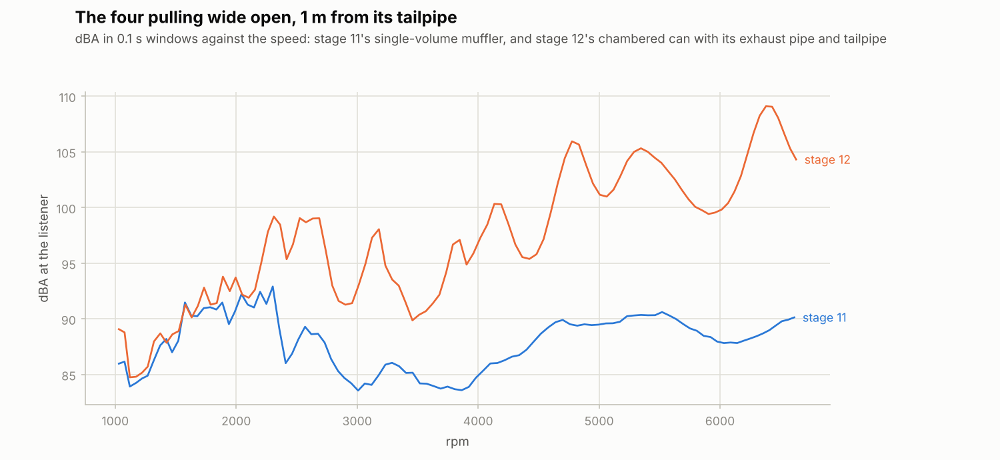
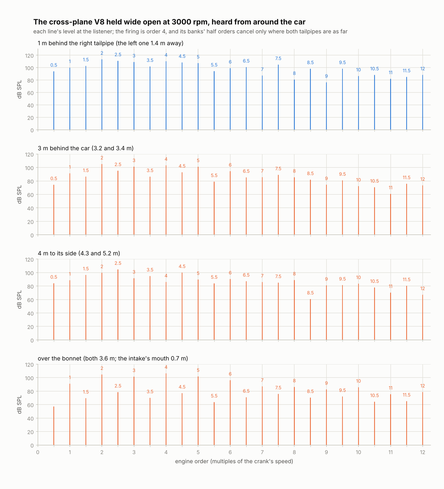
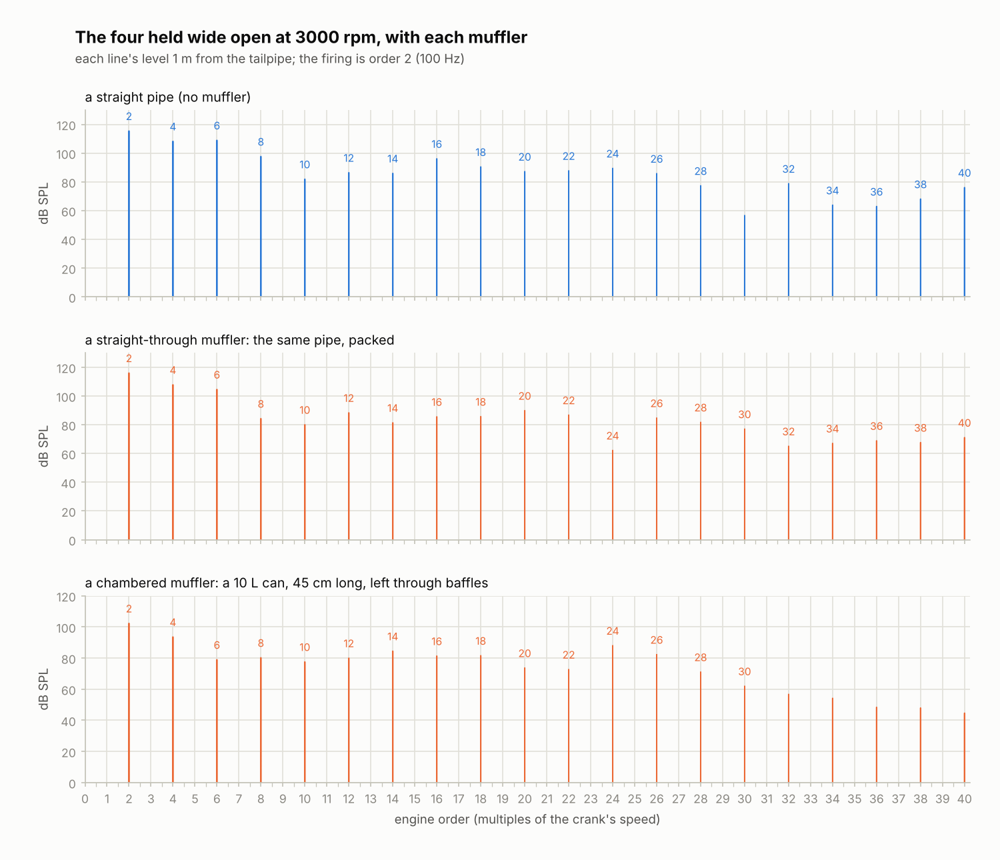
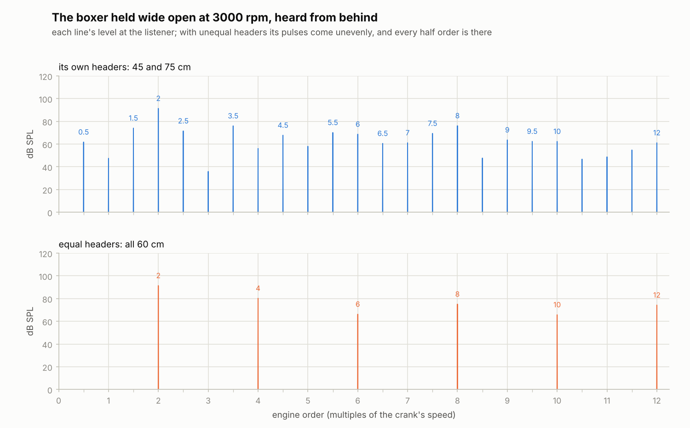
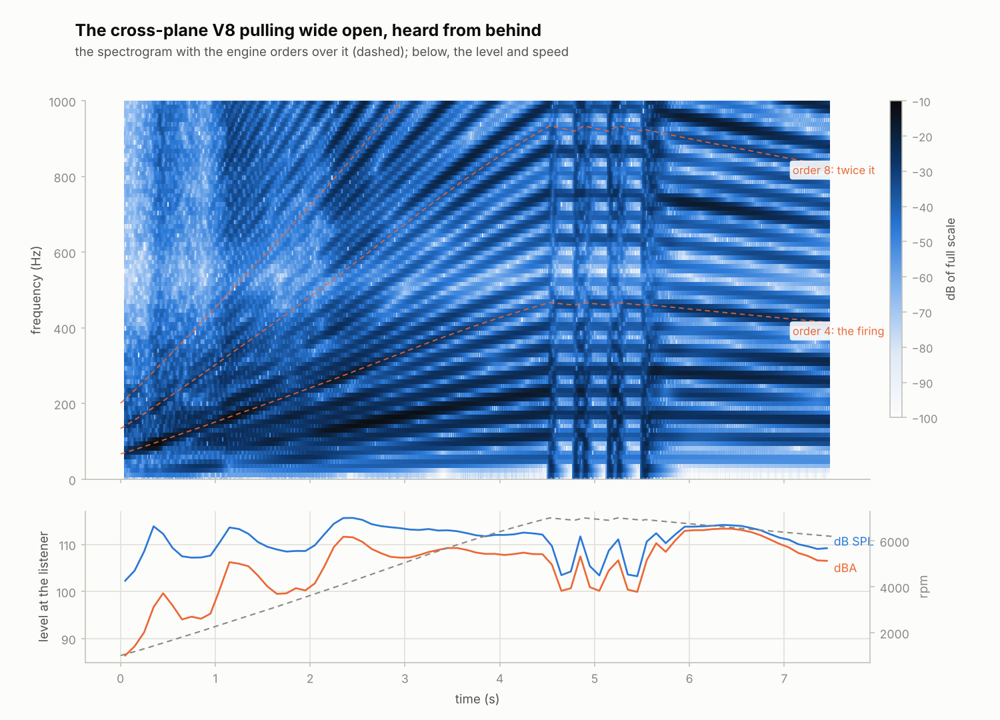

# Stage 12 — Mufflers, the intake and the listener 🎧

**Status:** done (2026-10-19)

Stage 11's engine was heard by one microphone, a metre from its tailpipes, through a muffler that
was a single volume. It booms, a pull doesn't get louder, and the cross-plane V8's burble cancels
itself between its two tailpipes. Stage 12:
- **the mufflers are pipes:** a **chambered** can the gas spreads into and leaves through damped
  baffles; a **straight-through**, a perforated pipe in a can of wool, which takes the fast swings
  and lets the flow through; or **none**, a straight pipe;
- **the intake breathes through a snorkel and an air box** with a filter, and the snorkel's mouth is
  a second source of sound;
- **a listener** stands somewhere around the car: 3 m behind it (the default), a metre behind a
  tailpipe (stage 11's microphone), 4 m to its side, or over the bonnet. It hears each tailpipe and
  the intake's mouth at its own distance and delay, and again off the ground;
- **pipes can go straight on into each other,** without the losses of a join through a volume.

The plan's checks: the renders sound more like a car (a pull now gets louder: a metre from the
four's tailpipe, 85–91 dBA below 1600 rpm and 99–109 above 5500, where stage 11's stayed between 84
and 93 all the way), and the boxer with equal and with unequal headers sounds different (with
unequal ones, every half order is there).

The stage was split (working agreement 2): the mechanical sound, the flow noise and the in-car
listener are stage 12b's.



## The renders

`make render` (about three minutes). All are clean: no DC (at least 74 dB under the RMS), no clicks
(the loudest 5 ms above 5 kHz at least 45 dB under the RMS), under 0.001 % of the power above 5 kHz,
nothing soft-limited.

| Render | What | Level at the listener |
|---|---|---|
| `i4-idle.wav` | the four started and idling, from behind (3.2 m) | 86.6 dB SPL, 60.8 dBA |
| `i4-sweep.wav` | the four pulling wide open, from behind | 96.4 dB SPL, 92.2 dBA |
| `i4-3000-none.wav` | held wide open at 3000 rpm, a straight pipe, 1 m from the tailpipe | 117.1 dB SPL, 105.5 dBA |
| `i4-3000-straight.wav` | the same, a straight-through | 117.0 dB SPL, 102.8 dBA |
| `i4-3000-chambered.wav` | the same, its chambered can | 103.3 dB SPL, 92.9 dBA |
| `v8-cross-3000-behind.wav` | the cross-plane V8 at 3000 rpm, wide open, from behind (half gain) | 109.7 dB SPL, 101.0 dBA |
| `v8-cross-3000-tailpipe.wav` | the same, 1 m behind the right tailpipe | 118.7 dB SPL, 109.6 dBA |
| `v8-cross-3000-side.wav` | the same, 4 m to its side | 107.9 dB SPL, 96.7 dBA |
| `v8-cross-3000-front.wav` | the same, over the bonnet | 110.2 dB SPL, 100.4 dBA |
| `v8-cross-sweep.wav` | the cross-plane V8 pulling wide open, from behind (half gain) | 111.8 dB SPL, 108.1 dBA |
| `v8-flat-3000.wav` | the flat-plane V8 at 3000 rpm, wide open, from behind | 105.7 dB SPL, 96.6 dBA |
| `boxer4-3000.wav` | the boxer at 3000 rpm, wide open, from behind | 92.4 dB SPL, 83.1 dBA |
| `boxer4-3000-equal.wav` | the same with equal headers | 92.1 dB SPL, 80.5 dBA |

The levels of the half-gain renders are what the listener hears (`plot_sound.py --gain 0.5` undoes
it); their files peak at −3 to −16 dBFS.

## Review of stage 11

- **Its audio.h said a reversing tailpipe's volume flow was taken at the outside air's density** —
  the very kink stage 11 found and fixed (the end cell's density both ways). The comment went with
  the microphone; the listener's says it right.
- **The boom wasn't the muffler's ring.** Stage 11's doc put the four's boom at 1500–2500 rpm on
  the single volume ringing on its tailpipe (about 40 Hz). With the 1D can it's still there and
  hardly moves with the baffles' damping, but it moves when either pipe changes: it's the whole
  exhaust's lowest ring, the exhaust pipe, the can and the tailpipe together, about 63 Hz (see
  "The boom" below).
- **The core's version stayed 0.10.0** though stage 11 added a telemetry channel (`limited`). It's
  0.12.0 now.
- **rb_internal.h put the signal's ceiling (`RB_MIC_MAX`, 1e6 of full scale) at 2e7 Pa,** from
  before full scale moved from 20 to 40 Pa. It's 4e7 Pa.
- **`rb_cli sound` counted the soft limiter's samples from the start,** including the 1.5 s it
  settles a held engine unheard. It counts what's recorded now.

## What was built

| Piece | Files | Purpose |
|---|---|---|
| The listener | `core/src/audio.h`, `audio.c`, `rb_sim.c`, `rb_internal.h` | Sources at places on a car (two tailpipes, the intake's mouth); the listener at one of four places, hearing each at 1/r and r/c later, and its image in the ground. `rb_sim_listen` places it whenever the engine is built. |
| Packing and going on | `core/src/pipe.h`, `pipe.c` | A laminar loss on a pipe's swings only (a straight-through's wool), and one pipe going straight on into another. |
| The mufflers | `core/src/engine.c`, `engine.h`, `presets.c` | Each system's muffler is a pipe between its exhaust pipe and tailpipe: none, straight-through or chambered (`muffler_type`, `muffler_length`). |
| The intake | `core/src/engine.c`, `engine.h`, `presets.c` | The air → a snorkel (pipe) → the filter → an air box (volume) → the throttle. The engine's books count at the snorkel's mouth; its flow is the third source (`mouth_flow`). |
| The API | `core/include/rb.h`, `rb_engine_api.c`, `web/src/core/rb-core.ts` | Fields `muffler_type`, `muffler_length`, `airbox_volume`, `snorkel_length`, `snorkel_diameter`; pipe kinds `muffler`, `snorkel`; places `muffler outlet`, `air box`. New pipes come after the old ones, so stage 10's indices hold. |
| Renders and charts | `native/rb_cli.c`, `Makefile`, `tools/plot_sound.py` | `rb_cli sound --listener`, `--muffler`, `--equal-headers`; `make render`'s new set; `plot_sound.py levels` (dBA against rpm over pulls) and `--gain`. |

## The listener

### Every source at its own distance

Each source is a monopole (stage 11): an open pipe end radiates its volume flow `Q`. Heard from a
place `r` away, its sound arrives `r/c` later and `1/r` as strong; the ground (asphalt) reflects it,
as if it also came from its image as far below the ground, `r'` away, `G = 0.9` as strong (Kinsler et
al., chapter 7):

    p(t) = ρ0 / (4π) · d/dt Σj [ Qj(t − rj/c) / rj  +  G · Qj(t − r'j/c) / r'j ]

Only the differences between the paths' delays matter, so the nearest path's is 0. The sources' flows
change once a pipe step (48 kHz): the listener keeps each one's last 2048 (42 ms, 14 m of path
difference) and reads a delay that falls between two steps between them. Its sum changes once a pipe
step too, so `d/dt` is that step's change, heard at the physics step after it; the anti-alias filter
turns those impulses back into the smooth derivative (stage 11's microphone did the same).

### Where it stands

The car is a front-engined one, 4.5 m long: tailpipes 35 cm up, out 5 cm under the rear bumper, the
right one 50 cm right of the middle (and with a twin exhaust the left one 50 cm left); the intake's
mouth behind the grille, 75 cm up.

| Place | Where | Tailpipes | Mouth | First notch of the ground's comb |
|---|---|---|---|---|
| `behind` (the default) | 3 m behind the car, a little right, at ear height (1.6 m) | 3.21 m, 3.39 m | 6.81 m | 521 Hz |
| `tailpipe` | 1 m behind the right tailpipe, 15 cm higher: stage 11's microphone | 1.01 m, 1.42 m | 4.82 m | 574 Hz |
| `side` | 4 m to the right of the car's middle | 4.34 m, 5.18 m | 4.63 m | 690 Hz |
| `front` | over the open bonnet, by the intake's mouth | 3.63 m, 3.60 m | 0.66 m | 713 Hz |

Where the direct and the ground's path differ by half a wavelength they cancel: a notch, at 521 Hz
and its odd multiples behind the car. That's real (a microphone over asphalt hears it) and it
colours each place's sound differently.

The default is behind the car because a loud V8 at full power is too loud a metre from its tailpipe:
the cross-plane with its straight-throughs peaks at 95 Pa there at 6000 rpm, more than twice full
scale (40 Pa, 126 dB SPL), and at 33 Pa from behind.

### The cross-plane V8's burble

Its banks fire the same uneven pattern (90-180-270-180°) a turn of the crank apart, so each
tailpipe's half orders are the other's turned upside down. Where both tailpipes are as far, they
cancel, as at stage 11's microphone; anywhere else they don't. `test_audio_listener_hears_each_tailpipe`
holds both: 60 dB down at the middle, within 25 dB of the firing a metre behind one tailpipe.



## The mufflers

### A muffler is a pipe

Each exhaust system's muffler is a pipe between its exhaust pipe(s) and its tailpipe:

| `muffler_type` | The pipe | Into it | Out of it |
|---|---|---|---|
| `none` (0) | the tailpipe's bore, `muffler_length` long | the exhaust pipe goes straight on (through the catalyst) | straight on into the tailpipe |
| `straight` (1): straight-through | the same, packed (below) | the same | the same |
| `chambered` (2) | a can as wide as `muffler_volume` over `muffler_length` (the four's: 10 L, 45 cm, 17 cm across) | the exhaust pipe opens into its first cell | the tailpipe starts from its last, through the baffles: `muffler_area`, and a laminar loss |

Where two exhaust pipes meet in one muffler (the six's), they open into its first cell. The four,
the six and the boxer have chambered mufflers; the V8s straight-throughs.

### The chambered can

A can much wider than its pipes is an expansion chamber (Munjal). At low frequencies it's
a volume, and with the pipes on it (mostly the tailpipe) it rings; above that it filters, until the
can's own length is half a wavelength: at `c / 2L` (about 550 Hz in the four's hot gas) and its
multiples the can passes sound as if it weren't there. The 1D can has all of that: its gas has
room, and waves run along it.

Its baffles are perforated plates. Besides their narrowing they cost a laminar loss, 30 Pa per m/s
of the tailpipe's gas, which damps the exhaust's rings a little (and costs back pressure: 3.7 kPa of
the 7 kPa the can costs at full power).

### Packing

A straight-through muffler is a perforated pipe in a can of glass or steel wool. The gas flows
straight through; a sound wave's pressure pushes gas in and out through the holes, and the wool's
fibres take its energy. Along the pipe, that's a laminar loss on the flow's swings only:

    a face's loss = R dx (ṁ − ṁ_settled) / ρ,    ṁ_settled following ṁ with a lag τ

It takes nothing from the steady flow. It damps swings much faster than `1/τ` by `R / (2 ρ c)`
nepers a metre, and slower ones by `(ωτ)² / (1 + (ωτ)²)` of that: the same shape as the real
loss, the holes' and the wool's resistance in series with the can's room (Munjal; Selamet et al.).
Its reactive side differs: below `1/τ` the lagging flow drags a swing along, as if the gas
were `R τ / (1 + (ωτ)²)` per m³ heavier, where the can would make room instead. So `R τ` is kept
under the gas's density. The four's straight-through: `R` = 1500 Pa per m/s per metre, `τ` =
0.25 ms (640 Hz): about 10 dB over its 45 cm for the fast swings.

`test_pipe_packing` checks it in a closed pipe: a 173 Hz ring with `τ` = 10 ms fades at 8.52/s, as a
laminar loss would make it (8.53/s); a 43 Hz ring with `τ` = 0.4 ms at 0.473/s, as the formula says
with the packing's weight (0.474/s), keeping 95 % over 0.1 s where the same laminar loss would leave
0.01 %; and a steady flow goes through as if the pipe weren't packed. A small pulse through the four's
exhaust pipe, straight-through and tailpipe (still of air, at 650 K) comes out with 12–15 dB less from
250 Hz to 2 kHz than through the same pipes unpacked.

### Going straight on

Joined as stage 10 joined a pipe to a volume, a pipe's end face loses the gas's speed (the jet
spreads out in the volume) and the next pipe pays to get it back: two velocity heads. Right for a
can, wrong for a straight pipe: it cost the four's straight pipe 7.5 kPa of back pressure at full
power, and made it cost more than the can. `rb_pipe_onward` joins one pipe's end 1 straight on to the next one's end 0: the face between
them is like one of a pipe's own, half of each cell long, with the momentum of the gas on both sides.
A pulse crosses it in the time one pipe takes and as big, to 0.01 %, and nothing comes back but
the single pipe's own 0.2 % (joined as through a volume, the joint echoes 1.9 %).

### What they do



The four held wide open at 3000 rpm, its tailpipe's sound source compared:

| | All | Order 2 (100 Hz) | Orders 8–16 | Orders 16–32 | Back pressure at 6000 rpm | Power at 6000 rpm |
|---|---|---|---|---|---|---|
| none | 0 dB | 0 dB | 0 dB | 0 dB | 15.7 kPa | 107.0 kW |
| straight-through | −0.6 dB | +0.6 dB | −2.7 dB | −6.0 dB | 15.6 kPa | 107.0 kW |
| chambered | −13.7 dB | −13.1 dB | −8.2 dB | −10.3 dB | 22.8 kPa | 106.3 kW |

The chambered can takes the low orders down most (the firing by 13 dB); its passbands let orders
around 24 (1200 Hz, the can's second) through as loud as the straight pipe's. The straight-through
passes the firing and takes 3–6 dB off what's above 400 Hz.

### The boom

The four pulling wide open booms between 1500 and 2500 rpm, about 7 dB over its level at 3000. The
order-2 line peaks near 1900 rpm (63 Hz) and moves when either pipe changes:

| Exhaust pipe, tailpipe | Order 2's peak |
|---|---|
| 1.8 m, 0.6 m (the four's) | 1900 rpm, 63 Hz |
| 1.2 m, 0.6 m | 2250 rpm, 75 Hz |
| 1.8 m, 0.3 m | 2100 rpm, 70 Hz |

It's the exhaust's lowest ring, the pipes and the can together. Damping the baffles three times as
much takes only 2 dB off it. Real exhausts drone like this at cruising speeds, and get resonators
tuned against it.

### The rasp

Through a straight pipe or a straight-through, the four's tailpipe flow turns round at every firing
at full load: +150 m/s out, then −45 m/s in, at 3000 rpm. Air drawn back in fills the end cell
(it cools from 750 to 450 K in 2 ms) and the end's behaviour changes abruptly: the sound's derivative
gets a notch, broadband up to the pipes' limit. The packing can't take it out, because it's made
after the muffler, at the open end: in the straight-through the 2 kHz octave is 14 dB louder at the
muffler's outlet than at its inlet (it comes back from the tailpipe), and in the sound it's only
1.6 dB under the straight pipe's. With cells half as long it's within 3 dB, so it isn't the grid's.
That's the rasp of a straight pipe at full load; a real one has a jet and turbulence there too
(stage 12b's flow noise).

## The intake

### Snorkel, air box, filter

The air goes in through the snorkel's flared mouth (0.2 velocity heads lost), along the snorkel (the
four's: 35 cm of 70 mm), through the filter into the air box (8 L), and from there through the
throttle and the idle valve into the plenum. The filter is a laminar loss at the snorkel's end, 60 Pa
per m/s of the snorkel's air (a clean paper filter costs 1–2.5 kPa at full flow). Wide open at
6000 rpm the four draws 112 g/s, 25 m/s in the snorkel: the filter costs 1.5 kPa and the mouth
0.4 kPa, and the air box sits 2.0 kPa under the outside air (motored, 1.75 kPa:
`test_engine_intake_losses`). The air box is stepped with the throttle every physics step, and the
snorkel's face into it with them.

The engine's books (the mass, energy and species that come in) are counted where the air crosses
into the engine: at the snorkel's mouth, not the throttle. Conservation holds to 1e-12 as before.

### The mouth as a source

The mouth's volume flow (`mouth_flow`, drawn in at the snorkel's end cell's density) is the
listener's third source. Over the bonnet, the four wide open at 4000 rpm, the mouth is as loud as
the tailpipe 3.6 m away (85.2 and 85.5 dBA); together they're 88.0 dBA, and their firing (order 2)
cancels: 89.9 and 91.3 dB alone, 76.3 together. Nearly shut, the throttle is choked:
the plenum's swings can't get through a sonic throat, and the mouth's flow holds still (its swings
60 dB under wide open's): the intake's roar is a wide-open sound. The throttle's hiss is flow noise,
stage 12b's.

## Equal and unequal headers

The boxer's headers are 45 and 75 cm (one bank's cross under the engine), so its four pulses a cycle
reach the collector unevenly. Its exhaust carries every half order, order 1.5 17 dB under the
firing; with all four headers 60 cm the pulses come every 180° and only the firing and its multiples
are left (`test_audio_headers_rumble`).



## The cross-plane V8 pulling



## Calibration

The air filter and the mufflers cost the engines a few % of their power (real engines are rated with
both, so this is right; the stage 9 calibration was made without them):

| | Stage 11 | Stage 12 | Real engine | Stage 12 against it |
|---|---|---|---|---|
| **2.0 L four** | 189.3 N m, 110.1 kW | 184.2 N m, 106.6 kW | 1AZ-FE: 190 N m, 108 kW | −3 %, −1 % |
| **3.0 L six** | 294.5 N m, 160.0 kW | 288.3 N m, 155.2 kW | M54B30: 300 N m, 170 kW | −4 %, −9 % |
| **2.0 L boxer** | 187.3 N m, 108.0 kW | 181.8 N m, 104.9 kW | FB20: 196 N m, 110 kW | −7 %, −5 % |
| cross-plane V8 | 476.4 N m, 269.1 kW | 458.9 N m, 257.8 kW | | −4 %, −4 % on stage 11 |
| flat-plane V8 | 449.3 N m, 345.7 kW | 442.0 N m, 330.3 kW | | −2 %, −4 % on stage 11 |

(The dyno held at 500 rpm steps from 1500 rpm.) All within the plan's ±15 %
(`test_calibration_*`). The four, the six and the boxer each lose about 3 %. The six stays furthest
from its real engine, as it was in stage 11 (−6 %): its single 60 mm tailpipe carries about 120 m/s at
full power, through the can's baffles. The idle tests pass without retuning.

## Cost

The four gains 13 cells (96 to 109: the snorkel's 7, the muffler's 6), the cross-plane V8 20 (212 to
232), and the listener a few dozen operations a pipe step. A held, fired step costs 4.1 µs for the
four (4.3 now, +4 %) and 10.7 µs for the cross-plane V8 (10.9, +2 %) on this cloud VM, the best of
five runs; runs here vary by 20 %.

## Tests that can fail

New tests: `test_pipe_packing`, `test_pipe_onward`, `test_audio_listener_monopole`, `_paths`,
`_places`, `test_audio_mufflers`, `_intake_mouth`, `_headers_rumble`,
`_listener_hears_each_tailpipe`, `_sim_hears_every_source`, `test_engine_intake_losses` and
`test_engine_muffler_back_pressure`: 119 tests, 1909 checks in all, clean under ASan and UBSan too.
Each bug below was planted on its own in a copy of the sources (`~/rb-mut12/m12.py`, as in earlier
stages); four got through at first, and the tests marked "once" were written or extended for them.

| Bug | Caught by |
|---|---|
| the ground's image not mirrored (heard from the source itself) | `test_audio_listener_paths` |
| delays not counted from the nearest path | `test_audio_listener_paths` |
| a delay between two steps read at the earlier one | `test_audio_listener_paths` |
| 1/r² instead of 1/r | `test_audio_listener_monopole`, `_paths` |
| the derivative over the pipe step instead of the physics step | `test_audio_engine_sound` |
| the sim not giving the listener the mouth's flow | `test_audio_sim_hears_every_source` |
| a rebuilt engine not placing the listener again | `test_audio_engine_rebuilt_quietly`, `_sim_hears_every_source` |
| the listener starting at the tailpipe, not behind the car | `test_audio_sim_hears_every_source` |
| the mouth's flow with the wrong sign | `test_audio_intake_mouth` |
| the air coming in not counted at the mouth | `test_engine_conserves_mass_and_energy` |
| the throttle drawing from the open air, not the air box | `test_engine_conserves_mass_and_energy` |
| the air box never integrated | `test_engine_conserves_mass_and_energy` |
| the snorkel's face into the air box never pushed | `test_engine_settles_and_balances` |
| no air filter | `test_engine_intake_losses` (once there was one) |
| no packing in a straight-through | `test_audio_mufflers` |
| the packing's lagging flow never following (a plain laminar loss) | `test_pipe_packing`, `test_audio_mufflers` |
| the packing's loss on the whole swing, not what's left after the lag | `test_pipe_packing` |
| a chambered muffler without its can (the tailpipe's bore) | `test_audio_mufflers` |
| the tailpipe drawing from the can's inlet | `test_api_pipes` (once it checked the four's can) |
| no laminar loss in the baffles | `test_engine_muffler_back_pressure` (once there was one) |
| going on without the next pipe's momentum | `test_pipe_onward` |
| the next pipe blind to the flow coming on into it | `test_pipe_onward` (once it checked the speed across the joint: in a steady flow the two mistakes it makes cancel) |
| a straight pipe joined to its muffler as through a volume | `test_engine_muffler_back_pressure` |
| the mufflers left out of the pipes' list (never stepped) | every engine test (a crash) |

## Tests that changed

| Test | Was | Now | Why |
|---|---|---|---|
| `test_engine_throttle_response` | wide open, the plenum over 0.99 bar | over 0.985 | the air filter: about 1 kPa at 2000 rpm |
| `test_engine_description` | 34 pipes | 36 | a muffler and the snorkel |
| `test_api_pipes` | 20 pipes; tailpipes from the muffler | 23; tailpipes from its outlet | the mufflers and the snorkel |
| `test_engine_pressures_dont_zigzag` | 9 chambers, the muffler one | 10: the muffler's first cell, and the air box | the muffler is a pipe |
| `test_calibration_matches_real_engines` | "within 5 %" | "within 9 %" (its comment) | the filter and the mufflers |
| `test_audio_engine_sound`, `_rebuilt_quietly`, `_reversal_quiet` | `tail_flow` | `tail_flow[0]`; their own listener | a flow per tailpipe; the listener |
| web: the pipes | 10 and 20 pipes | 12 and 23 | the same |

## What doesn't sound like a real engine yet

- **No mechanical sound and no flow noise** (stage 12b): the valvetrain's ticking, the throttle's
  hiss, the jet at the tailpipe. Above the pipes' 3 kHz there is next to nothing.
- **No in-car listener** (stage 12b).
- **The pipes ring sharply.** A pull's level swings 5–8 dB as the orders cross the exhaust's
  resonances (the levels chart); real exhausts have more damping in them (bends, junctions, the
  catalyst's monolith).
- **One snorkel and one air box,** however many cylinders; real V8s often have two.

## Three things that surprised me

- **A straight pipe cost more back pressure than the chambered can** until pipes could go straight
  on: each join through a volume lost two velocity heads.
- **The boom wasn't the can's.** It was the whole exhaust's lowest ring; three times the baffles'
  damping took 2 dB off it.
- **Packing can't take out a straight pipe's rasp,** because the rasp is made after it, at the open
  end, where the flow turns round every firing.

## What to listen for (Bernardo checks)

Run `make render` (about three minutes), then play `renders/*.wav` on headphones or speakers that
reach down to about 30 Hz.
- **`i4-idle.wav` and `i4-sweep.wav`:** heard from behind the car now. Does the pull get louder as it
  should? The boom at about 2000 rpm is still there, a little softer.
- **`i4-3000-none.wav`, `-straight.wav`, `-chambered.wav`:** the same engine with each muffler, a
  metre from its tailpipe. The chambered one should sound muffled, the straight pipe raw, the
  straight-through in between: as loud, less harsh.
- **`v8-cross-3000-behind.wav`, `-tailpipe.wav`, `-side.wav`, `-front.wav`:** the same V8 from
  four places (at half gain). **Does the V8 burble now?** It should a metre behind one tailpipe and
  from the side; over the bonnet both tailpipes are as far, and the burble mostly cancels.
- **`v8-cross-sweep.wav`:** the cross-plane V8 pulling, from behind.
- **`boxer4-3000.wav` and `boxer4-3000-equal.wav`:** unequal headers should rumble, equal ones not.
- **Which muffler, which place sounds most like a car?** Those are the knobs to tune from here:
  the packing (`PACKING`, `PACKING_SETTLE`), the baffles (`BAFFLE_LAMINAR`), the ground
  (`RB_GROUND`), the places.

## Try it

```bash
make render
build/rb_cli sound --preset v8-cross --sweep --listener tailpipe --gain 0.3 -o renders/v8-tp.wav
build/rb_cli sound --preset i4 --hold --rpm 4500 --muffler none --listener front -o renders/i4-front.wav
build/rb_cli sound --preset boxer4 --idle --equal-headers -o renders/boxer-idle-equal.wav
python3 tools/plot_sound.py orders renders/i4-3000-none.wav renders/i4-3000-chambered.wav --rpm 3000 --max-order 40
python3 tools/plot_sound.py orders renders/v8-cross-3000-*.wav --gain 0.5 --rpm 3000
python3 tools/plot_sound.py levels renders/i4-sweep.wav renders/i4-sweep.csv
```

## Notes for later stages

- **Stage 12b:** flow noise belongs where the flow is fastest: the throttle when it's choked, the
  tailpipe's jet, the valves. The listener has room for more sources (`RB_LISTEN_SOURCES`), and the
  in-car listener needs the cabin between it and them.
- **Stage 13:** stage 12 costs 2–4 % more per step; its pipes are cheap. The packing's lagging flow
  is one more number per face, only in packed pipes.
- **Stage 14:** `rb_sim_listen` after changing `sim->hear`; the listener's places could be a
  parameter. The default stands behind the car.
- **Stage 15:** `muffler_type` makes a three-way switch; `--equal-headers` is a good preset button
  for the boxer.
- **Stages 17–19 (3D):** the muffler is a pipe with a diameter (its can's), between the exhaust
  pipe's `muffler` place and the tailpipe's `muffler outlet`; the snorkel runs from the air to the
  `air box`.
- **A straight pipe gains only 0.7 kW over the chambered can** at the four's full power: its back
  pressure is 7 kPa lower, but the engine's breathing is set by the waves more than by the mean.

## Sources

- L. E. Kinsler, A. R. Frey, A. B. Coppens, J. V. Sanders, *Fundamentals of Acoustics*, 4th ed.,
  Wiley (2000), chapter 7: the simple source; the ground's reflection by the method of images.
- M. L. Munjal, *Acoustics of Ducts and Mufflers*, 2nd ed., Wiley (2014): expansion chambers (their
  transmission loss, domes and passbands), perforated pipes and dissipative (packed) mufflers.
- A. Selamet, I. J. Lee, N. T. Huff, "Acoustic attenuation of hybrid silencers", *Journal of Sound
  and Vibration* 262 (3), 509–527 (2003): what packing adds to a straight-through.
- J. B. Heywood, *Internal Combustion Engine Fundamentals*, 2nd ed., McGraw-Hill (2018): the
  intake's flow losses (air filter, ducts, throttle) at full load.
- D. E. Winterbone, R. J. Pearson, *Theory of Engine Manifold Design*, PEP (2000): joining pipes in
  1D codes, and the losses at junctions.
