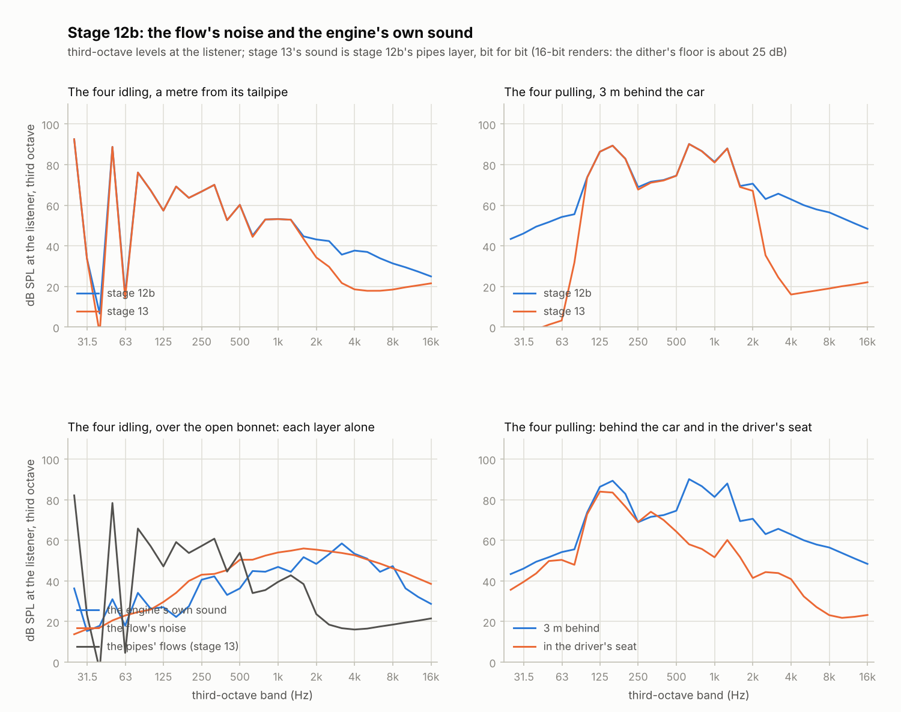

# Stage 12b — The flow's noise, the engine's own sound, and the cabin 🎧

**Status:** done (2026-10-20)

Stage 12 left three things for a stage 12b: the noise of the gas where it moves fast, the
engine's own mechanical sound, and a listener inside the car. After Bernardo found stage 12's
renders "dull and really artificial", the plan had spread them over the sound-realism stages
(S2–S4). This stage brings them back together, in their first form. It adds the sound the 1D gas
can't make (`core/src/noise.c`):
- **the flow's noise:**
  - the tailpipes' jets, by Lighthill's eighth-power law;
  - the exhaust valves' jets at blowdown, carried down the pipes and through the catalyst and
    the muffler to the tailpipe;
  - the throttle's and the idle valve's hiss, back through the air box to the intake's mouth;
- **the engine's own sound:** modal synthesis. Six damped resonances of the block and head,
  struck by what really strikes them: the pistons' force as it changes (combustion), piston slap
  at each dead centre, the valves seating and lifting off, the injectors' clicks. Radiated from
  the engine bay, which the body muffles unless the bonnet is open;
- **a listener in the driver's seat:** everything outside comes through the body (the mass law),
  the engine's torque comes through its mounts, and the cabin booms;
- **layers:** each part can be switched off (`rb_cli sound --layers`), to hear or measure the
  others.

Its fuzz run found a runaway in the pipes, from stage 10: held at high rpm with the throttle shut,
the runners near a vacuum, a pipe's flow could run away to many times the speed of sound and its gas
down to a few kelvin. Each face of a pipe is now held under twice the sonic flow of the gas it comes
from ("The pipes near a vacuum").

**What the plan asked:** idling and revving renders have the engine's mechanical sound under the
exhaust's, and the in-car render sounds like it's from inside.
- **From behind the car,** the engine's own sound is 21 dBA under the rest idling and 32 under it
  pulling, but it's there in the highs: 7 to 12 dB under them at 2–4 kHz, a ticking under the
  exhaust. Over the open bonnet it's the loudest thing above 2 kHz (17 dB over the rest at
  3000 rpm wide open).
- **In the driver's seat** the four pulling is 73 dBA, 19 under the same pull 3 m behind the car,
  and nearly nothing is left above 2 kHz (−39 dB of its energy; behind, −24). Whether it *sounds*
  like inside is Bernardo's call ("What to listen for").

**The highs are back.** Above 2 kHz the renders gained 3 to 29 dB of their energy share, and
their levels moved by 0.5 dBA or less (a straight pipe's, 2.5). The four pulling now has
−24 dB of its energy above 2 kHz and the cross-plane V8 −22 (stage 13: −40 and −26), inside the
real engines' range when revving (−42 to −6); the third-octave slope from 0.5 to 8 kHz is −8.0
and −6.2 dB an octave (stage 13: −21.9 and −14.7; real engines −2 to −8). On the overrun the
share above 4 kHz drops by 8 to 11 dB.



## The renders

`make render` (about four minutes) now also renders the four idling over the open bonnet, and from
the driver's seat idling and pulling, and the cross-plane V8 from the driver's seat. The
mufflers' renders are at half gain: with the valves' noise a straight pipe reached the soft
limiter (58 samples). All are clean: no DC (at least 66 dB under the RMS), nothing soft-limited,
no sample that isn't a number.

| Render | What | Stage 13 | Stage 12b | Above 2 kHz, 13 → 12b |
|---|---|---|---|---|
| `i4-idle.wav` | the four started and idling, from behind | 86.6 dB SPL, 60.8 dBA | 86.6, 61.2 | −55 → −41 dB |
| `i4-sweep.wav` | the four pulling wide open, from behind | 96.4, 92.2 | 96.4, 92.3 | −39 → −24 |
| `i4-idle-front.wav` | the four idling, over the open bonnet | | 85.8, 68.7 | −20 |
| `i4-idle-cabin.wav` | the four idling, in the driver's seat | | 81.5, 52.4 | −47 |
| `i4-sweep-cabin.wav` | the four pulling, in the driver's seat | | 90.6, 73.0 | −39 |
| `i4-3000-none.wav` | 3000 rpm wide open, a straight pipe, 1 m from the tailpipe (half gain) | 117.1, 105.5 | 117.3, 108.0 | −39 → −16 |
| `i4-3000-straight.wav` | the same, a straight-through | 117.0, 102.8 | 117.0, 103.3 | −38 → −26 |
| `i4-3000-chambered.wav` | the same, its chambered can | 103.3, 92.9 | 103.3, 93.1 | −56 → −27 |
| `v8-cross-3000-behind.wav` | the cross-plane V8, 3000 rpm wide open, from behind (half gain) | 109.7, 101.0 | 109.7, 101.2 | −33 → −25 |
| `v8-cross-3000-tailpipe.wav` | the same, 1 m behind the right tailpipe | 118.7, 109.6 | 118.7, 109.8 | −34 → −26 |
| `v8-cross-3000-side.wav` | the same, 4 m to its side | 107.9, 96.7 | 107.9, 96.9 | −39 → −27 |
| `v8-cross-3000-front.wav` | the same, over the bonnet | 110.2, 100.4 | 110.3, 100.6 | −41 → −24 |
| `v8-cross-3000-cabin.wav` | the same, in the driver's seat | | 96.8, 82.0 | −49 |
| `v8-cross-sweep.wav` | the cross-plane V8 pulling, from behind (half gain) | 111.8, 108.1 | 111.8, 108.2 | −24 → −21 |
| `v8-flat-3000.wav` | the flat-plane V8, 3000 rpm wide open, from behind | 105.7, 96.6 | 105.8, 97.0 | −29 → −22 |
| `boxer4-3000.wav` | the boxer, 3000 rpm wide open, from behind | 92.4, 83.1 | 92.4, 83.4 | −50 → −26 |
| `boxer4-3000-equal.wav` | the same, equal headers | 92.1, 80.5 | 92.1, 81.0 | −53 → −25 |

The levels are what the listener hears (`plot_sound.py --gain 0.5` undoes the half gain).

**The click check means something else now.** `plot_sound.py check` reports the loudest 5 ms above
5 kHz: in stage 12 at least 45 dB under the RMS, because there was nothing up there but a click
would stand out. Now there's real sound there, in bursts: the valves' noise with each blowdown,
the ticks. The loudest 5 ms is 16–31 dB under the RMS outside the car (50–57 in it), and none of
them is an artifact: the spectrograms show no line across the band but the rev limiter's cuts,
where the gas's flows jump in stage 13 too and the fuel's return makes a hard blowdown (13 dB over
the pull's highs).

**Stage 13's sound is still in there.** With only the pipes layer (`--layers pipes`) the renders
were stage 13's to the last bit (checked on the four and the V8, `cmp`), so every comparison here
is the same engine with and without the new layers. The pipes' new guard changes only the pulls'
overruns, by 55 to 75 dB under the signal; the idles and the held renders are untouched.

## Review of stage 13

- **The fuzzer only ever listened from behind the car.** It now stands the listener anywhere,
  the cabin too (`rb_cli fuzz` prints where), so the cabin's filters are fuzzed with the rest.
  Drawing the place changed every seed's drive, and the first full run found a stage 10 runaway
  ("The pipes near a vacuum").
- **The click check's threshold** (above) came from stage 11, when nothing was above 5 kHz.
- **`make render`'s note** still said three minutes; with this stage's renders it's about four.
- **The core's version** stays 0.13.0: the API didn't change (the new sound is inside the sim,
  and the browser still plays stage 1's tone until stage 14).

## What was built

| Piece | Files | Purpose |
|---|---|---|
| The flow's noise and the engine's sound | `core/src/noise.h`, `noise.c` | `rb_noise`: the tailpipes' jets, the exhaust valves' and the throttle's, the modes and their impacts, the mounts. Each physics step, Pa 1 m from each source. |
| The listener's new sources | `core/src/audio.h`, `audio.c` | `rb_listener_place_noise`, `rb_listener_push_noise`: pressures at the physics rate, each placed and delayed, the engine bay muffled by the body. |
| The cabin | `core/src/audio.h`, `audio.c` | `RB_HEAR_CABIN`: the body's low-passes, front and back, the mounts, the boom. |
| The sim | `core/src/rb_internal.h`, `rb_sim.c` | `sim->noise`, `sim->layers` (`RB_LAYER_PIPES`, `_FLOW`, `_ENGINE`), seeded with `RB_NOISE_SEED`. |
| The command line | `native/rb_cli.c`, `native/fuzz.h`, `fuzz.c` | `rb_cli sound --listener cabin`, `--layers`; the fuzzer's listener anywhere. |
| The pipes' guard | `core/src/pipe.h`, `pipe.c` | `RB_PIPE_MOST_SONIC`: no face's flow past twice the sonic flow of the gas it comes from. |
| Renders and charts | `Makefile`, `tools/plot_sound.py` | the cabin's and the bonnet's renders; `plot_sound.py bands`, third-octave levels side by side. |
| Tests and planted bugs | `tests/test_noise.c`, `test_pipe.c`, `test_engine.c`, `test_main.c`, `tools/bugs/stage12b.py` | 14 tests, 40 planted bugs. |

## The flow's noise

The pipes (stage 10) carry plane waves up to c/(πΔx), about 2.4 kHz in the exhaust's 7.5 cm cells:
the cliff in RESEARCH.md's "Sound realism". Real engines keep a broadband floor far above that,
and much of it is turbulence: gas moving fast through an opening or out into the air.

### The tailpipe's jet

The gas leaving a tailpipe is a jet, and a jet's turbulence radiates. Lighthill's law gives its
acoustic power:

  W = K ρ₀ U⁸ D² / c₀⁵,  K ≈ 4 × 10⁻⁵

U is the jet's speed (the tailpipe's volume flow over its area), D its diameter, ρ₀ and c₀ the
outside air's. Twice the speed is 256 times the power, 24 dB. A hot jet this slow is louder than a
cold one by about T_jet/T₀ (Tanna), taken from the tailpipe's end cell. A metre away, as a simple
source, p_rms = √(ρ₀ c₀ W / 4π).

Its spectrum peaks near the Strouhal number f D / U = 0.2 (170–400 Hz for a 50–60 mm tailpipe at
50–100 m/s) and falls 6 dB an octave of spectral density above, faster above 6 kHz. Below 150 Hz the pipes
already make the sound (the jet's flow *is* their flow), so a high-pass takes the jet's noise out
there. It's white noise through these filters, its level following the flow every physics step:
it comes and goes with each pulse, and drawing air in there is no jet.

On a pull the jet adds a faint rumble under 63 Hz (45–55 dB, from the high-pass's slope), 30 dB or
more under the firing's bands.

### The jets inside: the exhaust valves and the throttle

At blowdown the exhaust valve's gap is choked: the gas at several bar leaves at the speed of sound.
Such jets are where an engine's flow noise is made, and they're inside it. A share η of a jet's
stream power ½ ṁ U² becomes sound, and η goes as M⁵ (M = U/c, at most 1: choked, the gas can't go
faster). This is the simple form of the control-valve noise standard (IEC 60534-8-3), with one
constant, `VALVE_ETA` = 2 × 10⁻³ for a choked jet, calibrated against the real engines' energy
above 2 kHz.

That sound travels with the gas: each cylinder's down its header, the exhaust pipe, the muffler and
the tailpipe, at about 580 m/s (the exhaust's speed of sound at 900 K). It's written ahead into a
ring and comes out of its system's tailpipe when it gets there: 5–6 ms later for the presets. On the way the
catalyst takes half of its power, and the muffler its share: a chambered can 0.4 % (−24 dB), a
packed straight-through 8 % (−11 dB), a straight pipe nothing. Small fast jets put their sound high
(their Strouhal peaks are above the audible band), so what comes out is a band from about 1 kHz,
where the pipes' own sound fades, falling 6 dB an octave of spectral density, and 12 above where
the way out takes off the highs (3.5 kHz for a can, 6 for a straight-through, 9 for a straight
pipe).

The throttle at part load and the idle valve beside it are jets too, choked at idle. Their hiss
goes back through the air box and its filter (0.3 % of the power, −25 dB) to the intake's mouth.

## The engine's own sound

### Modal synthesis

The cylinders' pressure and the parts' impacts shake the block and the head, which ring at their
own frequencies; the engine bay radiates that. The model is modal synthesis (van den Doel and Pai;
Cook): six damped resonators, each struck by impulses, the sum radiated from the middle of the
engine bay.

| Mode | f (86 mm bore) | Q | Struck hardest by |
|---|---|---|---|
| the block, bending | 950 Hz | 10 | combustion |
| the block's skirt | 1750 Hz | 14 | piston slap |
| the liners | 2700 Hz | 18 | slap, the valves |
| the head | 3500 Hz | 22 | the valves |
| the cam cover and valvetrain | 5500 Hz | 28 | the valves, the injectors |
| the injectors' rail | 7800 Hz | 30 | the injectors |

A bigger block rings lower: each mode moves by √(0.086 m / bore), so the V8's are 3 % lower than
the four's. Each resonator is y[n] = x[n] sin(ωΔt) + 2r cos(ωΔt) y[n−1] − r² y[n−2], r =
e^(−πfΔt/Q): an impulse of height A rings at amplitude A, decaying in Q/(πf), whatever the physics
rate.

### What strikes them

- **Combustion:** the change, each step, of the pistons' total force (p − p_ambient) A. The block
  passes quick rises far better than slow ones (its attenuation curve, Priede), and a step's change
  is that: steep pressure rises strike hard, the slow swell of compression barely.
- **Piston slap:** at each dead centre the piston's side thrust changes sign and it crosses its
  clearance to hit the other side of the bore (Ungar and Ross), as hard as the axial force on it
  then: the gas's, less the parts' inertia, m r ω² (1 + λ) at TDC and less (1 − λ) at BDC (m the
  piston, pin and the rod's small end, about 0.45 kg at an 86 mm bore; λ = r/l). After firing TDC
  the gas wins: the slap follows the load (at 3000 rpm wide open a cycle's four slaps are 6.5
  times as hard, RMS, as with the throttle nearly shut).
- **The valves:** each seats as fast as the cam's closing ramp brings it down, and that goes as the
  rpm: twice the rpm, twice each tick. Lifting off is a third of that. Two valves of a cylinder add
  their energies.
- **The injectors:** a click as each one opens, when the intake valve opens, only while fuel flows
  (not motored, not on a fuel cut).

No two impacts are the same (the oil film, the clearances, the cam's wear), so each slap and valve
varies at random by 25 % (RMS). Without that the ticking was a machine's.

The impacts are counted (`rb_noise.impacts[]`) for the tests: a cylinder slaps four times a cycle,
seats its valves twice, lifts them twice and clicks its injector once when fired.

### The mounts

The gas torque's swings shake the engine on its mounts, which pass them into the body: 20–200 Hz,
not the torque's mean. Only the cabin hears them.

## The cabin

`--listener cabin` sits in the driver's seat. Everything outside comes through the body, whose
transmission loss rises 6 dB an octave (the mass law, Fahy): 0.3 of the pressure outside below a
corner, a one-pole low-pass above. The firewall lets through more than the floor and the boot, so
what comes from in front (the engine bay, the intake's mouth) has its corner at 200 Hz, what comes
from behind (the tailpipes) at 100 Hz. The mounts add their pressure. Last, the cabin's lowest mode,
about c/2L for its 3.1 m, booms: a peak of 8 dB at 55 Hz (Q 2.5).

In the cabin, everything waits for the nearest source: the engine bay, 1 m from the driver's head.
The flows' delays grow to match, so every path still arrives as late as it's long.

## The listener's new sources

The flow's noise and the engine's sound come as pressures 1 m from their sources, every physics
step, while the pipes' flows come once a pipe step. The listener keeps them at the physics rate (in
rings of 8192 steps, 43 ms), each heard at (1 m)/r, as late as its path is long, straight and off
the ground, like the flows. The tailpipes' and the mouth's noise come from where their flows do;
the engine bay's from the engine's middle. With the bonnet shut most of the engine bay's sound
leaves under the car, so away from the open bonnet it's heard at 0.3 (−10 dB; 0.4 beside the car).

## The pipes near a vacuum

The fuzzer's first full run of this stage failed one engine in twenty: the four with a 35 mm intake
valve and a 115 mm rod, at 4.08 s, its first cylinder at 10¹⁵ Pa. The noise can't have done it (it
only reads the engine), and the run went back to stage 10's pipes:
- the throttle shut at 4600 rpm, the fuel cut and the idle valve closed, the plenum fell to 8 kPa and
  filled with hot gas the cylinders pushed back;
- each intake stroke then pulled the runner's gas towards the valve, and the column's momentum
  carried on past what its gas could give: 0.16 kg/s through the runner's plenum end, five times the
  sonic flow of the gas there. The cell it left emptied and cooled to 130 K, then 1 K;
- in 2 ms the runner's cells were at 1 K and 2.8 × 10⁶ K, and the gas the cylinder drew in carried
  5 × 10¹⁷ J/kg.

The 1D scheme carries waves on a flow well under the speed of sound; it can't carry gas much
faster than sound. Held at 6000 rpm with the throttle shut, four presets' faces passed twice their
gas's sonic flow, the cross-plane V8's 58 times it, and its pipes' gas fell to 13 K (the boxer's to
24 K). In normal running no face passes 1.13 times it (wide open at 6000 rpm, at the valves).

So a face's flow is held under twice the sonic flow of the gas it comes from, A √(1.4 ρ p)
(`RB_PIPE_MOST_SONIC`). A constant-area pipe chokes at the speed of sound (Fanno flow), so the
guard never takes from a physical flow; and a cell can lose at most 2c Δt/Δx of its gas through a
face in a step. Held at 6000 rpm with the throttle shut, no pipe's gas is now colder than 160 K;
the failing run drives its 10 s; the idles and held renders are bit for bit what they were, and the
pulls change only on their overrun, 55–75 dB under the signal.

The plenum's 5–9 kPa at high rpm with the throttle shut is deeper than real engines' (about
20 kPa: their throttles leak, and their computers keep the idle valve a little open on the
overrun). That's for a later stage.

## Calibration

What's physics and what's tuned:
- **Physics:** Lighthill's law and its constant, the hot jet, the M⁵ of the inner jets, their
  delays, the impacts' timing and their sizes' dependence on load and rpm, the modes' scaling with
  the bore, the inertia, the mass law's slope.
- **Tuned against the recordings** (`tools/compare_real.py`): the inner jets' η (the energy above 2
  kHz behind the car), the muffler's and air box's passes (each from the transmission losses Munjal
  gives, then checked by ear), the impacts' sizes (`K_FORCE`, `K_SLAP`, `K_VALVE`, `K_INJECTOR`:
  over the open bonnet, the share of the energy above 1, 2 and 4 kHz like the recorded Honda V6's in
  front, and the engine's own sound about 63 dBA idling and 83 at 3000 rpm wide open), the
  impacts' spread (by ear), the modes' table (the octaves where piston slap and valve noise are
  strongest in the literature), the cabin's corners, its boom and the engine bay's shielding.

The numbers, as compare_real.py measures them (the share of the energy above 1, 2 and 4 kHz,
the third-octave slope from 0.5 to 8 kHz, and the crest factor, all in dB):

| Idling | >1k | >2k | >4k | slope | crest | repeats: lo | mid | hi |
|---|---|---|---|---|---|---|---|---|
| real engines at the exhaust (5) | −20…−42 | −25…−45 | −29…−47 | −3…−7 | 9…15 | 5…13 | −5…−10 | −10…−13 |
| the four, 1 m from its tailpipe: stage 13 | −38.8 | −59.2 | −66.6 | −11.6 | 7.1 | 38.4 | 13.9 | 6.2 |
| the same, stage 12b | −38.0 | −47.3 | −52.5 | −6.2 | 7.1 | 38.3 | 11.2 | −8.9 |
| the four, from behind: stage 13 | −39.8 | −55.2 | −57.4 | −8.5 | 6.9 | 38.5 | 14.1 | −0.2 |
| the same, stage 12b | −36.5 | −41.3 | −46.7 | −3.7 | 7.0 | 38.4 | 5.0 | −8.3 |
| the recorded Honda V6, in front | −17.0 | −23.8 | −27.3 | −2.7 | 11.0 | 10.6 | −7.1 | −12.3 |
| the four, over the open bonnet: stage 13 | −38.6 | −55.4 | −56.5 | −8.5 | 7.3 | 39.1 | 13.9 | −5.6 |
| the same, stage 12b | −18.1 | −19.9 | −26.1 | −0.4 | 8.4 | 31.6 | −6.5 | −0.9 |
| the four, in the driver's seat | −44.0 | −46.8 | −49.0 | −2.7 | 6.4 | 40.5 | −4.6 | −4.2 |

| Revving | >1k | >2k | >4k | slope | crest |
|---|---|---|---|---|---|
| real engines revving (6) | −4…−33 | −6…−42 | −10…−45 | −2…−8 | 10…15 |
| the four pulling, from behind: stage 13 | −7.6 | −40.0 | −68.0 | −21.9 | 10.8 |
| the same, stage 12b | −7.5 | −24.3 | −30.0 | −8.0 | 12.0 |
| the four's overrun: stage 13 | −3.1 | −38.0 | −61.4 | −15.7 | 10.0 |
| the same, stage 12b | −3.1 | −30.0 | −38.1 | −7.2 | 10.0 |
| the V8 pulling, from behind: stage 13 | −9.2 | −26.1 | −52.2 | −14.7 | 13.5 |
| the same, stage 12b | −8.9 | −22.0 | −29.2 | −6.2 | 13.6 |
| the V8's overrun, stage 12b | −3.4 | −26.1 | −40.4 | −11.1 | 9.8 |
| the four pulling, in the driver's seat | −26.5 | −39.3 | −51.9 | −9.3 | 7.7 |

What they say:
- **Above 2 kHz, from behind, idling and revving are in the real range now.** A metre from the
  tailpipe the four's idle is still 2 dB under the quietest recording (−47 against −45): its can
  takes 24 dB off the valves' noise, and an idle's tailpipe jet is slow.
- **Over the open bonnet the four sounds like the recorded Honda's engine bay** above 1 kHz
  (−18, −20, −26 against −17, −24, −27).
- **The highs drop on the overrun,** by 8 dB (the four) and 11 (the V8) above 4 kHz: no blowdown
  without combustion, and a slower jet.
- **The cycle still repeats** at +38 below 500 Hz (real: 0 to +13) and at +5 to +11 at 0.5–2 kHz
  behind the car (real: −5 to −10): stage S1's work. Above 2 kHz it no longer does (−8 to −9).
- **The crest factor idling** is still 7 dB (real: 9 to 15): S1's variation, again.

## Cost

Callgrind counts 4.8 % more instructions per step than stage 13 for the cross-plane V8 and 6.4 %
for the four (about 4 and 2.4 thousand a step). The new sound is 2.6 and 4.1 % of it: a few random
numbers and filters per source, six resonators, and the listener's eight new paths. The pipes'
guard is the other 2 %: a few multiplications per face. In wall time that's lost in the VM's 20 %
swings (best of three, interleaved, before the guard: the four 1.48× real time before and 1.45×
after, the V8 0.65× and 0.64×). The WebAssembly core grew from 91.5 to 102.1 kB, and the sim by
160 KB of memory (the listener's rings and the exhaust's ring). The tests: 137 in about 3.8
minutes.

## Tests that can fail

New tests, in `tests/test_noise.c`, and two for the pipes' guard: 137 tests in all, 2180 checks,
clean under ASan and UBSan too.

| Test | What it checks |
|---|---|
| `test_noise_jet_eighth_power` | a 600 K jet at 100 m/s within 0.5 dB of Lighthill's law, less the band's share; twice the speed 48 dB (±1); no jet drawing in; each of two tailpipes its own |
| `test_noise_valve_jets` | the valves' noise arrives exactly when its path says; twice the flow 24.1 dB below choking, 3 dB choked; the level of the law through a can to 0.5 dB; each muffler's share; two systems each out of its own tailpipe |
| `test_noise_throttle_hiss` | the throttle's hiss at the mouth only, 3 dB for twice the flow choked; the idle valve's as loud for the same flow |
| `test_noise_impacts_per_cycle` | each cylinder's 4 slaps, 2 seats, 2 lifts a cycle, and an injection fired only |
| `test_noise_strikes` | posed by hand: slap from the inertia alone 16 times the energy at twice the speed, and with the gas as strong as the inertia exactly as λ says; each valve event one impact of its kind; a force step rings in proportion and dies away |
| `test_noise_ticks_and_clatter` | twice the rpm, 4 times a seat's energy; slap 1.5 times harder wide open |
| `test_noise_modes_follow_the_bore` | the modes' frequencies and decay, and their move with the bore |
| `test_noise_repeatable` | the same seed the same noise, another other noise; silence at rest; a NaN slap gives silence, then the noise carries on |
| `test_noise_mounts` | posed: their filters' response at 100 Hz and 2 kHz to 0.5 %, the mean not passed; on the four wide open, its firing far stronger than at light load |
| `test_audio_noise_sources_placed` | each source's gain and delay, the flows waiting for a nearer noise source, the bay's shielding |
| `test_audio_cabin` | the body's filters front and back and the boom, to 0.5 % of their responses |
| `test_audio_engine_bay` | over the open bonnet the engine's own sound over 10 dB above the rest at 2–8 kHz; behind the car under it |
| `test_pipe_most_sonic` | a pipe from 10 bar into a near vacuum: its faces reach twice the sonic flow of their gas, and never pass it |
| `test_engine_vacuum` | the cross-plane V8 and the boxer held at 6000 rpm, the throttle shut: the plenum near a vacuum, no pipe's gas under 100 K |

Each bug below (`tools/bugs/stage12b.py`) was planted on its own in a copy of the sources with
`tools/plant_bugs.py`, and each was caught. Three slipped through at first:
- **the jet's flow taken whichever way it went** wasn't a bug at all as first planted: an inflow
  made the filter's coefficient negative and its normalisation NaN, which the NaN guard turned into
  silence. Planted as a jet from the flow's size, it's caught;
- **the mounts without their 200 Hz low-pass** and **the NaN guard switched off** passed: the
  engine-driven test couldn't tell, and no test's NaN ever reached the outputs. Both tests now pose
  the engine by hand (a tone in the torque; a NaN pressure through a slap).

Writing the table found one more before it was planted: the jet's test tailpipe was at the outside
air's temperature, where the hot jet's factor is 1. It's 600 K now.

| Bug | Caught by |
|---|---|
| the jet's power as U⁶ | `test_noise_jet_eighth_power` |
| the jet always cold | the same |
| the jet's band not normalised | the same |
| a jet drawing air in | the same |
| the second tailpipe silent | the same, `test_noise_valve_jets` |
| the inner jets' power as M³ | `test_noise_valve_jets` |
| the inner jets never choked | the same, `test_noise_throttle_hiss` |
| the valves' noise not delayed | `test_noise_valve_jets` |
| the valves' ring never cleared | the same |
| a straight-through passing a can's share | the same |
| the catalyst ignored | the same |
| every cylinder's noise out of tailpipe 1 | the same |
| the idle valve silent | `test_noise_throttle_hiss` |
| the hiss out of the tailpipe | the same |
| slap without the inertia | `test_noise_strikes` |
| slap's λ the wrong way round | the same |
| slap at TDC only | `test_noise_impacts_per_cycle`, `test_noise_strikes` |
| the exhaust valves seating at EVO | `test_noise_strikes` |
| the seats not following the rpm | `test_noise_ticks_and_clatter` |
| the injectors clicking motored | `test_noise_impacts_per_cycle` |
| combustion striking with the force, not its change | `test_noise_strikes` |
| the modes not moving with the bore | `test_noise_modes_follow_the_bore` |
| the modes' Q inverted | the same |
| the mounts passing the mean | `test_noise_mounts` |
| the mounts without their low-pass | the same |
| the NaN guard off | `test_noise_repeatable` |
| the engine bay never shielded | `test_audio_noise_sources_placed` |
| the noise's delays not from the nearest path | the same |
| the flows not waiting for a nearer noise source | the same |
| never in the cabin | the same, `test_audio_cabin` |
| the firewall's corner the floor's | `test_audio_cabin` |
| the mouth heard through the floor | the same |
| the boom a dip | the same |
| the cabin without the mounts | the same |
| the cabin's filters never designed | the same |
| the layers ignored | `test_audio_engine_bay` |
| the noise never placed | the same |
| the noise never pushed | the same |
| the pipes without the sonic guard | `test_pipe_most_sonic`, `test_engine_vacuum` |
| the guard taking the wrong side's gas | the same |

## Tests that changed

None of the old ones. The fuzzer's runs changed (each now picks a listener first, so a seed makes a
different run than in stage 13); `test_fuzz_random_engines` passes, and `make fuzz` (20 engines, 10
s each) too, once the pipes had their guard.

## What doesn't sound like a real engine yet

- **Each cycle still repeats the last** below 2 kHz: the pipes' sound is stage 13's, and its
  cycle repeats at +38 dB (S1).
- **A metre from a can's tailpipe the idle is a little dull** (−47 dB above 2 kHz; the recordings
  −25 to −45). The finer exhaust and the tailpipe's beaming (S2) are the next step there.
- **The engine's own sound is six modes,** the same on every engine but for the bore. A V8's block
  and an inline four's aren't the same shape; the table could become the engine's.
- **No cam drive's whine,** no alternator, no fan: a running car's other sounds.
- **The cabin is mono and has no reverberation** of its own (S4).
- **The throttle's hiss over the open bonnet** at idle is as loud as the engine's own sound at 2–4
  kHz. Real intakes hiss there too, but the air box's 25 dB is a guess.

## Three things that surprised me

- **A planted bug was harmless.** Taking the jet's flow whichever way it went made the filter's
  coefficient negative and its normalisation NaN, which the guard turned into silence: the code
  failed safe. The table now plants the bug that would have made noise.
- **A sound stage found a stage 10 runaway.** Letting the fuzzer pick where to listen changed its
  random drives, and the first full run found the pipes running away near a vacuum: gas at 13 K
  in the cross-plane V8's runners, held at 6000 rpm with the throttle shut. No render goes there,
  but the browser's controls will.
- **A straight pipe's valves are loud.** With nothing between the valves and the air, their jets
  put 0.6 % of the power above 5 kHz, a hundred times the can's, and pushed the render into the
  soft limiter.

## What to listen for (Bernardo checks)

Run `make render` (about four minutes), then play `renders/*.wav` on headphones or speakers.
- **`i4-idle.wav` and `i4-sweep.wav`, from behind:** less dull? The idle should have a light
  ticking and hiss under the exhaust; the pull a rasp that grows with the load, dropping when the
  foot comes off.
- **`i4-idle-front.wav`, over the open bonnet:** does it sound like an engine bay: ticking, clatter,
  hiss?
- **`i4-idle-cabin.wav`, `i4-sweep-cabin.wav`, `v8-cross-3000-cabin.wav`:** does it sound like
  you're inside the car? Muffled, boomy, the engine more than the exhaust?
- **`i4-3000-none.wav`, `-straight.wav`, `-chambered.wav`:** the straight pipe should rasp now; the
  can should still be muffled.
- **The knobs, if something's off:** the impacts' sizes and spread (`K_FORCE`, `K_SLAP`,
  `K_VALVE`, `K_INJECTOR`, `IMPACT_SPREAD`), the inner jets' η (`VALVE_ETA`, `THROTTLE_ETA`), the
  passes (`PASS_*`), all in `core/src/noise.c`; the cabin's in `core/src/audio.h`
  (`RB_CABIN_*`). To hear one layer: `--layers engine`, `--layers flow`, `--layers pipes`.

## Try it

```bash
make render
build/rb_cli sound --preset i4 --idle --listener front --layers engine -o renders/i4-engine.wav
build/rb_cli sound --preset v8-cross --sweep --listener cabin -o renders/v8-cabin.wav
build/rb_cli sound --preset i4 --hold --rpm 4500 --muffler none --listener tailpipe --gain 0.3 -o renders/i4-raw.wav
python3 tools/plot_sound.py bands renders/i4-sweep.wav@3-10.5:behind renders/i4-sweep-cabin.wav@3-10.5:inside
python3 tools/compare_real.py compare --kind rev renders/i4-sweep.wav@3-10.5:"the four pulling"
python3 tools/plant_bugs.py 12b --list
```

## Notes for later stages

- **Stage S1 (variation):** the noise is seeded (`RB_NOISE_SEED`) and so stays reproducible; S1's
  generator can be its own. What repeats now is the pipes' sound: varying the burn will vary the
  blowdowns, and with them the valves' noise, which follows the flow through the valve.
- **Stage S2:** the jet and the valves' noise are in; what's left is the finer exhaust, the
  tailpipe's beaming and the baffles' own noise. The valves' noise is a stand-in for what the 1D
  gas can't carry: with finer cells some of its band will come from the pipes, and `VALVE_ETA`
  should come down.
- **Stage S4:** the cabin is a place with a listener; stereo gives each ear its paths. The
  listener's noise sources are pressures at the physics rate, a different kind from the flows: a
  second ear needs both.
- **Stage 14:** the browser hears the noise as soon as it plays the engine. The layers could be a
  developer's switch.
- **Stage 15:** a "listen from" control (`sim->hear`, then `rb_sim_listen`).
- **Stages 17–19 (3D):** the engine bay's source is at the engine's middle; the 3D view could show
  where the sound comes from.
- **Stage S5:** every calibrated constant is listed in "Calibration".

## Sources

- M. J. Lighthill, "On sound generated aerodynamically. I. General theory", *Proceedings of the
  Royal Society A* 211, 564–587 (1952): the U⁸ law.
- M. E. Goldstein, *Aeroacoustics*, McGraw-Hill (1976): jet noise's constant and spectrum.
- H. K. Tanna, "An experimental study of jet noise. Part I: Turbulent mixing noise", *Journal of
  Sound and Vibration* 50 (3), 405–428 (1977): hot jets at low speed.
- IEC 60534-8-3, *Industrial-process control valves. Part 8-3: Noise considerations. Control valve
  aerodynamic noise prediction method* (2010): a jet's acoustic efficiency, choked and not.
- M. L. Munjal, *Acoustics of Ducts and Mufflers*, 2nd ed., Wiley (2014): the mufflers'
  transmission losses.
- K. van den Doel, D. K. Pai, "The sounds of physical shapes", *Presence* 7 (4), 382–395 (1998);
  P. R. Cook, *Real Sound Synthesis for Interactive Applications*, A K Peters (2002): modal
  synthesis.
- T. Priede, "In search of origins of engine noise: an historical review", SAE paper 800534 (1980):
  combustion noise and the structure's attenuation.
- E. E. Ungar, D. Ross, "Vibrations and noise due to piston-slap in reciprocating machinery",
  *Journal of Sound and Vibration* 2 (2), 132–146 (1965).
- F. Fahy, P. Gardonio, *Sound and Structural Vibration*, 2nd ed., Academic Press (2007): the mass
  law.
- R. Bristow-Johnson, "Cookbook formulae for audio EQ biquad filter coefficients": the boom's
  peaking filter.
- S. Vigna, "An experimental exploration of Marsaglia's xorshift generators, scrambled", *ACM
  Transactions on Mathematical Software* 42 (4), 30 (2016): xorshift64*.
