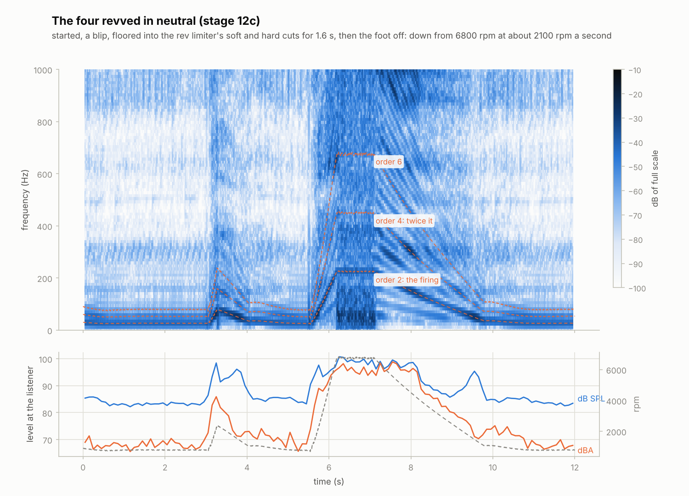
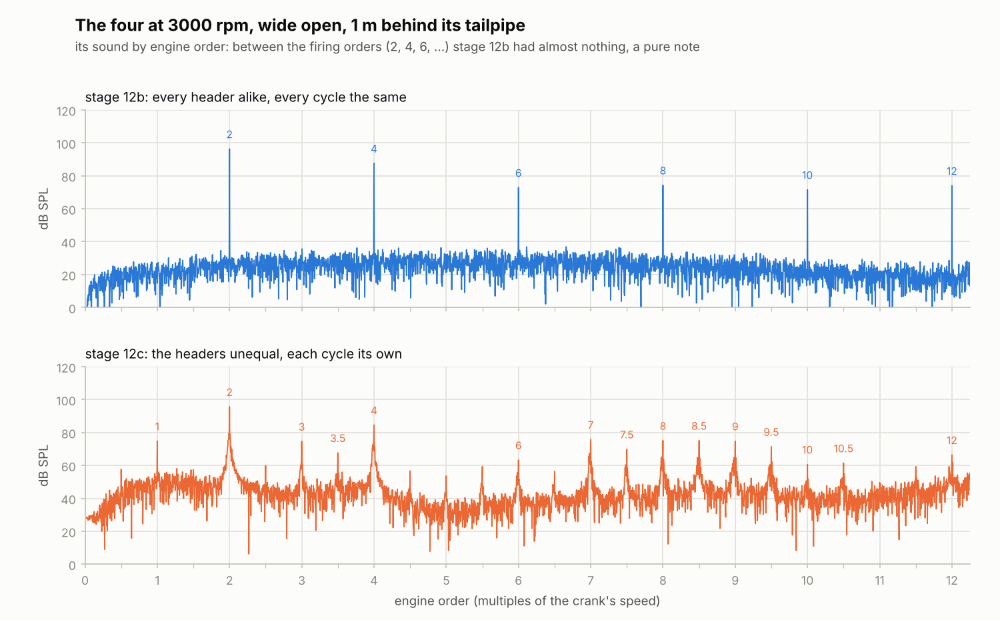
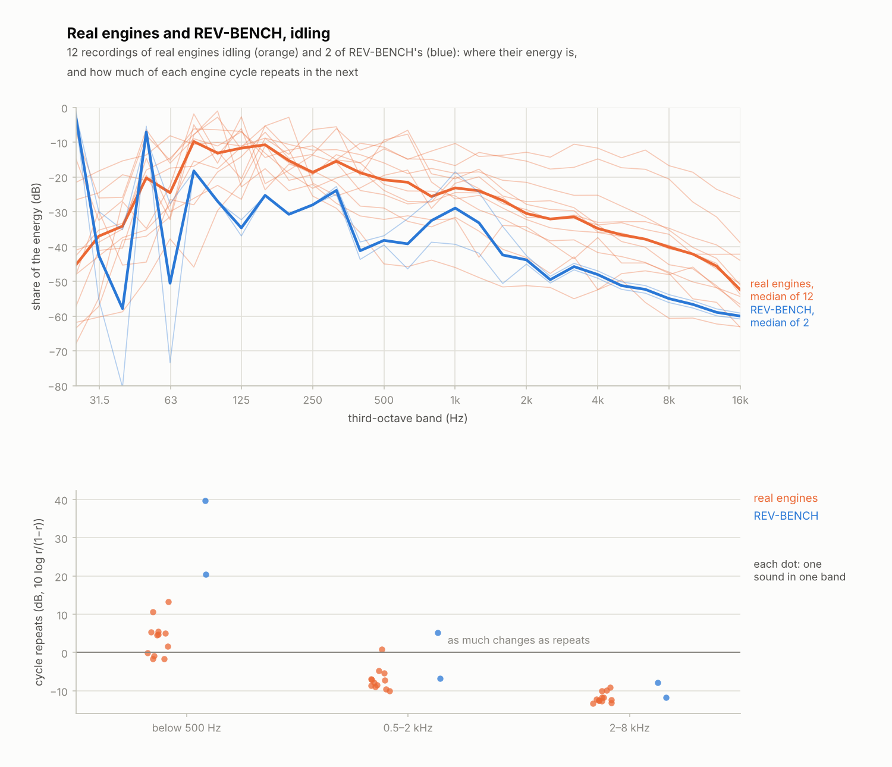

# Stage 12c — Rough, not a piano note: variation, the limiter, the deceleration 🎧

**Status:** done (2026-10-20)

Bernardo, after listening to stage 12b's renders:

> Honestly, the 3000 on all engines feel like they should be the idle. The sound are better yes
> but they are still lacking. the rev limiter is very weird because of the huge gap and the
> deceleration feels very off. [...] Search for iconic cars with those engines and try finding
> samples of engines that are as little muffled as possible so that you can hear the true tone.

> I feel that the sound is too smooth, it should feel less smooth and maybe more raspy and less
> like a piano note if that makes sense

This stage measured why, against more recordings of real engines, and changed what the
measurements pointed at:
- **no two cycles alike:** each burn starts and runs its own way, the cylinders differ a little,
  and the exhaust valves' jets flicker (`variation`, stage S1's core brought forward);
- **unequal headers** on the four, the six and the cross-plane V8, as production manifolds have:
  their cylinders no longer all sound the same;
- **the accessories** (alternator, pumps): the idling engine works against a realistic load, and
  the presets' idle valves and gains were retuned for it;
- **a real rev limiter:** a soft cut that skips single sparks at random, then the hard cut;
- **real drives:** the held renders on a dyno with the crank free, a pull with the road's load
  that ends with the clutch in and the engine falling back to idle, and revs in neutral like
  the recordings;
- **the measurements** that found all this: `tools/orders.py`, and `compare_real.py`'s new
  `steady` kind with five more recordings.



## What the recordings and the renders showed

The recordings (Freesound, CC0, CC BY and Sampling+; `tools/real_engines.csv`) now include a Ford
GT V8 revving at its exhaust outlets, a 1989 Porsche 911T revving behind its pipes, a Toyota
Tercel four revving from under the engine, a bumpy-cammed Chevy 350 from its engine bay and a
Corvette LS6 V8 held at 3000 rpm. Measured with stage 12b's tools and two new ones:

- **A piano note.** Below 500 Hz each of our cycles repeated the last one to +28…+40 dB (r of
  0.998 and more): an exact loop. Real engines read −2 to +13 dB idling. A cycle-by-cycle average
  (each cycle against the mean cycle, the cut following the speed) put real idles' low band
  65–95 % off the mean cycle, stage 12b's 0.04 %.
- **Every firing the same.** `tools/orders.py` measures the orders between the firing ones (for
  the four: 0.5, 1, 1.5, 2.5, ...) against the firing orders (2, 4, ...). Real engines read −12 to
  +11 dB (a Lancer four −11, a WRX boxer −7, V8s −3 to +11). Our four read −72 dB idling and −33
  to −41 at 3000 rpm: every cylinder's pulse identical, so only the firing frequency's harmonics
  were left, the very thing a piano note is. Only the boxer (unequal headers since stage 12) and
  the V8s were in the real range.
- **Idling, no blowdown.** The four idled at 25 kPa in its manifold (real ones run 30–40), with
  its cylinders at 0.78 bar when their exhaust valves opened: below the exhaust's own pressure,
  so the gas went back into the cylinder and nothing "popped". The idle's sound was the pistons
  pushing the gas out, a smooth 27 Hz with weak harmonics: A-weighting took 26 dB off it (real
  idles: 1–18, median 11).
- **The limiter's gap.** In gear, with a car's 3 kg m² on the crank, the hard cut held 0.6 s
  before the speed fell the 100 rpm back to where it fired again. Real limiters bounce 10–30
  times a second.
- **The deceleration.** The pull's foot came off at the limiter and the crank, still carrying the
  car, lost 146 rpm a second; the render ended 2 s later at 6500 rpm. Revved in neutral, real
  engines fall 1000–4000 rpm a second.
- **A caveat about the recordings.** Recorded "at the exhaust", a microphone sits in the exhaust's
  jet: its puffs blow on it (½ρu² of 20 m/s is 80 Pa, louder than the sound itself at 30 cm), so
  those recordings hold turbulence no listener a few metres away hears. Their low band changes
  from cycle to cycle partly for that. The orders between the firing ones don't depend on it.

## What was built

### No two cycles alike (`core/src/engine.c`, `core/src/rand.h`)

`e->variation` (0 by default, as the tests and the dyno numbers want; `rb_cli sound` uses 1):
- **each burn its own:** at intake valve closing, the burn's start moves from the spark by 7 % of
  the burn's length (RMS) and its length changes by 6 % (RMS), from two normal numbers correlated
  0.5 (a slow start mostly means a slow burn), each kept within 3 RMS. The engine computer times
  the spark for the burn it expects, not this one. `b->start_angle` is where the burn's Wiebe
  curve starts; `b->spark_angle` stays the computer's spark;
- **each cylinder its own:** two normal numbers per cylinder drawn at init, their mean over the
  cylinders taken away: its mixture (2 % RMS of the fuel, the injectors and the ports' air) and
  its burn length (4 %, its swirl);
- **the exhaust valves' jets flicker:** each valve's area times 1 + 15 % (RMS) of white noise
  through a one-pole low-pass at 2 kHz, while the valve is open. The pipes carry it to the
  tailpipe as a rasp;
- **seeded:** `rand.h` is xorshift64* (Vigna), the same generator noise.c had (it uses it now);
  the cycles and the flicker each have their own state, so renders repeat to the last bit;
- `b->work`, `b->last_work`: each cylinder's work over its own cycle (its IMEP times its swept
  volume), for the tests and later the 3D view.

With variation 0 the engine is bit-identical to stage 12b's (a render compared by its checksum
before the presets changed).

### Unequal headers (`core/src/presets.c`)

A production manifold's runners aren't all alike: they reach the collector from where each port
is. The four's headers run from 58 cm at the front to 30 cm (`{0.58, 0.40, 0.30, 0.52}`, the mean
still 45 cm), the six's outer ones are longest (`{0.48, 0.40, 0.32, 0.32, 0.40, 0.48}`), the
cross-plane V8's front ones (`{0.52, 0.52, 0.44, 0.44, 0.36, 0.36, 0.28, 0.28}`, each bank's
manifold leaving at its back). The flat-plane V8 keeps its tuned equal headers, the boxer its
unequal ones. `rb_engine_desc_default` (the stage 5–9 engine the tests use) keeps equal ones.

### The accessories (`accessory_power`, an engine field)

The alternator for the car's electrics and the pumps: a steady torque below 1500 rpm (an
alternator can't give its full output that slowly; a power steering pump takes about the same
torque at any speed), `accessory_power` above it, nothing while the engine cranks (they come in
between 300 and 500 rpm). They count as friction, as Heywood counts them. A first version took a
constant power at every speed: as the speed sagged the load grew, and the six hunted ±50 rpm at
idle. The presets take 800 W (the four, the boxer), 950 W (the six, the flat-plane V8) and 1250 W
(the cross-plane V8): 5–8 N m idling. Twice that made the idle controllers hunt, so the presets
stop where the existing control works. The four now idles at 28 kPa (from 25), its FMEP 0.86 bar
(from 0.53). Each preset's idle valve was resized so it idles about 15 % open again, and its
gains scaled down by the valve's growth (docs/stage-08.md's rule: a start, a 30 % blip, a 10 N m
load at idle, room for gains 1.5 times stronger):

| preset   | accessories | idle valve | gains (P/I, ×10⁻⁴) | MAP idling | valve open |
|----------|------------:|-----------:|-------------------:|-----------:|-----------:|
| i4       |       800 W |     47 mm² |          2.4 / 2.4 |     28 kPa |       15 % |
| i6       |       950 W |     56 mm² |          4.4 / 3.2 |     30 kPa |       15 % |
| v8-cross |      1250 W |     95 mm² |          5.1 / 2.6 |     35 kPa |       13 % |
| v8-flat  |       950 W |    135 mm² |          4.2 / 3.4 |     58 kPa |       15 % |
| boxer4   |       800 W |     43 mm² |          2.6 / 3.1 |     28 kPa |       15 % |

At 3000 rpm the accessories take 1–1.5 % of the brake torque.

### The rev limiter's soft cut

In the 150 rpm below the rev limit the engine computer skips single sparks at random, a share
growing from none to all across the band (`soft_cut`): a racing ECU's soft cut. Above the limit the
hard cut stops every spark until the crank is back 100 rpm under it, as before. Held by a dyno the
computer is off and nothing is cut. `e->limiter_cuts` counts the sparks it cut. Floored in
neutral, the four fires about a quarter of its sparks at the limit and bounces off the hard cut
8 times a second, never quiet for 0.1 s; in gear the soft cut holds it in its band, and it never
stops firing for 0.2 s (it did for 0.6 s).

### The drives (`rb_cli sound`)

- **`--hold`** settles held for 1.5 s, then puts stage 9's dyno on the crank: the sim steps it
  before the engine every physics step (`sim->dyno`, internal; a rebuilt engine drops it). The
  crank is free, so each firing and each cycle moves it a little, as they do a real engine's.
- **`--sweep`** pulls with the road's load on the crank (1300 kg, 31 cm wheels geared so the car
  is the crank's 3 kg m² less the engine's own, rolling resistance 0.012, CdA 0.7 m²). A second at
  the limiter, the foot off for 0.4 s in gear, then the clutch goes in: the car's inertia leaves
  the crank, which falls back to idle (6000 to 2000 rpm in 1.9 s for the four), and the render
  ends 1.5 s after.
- **`--rev`** (new, 12 s): started with the key, a 0.25 s blip at 3 s, floored at 5.5 s into the
  limiter for 1.6 s, then the foot off and back to idle, in neutral: what the recordings do.
- **`--variation V`** (default 1; 0 is stage 12b's exact loop), **`--headers L,L,...`**, **`--load N`**
  (a load at idle, N m).

The fuzzer gives each random engine a variation between 0 and 2 (`var` in its table).

## The renders

`make render` (5.5 minutes): the four idling, pulling and revving from behind, idling at the
bonnet and in the cabin, pulling in the cabin; the four at 3000 rpm on the dyno with each muffler
1 m from its tailpipe; the cross-plane V8 at 3000 rpm from every place, pulling and revving; the
flat-plane V8 at 3000 rpm and revving; the six and the boxer revving; the boxer with equal
headers. The V8s are at gain 0.4 now: with the variation their peaks reached the soft limiter at
0.5. Nothing is soft-limited, nothing is non-finite.

| revved in neutral | falls 6000 → 2000 rpm | sparks cut at the limit |
|-------------------|----------------------:|------------------------:|
| i4                | 1.88 s (2125 rpm/s)   | 158                     |
| i6                | 1.59 s (2517 rpm/s)   | 256                     |
| v8-cross          | 1.41 s (2841 rpm/s)   | 348                     |
| v8-flat           | 0.99 s (4054 rpm/s)   | 480                     |
| boxer4            | 1.69 s (2366 rpm/s)   | 160                     |

## The numbers, stage 12b → 12c

**Between the firing orders** (`tools/orders.py`; real engines −12 to +11 dB):

| render                       | stage 12b | stage 12c |
|------------------------------|----------:|----------:|
| the four idling, behind      |  −71.9 dB |  −25.7 dB |
| the four at 3000, no muffler |  −33.0 dB |  −13.5 dB |
| the four at 3000, chambered  |  −40.6 dB |  −14.2 dB |
| the boxer at 3000            |  −11.1 dB |  −11.1 dB |
| the cross-plane V8 at 3000   |   +5.3 dB |   +5.4 dB |
| the flat-plane V8 at 3000    |   −8.2 dB |   −7.3 dB |



**Idling, from behind** (`compare_real.py compare --kind idle`; the real idles' range in
brackets):

| the four        | >1k (−41…−3) | A loss (1…18) | crest (9…21) | repeat lo / mid / hi (−2…+13 / −10…+1 / −13…−9) |
|-----------------|-------------:|--------------:|-------------:|-------------------------------------------------|
| stage 12b       |      −36.5 dB |      26.3 dB |       7.0 dB | +39.6 / +5.2 / −7.9 dB                          |
| stage 12c       |      −20.6 dB |      15.9 dB |      10.6 dB | +20.5 / −6.8 / −11.8 dB                         |



**Held at 3000 rpm** (`--kind steady`; the Corvette LS6 reads +13.2 / +4.5 / −3.3 dB of repeat,
crest 7.3 dB): the four with its chambered muffler +36.1/−2.2/−16.2 → +19.3/−7.8/−10.3 dB, crest
8.5 → 12.2 dB; the cross-plane V8 +34.6 → +18.0 dB below 500 Hz; the flat-plane V8 +36.2 → +12.0.

**Revving** (`--kind rev`, 10 recordings): above 1 kHz our revs have −5 to −10 dB of their energy
(real −4 to −33), A-weighting takes 3–5 dB off (real 1–16), their crest is 14–18 dB (real 10–15:
the limiter's stutter).

## Calibration

- **The burns' variation** gives the cylinders' work a COV of 1.2 % held wide open at 3000 rpm
  (real engines 1–3 %) and 4.3 % idling (4–8 %; unloaded by accessories the four read 6.9 %). The
  mean work is 0.6 % under the unvaried engine's: a burn off its best timing either way loses a
  little. Variation 2 gives 3.9 % wide open. Making the spread grow with the burn's slowness on top
  of its length (as the slower burn's degrees already do) pushed the idle to 9 %, so it doesn't.
- **The flicker:** 5, 10 and 15 % were tried. At 15 % the band 0.5–2 kHz changes more than it
  repeats from cycle to cycle (−6 to −8 dB, real engines −5 to −10) and the crest is 12 dB (real
  10–15), with the spectrum's balance unchanged.
- **The cross-plane V8's H-pipe** (planned) wasn't built: its order 2 is strongest, but so are
  real cross-plane V8s' half orders (the LS6 recording's strongest order is 2.5, its firing orders
  7 % of the energy), and ours, at +5.4 dB, is within the real range.

## Cost

Rendering with variation 1 takes 4.0 % more instructions than with 0 (the flicker's generator,
every physics step). With variation 0, as `make bench` runs, the cross-plane V8 is unchanged and
the four takes 2.4 % more (its new headers). The WebAssembly core is 105,619 bytes (102,062).

## Tests that can fail

`tests/test_variation.c` (10 tests) and `test_audio_cylinders_sound_apart`:
- variation 0 is exact (every burn at its spark, the valves as their cams lift them, each
  cycle's work the same); NaN or negative variation counts as none, a huge one as 4, and a long
  burn's start stays within 90 degrees of TDC;
- the COV of IMEP held wide open (0.8–2.5 %, the mean work within 1.5 %, twice the variation more
  than twice the COV) and idling (3–8 %, the idle within 40 rpm);
- repeatable to the last bit, and the cycles really differ;
- the cylinders' trims: mean none, about 1 RMS, the fuel at IVC 1 + 0.02 v trim exactly, the burn
  lengths following theirs;
- the flicker: 15 % RMS (12–18), mean within 2 %, its correlation at 1/(2π 2000) s about 1/e;
- the accessories' torque at 0, 250, 400, 1000, 1500 and 3000 rpm, and the check refusing a
  negative power;
- the soft cut: none while held, neutral (4–30 hard-cut bounces a second, 10–60 % fired, never
  quiet 0.1 s), in gear (30–97 % cut, never quiet 0.2 s), the speed within the limit's band;
- the books balance with variation 2 held, and the crank's with variation 1 floored into the
  limiter;
- the sim's dyno holds 3000 rpm within 30 with the crank free and moving, and a new preset drops
  it;
- the four's and the six's cylinders sound apart: the strongest order below the firing within
  35 dB of it (with every header alike: 60 dB down).

27 planted bugs (`tools/bugs/stage12c.py`), every one caught: the variation ignored, its start or
length not varied, the start unbounded (missed at first: the four's burn is too short to need
the bound; the test now runs a 170-degree burn), the variation and the normal numbers unbounded,
the trims not centred or ignored or mixed up, the flicker off, unfiltered, not normalised or on
with variation 0, the accessories at constant power, while cranking, or not counted, no soft cut,
its band above the limit, cutting while held or everything, the cuts not counted, the dyno never
stepped or kept on a new preset, the four's or the six's headers alike, the four without
accessories.

All 148 tests pass (2367 checks), and under AddressSanitizer and UBSan (run in parts); `make fuzz`
ran 20 random engines with variations of 0–1.8 cleanly; the web unit tests (16) and the browser
test in both modes pass.

## Tests that changed

- `test_audio_listener_hears_each_tailpipe` gives the cross-plane V8 equal headers: it checks the
  listener's geometry, which needs the two banks to be one turn apart copies of each other.
- The presets' idle valves and gains changed (above); `test_presets_*` pass unchanged.

## What doesn't sound like a real engine yet

- **The low band still loops too well:** +12 to +20 dB of repeat below 500 Hz where real engines
  read −2 to +13. Part of the recordings' irregularity is the jet on the microphone, but real
  pulses also vary more than a 1–4 % COV of work makes ours.
- **The idle is still bassy** behind the chambered muffler (A-weighting takes 16 dB off; the
  median real idle 11): the valves make orders 8–10 only 11 dB under the firing order, and the
  10 L chambered muffler takes 26–31 dB more off them. Its orders between the firing ones are at
  −26 dB (real −7 to −11): the cylinders differ less idling than at 3000 rpm.
- **The limiter** in neutral is a random stutter on the soft cut more than a periodic bounce.
- The accessories are half what real cars draw idling: twice as much made the idle controllers
  hunt. A stronger idle control (a feed-forward for loads) would let them grow.

## What to listen for (Bernardo checks)

- `renders/i4-idle.wav`, `i4-3000-chambered.wav`, `v8-flat-3000.wav`: less smooth, raspier, not
  a piano note? Each cycle now its own; at 3000 rpm the orders between the firing ones (1, 3, 7,
  8.5, 9.5 ...) are there.
- `renders/i4-rev.wav` and the other `*-rev.wav`: the limiter stutters for 1.6 s, then the engine
  falls back to idle in about 2 s.
- `renders/i4-sweep.wav`: the pull ends with the clutch in and the engine back at idle.
- `rb_cli sound --variation 0` against 1 on the same drive: stage 12b's loop and this stage's.

## Try it

```
make && build/rb_cli sound --preset v8-cross --rev --gain 0.4 --out renders/v8.wav
build/rb_cli sound --preset i4 --hold --rpm 3000 --variation 2 --out renders/rough.wav
python3 tools/orders.py 4 renders/rough.wav@1-5@2900-3100:rough
python3 tools/compare_real.py compare --kind steady renders/rough.wav@1-5:rough
```

## Notes for later stages

- Stage 14 should expose `variation` (an engine-life control, 0–2) and `accessory_power` through
  the browser's controls; the sim's engine defaults to variation 0 until it does.
- Stage S1 had cycle-to-cycle variation as its core: what's left of it is the low band's repeat
  (above) and misfires and partial burns at high dilution, which this model still doesn't do.
- The cross-plane V8's H- or X-pipe is still a possible option for its tailpipes' sound.
- An idle control with a load feed-forward would allow real accessory loads.

## Sources

- Heywood, *Internal Combustion Engine Fundamentals*, section 9.4 (cycle-by-cycle variations:
  COV of IMEP, the flame's early development), chapter 13 (friction, including accessories).
- Ozdor, Dulger and Sher, "Cyclic variability in spark ignition engines: a literature survey",
  SAE 940987.
- Vigna, "An experimental exploration of Marsaglia's xorshift generators, scrambled" (2016):
  xorshift64*.
- Haltech and HP Academy on rev limiters: soft cuts drop single ignition or injection events,
  more as the speed nears the limit; hard cuts drop them all.
- The recordings: `tools/real_engines.csv` (Freesound: djbono's Ford GT, Porsche 911T and Toyota
  Tercel, Sampling+ 1.0; lonemonk's Chevy 350, CC BY 4.0; cr4sht3st's Corvette LS6, CC0).
