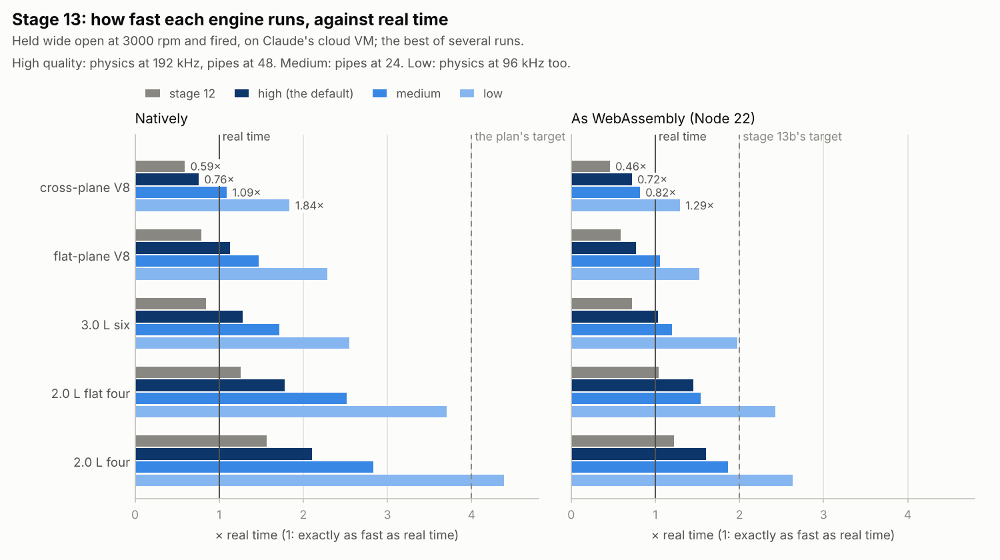

# Stage 13 — Performance & stability pass

**Status:** done (2026-10-20)

Stage 12's heaviest engine, the cross-plane V8 with all its pipes, ran at 0.59 times real time
natively on Claude's cloud VM and 0.46 as WebAssembly: too slow to play live. Stage 13:
- **made the core faster where the profile pointed, without changing the sound:** at the default
  quality the renders are stage 12's to the last bit of dither (the difference is 98–120 dB down).
  The V8 runs at 0.76× real time natively and 0.72× as WebAssembly, 1.3 and 1.6 times stage 12's
  speed;
- **added a quality setting:** high (the default), medium and low. Medium steps the pipes at 24 kHz
  instead of 48; low also runs the physics at 96 kHz instead of 192. At low the V8 runs at 1.84×
  natively and 1.29× as WebAssembly, with a fired engine's torque and VE within 0.35 % of high and
  the sound's level within 1 dB;
- **added a fuzzer:** random engines, started with the key and driven on their own crank, must stay
  numbers and not run away. Its first full run blew up a V8 with wide tailpipes: a stage 12 bug, now
  fixed;
- **added benchmarks** (`make bench`, `make bench-wasm`), and each stage's planted bugs to the repo
  (`tools/plant_bugs.py`).

**The plan's check isn't met:** the V8 runs at 0.76× natively at the default quality, not 4×. No
single function is left to fix. The cost is spread over the pipes' cells and the gas's chemistry,
in loops that call a function or two per cell, and what's left needs them rewritten as arrays the
compiler can vectorize, with the valves' flow solved implicitly so low quality loses nothing. That
is stage 13b (working agreement 2: split, not stretched), after the sound stages S1–S4, which
change the same code first.



## Measuring

- **Timings on this VM swing by 20 % between runs, and more between VMs.** On the VM this stage
  started on, stage 12's build took 10.8 µs per step for the V8 and stage 13's 6.2; on today's, 8.8
  and 6.9. So the numbers here are the best of several runs, interleaved (stage 12's build, then
  each quality, and round again), and instruction counts back them (callgrind), which don't change
  from run to run.
- **The instructions fell less than the time:** by 14 % at high quality (from 94.6 to 81.6 thousand
  per step), the time by 22–43 %. Most of what went was slow work: divisions, and pow's long chains.
- `make bench` holds each preset wide open at 3000 rpm, fired, times 0.5 s of it (best of three),
  then the pieces the plan named. `make bench-wasm` builds the same program as WebAssembly (zig) and
  runs it in Node.
- **A segfault after a header change** had a dull cause: the Makefile left the benchmark's object
  out of the list whose header dependencies it tracks, so `make bench` linked a stale `rb_bench.o`
  with the old struct layouts. It's in the list now.

## Review of stage 12

- **Pipes of very different bores went straight on into each other, and could run away.** The
  fuzzer found it ("The fuzzer" below); stage 12's test only joined equal bores.
- **docs/stage-12.md put the pipes' limit at 3 kHz.** It's c/(πΔx): about 2.4 kHz for the exhaust's
  hot gas in 7.5 cm cells (RESEARCH.md, "Sound realism").
- **rb_config had no rule for fields added later.** A host that filled one in field by field, as
  `test_core_fuzz_output_bounded` did, left the new ones as garbage, and this stage added
  `pipe_rate`. rb.h now says to start from `rb_config_default()`, and `rb_create_with()` does.
- **The core's version** is 0.13.0: the API gained the quality setting.

## What was built

| Piece | Files | Purpose |
|---|---|---|
| The chamber | `core/src/chamber.h`, `chamber.c` | γ and the speed of sound worked out when asked (`rb_chamber_gamma`, `rb_chamber_sound_speed`), not at every update; 1/ρ kept (`per_rho`); Newton's method for T started from a predicted guess, handing back cv. |
| The gas | `core/src/gas.h`, `gas.c` | Each species' u(T) constants worked out by the compiler; a mixture is a weighted sum of its species' coefficients; u and cv together (`rb_gas_u_cv`), T and cv together (`rb_gas_T_cv_from_u`). |
| The nozzle and the walls | `core/src/flow.c`, `heat.c` | The nozzle is choked when 2a ≥ (γ + 1) r, with a = r^(1/γ): one pow when subsonic. Woschni's h is one exp of logs. |
| The pipes | `core/src/pipe.h`, `pipe.c` | 1/area, 1/length and the wall's ratio kept; no division for a face without drag. Pipes go straight on only between bores within 1.5 times in area (`RB_PIPE_ONWARD_MAX_RATIO`). |
| The quality setting | `core/include/rb.h`, `rb_sim.c`, `rb_alloc.c`, `rb_engine_api.c`, `engine.h`, `engine.c`, `web/src/core/rb-core.ts`, `Makefile` | `rb_config.pipe_rate`; `RB_QUALITY_LOW`, `_MEDIUM`, `_HIGH`, `rb_config_quality`, `rb_create_with_quality`, `rb_pipe_rate`; `rb_engine_init_at`. Exported to WebAssembly. |
| The fuzzer | `native/fuzz.h`, `fuzz.c`, `native/rb_cli.c`, `tests/test_fuzz.c`, `Makefile` | `rb_cli fuzz`, `make fuzz`, and a short test. |
| Benchmarks | `native/rb_bench.c`, `tools/bench_wasm.mjs`, `Makefile` | `make bench`, `make bench-wasm`. |
| Planted bugs | `tools/plant_bugs.py`, `tools/bugs/stage12.py`, `stage13.py` | Each stage's table of bugs, planted one at a time in a copy of the sources (they were in Claude's workspace). |

## Where the time goes

The cross-plane V8 at high quality, wide open at 3000 rpm: thousands of instructions per physics
step (callgrind, everything inside `rb_engine_step`).

| Work | Stage 12 | Stage 13 | What changed |
|---|---|---|---|
| u(T), cv(T) and T(u) | 15.1 | 7.7 | Newton's method starts where its first step would land and hands back cv; u and cv share the powers of T |
| gas mixtures rebuilt | 15.3 | 13.8 | each species' constants worked out by the compiler |
| chambers and cells updated | 15.5 | 14.9 | γ and the speed of sound only when asked; 1/ρ kept |
| the pipes' faces and cells | 26.0 | 24.7 | 1/area, 1/length and the wall's ratio kept; no division without drag |
| gas moved between volumes | 8.2 | 8.2 | |
| pow, exp and log | 5.2 | 3.0 | the nozzle's choke test; Woschni as one exp of logs |
| valves, nozzles, burning, walls | 3.1 | 3.1 | |
| the rest | 6.3 | 6.2 | |
| **all** | **94.6** | **81.6** | |

### The chamber and the gas

Every chamber and pipe cell finds its temperature after each step, from its energy: u(T) = U/m,
by Newton's method. Stage 12 started from the last temperature and took about two corrections,
each a polynomial for u and another for cv. Now it starts where the first correction would land,
T + Δu/cv with the cv kept from the last update, so one correction usually finishes it, and it
hands back cv for next time. γ and the speed of sound, which every update worked out, are worked
out when something asks (the nozzles, the pipes' ends): a fraction of the updates.

A cell rebuilds its mixture's coefficients when its composition moves by 1e-8 (`RB_REMIX`). They
are sums of the three species' coefficients weighted by mass, and each species' integration
constants are now worked out by the compiler (`SPECIES_ENTRY` in gas.c) instead of at every
rebuild. Raising `RB_REMIX` would save more, but it makes T and p jump, by up to 1 Pa. Stage 13b
will weigh the species' u(T) and cv(T) instead, with no rebuild at all.

### The nozzle and the walls

The nozzle's flow is choked when the pressure ratio r is at or below the critical ratio,
(2/(γ + 1))^(γ/(γ − 1)), and stage 12 worked that out, a pow, on every call. It's the same test as
2a ≥ (γ + 1) r with a = r^(1/γ), which the subsonic formula needs anyway: one pow when subsonic.
Woschni's correlation, h = 3.26 B^−0.2 p^0.8 T^−0.55 w^0.8, took three pows; it's one exp of logs.

### The pipes

Each pipe keeps 1/area and the ratio of its wall's area to a cell's volume, each face 1/area and
1/length, each cell 1/ρ: the formulas multiply where they divided. The implicit drag's division is
skipped where a face has none.

### What didn't help

- **Link-time optimization,** natively and in WebAssembly, and **WebAssembly's SIMD**
  (`-msimd128`): within the noise. The loops call functions per cell, so there's nothing for the compiler to vectorize: that's
  stage 13b.
- **A table for the nozzle's γ-dependent constants:** after the choke test, pow, exp and log
  together are 3.7 % of the work.

The pieces the plan named, timed alone (`make bench`, `make bench-wasm`), best of five:

| ns per call | natively: stage 12 → 13 | WebAssembly: stage 12 → 13 |
|---|---|---|
| the nozzle's flow | 31.8 → 27.8 | 41.9 → 36.5 |
| T from u (Newton) | 41.2 → 46.8 | 53.8 → 50.3 |
| building a gas mixture | 20.0 → 20.0 | 30.8 → 24.7 |

Alone, from the same guesses, T from u costs about what it did (it hands back cv now); in the engine
it starts from a better guess and corrects less often. That's where its saving is.

## The quality setting

| | high (the default) | medium | low |
|---|---|---|---|
| physics | 192 kHz | 192 kHz | 96 kHz |
| pipes | 48 kHz | 24 kHz | 24 kHz |
| cross-plane V8: natively, as WebAssembly | 0.76×, 0.72× | 1.09×, 0.82× | 1.84×, 1.29× |
| the four: natively, as WebAssembly | 2.11×, 1.61× | 2.83×, 1.86× | 4.39×, 2.63× |
| torque and VE, fired (against high) | | within 0.16 % | within 0.32 % |
| pumping work | | within 0.7 % | 2–4 % more fired; 7–9 % more motored, wide open at 1500 rpm |
| the sound | | level +0.0 to +0.8 dB; a little brighter above 1 kHz (up to +1.4 dB) | as medium |

Torque, VE and pumping are the four's and the cross-plane V8's, settled at 3000 and 6000 rpm wide
open, at 3000 rpm with a fifth of the throttle, and motored wide open at 1500 rpm; the other
presets' speeds are on the chart. The pipes' rate costs the least accuracy for the most speed. Low's physics rate brings back stage 10's error at the valves: a 5 cm
cell at a wide-open valve takes two 96 kHz steps to fill, and the flow's cap adds pumping work
(docs/stage-10.md, "At 96 kHz"). Stage 13b's implicit valves are for that.

In the API:
- `rb_config.pipe_rate` (Hz; 0 means 48 kHz). The pipes step every `lround(physics rate / pipe
  rate)` physics steps, at least every one.
- `rb_config_quality(&cfg, RB_QUALITY_LOW / _MEDIUM / _HIGH)` sets the oversampling (the whole
  number nearest 96 or 192 kHz over the sample rate) and the pipe rate; `rb_create_with_quality(rate,
  quality)` makes a sim with them; `rb_pipe_rate(sim)` says what the pipes run at. At 44.1 kHz, low
  runs the physics at 88.2 kHz and the pipes at 22.05 kHz.
- A preset, a changed field and a reset keep the sim's rates.
- `rb_cli sound --quality` and `rb_cli fuzz --quality`; in the browser, `RB_QUALITY_*` and
  `rb_create_with_quality` in rb-core.ts.

## The fuzzer

`rb_cli fuzz --sets N --seconds S` runs N random engines for S seconds each (`make fuzz`: 20 of
10 s, about four and a half minutes). Each takes a random preset and changes a few of its fields to anywhere
in their ranges, through `rb_set_engine` as the browser's controls will (new fields join by
themselves: it picks from the API's list). It starts the engine with the key and drives it: the
throttle jumping between shut, wide open and anywhere between, loads on the crank, the ignition cut
now and then, the sound through the whole chain to the audio rate. It fails if anything stops being
a number (a sample, the speed, a chamber's pressure or temperature) or runs away: past 30,000 rpm,
1000 bar or 6000 K. The same seed makes the same run, and a failure prints the fields it changed.
`test_fuzz_random_engines` runs four for 1.5 s, at each quality.

**Its first full run found a stage 12 bug.** Run 13 gave the cross-plane V8 75 mm tailpipes; 0.36 s
after the key, a cell in its exhaust was at 4.8 × 10¹² Pa and 1.5 × 10¹⁰ K. A straight-through
muffler takes its tailpipe's bore, so its 75 mm perforated pipe went straight on from the 55 mm
exhaust pipe: 1.86 times the area. At a step in bore the momentum fluxes either side of a straight-on
joint don't balance, and the imbalance pumps the flow from the narrow pipe into the wide one on
every firing; past about 1.8 times the area it adds more each cycle than the friction takes, and
the pulses run away. `rb_pipe_onward` now refuses bores more than 1.5 times apart in area, either
way round, and the engine joins those as it did before stage 12, through the wide pipe's end cell.
No preset changes. After the fix, `make fuzz` passes: 20 engines of 10 s, run 13 among them, with
one bad state repaired between them (in run 7, once).

## The sound check

**At the default quality nothing changed.** The five sound-check renders (the four and the V8 held
wide open at 3000 rpm, the four at 2000 rpm and 15 % throttle, idling, and the V8 pulling, 16-bit
and dithered) differ from stage 12's by 98–120 dB below their level, the dither's rounding, and
compare_real.py's numbers are the same to the last digit.

**Medium and low** against high:

| Render | Level | Above 1 kHz | Crest factor |
|---|---|---|---|
| the four, 3000 rpm wide open, a metre from the tailpipe | +0.27, +0.27 dB | +1.4, +1.6 dB | +0.7, +0.7 dB |
| the V8, 3000 rpm wide open, a metre from a tailpipe | +0.21, +0.23 | +0.4, +0.5 | +0.6, +0.6 |
| the four, 2000 rpm, 15 % throttle | +0.02, +0.03 | +0.4, +0.3 | +0.3, +0.3 |
| the four idling | 0.00, −0.06 | −0.1, −0.4 | +0.2, +0.1 |
| the V8 pulling, from behind | +0.83, +0.86 | +0.6, +0.7 | +0.2, +0.2 |

Medium and low sound alike: the pipes' rate matters, the physics' hardly. Probably the pipes,
stepped half as often, damp their shortest waves a little less. The pull's level moves most because
a free-running engine's timing drifts with its torque.

## Cost

The core is the cost this stage cut. The tests: 123 in 3.7 minutes (stage 12: 119 in 4.5), and
4.5 minutes for `make fuzz`. The WebAssembly core grew by 2 kB, to 91.5 kB: the quality setting.

## Tests that can fail

New tests: `test_core_quality`, `test_engine_pipe_rate`, `test_engine_wide_tailpipes` and
`test_fuzz_random_engines`: 123 tests, 1985 checks in all, clean under ASan and UBSan too. Each bug
below (`tools/bugs/stage13.py`) was planted on its own in a copy of the sources with
`tools/plant_bugs.py`, and each was caught.

| Bug | Caught by |
|---|---|
| each species' u(T) jumping at 1000 K (its low range's constant) | `test_gas_matches_nasa_data`, `test_gas_u_and_T_are_inverse` |
| a mixture's integration constant taken from air alone | the same |
| the fuel's high-range coefficients weighted by air's share | the same |
| a chamber's cv never taken from the Newton step | `test_chamber_init_and_repairs`, `test_two_tanks_equalise`, `test_blowdown_matches_analytic`, `test_stiff_equalisation_has_no_overshoot`, `test_filling_heats_the_tank` |
| a chamber's 1/ρ zero | `test_pipe_friction`, `test_pipe_waves_ride_the_flow` |
| the nozzle's choke test the wrong way round | `test_nozzle_formulas`, `test_blowdown_matches_analytic` |
| Woschni's bore term with the wrong sign | `test_woschni` |
| a pipe's wall ratio halved | `test_pipe_walls` |
| a cell's kinetic energy turned to heat times the step instead of over it | `test_pipe_waves_ride_the_flow`, `_conserves_everything`, `_packing`, `_onward` |
| the velocity heads' loss without its 1/area | `test_pipe_friction`, `_waves_ride_the_flow`, `_walls`, `_conserves_everything`, `_packing` |
| the laminar loss skipped | `test_pipe_friction`, `test_pipe_packing`, `test_engine_intake_losses` |
| no momentum flux | `test_pipe_pulse_travels_at_the_speed_of_sound`, `test_pipe_friction`, `test_pipe_waves_ride_the_flow` |
| any two bores going straight on | `test_pipe_onward`, `test_engine_wide_tailpipes` |
| low quality at 192 kHz | `test_core_quality` |
| a reset forgetting the pipe rate | `test_core_quality` |
| a preset forgetting the pipe rate | `test_core_quality` |
| the pipe rate ignored (always 48 kHz) | `test_core_quality`, `test_engine_pipe_rate` |
| the fuzzer's speed limit at 100 rpm (every run must fail) | `test_fuzz_random_engines` |

## Tests that changed

| Test | Was | Now | Why |
|---|---|---|---|
| `test_chamber_init_and_repairs`, `test_blowdown_matches_analytic`, `test_pipe_waves_ride_the_flow` and test_pipe.c's helpers | a chamber's `c` and `gamma` | `rb_chamber_sound_speed()`, `rb_chamber_gamma()` | the chamber no longer keeps them |
| `test_core_fuzz_output_bounded` | configs filled in field by field | each from `rb_config_default()` | rb_config gained `pipe_rate` |
| `test_pipe_onward` | two equal bores | also: bores 1.86 times apart refused both ways, 1.40 accepted | the fuzzer's find |

## What doesn't sound like a real engine yet

This stage changed no sound. Stage 12's list stands, now the sound stages: each cycle repeats the
last (S1), nothing above about 2.4 kHz (S2), no mechanical sound (S3), and no place (S4).

## Three things that surprised me

- **The instructions fell by 14 %, the time by 22–43 %.** Removing a division or a pow takes out
  one instruction or a few dozen, but dozens of cycles of waiting.
- **The fuzzer's first full run found a blow-up** that no hand-written test had: 75 mm tailpipes on
  a V8, a choice anyone could make with stage 15's sliders.
- **`rb_cli sound --quality medium` came out bit for bit the same as high.** The command built its
  own engine with `rb_engine_init`, which knows nothing of the pipe rate. The sound check caught it,
  not a test; every engine built from a config now goes through `rb_engine_init_at`, and
  `test_core_quality` checks the sim's paths.

## What to listen for (Bernardo checks)

Nothing new at the default quality. To hear what the quality setting costs:

```bash
build/rb_cli sound --preset v8-cross --hold --rpm 3000 --listener tailpipe --gain 0.5 -o renders/v8-high.wav
build/rb_cli sound --preset v8-cross --hold --rpm 3000 --listener tailpipe --gain 0.5 --quality low -o renders/v8-low.wav
```

Can you hear a difference? If not, low could be what the browser plays the eights at (stage 14).

## Try it

```bash
make bench                           # each preset, natively
make bench-wasm                      # the same as WebAssembly (needs zig)
build/rb_cli fuzz --sets 5 --seconds 5
make fuzz                            # 20 random engines, 10 s each, about 4.5 minutes
build/rb_cli sound --preset v8-cross --sweep --quality low -o renders/v8-low-sweep.wav
python3 tools/plant_bugs.py 13 --list
```

## Notes for later stages

- **Stage S2 (finer exhaust cells):** a pipe costs its cells times its rate, and the rate has to rise
  as the cells shrink (the waves mustn't cross a cell in a step), so halving the exhaust's cells
  costs four times its pipes'. The V8 has no headroom at high quality; finer cells will need 13b,
  or to be part of the quality setting (as the plan says).
- **Stage 13b:** start from "Where the time goes". The pipes are 30 % of the work and the gas's
  chemistry 45 % (rebuilds 17 %, u and T 9 %, updates 18 %), all of it per cell in loops that call
  functions per cell. Structure of arrays first; then SIMD and link-time optimization for
  WebAssembly, which gain nothing on today's code.
- **Stage 14:** at high quality only the fours and the six keep up as WebAssembly (in Node 22 on
  this VM), and the cross-plane V8 needs low (1.29×). The worklet could time its own blocks and step
  down when it falls behind; the rates are fixed when a sim is made, so a new quality is a new sim
  (`rb_create_with_quality`, exported).
- **The fuzzer:** run `make fuzz` after physics changes. A failure names its seed: `rb_cli fuzz
  --seed N --sets 1` runs just that one again.
- **Planted bugs:** each stage's table goes in `tools/bugs/stageNN.py`, started from the last one's.

## Sources

- Valgrind developers, *Callgrind: a call-graph generating cache and branch prediction profiler*,
  Valgrind user manual, chapter 6: instruction counts by function.
- A. Fog, *Instruction tables: lists of instruction latencies, throughputs and micro-operation
  breakdowns for Intel, AMD and VIA CPUs*, Technical University of Denmark (updated yearly): why a
  division costs many multiplications' time.
- B. P. Miller, L. Fredriksen, B. So, "An empirical study of the reliability of UNIX utilities",
  *Communications of the ACM* 33 (12), 32–44 (1990): fuzzing.
- G. Woschni, "A universally applicable equation for the instantaneous heat transfer coefficient in
  the internal combustion engine", SAE paper 670931 (1967).
- D. E. Winterbone, R. J. Pearson, *Theory of Engine Manifold Design*, PEP (2000): sudden area
  changes and their losses in 1D pipe models.
