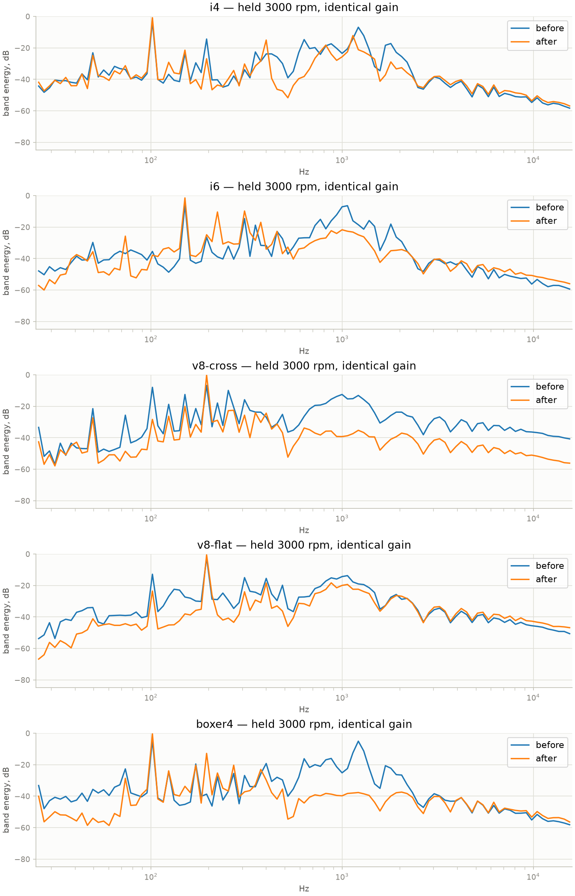
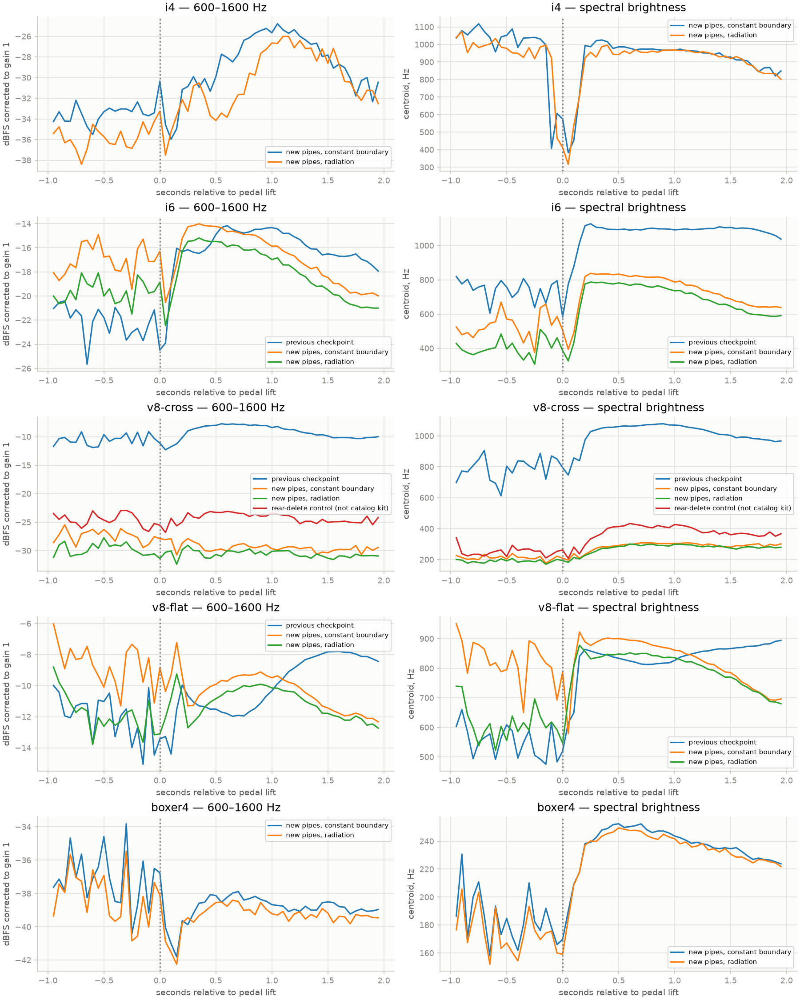

# Stage 13b-p — researched exhaust configurations

The configurations and measurements below record stage 13b-p. The latest
[selective rollback](stage-13b-r-rollback.md) restores its I6 and flat-V8
exhaust definitions, keeping I6 8500 rpm. Cross V8 retains the 13b-r 7500-rpm
rear-delete X setup; I4/boxer remain unchanged. Historical performance/audio
measurements below are not new measurements of this mixed selection.

2026-10-22. The research configurations, extended topology and radiation load
are implemented. Native/browser validation and the new listening checkpoint are
recorded below. This does not complete the remaining performance/implicit-solver
requirements of 13b. Stage 14 is outside the authorized scope.

**Listening accepted, 2026-10-22:** Bernardo considers the changes a success
and says the sound is "a lot better". At his request, superseded generated
audio is deleted and all 34 current recordings are consolidated into the
portable `renders/RESULTS.html`, including five long coasts. Current raw float
originals are in `renders/current/{standard,feedback}/`; retained numerical
evidence and binaries moved to `renders/evidence/13b-p/`. The earlier paths
in historical run commands identify their original locations. Reference files
are unchanged. See [the render workflow](render-workflow.md).

Bernardo explicitly allows large sound changes when research and physics support
them. Previous WAVs are controls. Realism takes priority over matching their
timbre or saving processing time. A large audible difference alone is not proof
of realism. Reference recordings, dimensions or additional sounds may be sought
and requested when they would resolve a specific uncertainty.

## Selected real systems

The five engines remain generic approximations. These are complete **1D research
configurations inspired by real fitted systems**, including retained upstream
hardware; they are not measured CAD replicas or manufacturer-calibrated models.
Changing the rear exhaust does not make our crank, firing-number convention,
cams, catalyst or ECU identical to the named vehicle.

| Preset / reference | Primary source and selected configuration | Established data used |
| --- | --- | --- |
| I4 / Toyota 1AZ-FE, RAV4 2.0 | [BRExhaust 106-0135](https://www.magnaflow.com/products/106-0135-brexhaust-2001-2003-toyota-rav4-2-0l-direct-fit-exhaust-system-kit-106-0135) | 2001–03 fitment; 2-inch tubing; two silencers. Front body 5×5×9.5 inches; rear 7.25×7.25×28.5 inches. Retains upstream emissions equipment. |
| I6 / BMW M54B30, E46 330i | [Supersprint complete oversize system](https://www.supersprint.com/en-us/supersprint-performance-sport-exhaust-for-bmw-e46-330i.aspx) | Twin 54 mm routing; manifold 787401, catalyst pair 787402, unresonated center pair 787413, rear 787406. Manufacturer page available through indexed content; direct page intermittently blocks retrieval. |
| Cross V8 / Mustang GT 5.0 inspiration | [Borla ATAK 140961](https://www.borla.com/products/ford-mustang-gt-cat-back-exhaust-system-140961), [installation drawing A-36106](https://www.borla.com/media/installation_instructions/A-36106.pdf) | Non-active S650 coupe version, true dual 3-inch pipes, merge X, intermediate pipes, two rear silencers and split rear exit. Four-inch trim is not the pipe bore. Retain modeled upstream manifolds/cats. |
| Flat V8 / Ferrari 458 inspiration | [Tubi Style TSFE458C09.003.ANT](https://www.tubistyle.it/ferrari-458-italia-and-spider-exhaust-system/) | Unvalved straight-pipe rear option; modeled OEM headers/cats retained. Manufacturer does not publish the internal bore/length or enough information here to reconstruct the OE three-tip assembly. Two equivalent bank outlet paths are an explicit simplification. |
| Boxer / Subaru FB20, XV GP7 | [HKS LEGAMAX Premium 32018-AF012](https://hksusa.com/product/32018-AF012) | FB20/GP7 fitment, 50.8 mm main section to two 45 mm paths, SUS304; 76.3 mm tips excluded from flow bores. Modeled OEM header/cat/center section retained. This is not an EJ turbo or FA20 exhaust. |

The selected Tubi option removes the old generic packed silencer. The BMW paths
remain separate through two equivalent rear cores. The Mustang has a common
finite X junction upstream of its intermediate pipes. The boxer has a finite
rear Y feeding two equivalent cores. The Toyota has two successive can volumes.
The BMW/Subaru equivalent cores do not claim measured proprietary internals.

## Geometry and uncertainty ledger

`core/src/exhaust_models.c` is the numerical definition. Every preset includes
valves, individual headers, collector(s), modeled catalyst restrictions, front
pipe(s), any center section/link, rear section(s), tailpipes and ambient boundary.
The headers and their groups retain the generic engine's existing geometry;
their lengths, collector cones and upstream catalyst properties are **unmeasured**.

Published tubing diameters are treated as nominal outside sizes; a **1.2 mm
wall estimate** gives the flow bore. The HKS source specifies the largest pipe
sections, not every local bend or reducer. Ferrari's 60 mm flow bore is wholly
inferred. Neither trim dimensions nor external can volumes become flow areas.

| Preset | Flow bores, main / rear (mm) | Front / center / link / rear / tail lengths (m) | Other inferred quantities |
| --- | --- | --- | --- |
| I4 | 48.4 / 48.4 | .65 / .2413 / 1.05 / .7239 / .32 | Can free volumes 2.6 and 12 L; rear effective baffle area 19 cm² |
| I6 | 51.6 / 51.6, each path | .55 / .70 / .55 / .52 / .25 | Rear core packing; shared outer casing omitted |
| Cross V8 | 73.8 / 73.8, each path | .80 / .80 / .65 / .45 / .30 | X free volume 1.2 L; rear packing; equivalent front pipe includes OEM connection |
| Flat V8 | 60 / 60, each path | .75 / none / none / .35 / .28 | Bore, route lengths, two equivalent radiating paths |
| Boxer | 48.4 / 42.6×2 | 1.00 / .42 / .85 / .42 / .22 | Y free volume .7 L; center/rear packing and internal core arrangement |

Only the Toyota body lengths in that length column are published. All other
longitudinal lengths are estimates. Free volumes exclude metal, packing and
baffles; they are not products of the external body dimensions. Existing
catalyst channel loss, Darcy factors, fixed warm wall temperatures and packing
coefficients remain engineering approximations. Quantitative transfer-impedance,
backpressure and temperature measurements would be more useful than tuning these
unknowns to an unrelated microphone recording.

## Physics review

The existing staggered finite-volume scheme transports each species and donor
enthalpy/kinetic energy through the actual pipe connections. Changing geometry
therefore changes pressure-wave delay, impedance, reflection, gas cooling,
backpressure, breathing and the radiating volume flows. There is no exhaust EQ or
pitch multiplier in this change.

For a low-amplitude plane wave, `c² = gamma R T`, travel time is `L/c` and volume
impedance is `rho c/A`. At a compact junction, equal junction pressure and mass
continuity give `p_j/p_inc = 2Y_inc / sum(Y)` with `Y=A/(rho c)`; the reflected
pressure is `p_j-p_inc`. Four equal arms therefore give reflection −1/2 and
transmission +1/2 into each other arm. A finite junction volume adds compliance;
it must participate in both integration and the inventory books. New tests check
this independently of rendered sound, plus all five complete engine inventories.

[COMSOL's pipe-acoustics example](https://doc.comsol.com/6.4/doc/com.comsol.help.models.aco.acoustics_pipe_system/acoustics_pipe_system.html)
explains the division between 1D propagation and junctions needing 3D treatment.
Our common X/Y volume is a compact mixing approximation. It omits directional
jet momentum and detailed 3D scattering in the merge; accuracy deteriorates when
the junction is no longer small compared with wavelength. Rear can modes,
perforation geometry, flexible walls and proprietary packing are also unresolved.

Existing tests cover sound speed, open/closed reflection, convection, Darcy
friction, Colburn heat exchange, packed-pipe attenuation, contiguous joints and
one/two-rate conservation. Large area changes use a volume connection rather
than the unstable direct momentum connection; that is an approximation, not a
proof of exact real expansion losses. The current open boundary includes a
0.6-radius inertial end correction but lacked frequency-dependent radiation
resistance. The researched presets now replace it with the causal unflanged
rational load from [Silva et al.](https://arxiv.org/abs/0811.3625), table 1. The
fixed external medium is ambient air; strong mean jets, rolled/flared trims and
vehicle-body scattering remain outside this approximation. Generic default
descriptors retain the old boundary as a control. The native sound command's
`--outlet-radiation constant|unflanged` isolates this change at identical geometry.

With `x=s a/c`, converting the published reflection fit to pressure/velocity
impedance gives

```
Z/(rho c) = (1.226 x + .457 x²) / (2 + 1.560 x + .457 x²).
```

At low frequency this tends to `.24964 (ka)² + i .613 ka`: finite radiation
resistance and the expected end inertance, with zero DC resistance. The poles
are stable. Its real part on the imaginary axis is nonnegative: its numerator
after multiplying by the conjugate denominator is
`.99856 (ka)² + .208849 (ka)^4`. A bilinear discretization preserves the passive
load and is included implicitly in the outlet momentum update. The previous
constant end correction is removed there, avoiding double-counted inertance.
Numerical frequency tests include the bilinear frequency mapping explicitly.

Work `p_radiation Q dt` leaves the gas and enters the engine's exterior energy
book. Its signed integral includes energy temporarily stored in the external
load, which can return; it is not solely far-field dissipated sound energy.
Omitting this work would recycle the load's extracted kinetic energy as gas
heat. Independent pipe and complete-engine inventory tests catch that fault.
The new boundary changes the actual volume flows before sound generation.

The spatial grid also limits propagated high frequencies. The existing jet and
mechanical noise models supply additional broadband sound; this is not a claim
that the gas solver resolves combustion shocks or all audible wavelengths.

## Validation and feedback

All generated material stays in ignored `renders/`. Raw current float WAVs
are the measurement inputs. Superseded generated audio was removed after
Bernardo accepted this checkpoint; its numerical comparisons are retained.
The single results file embeds PCM16 listening copies with one static gain
per complete clip. The earlier six MP3 previews are also retained with their
processing manifest under `renders/current/feedback/`.

`tools/exhaust_feedback.py` records five matched 3000 rpm before/after controls
at the same gain when an optional preceding executable is supplied, plus five
extended pull/coast scenarios and the rear-delete control. Analysis plots
spectral shape and records raw level changes. `make render` now stages both
the standard regression set and all current coast/held examples, then publishes
one complete result. `make render-standard` is available for isolated controls.

The supplied BMW M4 recording is turbocharged, whereas the I6 is naturally
aspirated; the Golf GTI is not a Toyota 1AZ-FE. Their microphone gain, speed/load
and cabin/exterior/flyby transitions are unverified. They are qualitative engine
sound references, not transfer functions to fit. Source intervals and separate
filtered listening copies remain documented in `docs/user-sound-references.md`.
Brighter/darker groups remain acoustic observations. No original MP3 is modified.

Remaining S1 realism acceptance is separate from this exhaust listening approval.
In particular, the pre-existing flat-V8 incomplete burns and high idle work COV
must not be hidden by an exhaust change. Whole-stage 13b completion also requires
its explicit solver/performance acceptance; the new exhaust does not waive it.

## Idle-control calibration

The split boxer system changed the short startup transient. At variation zero
and 96 kHz, its cycle-mean speed across 4.5–6.5 s ranged 730.56–757.10 rpm,
failing the existing 15 rpm stability limit. A measured actuator-area sweep
43/45/46/47 mm², scaling the normalized PI gains inversely with area to retain
their air-area gain, found 46 mm² sufficient: 744.91–752.74 rpm. The selected
equivalent actuator is therefore 46 mm², with gains multiplied by 43/46.
These are model-control calibration values, not published Subaru hardware data.
The existing startup and load tests pass without loosening their thresholds;
the final radiation build also passes the full native suite. Raw tuning rows remain in
`renders/evidence/13b-p/boxer-idle-area.csv`.

## Final numerical and listening checks

- Native: **173 tests / 3252 checks** pass; ASan/UBSan focused physics:
  **9 / 659** with leak detection disabled for the sandbox's ptrace limitation.
- Actual SIMD WASM C physics: **16 / 843**, including the new network and
  radiation tests. Web: **17** tests, production build, and Chromium audio
  smoke tests in both development and production preview pass.
- Eight deliberate faults are all caught: radiation reactance, omitted
  exterior work, duplicated exterior inertance, a disconnected X bank,
  omitted junction update, omitted junction inventory, reversed junction
  face orientation and a cosmetic tip mistaken for the bore. The first
  orientation mutant escaped the pressure-only test; checking signed
  incident/transmitted volume flow exposed it. The final table has no misses.
- Twenty randomized ten-second runs with the radiation build: no failures or
  state repairs. Standard float renders and five extended eight-second coast
  scenarios are preserved, along with matched 3000 rpm before/after controls.
- Two standard render gains change to .2: I6 rev and flat V8 at 3000 rpm.
  Their initial gain-1 renders entered the output limiter. The rerenders have
  zero limited/nonfinite samples. The primary matched-control recordings all
  use gain .1, so their measured level differences do not hide this change.

The 30-second idle / 10-second held-WOT audit uses 192 kHz physics, 48 kHz
pipes and seeded variation 1. All five start and have zero warm stalled steps.
Per-cylinder idle work COV ranges are I4 **3.99–4.42%**, I6 **5.59–6.84%**,
cross V8 **7.91–10.91%**, flat V8 **21.21–30.98%**, boxer **4.91–5.66%**.
The flat V8 still has **162 incomplete modeled burns** at EVO in the warm
window; the other four have zero. These are not inferred real misfire rates.
The pre-existing S1 V8 combustion acceptance is still open.

At matched 3000 rpm and identical output gain, new-minus-old RMS levels are
I4 **−1.19 dB**, I6 **+13.08 dB**, cross V8 **+2.25 dB**, flat V8 **+9.34 dB**,
boxer **+13.82 dB**. The old generic configurations are not measured stock
systems, so these differences cannot validate a manufacturer's advertised
kit-versus-OEM gain. See the spectral comparison and the full JSON measurements.



The 600–1600 Hz diagnostic band rises from pre-lift to early coast by
**+6.98 → +4.04 dB** for I6, **+2.68 → −1.91 dB** for cross V8, and
**−.32 → +1.47 dB** for flat V8, comparing the prior checkpoint to the new
systems. Runs are phase-aligned to lift, not matched at every RPM/load.
This does **not** establish a universal perceptual improvement. Radiation alone
does not reduce this band step in every model, despite its independently
verified passive boundary behavior. The robotic-deceleration diagnosis remains
open rather than being declared solved from one band metric.

The chosen packed Borla-style configuration also measures considerably darker
than the prior unfilled V8 at high RPM. A separate `v8-cross-rear-delete-control`
keeps the new pipes/X/radiation but removes the rear packing using the existing
`--muffler none` control. It is a physical modification control, **not the catalog
140961 kit**. It is included for listening against the straight-piped Mustang
recording, without tuning undocumented silencer internals to force brightness.
The selected catalog configuration stays distinguishable from that control.



Fresh free-crank dyno runs hold 1000 rpm steps from 1500 rpm, using deterministic
variation zero. These are sampled maxima, not interpolated peak claims:

| Model | Peak brake torque (N m / rpm) | Peak brake power (kW / rpm) |
| --- | ---: | ---: |
| I4 | 178.7 / 4521 | 104.1 / 6514 |
| I6 | 289.0 / 4534 | 156.9 / 5520 |
| Cross V8 | 462.2 / 4530 | 257.0 / 6504 |
| Flat V8 | 434.0 / 4558 | 327.6 / 8502 |
| Boxer | 179.5 / 4520 | 100.1 / 5521 |

The step spacing means the final held point can be below the redline. No
manufacturer kit gain is inferred from comparison with the previous generic
system. The raw readings and modeled pumping/heat/VE channels are in
`final-dyno/`.

Listener positions and body geometry remain the existing generic car, including
the assumed spacing of twin sources. They are not surveyed BMW/Subaru/Ferrari
outlet positions. This is another reason to preserve recording perspective
uncertainty and avoid claiming exact vehicle sound from nominal tube sizes.

Final core WASM: **158247 bytes**, source fingerprint
`07ce3366e927c09cab6e97e8f8485d2782032662c76673d92149f47e635fe40b`.
Logs, binaries, hashes, the geometry-before-radiation controls and rejected
solver patches and historical numerical comparisons are local under
`renders/evidence/13b-p/`. Their superseded control audio is no longer retained.

Three final interleaved timing rounds, after the other validation jobs finish,
compare the b922742 binaries with this physical-model change. Physics stays at
192 kHz and pipes at 48 kHz. These are engine-only throughput medians on the
shared host; they exclude stereo propagation and browser deadlines:

| Preset | Native, previous → new (× real time) | WASM, previous → new |
| --- | ---: | ---: |
| I4 | 1.335 → 1.316 | 1.006 → .982 |
| I6 | .887 → .802 | .673 → .635 |
| Cross V8 | .656 → .656 | .488 → .472 |
| Flat V8 | .754 → .769 | .551 → .562 |
| Boxer | 1.304 → 1.164 | .964 → .891 |

Geometry and physics differ here, so these ratios are not an isolated
optimization result. The extra topology and physical radiation load have a
modest measured cost; shortened flat-V8 paths reduce its cost. Cross-V8 WASM
rounds span 2.060–2.467 wall seconds per simulated second, so shared-host timing
variance matters. Full logs/hashes are in `timing/benchmarks.json` and adjacent
logs. The original **4× native / 2× WASM** targets are still unmet. The
persistent pipe/face SoA refactor and converged low-rate implicit boundary also
remain open; 13b-p does not silently complete or waive them.

Graphify was queried before code exploration and updated using its AST path:
**1765 nodes, 4818 edges, 97 communities**. Its existing `rb.h` parser limitation
now points at line 414 after enum additions; native and WASM compilation and
tests validate the header. Claude's instructions and `.claude/` are preserved.

## Reproduce the checkpoint

From the repository root:

```
make render
make results   # repackage existing current files without rerendering
```

Open `renders/RESULTS.html`; all current listening audio is embedded. Use
`.venv-analysis/bin/python tools/exhaust_feedback.py --cli build/rb_cli --output renders/current/feedback --analyze`
for current measurements. Historical geometry-before-radiation and preceding
checkpoint controls are optional explicit analysis inputs; rerender them from
the appropriate saved binary if a new comparison is needed. Eight-second
coasts are loaded overrun before clutch-in, distinct from the neutral examples.
The current raw WAVs and source hashes are preserved; no audio is committed
to GitHub. Full workflow and retention rules: `docs/render-workflow.md`.
