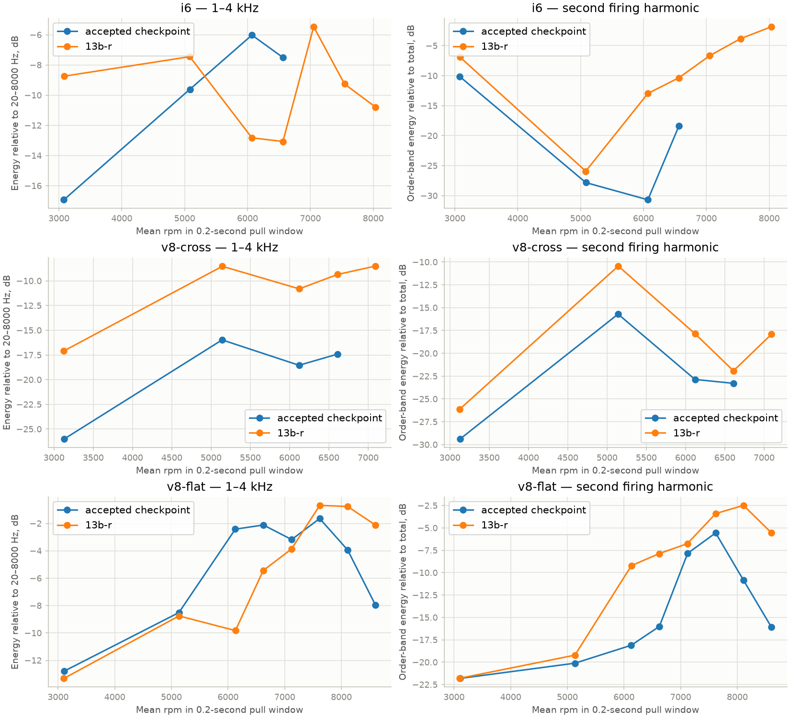

# Stage 13b-r — high-RPM exhaust character

Current selection: [selective rollback](stage-13b-r-rollback.md) restores the
pre-13b-r I6/flat-V8 exhausts. I6 stays 8500 rpm, cross V8 keeps this stage's
7500-rpm rear-delete X setup, flat V8 stays 9000 rpm. The measurements and
Kline/BimmerWorld choices below describe the earlier 13b-r checkpoint.

Subsequent review: Bernardo describes these renders as “Decent” and requests
an audit of all sound stages. See [the complete audit](sound-physics-audit-2026-10-22.md)
for confirmed issues and remaining physics/realism validation. The current
recordings are preserved. Hold for instructions; no fixes applied in the audit.

2026-10-22. Bernardo requests a sharper, louder, F1-style roar over roughly
the final 1000 rpm of the I6 and both V8s. The I6 limit becomes 8500 rpm
(+1500), cross V8 7500 (+500), and flat V8 stays at 9000. The accepted prior
checkpoint is the control. This substage is authorized; stage 14 is not.

## Research and implementation choices

Exhaust geometry changes the amplitudes and phases of existing firing
harmonics. For an evenly firing four-stroke engine, the overall firing rate
is `f_fire = cylinders * rpm / 120`. At the new limits these are 425 Hz
(I6), 500 Hz (cross V8) and 600 Hz (flat V8). Higher harmonics can produce a
sharper perceived tone without changing the crank's timing. These are not
the firing rates of a historic 18000-rpm F1 engine. No pitch shift, added
oscillator, RPM-dependent output gain or exhaust EQ is proposed.

- **I6:** [BimmerWorld/MagnaFlow E46 race rear system](https://www.bimmerworld.com/SpecE46/BimmerWorld-E46-Non-M-Exhaust-System-by-MagnaFlow-Race-Version.html)
  specifies a single 3-inch main and an optional straight center section.
  Its [matching front Y](https://www.bimmerworld.com/SpecE46/BimmerWorld-E46-Non-M-Front-Y-Pipe-by-MagnaFlow-Race-Version.html)
  uses E36 manifolds and compensating legs to time the pulses like equal
  primary paths. Model the two three-cylinder streams merging into one
  finite Y, followed by a shorter equivalent packed rear core and single
  3-inch pipe. Equal equivalent header lengths stand for the compensated
  upstream paths; they are not measurements of individual E36 primaries.
- **Flat V8:** [Kline's 458 system](https://www.kline-innovation.com/exhaust-collection/ferrari/458-3/ferrari-458-exhaust/)
  publishes a tight-radius X and dual 63.5 mm tubing in its valve-open path,
  with catalyst and bypass alternatives. Select the bypass/valves-open
  configuration, retaining the generic engine's equal 0.60 m headers.
  The closed-valve muffled branch and automatic valve control are outside
  this static open-path model. Do not claim a complete variable-valve replica.
- **Cross V8:** retain the [Borla 140961](https://www.borla.com/products/ford-mustang-gt-cat-back-exhaust-system-140961)
  inspired dual 3-inch X route, with the already evaluated physical rear
  muffler delete. This modified system is not the catalog kit. The retained
  catalysts and uneven bank firing distinguish it from the flat V8.
  [Pypes' manufacturer explanation](https://www.pypesexhaust.com/news/x-pipe-or-h-pipe-better-street-driven-muscle-car)
  describes the smoother, higher character generally associated with X
  mixing; that qualitative claim does not determine our geometry or gains.

[COMSOL's muffler model](https://doc.comsol.com/6.4/doc/com.comsol.help.models.mph.automotive_muffler/automotive_muffler.html)
illustrates frequency-dependent attenuation and resonances. Shorter paths
move their resonances upward (`f ~ c/L`); this does not mean that shortening
any tube universally raises engine pitch. Less absorptive packing preserves
upper harmonics. The existing gas solver must produce the changed waveform.

At a compact junction `Y=A/(rho*c)`, `p_j = 2*sum(Y_i*p_inc_i)/sum(Y_i)`.
Equal-length flat-V8 banks alternate by 90 crank degrees: their second
engine-order components oppose one another while fourth-order components
reinforce at a symmetric X. Real finite volumes, mean flow and temperature
make this approximate. Cross-plane banks retain other orders because their
firings are uneven. A small-signal two-input cancellation test must check
the network independently of listening renders.

## Rev limits and mechanical assumptions

[NJ Performance's M52/M54 spring set](https://nj-performance.com/shop/bmw/m52-m54-m50-vanos-dual-valve-springs-with-retainers-6-cylinder-engines-njperformance-valve-springs/)
advertises 8500-rpm valvetrain operation. This is a component claim, not proof
that a stock M54 bottom end, lubrication or damper is adequate. The generic
I6 is now explicitly a mechanically prepared race-build assumption. Its
90 mm stroke gives mean piston speed **25.5 m/s** at 8500. Valve float,
fatigue and oil-system failure remain unmodeled (stage 22).

[Ford Performance's Dark Horse R bulletin](https://performance.ford.com/content/dam/fordPerformance/motorsport/mustang-challenge/pdfs/MC-TSB-07-6-5-2024-Engine-Calibration.pdf)
documents a 7500-rpm limit for that particular race engine. Our generic
cross V8 is not that engine; its 94 mm stroke gives **23.5 m/s** at 7500.
The flat V8 remains at **24.3 m/s** at 9000 with an 81 mm stroke. No stock
vehicle durability, exact dyno output or real F1 equivalence is inferred.

## Implemented geometry and limits

`core/src/exhaust_models.c` defines the current routes. The engines retain
their generic bores, strokes, cams, compression and firing orders. Published
tubing outside diameters are reduced by an **estimated 1.2 mm wall** to obtain
flow bores. Every longitudinal length and junction volume below is an
estimate, not a measurement or a claimed manufacturer specification.

| Model | Flow bore | Effective header / front / center / link / rear / tail lengths (m) | Junction and rear treatment |
| --- | --- | --- | --- |
| I6 | Two 51.6 mm front paths → one 73.8 mm rear | .42 equal / .55 / .55 / .25 / .25 / 1.10 | .45 L Y; equivalent packed rear core; unresonated main |
| Cross V8 | Twin 73.8 mm | Prior unequal headers / .80 / .80 / .65 / .45 / .30 | Prior 1.2 L X; rear packing removed, catalysts retained |
| Flat V8 | Twin 61.1 mm | Prior equal .60 / .50 / .12 / .12 / .15 / .20 | .35 L X; open-valve equivalent paths, no packed rear loss |

The I6's upstream equivalent paths represent manifold/Y compensation. Its
rear core length and generic packing coefficient are unmeasured. The flat
V8's OEM-style headers are retained; Kline's unreleased primary lengths are
not treated as known data. Its two equivalent outlet locations remain the
generic listener geometry, not surveyed Kline outlets. Neither system is an
exact CAD or transfer-impedance replica. Fine junction scattering, higher
duct modes, wall vibration and proprietary silencer internals remain outside
the compact 1D approximation.

The new `catalyst_laminar` descriptor/API field separates substrate resistance
from the existing effective throat area. Default **25 Pa s/m** preserves the
previous model. The selected I6/flat-V8 catalyst-bypass configurations use
**zero substrate resistance** and throat area equal to the pipe area.
Geometric junction/entry losses, friction, heat transfer and physical outlet
radiation remain. This avoids leaving a hidden catalyst attenuation term in
a modeled bypass pipe. Existing public field indices are preserved; the new
field appends to the enum.

## Numerical validation

- The **175-test native suite** passes. The final strengthened coherent-X
  test also passes its six assertions separately. Its two simultaneous
  incident packets reinforce in phase and suppress outlet pressure by at
  least about 34 dB when opposed; signed flow must enter from the sources and leave
  down the outlets. No listener or audio filter participates in that test.
- Actual SIMD WASM physics: **18 tests / 2031 checks**. ASan/UBSan focused
  network/radiation/API validation: **10 / 2144**, leak detection disabled
  for the sandbox's existing ptrace limitation. Python **29**, web **17**,
  and the production build pass. Chromium checks the AudioWorklet and loads
  the revised presets from the actual WASM asset in both development and
  production (**two tests per mode**).
- Fired full-load mass/energy books are checked at 8250/7250/8750 rpm with
  seeded variation, with positive brake torque and zero cylinder/pipe state
  repairs. Five deliberate faults are caught. Initially, pressure-only
  coherence checks missed a reversed flow orientation; adding signed incoming
  and outgoing flow checks catches it. Original and final mutation logs are
  retained rather than concealing that initial miss.
- The fixed-geometry convergence probe holds pipes at **48 kHz**, averages
  cycles after 50 warm-up cycles, and refines physics 192 → 384 → 768 kHz.
  It changes neither geometry nor spatial grid between these rates.

| Model / test rpm | VE, 192 → 384 kHz | Pumping loss, Pa, 192 → 384 | Brake torque, N m, 192 → 384 → 768 |
| --- | --- | --- | --- |
| I6 / 8250 | .68011 → .67938 | 111331 → 111486 | 148.62 → 148.30 → 148.14 |
| Cross V8 / 7250 | .77102 → .77049 | 96037 → 96250 | 310.94 → 310.49 → 310.26 |
| Flat V8 / 8750 | .91730 → .91677 | 132123 → 132434 | 355.86 → 355.39 → 355.15 |

The first refinement changes torque by **.214/.144/.134%**, and pumping
loss by **.139/.222/.235%**, respectively. The next refinement roughly halves
these differences. Maximum absolute inventory discrepancies are below
**2.2e-14 kg / 1.3e-7 J**, with zero state repairs. This supports the retained
192 kHz default at these tested points; it does not solve 13b's separate
96 kHz implicit-valve acceptance or prove all conditions converged.

The shared-host 3000-rpm engine-only timing comparison uses three interleaved
rounds, each process taking its best of three. The physical models differ;
these are not isolated optimization gains or browser audio-deadline results.

| Model | Native throughput, accepted → new | WASM throughput, accepted → new |
| --- | --- | --- |
| I6 | 1.13× → 1.14× | .88× → .89× |
| Cross V8 | .91× → .90× | .68× → .67× |
| Flat V8 | 1.07× → 1.04× | .79× → .79× |

The few-percent changes are small relative to host variability. Full timing
logs, commands and binary hashes are retained locally. The 4× native / 2×
WASM targets remain unmet. Core WASM is **158724 bytes**.

## Measured sound and listening checkpoint

All measurements use unfiltered 48-kHz float WAVs at the same **0.1 render
gain**. `tools/high_rpm_report.py` averages the ears' powers, preventing
interaural cancellation in the measurement. It records source hashes, exact
0.2-second intervals, RPM range, harmonic bands and reference intervals.
Known synthetic harmonics and gain/ear-phase invariance are tested.
Crossing windows are transient and have different acceleration/load histories;
they are not steady-state matched-load or calibrated microphone comparisons.

The I6 reaches **8429 rpm**, cross V8 **7457**, flat V8 **8957** in the loaded
pulls, consistent with soft limiting below the nominal limits. Each retains
eight seconds of loaded coast before clutch-in. The I6 pull guard increases
to 20 s, allowing the higher limiter to finish; the other scenarios retain
their 12 s guard. The I4 and boxer recordings, including their long coasts,
remain byte-identical to the accepted checkpoint. Seventeen recordings in
the complete set are unchanged.

At their respective final-1000-rpm windows, spectral brightness moves from
**590 → 776 Hz** for I6, **282 → 558 Hz** for cross V8 and **919 → 1246 Hz**
for flat V8. The I6/cross comparisons include the requested RPM increases;
centroid is brightness, not a measurement of perceived pitch. Second firing
harmonic energy relative to total rises by approximately **16.6 / 5.4 /
10.5 dB** in those windows. The I6's 1–4 kHz share falls even while its
stronger firing overtones and higher RPM raise its centroid; the change is
not a uniform treble boost.

For the flat V8, the same nominal 8500-rpm crossing is available in both
versions (mean 8600/8602 rpm): energy above 2 kHz changes **−16.42 → −8.07 dB**
relative to total, and the second firing harmonic **−16.06 → −5.55 dB**.
Its raw 1–4 kHz level is about 3 dB lower despite the much brighter balance.
Listening previews apply one fixed whole-clip gain, so they must not be used
to claim calibrated absolute loudness between systems.



**Coast behavior also changes.** The pre-lift → early-coast 600–1600 Hz step
is **4.03 → 6.37 dB** for I6, **−1.91 → .80 dB** for cross V8 and
**1.46 → 3.28 dB** for flat V8. I6 broadband RMS rises about 1.94 dB after
lift where the preceding recording fell .41 dB. The flat V8's broadband
level falls more, despite its increased diagnostic-band step. These band
numbers are not a universal perceptual boom criterion. They identify a
changed transition needing Bernardo's feedback; this substage does not
declare the earlier deceleration-realism investigation solved. No gain ramp
was added to conceal the physical change.

The existing qualitative reference intervals remain in the report. Their
RPM, load, gain, ECU state and cabin/exterior/flyby perspective are unverified;
the turbo M4 is not the naturally aspirated race I6. No new reference file
is fabricated or modified. All **59 reference-library files** are hash-verified
unchanged. Further targeted recordings can be sought or requested if needed.

Fresh 30-second idle / 10-second 3000-rpm WOT audits start all five engines
with **zero warm stalled steps**. I6 idle work COV is **5.30–6.70%**, cross V8
**7.83–11.70%**, flat V8 **20.59–29.49%**. Flat V8 still has **135 incomplete
modeled burns** at EVO in the warm window. These are not inferred real
misfire rates. The pre-existing S1 combustion/repetition work remains open.

Two historical regression checks were made independent of the new presets:
the unequal-header mechanism test explicitly restores its original production
I6 fixture, and the free-crank I6 limiter check allows 1.8 s instead of 1.2
for the 48% greater target kinetic energy. It accepts a working soft limiter
as well as a hard cut; the upper speed bound remains enforced. Idle checks
and physical stability thresholds are not relaxed.

## Deliverable and reproduction

Open **`renders/RESULTS.html`** for all 34 current clips. The I6 and V8s have
buttons to jump directly to their last 1000 rpm. The cross-V8 alternate is
now the **packed** rear-muffler comparison; the main configuration has the
rear delete. All long coasts remain in the same portable offline file.
Superseded/generated comparison audio is removed after preserving numerical
evidence. Raw current float WAVs remain separate measurement inputs.

```
make render
.venv-analysis/bin/python tools/high_rpm_report.py --output renders/evidence/13b-r/after.json
cc -O3 -flto -ffp-contract=off -Icore/include -Icore/src tools/high_rpm_probe.c build/core/src/*.o -lm -o build/rpm_probe
build/rpm_probe > renders/evidence/13b-r/convergence.csv
```

Use the saved `before.json` with `--compare` to reproduce the spectral plot.
It retains the accepted checkpoint's measurements without retaining obsolete
audio. Native/WASM binaries and logs stay ignored under
`renders/evidence/13b-r/`; source code, equations and the chart are committed.
Claude's setup is preserved. **Hold for listening feedback.** Full 13b and
S1 remain incomplete; stage 14 is outside this request.

Graphify was queried before exploration and refreshed via AST: **1842 nodes,
5027 edges, 77 communities**. The existing `rb.h` parser limitation moves to
line 415 after the appended field; both C compilers accept it.
