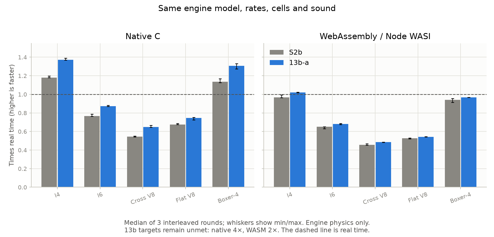

# Stage 13b — Performance and solver work

## 2026-10-22 continuation: coupled port experiment and researched exhausts

Bernardo resumed the whole stage and requested a dedicated exhaust substage.
The former holds below are historical. Stage [13b-p](stage-13b-p.md) documents
new full-path exhaust configurations and the causal outlet radiation load.
Those changes intentionally alter sound. They do not make the remaining
persistent pipe/face SoA refactor or the original throughput targets complete.

A new local experiment couples both valves, their port cells and each port's
adjacent momentum face. It eliminates the linearized face response, then solves
two signed nozzle residuals at a midpoint with bounded Newton iterations.
Species and enthalpy transfers remain paired; unresolved/unsafe states fall
back to the existing orifice. The frozen-property linearization, face timing
and operator splitting still need a converged treatment. This is an experiment,
not production code or a validated new solver.

For motored WOT at 1500 rpm, adiabatic cylinders and 48 kHz pipes, using the
same pre-exhaust-change geometry as the preceding probe:

| Engine | Midpoint probe at 96 kHz, PMEP Pa | 192 kHz | 384 kHz | 96 vs 192 error |
| --- | ---: | ---: | ---: | ---: |
| I4 | 8486.8211 | 8913.1531 | 9127.1476 | −4.78% |
| Cross V8 | 5735.5675 | 6159.6916 | 6372.3737 | −6.89% |

The lower rate underestimates pumping loss instead of the original explicit
cap's overestimate. Compared with its own 384 kHz values the probe's 96 kHz
errors are −7.02% / −9.99%; it is not a satisfactory replacement. A subsequent
half-piston-work / midpoint-valve-area splitting control changes these results
only marginally. No 96 kHz accuracy claim or speed gain follows. The prototype
and exact patches/results stay ignored in
`renders/13b-complete/coupled-probe/`. This does not rule out a properly converged
implicit method.

Valve boundary treatment warrants this caution: [Brejaud et al.](https://journals.sagepub.com/doi/abs/10.1177/0954407011409653)
validate a coupled gas-exchange boundary with experiments; our exploratory
linearization is not an implementation or validation of their method. The
current 192 kHz production setting is retained while this acceptance is open.

The implementation below remains the completed 13b-a optimization. Final
exhaust validation and updated runtime measurements are recorded in 13b-p;
old exact-WAV-identity statements below refer specifically to b922742 versus
S2b, before the new physical exhaust configurations.

2026-10-22. Bernardo said the S2b renders seem okay and authorized proceeding
from them to this checkpoint, then holding for feedback. **13b-a is complete;
the full 13b milestone remains open. Stage 14 has not started.**

The accepted pass computes pipe thermodynamics in batches, vectorizes gas
mixture rebuilds, and enables strict double SIMD/LTO builds. All **23 standard
float WAVs and three longer stereo pull/coasts are byte-identical to S2b**.
This preserves the approved sound; it does not claim a new realism gain.

The cross-plane V8 improves from **0.546× to 0.649× real time natively** and
**0.455× to 0.485× in WebAssembly** in matched engine-only benchmarks. These are
about **19% / 7% higher throughput**, far below the retained 4× / 2× targets.
A simplified implicit-flow experiment worsens pumping accuracy and is rejected.

## What was built

- `rb_chamber_integrate_many` uses an eight-cell structure-of-arrays workspace
  for the first Newton temperature correction. Each lane retains the scalar
  operation order, fit selection, temperature floor and convergence tolerance.
  Difficult states restart the original scalar solver from the original guess,
  preserving its 50-iteration cap and last-iteration heat capacity.
- Empty, fixed, corrupt and negative-species states retain the scalar repair
  path. Incomplete batches also use the scalar integrator. There is about
  1.2 kB of automatic scratch storage, with no allocation or persistent copy.
- The slow pipe pass gathers its heat before batching the contiguous slow
  cells. Fast end cells, direct transfers, pressure prediction, face ordering,
  kinetic-energy accounting and limited momentum transport are retained.
- Mixture coefficients and their integrals are constructed together in an
  independent loop. The 1e-8 remix threshold and normalization are unchanged.
- Native defaults use O3 and LTO; WebAssembly uses `-msimd128` and LTO.
  Fast-math stays off and contraction is explicitly disabled. `LTO=0` supports
  native profiling; `WASM_OPT` can select a separate scalar control build.
  Makefile changes now invalidate compiled objects and WASM targets.
- `make test-wasm` runs the C gas, batch and selected pipe assertions in the
  actual SIMD WASM build. `tools/performance_13b.py` preserves binary hashes,
  interleaved benchmark logs and exact float-WAV comparisons.

This is a bounded SoA working kernel, **not** a conversion of every persistent
pipe/face field to SoA. Chambers remain the canonical state read by faces and
the public cell API. Full storage/face vectorization and the coupled implicit
valve solve remain in 13b. PLAN.md records 13b-a separately under the existing
small-stage agreement; the original performance acceptance is not relaxed.

## Arithmetic and research

For each cell, species masses and sensible energy advance as before:

    m_s' = m_s + dt dm_s,    U' = U + dt dU
    y_s' = m_s' / sum(m_s'), u_target = U' / sum(m_s')
    T_guess = T_old + (u_target - u_old) / cv_old

With t = clamp(T_guess, 200, 4000) / 1000, the selected mixture coefficients
give the same two Horner polynomials for cv and sensible u. The first Newton
correction is `(u(T_guess) - u_target) / cv(T_guess)`. A lane uses that result
only if the scalar tolerance `abs(dT) <= 1e-6 T_new` holds after the 1 K floor.
The other lanes use the complete scalar solve. No sums run across cells.

[LLVM's vectorizer documentation](https://llvm.org/docs/Vectorizers.html)
explains why independent lanes can vectorize without reassociating reductions.
[Clang documents LTO](https://clang.llvm.org/docs/CommandGuide/clang.html), and
the [WebAssembly SIMD guide](https://emscripten.org/docs/porting/simd.html)
documents `-msimd128`. Native compiler reports show 16-byte vectors in the
new polynomial loop and mixture rebuild. Emitted WASM contains `f64x2` Horner
multiply/add, division and correction instructions. The local evidence is in
`renders/stage-13b/vectorization-native.txt` and `wasm-chamber.s`.

The initial instrumented profile still spreads work over mixtures, cell
updates, transport and faces. Gas-mixture rebuilding accounts for about
14.5% of that sampled run, which also includes the benchmark's microkernels.
It is not a precise engine-only cost fraction or an uninstrumented timing.

## Measured cost

Before is commit `4cb6546`, including S2b's limited reconstruction and open
cross-plane exhaust. After retains the same 192 kHz physics, 48 kHz pipes,
cell counts, hardware and benchmark workload: held WOT at 3000 rpm.
Both binaries run on this same host in alternating order for three rounds.
Each round internally takes the best of three 0.3-second measurements after
warm-up; the table uses the median round cost. Ranges are retained in JSON.

| Preset | Native before → after | WASM before → after |
|---|---:|---:|
| I4 | 1.181× → 1.372× | 0.968× → 1.021× |
| I6 | 0.765× → 0.873× | 0.651× → 0.679× |
| Cross-plane V8 | 0.546× → 0.649× | 0.455× → 0.485× |
| Flat-plane V8 | 0.675× → 0.745× | 0.528× → 0.541× |
| Boxer-4 | 1.136× → 1.307× | 0.940× → 0.967× |

The cross V8 costs 1.832 → 1.540 wall seconds per simulated second in
the median native run and 2.197 → 2.062 as WASM. The native ranges are
1.816–1.842 / 1.505–1.548; WASM 2.141–2.210 / 2.056–2.069. Shared-host timing
varies; especially small gains on other presets should not be generalized.
The cross target still needs about 6.2× the new native throughput and 4.1×
the new WASM throughput. The WASM core grows from 134,398 to 149,987 bytes.

These benchmark numbers time **engine physics only** in native C and Node's
WASI runtime. They do not establish stereo-render speed, AudioWorklet deadline
headroom or dropout-free playback on Bernardo's machine. No default rate,
grid, sound layer or physical loss was reduced to improve these numbers.
The final cross V8 extended stereo clip is 17.23 seconds and takes 34.6 CPU
seconds in one offline native run (about 0.50×). This current render cost is
not an interleaved stereo speedup measurement or a worklet deadline test.

## Why the implicit probe was rejected

A research-only probe replaces the equalization cap with a frozen-property
backward-Euler orifice solve. It bisects moved mass against the nozzle flow
at predicted final pressures, applying equal and opposite species/enthalpy
transfer. It leaves the neighbouring port momentum face outside the solve,
freezes thermal coefficients, and applies to all orifices. This is **not**
the roadmap's genuinely coupled valve/port solver.

Motored WOT at 1500 rpm, adiabatic cylinders, all pipes held at 48 kHz:

| Case: pumping pressure, Pa | I4 | Cross V8 |
|---|---:|---:|
| Existing 96 kHz | 10,326.85 | 7,359.14 |
| Existing 192 kHz reference | 9,322.09 | 6,532.13 |
| Existing 384 kHz | 9,293.12 | 6,537.37 |
| Probe 96 kHz | 11,272.89 | 8,483.41 |
| Probe 192 kHz | 10,305.64 | 7,533.10 |

The existing 96 kHz errors are +10.78% / +12.66%; the probe's become +20.93% /
+29.87% against the accepted 192 kHz reference. The existing 384 kHz values
are within 0.32% of 192 kHz. All points settle in 11–16 cycles. The probe also
costs more: 40 nozzle iterations per connection are a research bracket, not
an optimized production solve. Its source, patch, commands and results stay
in ignored `renders/stage-13b/implicit-probe/`; none enters the core or CLI.

[SUNDIALS' mathematical notes](https://sundials.readthedocs.io/en/v6.6.1/cvode/Mathematics_link.html)
separate stiff integration, nonlinear solution and error control.
[COMSOL discusses backward Euler's numerical damping](https://www.comsol.com/support/knowledgebase/1062).
The experiment supports rejecting this approximation. It does not establish
that a fully coupled implicit method cannot meet the accuracy requirement.
The next solver needs port-face coupling, time-step convergence, conservation,
phase/amplitude and sound comparisons. The default rate remains 192 kHz.

## Validation and sound

- Native: **167 tests / 2,709 checks**; updated batch cases also rerun after
  final compiler hints. The complete scalar chamber state is the batch oracle,
  including gas coefficients, rates and repairs, across 1/7/8/9/17/64 cells,
  fit boundaries, large corrections, fixed/empty cells and corrupt inputs.
- ASan/UBSan: five focused tests / 149 checks, with leak detection disabled
  for the sandbox's ptrace limitation. WASM C assertions: nine tests / 310
  checks, including gas fits, both acoustic-flow directions and conservation.
- All six planted correctness faults are caught: wrong Newton sign, corrupt
  cached cv, omitted tail, missing per-species negativity guard, wrong fuel
  weight, and non-finite specific energy accepted as converged. Finite total
  energy can overflow when divided by a tiny mass; this must use the scalar
  invalid-energy result, not accept an infinite correction against infinite T.
  An earlier wrong-constant perturbation merely triggered the correct
  scalar fallback; the cv mutation tests an observable state error instead.
  The negative-species case retains positive total mass so its guard matters.
- Twenty randomized engines run ten seconds each: zero failures and repairs.
  This full fuzz run precedes the final specific-energy guard; the final full
  native suite reruns its randomized engines and the new overflow regression.
  Twenty Python tests, 17 web unit tests, production build, and browser audio
  in dev and production preview pass. Browser playback remains the stage-2
  tone; these checks do not constitute stage-14 engine playback acceptance.
- `make render` produces 23 unfiltered float WAVs; the three asphalt long
  sweeps retain eight seconds of vehicle-coupled coast before clutch-in.
  All **26 WAVs are byte-identical** to their S2b counterparts. All 25 engine
  diagnostics report zero limited/non-finite samples. `plot_sound.py check`
  and `compare_real.py compare` complete with matching paired spectra/metrics.
- No new sound calibration, full dyno sweep, 30-second idle-COV audit or
  repetition claim is made. The complete native dyno/conservation suite passes;
  the prior S1 limitations and reference provenance remain applicable.

The final native renders and rebuilt SIMD WASM assertions include the
specific-energy overflow guard. Original recordings remain untouched.
The MP3 previews reuse S2b encodings only after verifying identical source
float WAVs; their hashes and provenance are recorded alongside the new WAVs.

## Feedback checkpoint and handoff

The current long examples are under `renders/stage-13b/long-coast/`:
`i6-long-pull-coast.mp3`, `v8-cross-long-pull-coast.mp3`, and
`v8-flat-long-pull-coast.mp3`. They intentionally sound the same as the
approved baseline. Bernardo can continue judging the lift-off transition,
the full deceleration and the cross-plane upper pull from these examples.

**Hold here for feedback.** The remaining 13b work is persistent cell/face SoA
and a coupled implicit solve that meets the accuracy and 4×/2× acceptance.
S1's repetition/ignition/V8-idle issues and broader S2/S4 acceptance remain
open. Realism, research-based solutions and the supplied real recordings
retain priority. Additional references can be sought or requested from
Bernardo when needed. Stage 14 remains unstarted.

Claude's `CLAUDE.md` and `.claude/` setup are preserved. Validation tools and
dependencies stay isolated. Graphify was queried before code exploration and
is refreshed after the changes; its known `rb.h` parser warning does not
affect compilation. The code, notes, WASM and tracked graph are committed and
synced to the existing main branch; generated media and experiments stay ignored.

Reproduce with `make test`, `make wasm`, `make test-wasm`, and `make render
RENDER_DIR=renders/stage-13b/mono RENDER_FLAGS=--float`. Then run
`tools/checkpoint_13b.py --cli PATH --output renders/stage-13b --long-coast`
and `tools/performance_13b.py compare`. For timing, preserve the before native
and WASI benchmark binaries and pass their paths with `--before-native` and
`--before-wasm` to `tools/performance_13b.py bench`; `--after-native`,
`--after-wasm` and `--node` select the isolated after tools. Do not overwrite
the before renders or reuse another machine's timings as a speedup claim.
