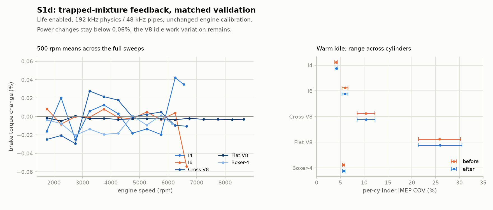

# Stage S1d — Burn timing follows the trapped mixture

Date: 2026-10-21. Complete as a charge-coupling substage. S1 remains open.

S1c showed why simply increasing variation globally is unsafe: the I4/boxer
still repeat too much, while the V8s already have substantial idle work
variation. Investigation found a missing physical connection. Fuel injection
accounts for fuel already in the gas, and heat release uses the actual trapped
reactants, but the flame-speed calculation used the injector's requested AFR.
Thus the same rich trapped charge could have different modeled burn durations
solely because a leaner injection target was selected, even when no injection
occurred. Cylinder fuel trims also changed available heat without affecting
the mixture argument in the burn-speed law.

## Change and limits

After injection at intake-valve closing (IVC), the core records

```text
phi_ivc = AFR_stoich * m_fuel / m_air
```

Both masses are the cylinder's actual species masses. With `variation > 0`,
the existing flame-speed fit uses this trapped equivalence ratio instead of
`AFR_stoich / requested_AFR`. Temperature, pressure and burned-gas fraction
remain the same captured charge quantities. The rest of the burn-duration,
ECU spark, seeded jitter, heat release and finite-time EVO truncation paths
are retained. The ECU's expected duration consequently reflects this mixture
before the existing per-cycle timing variation is drawn.

With variation off, negative or NaN, the requested-AFR calculation remains
exactly the legacy one. No random draws, calibration constants, duration caps,
preset settings, quality defaults or standard render gain recipes were changed. This is a
correction to S1's life-enabled charge coupling, not an ignition-misfire model.

`phi_ivc` is an internal `rb_burn` observation, fixed until the next IVC. If
either reactant is absent or the ratio overflows, it records zero and burn
timing uses the old finite reference calculation. Zero is an unavailable-ratio
sentinel, not a flammability cutoff. The existing burnable-fuel calculation
still prevents heat release without reactants. Existing fit extrapolation
floors and one-cycle duration bounds remain numerical approximations.

The retained correlation comes from [Metghalchi and Keck (1982)](https://doi.org/10.1016/0010-2180(82)90127-4),
[author-collection PDF](https://james-keck-memorial-collection.unibs.it/JCKeck-papers/MetghalchiKeck-CombustionFlame-48-191-1982.pdf),
as already documented in `docs/stage-09.md`. Its measured mixture range was
phi 0.8–1.5, with pressure 0.4–50 atm and temperature 298–700 K; the dilution
measurements extended to mass fraction 0.2. Applying the retained fit to very
dilute V8 idle or extreme mixtures is not newly validated by this change.
In particular, the correction establishes neither ignition failure nor a
calibrated probability of a misfire.

## Tests and reproducible validation

`test_variation_trapped_mixture` first failed against the previous core: it
treated phi 1.0 and 1.5 identically under the same requested AFR, then changed
duration for the identical phi-1.5 charge when requested AFR changed to 20.
After the correction it requires a slower rich burn, equal durations for
equal trapped charges, and unchanged legacy behavior with life disabled,
negative or NaN.

`test_variation_trapped_mixture_capture` checks injection into a lean charge
with a known fuel trim, expects captured phi 1.04, verifies zero markers for
missing fuel/air, and confirms a subsequent target-AFR change cannot move
the already scheduled burn. Existing partial-burn tests still verify species,
mass, energy and EVO behavior.

All four deliberate mutations in `tools/bugs/stageS1d.py` are caught by the new
tests: use requested mixture, invert fuel/air, change life-off behavior, or
ignore the actual trimmed charge. Each compiles and fails assertions in its
named tests; no mutation relies on a timeout or build failure.

Two validation affordances preserve existing defaults:

- `rb_cli dyno --variation 1` runs the life-enabled model on the existing free
  crank absorbing dyno. The default remains variation 0.
- `make render RENDER_DIR=renders/s1d/after-renders RENDER_FLAGS=--float` keeps a
  full float render set separate from the usual listening files. Omitting
  these variables retains the original render paths and PCM16 output.

The before executable and core snapshot are from commit `6216794`. Paired
dyno binaries use the same new command-line option, with the old or new core
respectively. Sweeps cover each preset from 1500 rpm to 200 rpm below its
limiter at 250 rpm/s, high quality, wide open and variation 1. Commands, binary
hashes and per-cycle CSVs stay in `renders/s1d/dyno/`.

The S1c 30-second float idle baselines and physics CSV are retained under
`renders/s1d/before/`. The new audits use the same compiler, settings, seed,
windows and quality. Additional matched old/new 30-second recordings use gain
0.5 in `before-audio/` and `after/`. `--source-root` identifies the old core
snapshot for the control's provenance, rather than labeling it with current
sources. The full old/new render recipes write 23 float WAVs each
under `before-renders/` and `after-renders/`; numerical sound checks use those
float files without extra filtering or normalization. User reference recordings
and their uncertain perspective groups remain unchanged and separate.

## Results

**All 153 native tests / 2517 checks pass.** All 16 Python tests and 16 web
unit tests pass, as do production typecheck/build and the existing Chrome
audio test against both development and production preview. The WASM core was
rebuilt with the existing isolated wasi-sdk 20 / Clang 16: 121148 bytes, with
the source fingerprint updated. No browser source or dependency was changed.

ASan/UBSan also passes all five focused charge/partial-burn tests (150 checks).
The first sanitizer run's tests passed but LeakSanitizer could not inspect
threads under sandbox ptrace; the successful rerun uses
`ASAN_OPTIONS=detect_leaks=0`. Leak checking is not claimed. Builds and temporary
packages stay isolated, and `CLAUDE.md` / `.claude/` are unchanged.

### Idle and work variation

Every preset completes 30 seconds from rest with zero warm stalled steps.
Numbers cover seconds 6–30; COV ranges are across individual cylinders.

| Preset | Idle IMEP COV before → after | After warm RPM range | Held 3000-rpm torque change |
|---|---:|---:|---:|
| I4 | 3.83–4.33% → 3.86–4.44% | 780.90–812.53 | -0.00118% |
| I6 | 5.36–6.57% → 5.32–6.55% | 676.41–712.62 | -0.00154% |
| Cross-plane V8 | 8.49–12.24% → 8.53–12.27% | 635.00–661.75 | -0.00127% |
| Flat-plane V8 | 21.40–30.22% → 21.37–30.52% | 976.81–1018.75 | -0.00150% |
| Boxer-4 | 5.43–5.95% → 5.41–5.99% | 715.53–768.04 | -0.00175% |

Held-load COV remains 1.11–1.99%. Flat-plane warm idle has 135/1598 modeled
partial completions versus 132/1598 before; minimum completion is 0.87849
versus 0.87488. Other presets have none in the sampled warm window. These are
the existing finite-time burn observations, not ignition failures. High V8
relative net-work COV remains unresolved despite stable idle speed.

### Matched full dyno sweeps

Each curve is averaged into 500-rpm bands on the common observed RPM range,
including the final partial band when at least ten cycles are present in each
run. This compares mean performance without confusing individual firing/cycle
variation with a change in the power curve. Every band is within S1's 1% target.

| Preset | Observed common RPM range | Maximum absolute torque change | Maximum absolute power change |
|---|---:|---:|---:|
| I4 | 1500–6595 | 0.0423% | 0.0345% |
| I6 | 1500–6796 | 0.0541% | 0.0246% |
| Cross-plane V8 | 1500–6796 | 0.0294% | 0.0314% |
| Flat-plane V8 | 1500–8796 | 0.0049% | 0.0076% |
| Boxer-4 | 1500–6297 | 0.0203% | 0.0187% |

Values are rounded upward at the displayed precision. This is a stock-preset,
wide-open, single-seed before/after regression, not new calibration against
real engines or proof of every possible operating condition.



### Sound and startup headroom

Both 23-file float sets complete. All 46 WAVs have finite samples; all 44 engine
render logs report zero soft-limited/non-finite samples. The test tone is
byte-identical. Engine waveforms change as intended by the charge coupling;
this is not a claim of improved realism by ear.

An additional 30-second cross-plane idle at the S1c audit's old gain 1 reports
six soft-limited samples, with peak 0.8401 at 0.3390 seconds; the old peak is
0.7044 at 0.3291 seconds. This is a changed startup transient, not a warm-idle
instability. The complete failed run is retained under `initial-gain1/`.

The audit now defaults to gain 0.5, with an explicit validated `--gain` option.
Matched old/new recordings at 0.5 have zero limited/non-finite samples in every
preset. Their cross-plane peaks are 0.3522 / 0.4203. This adds measurement
headroom only: it does not fix the larger startup peak, change engine/browser
gain or establish better sound. The startup needs listening review.

| Preset | Warm low-band repetition before → after | S1 target met? |
|---|---:|---|
| I4 | +19.91 → +19.89 dB | No |
| I6 | +11.36 → +11.38 dB | Yes |
| Cross-plane V8 | +10.13 → +10.20 dB | Yes |
| Flat-plane V8 | +5.36 → +5.32 dB | Yes |
| Boxer-4 | +17.71 → +17.71 dB | No |

The essentially unchanged I4/boxer repetition means this substage does not
solve the repeated-loop sound. Mid/high repetitions remain below 0 dB. No
metric definitions or acceptance thresholds were changed.

Across the full render recipe, most changes in energy share above 2 kHz are
under 0.3 dB. The boxer rev changes by +1.42 dB there, with crest factor -2.18 dB
and peak 0.2773 → 0.2069. The flat-plane rev changes by -0.28 dB above 2 kHz,
crest -0.62 dB and peak 0.7807 → 0.7458 at the same 0.38 gain. Their rev envelopes,
startup and limiter trajectories also shift; these whole-render numbers do not
alone establish a sound-quality improvement.

`renders/s1d/comparison.json` retains the full per-render, per-cylinder and
per-band results. `listening/` contains eight matched before/after pairs: all
five warm idles (source seconds 6–12), cross-plane startup (0–1.5), boxer rev
and flat-plane rev (0–12). Each plays before, a 0.5-second gap, then after.
Only these listening aids use 10 ms end fades and one shared static gain per
pair targeting peak 0.6; there is no EQ, denoising, compression or pitch shift.
Their manifest records source intervals and gain. They are not measurement
inputs. Compare startup and rev pairs for isolated transients and the return
to idle; Bernardo's assessment is still required.

Graphify is refreshed after final code and documentation changes; the existing
Claude graph workflow and setup are preserved.

## Remaining S1 work

Do not mark S1 complete from these passing charge-coupling tests. Low-band
repetition, high V8 idle COV, genuine spark-kernel failure and Bernardo's
listening checkpoints remain separate requirements. The matched S1d dyno
acceptance now passes; subsequent physics changes must repeat it.
The original real-recording intervals, perspective uncertainty and filtering
limits remain documented in `docs/user-sound-references.md`. Filtered listening
copies never become calibration measurements.
