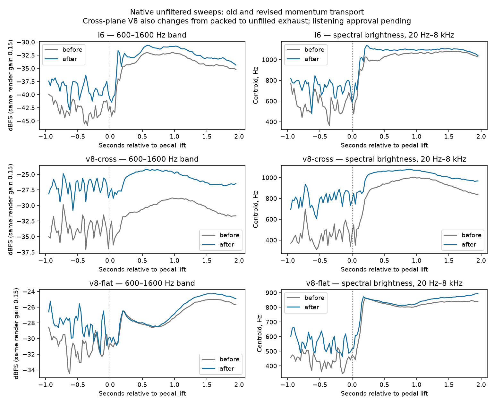

# S2b — Loaded exhaust detail and the lift-off contrast

2026-10-21. Bernardo confirmed that the reported “boom” means the louder,
higher tone replacing the burble at lift-off, around 8.8 s in the I6 and
8.2 s in the flat-plane V8 checkpoint clips. He also requested a higher,
less muffled cross-plane V8 near redline and reported an analysis traceback.
**S1/S2/S4 and the listening checkpoint remain open.** This work does not
start stage 13b's performance refactor or stage 14.

## Evidence and research

Graphify located the ECU, source radiation, pipe transport and muffler paths.
Matched float controls isolated the sustained overrun tone mainly to the
pipe-flow source. The additional jet and mechanical layers are much quieter.
Immediate fuel cut still produces it; delaying cut from 0.15 to 0.8 s does
not remove it. At lift, the crank continues slowing: the brighter tone is a
change in the dominant harmonics, not an increase in simulated engine RPM.

The old momentum transport uses the upstream face value throughout a cell.
This adds numerical dissipation when gas is moving. The separate mass and
enthalpy transport is also first order. [Thomas and Roe's acoustic-wave
study](https://scholars.duke.edu/publication/1162275) demonstrates that flow
solvers can lose acoustic amplitude at higher frequencies. The [TU Berlin
CAA notes](https://www.cfd.tu-berlin.de/research/acoustic/Overview/Overview_CAA/node3.html)
explain the phase and amplitude errors of coarse wave discretisation.
These motivate an independent transport test; they do not by themselves
prove the cause of every engine-sound defect.

In a frictionless pipe, an 800 Hz acoustic packet riding an approximately
70 m/s flow retains **39.0%** of its initial perturbation energy with the
old transport, versus **59.9%** with the revision after 2.5 ms. The test
covers both directions. With no mean flow both retain about 100.1%.
Thus the old scheme suppresses loaded detail more than motored detail.
This is a demonstrated contributor to the contrast; it is not a complete
calibration of real exhaust acoustics.

[The Roe–MUSCL numerical-diffusivity study](https://doi.org/10.1016/j.jcp.2013.12.011)
analyses how limited reconstruction reduces upwind diffusion; [NASA's LAVA
documentation](https://www.nas.nasa.gov/LAVA/unst_docs/input_file_unstructured/)
uses limited reconstruction while treating stability near shocks separately.
REV-BENCH adopts only limited linear reconstruction of transported momentum.
It does not adopt a complete Roe solver or claim second-order accuracy/TVD
for the whole nonlinear, two-rate gas system.

## Model

For the mass flows at a cell's left and right staggered faces, `mL` and `mR`,
let `m = (mL + mR)/2`. The transported momentum density is reconstructed at
the cell centre:

- Positive flow: `s = minmod(mL - mLL, mR - mL)`, `mStar = mL + s/2`.
- Negative flow: `s = minmod(mR - mL, mRR - mR)`, `mStar = mR - s/2`.
- Opposite-signed slopes or a missing upstream neighbour: `s = 0`.

`minmod(a,b)` returns the smaller absolute slope with their common sign,
or zero if their signs differ. The momentum flux is
`F = m * mStar / (rho * area)`. The same flux is shared by adjacent momentum
volumes. The pressure update, finite volumes, physical friction, heat transfer,
mass/species/enthalpy transfers, sonic guard and two stepping rates are retained.
There is no new audio envelope, pitch shift, noise gain or global equaliser.

The default is order 2. `rb_cli sound --momentum-order 1` is the donor-cell
control. This internal pipe setting is not a new public engine-description
field. The default quality, spatial grid and physics rates are unchanged.

## Cross-plane V8

The checkpoint's V8 has a packed straight-through muffler, whereas Bernardo's
Mustang recording is described as straight-piped. The revised example uses
unfilled pipes of the same length and bore. `--muffler straight` retains the
previous hardware configuration. This is an explicit reference-oriented
exhaust setup, not a verified replica of the recorded Mustang.

[SAE's exhaust-system study](https://saemobilus.sae.org/papers/exhaust-system-sounds-2006-01-1372)
describes the role of exhaust resonances and layout in sound. [Flowmaster's
manufacturer documentation](https://www.holley.com/support/exhaust/)
explains absorption in packed through-flow mufflers. In the controlled old
solver test, removing the packing raises the 6500-rpm spectral centroid from
about 365 to 551 Hz and the above-2-kHz share from -23.1 to -18.2 dB. Those are
brightness measures, not perceived-pitch measurements. Final combined results
are recorded below; crank speed and firing layout remain physically generated.

## Rejected controls

[Haltech documents throttle followers](https://support.haltech.com/portal/en/kb/articles/throttle-follower)
that slow closure after pedal release; [MoTeC documents progressive ignition
control before cut](https://motec.zendesk.com/hc/en-gb/articles/14575174412815-Checklist-Engine-Overrun-Setup).
A 30/60/120 ms air-area follower, earlier/delayed cut and a manifold-pressure
cut condition were tested. They move the transition and can increase its later
rise. The follower is **not shipped**. Its experimental patch and renders are
retained locally under `renders/feedback-13b/diagnostics/`.

An open-end radiation-impedance control based on [Silva et al.](https://arxiv.org/html/0811.3625v1)
changes the overrun level by less than about 1 dB in these probes, so it is not
adopted as the explanation or fix. Ultra-grid controls also change the tone
and cost substantially more; neither default quality nor grid size is changed.
Further radiation/viscothermal and spatial-convergence work remains useful.

## Measurement and listening

At the same render gain, the pre-lift to early-coast band contrast changes:

| Layout | Before | Revised | Reduction in contrast |
| --- | ---: | ---: | ---: |
| I6 | +9.84 dB | +6.96 dB | 2.88 dB |
| Flat-plane V8 | +3.51 dB | -0.32 dB | 3.83 dB |

The pre-lift window is -0.8 to -0.2 s, the early coast +0.2 to +0.8 s.
The improvement comes principally from retaining loaded detail: the absolute
I6 sustained-overrun level is not uniformly quieter. The remaining tone is
not declared resolved. Near the cross V8's 6500-rpm crossing, the combined
solver/exhaust change raises the centroid from 393 to 790 Hz and the share
above 2 kHz from -21.51 to -14.98 dB.



Local listening copies play **before, then after**:

- [I6 lift-off comparison](../renders/feedback-13b/listening/i6-before-after.mp3)
- [Flat V8 lift-off comparison](../renders/feedback-13b/listening/v8-flat-before-after.mp3)
- [Cross V8 upper-pull comparison](../renders/feedback-13b/listening/v8-cross-before-after.mp3)

Full revised longer sweeps are in `renders/feedback-13b/long-coast/`.
These audio files are local and ignored; they are not uploaded to GitHub.

The originals and measurements are unfiltered float WAVs at gain 0.15 in the
same stationary asphalt scene, with 3 kg m² inertia and an eight-second coast
before clutch-in. CSV records requested pedal, actual throttle area and MAP.
Lift time is the start of the first closed-pedal block, identified from the
preceding CSV row; the earlier checkpoint manifest used that block's end
(2.67 ms later). No audio is stretched or retimed.

`tools/measure_lift_feedback.py` measures mean ear power, avoiding cancellation
from summing the two ear signals. The 600–1600 Hz diagnostic band was chosen
after inspecting the original renders; it is not an independent perceptual
acceptance target. Spectral centroid measures brightness, not perceived pitch.
Listening-only A/B copies use one shared static gain per pair, 10 ms edge fades
and a half-second silent gap. Their original float measurement files are intact.

The same real falling-pitch references remain BMW 250–253 s, Mustang 257–263 s
and Ferrari 302–310 s. They have no verified matching RPM, pedal/load or
cabin/exterior/flyby perspective. The current I6 is naturally aspirated and
the BMW is turbocharged. Bright/dark labels are acoustic observations.

## Render-helper error and validation

The recovered screenshot shows `ModuleNotFoundError: No module named
'matplotlib'` from `checkpoint_13b.py` importing `compare_real` at startup.
Rendering now uses only the Python standard library. Analysis dependencies
are imported only for `--analyze`, with an actionable message when absent.
NumPy/Matplotlib are installed in ignored `.venv-analysis/`; Claude's environment,
`CLAUDE.md` and `.claude/` are preserved. The fault-test copier now excludes
virtual environments so it does not copy analysis packages for every mutant.

- 165 native tests / 2583 checks pass. Three focused ASan/UBSan tests / 23
  checks pass (leak checking disabled for the sandbox's ptrace limitation).
- All three deliberate faults (donor default, backward slope, excessive
  reconstruction) are caught by the packet test through real assertions.
- Twenty randomized engines run for ten seconds each: zero failures.
- Five full life-enabled dyno sweeps retain their bounds: the maximum changes
  in 500-rpm-bin mean torque/power are 0.66% / 0.88%. No thresholds were relaxed.
- All 23 final float WAVs are finite; all 22 engine diagnostics report zero
  limited/non-finite samples. The three long sweeps also have clean diagnostics.
- Twenty Python tests pass; 17 WASM unit tests, production build and browser
  audio in development/production-preview pass. The rebuilt core is 134398 bytes.
- Default grid/quality and physics rates are unchanged. Engine-only cross V8
  benchmarking is about 0.52x native / 0.47x WebAssembly on this shared host. Full stereo clip
  CPU times before/after are I6 76.2/73.8 s, cross 72.5/85.0 s and flat
  80.5/84.2 s, for approximately 17–21 s of audio. Runtime varies with preset
  and host; the cross clip costs about 17% more here. No speed gain is claimed,
  and 13b's performance targets remain unmet.
- Fresh 30-second warm-idle/held physics results are retained in
  `renders/feedback-13b/physics.csv`; S1 repetition/ignition/listening acceptance
  remains open. All five presets have zero warm stalled steps.
  Per-cylinder idle IMEP COV ranges: I4 3.84–4.37%, I6 5.50–6.81%, cross V8 8.45–12.38%, flat V8 21.38–30.53%, boxer 5.41–5.93%.
  These do not resolve the V8 idle work-variation gap; low-band repetition
  has not been re-audited over a fresh 30-second audio window in this step.

The earlier checkpoint's claim that every standard render had zero limited
samples was inaccurate: its I4 cabin sweep is byte-identical to a control that
reports 27 limited samples. The new render gains provide headroom; these are
listening-export settings, not a reduction of the engine's physical pressure.
All quantitative before/after lift comparisons use the same gain 0.15.

Reproduce after building and preparing the local reference excerpts:

```sh
make render RENDER_DIR=renders/feedback-13b/mono RENDER_FLAGS=--float
python3 tools/checkpoint_13b.py --cli build/rb_cli --output renders/feedback-13b --long-coast
.venv-analysis/bin/python tools/measure_lift_feedback.py
```

For analysis setup on another WSL checkout:

```sh
python3 -m venv .venv-analysis
.venv-analysis/bin/python -m pip install -r tools/requirements-analysis.txt
```

Bernardo should compare the transition and later sustained coast separately,
and judge whether the cross-plane pull now communicates rising RPM clearly.
The sustained pumping tone and remaining sound/combustion acceptance gaps
still require listening and further research as needed.

The Graphify code graph is refreshed without semantic/API calls. Its extractor
still reports a partial parse of the unchanged `core/include/rb.h`; native and
WASM compilation succeed. Treat that as a graph-navigation limit, not a C error.
