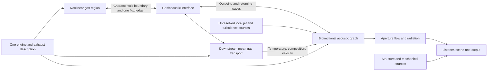
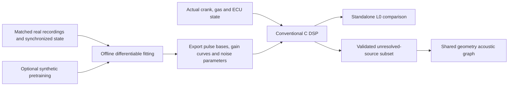

# S2d design — coupled exhaust acoustics and learned-DSP benchmarks

2026-10-23. **Implementation specification; not acceptance evidence.**
The later [S2d checkpoint](stage-S2d.md) implements the initial native A1/B0
fixtures; it does not complete engine coupling or architecture promotion.
Bernardo requests architecture sketches, algorithms
and a practical comparison plan following S2c. Baseline revision:
`c1c8afaea3de7f750bbe67ab5b3e1fb0447acfee`. Keep the accepted exhausts and
recordings as the control. S2d/S2e/S6, S1/S1e/S2/S4 and full 13b remain open;
stage 14 remains unstarted. Preserve `CLAUDE.md` and `.claude/`.
Keep generated audio and local recordings in ignored `renders/`; measurements
use unfiltered float WAVs. Document reference intervals, processing and
uncertain perspective rather than treating brightness as microphone position.

## Decision and experimental arms

Prototype a **bidirectional acoustic network downstream of a retained nonlinear
gas region**, against a conservative 1D control. Learn source parameters only
after separating source, propagation and recording response. Do not choose a
new renderer from brightness or a reconstruction score alone.

| Arm | Implementation to compare | Purpose |
| --- | --- | --- |
| A0 | Current production solver/rendering, frozen settings | Regression, sound and cost baseline |
| A1 | Conservative coupled-variable finite-volume prototype | Establish whether improved nonlinear transport meets acoustic accuracy at acceptable cost |
| B0 → B1 | Fixed-background acoustic graph, then nonlinear-gas/graph coupling with returning load | Test an efficient propagation alternative without separating engine breathing from exhaust sound |
| L0-P / L0-G | Engine-specific pulse synthesis / learned order-and-noise gain tables, standalone | Compare structured learned representations against physical rendering; initially outside engine feedback |
| L1 | Learned unresolved-source parameters feeding the validated shared graph | Optional integration after R2/S1f/S2e gates; no second copy of resolved combustion pulses |

S2c establishes a reason to test these arms, not their eventual winner. Engine
rate doubling changed upper-band share by at most 0.15 dB; finer space at the
same pipe timestep changed it by +5.93/+5.29/+0.85 dB for I6/flat/cross V8.
The 2-kHz control retained almost all perturbation energy while missing phase
by 134.65°, reduced to 8.30° with finer cells. The refined hot-flow network
also grew waves; its partition sensitivity prevents assigning all error to
bulk transport. See [S2c](stage-S2c.md) for exact conditions and exclusions.

## Architecture and ownership



The two gas regions divide the physical domain; their boundary must not
overlap. The downstream mean model and acoustic graph are complementary
representations of that downstream domain, with an explicit mean/perturbation
decomposition. They must not both advance the same acoustic degrees of freedom.

Compile the existing engine descriptor into a topology with stable component,
port, bank and source IDs. Generate both candidate gas connectivity and
acoustic connectivity from it. Include primaries, collectors, center sections,
links, X/Y junctions, catalysts, mufflers and outlets. Keep SI units, physical
lengths, cross sections, volumes, material parameters and provenance. Reject
unsupported topology/capacity at preparation time rather than silently removing
a branch or enlarging cells. An X connection is an actual connected multiport,
not a destination selected by collector index.

The descriptor currently gives effective geometry for several components;
it is not automatically a complete fabrication drawing. Add perforation,
packing and cavity data with measured/researched uncertainty where needed.
The same geometry does not imply the same numerical discretization in A1/B1.

| Quantity | Owner and contract |
| --- | --- |
| Crank, valves, spark, fuel, cylinder state, blowdown and strong local waves | Existing physical engine plus retained nonlinear gas region |
| Downstream mean mass, species, enthalpy, pressure loss and thermal inventory | Mean gas transport model; preserve advection, reverse-flow composition and finite volumes |
| Downstream acoustic propagation, reflections and component scattering | Acoustic graph; return its incoming characteristic at the interface |
| Interface transfer | One accepted boundary flux, applied with opposite signs to the two gas regions; one work ledger |
| Unresolved jet/turbulence sound | Located physical source with declared units and energy allocation, routed through that graph |
| Aperture acoustic load | One terminal impedance, owned by the active propagation arm |
| Far-field pressure and listener effects | Aperture/directivity and scene model; never an additional load applied to the engine |
| Mechanical/structure sound | Its own structural transfer; exhaust routing only where physical coupling warrants it |

Do not append a waveguide to a fully resolved downstream gas pipe and sum both
outputs. That duplicates wave storage, delays and reflected loading. Likewise,
do not leave the old procedural exhaust filters active on a noise source that
the new graph already transports.

## A1 — conservative 1D comparison

Build a standalone uniform-duct reference before adapting engine storage.
For fixed composition and ideal-gas verification, advance the conservative
state and flux:

```text
W = [rho*A, rho*u*A, rho*E*A, rho*Y_k*A]
F = [rho*u*A, (rho*u*u + p)*A, u*(rho*E + p)*A, rho*u*Y_k*A]
E = e(T,Y) + u*u/2
W_i(new) = W_i(old) - dt/dx * (F_right - F_left) + dt * S_i
```

`E` is specific total energy; `e` is specific internal energy. For smoothly
varying area, the axial momentum source includes `p*dA/dx`. Abrupt steps and
junctions need their own validated interface treatment, not an untested smooth
area source. Friction, heat and chemistry retain explicit work/energy books.

Initial candidate: limited piecewise-linear reconstruction, HLLC-type flux
and SSP-RK2, with a more dissipative admissible fallback for problematic
states. Compare limiter choices in smooth weak waves versus finite blowdown
pulses; instrument fallback frequency, not just NaNs. Do not assume HLLC is
acoustically adequate at low Mach or that a positivity fallback is accurate.
Only introduce an all-speed/low-dissipation flux correction after a controlled
fixture demonstrates the need, with shock and entropy checks retained.
The [Clawpack Euler reference](https://www.clawpack.org/riemann_book/html/Euler_approximate.html)
provides a transparent constant-gamma Riemann baseline; those formulas cannot
be copied unchanged into this project's variable-heat-capacity mixture.

Then use the existing `gas.c` mixture/EOS consistently for pressure, sound
speed, total/internal energy and reconstructed thermodynamics. Transport
species with the same accepted mass flux; preserve their sum and nonnegative
states without silently renormalizing away a conservation failure. Validate
contact/temperature fronts as well as isentropic waves. Record the limits of
the existing apparent heat-capacity model separately from discretization.

The current `momentum_flux()` limits only staggered momentum reconstruction;
mass/species/enthalpy remain donor transport. A1 must compare the complete
coupled update. When integrating it, replace the corresponding kinetic/internal
energy bookkeeping, rather than adding a total-energy equation on top of it.
Preserve existing valve, cylinder-work and two-rate convergence controls.

Start on uniform spacing. Add local resolution near strong gradients only
after conservative interfaces, subcycling and refluxing pass; no initial AMR
or global cell doubling. Compare acoustic error **per measured CPU cost**, not
per cell or nominal order. A1 may remain the preferred model in nonlinear
regions even if B1 wins downstream.

## B0 — fixed-background acoustic graph

### Pressure/flow waves and scattering

Begin with quiescent, homogeneous, plane-wave ducts. At each junction port,
let `a_i` be pressure traveling toward the junction, `b_i` pressure traveling
away, and `Q_i` volume flow positive toward the junction:

```text
Z_i = rho_i*c_i/A_i                 [Pa s / m^3]
Y_i = 1/Z_i
p_i' = a_i + b_i                   [Pa]
Q_i' = (a_i - b_i)/Z_i             [m^3/s]
p_j = 2 * sum(Y_i*a_i) / sum(Y_i)   # no source or junction storage
b_i = p_j - a_i
```

This enforces equal pressure and zero net junction flow. With power-normalized
waves `w_i=sqrt(Y_i)*a_i`, `v_i=sqrt(Y_i)`, scattering is
`S=2*v*v^T/(v^T*v)-I`. For real positive impedances, `S^T*S=I`: the ideal
static junction conserves acoustic power. A finite collector/cavity instead
has compliance/storage; do not replace every existing chamber by a zero-volume
junction. This follows the traveling-wave/scattering approach of
[Rocchesso and Smith](https://www.di.univr.it/documenti/ArticoloRivista/allegato/allegato979612.pdf);
the present exhaust implementation and its validity still require testing.

Useful independent limits: equal-area two-port transmission without
reflection; area-step pressure reflection `(Z2-Z1)/(Z2+Z1)`; an equal-area
four-port gives -0.5 reflection and +0.5 pressure to each other port. The
latter conserves power because all four outgoing branches count.

Each straight component uses two traveling-wave delay paths and causal loss
filters. For frozen uniform axial background velocity `U`, candidate delays
are `D_plus=fs*L/(c+U)` and `D_minus=fs*L/(c-U)` samples, with `abs(U)<c`.
The moving-medium coupling and power metric below are required before using
these delays in a flowing engine. Compute `c` from local gas composition and
temperature, rather than the current procedural fixed 580 m/s delay.

Implement integer delays plus a tested fractional-delay filter. Compare a
Thiran/all-pass option against a short Farrow/FIR option using both magnitude
and group delay; an all-pass has flat magnitude but can have substantial delay
error. [Smith's Thiran treatment](https://www.dsprelated.com/freebooks/pasp/Thiran_Allpass_Interpolators.html)
describes its delay-dependent design/stability limits. Neither time-varying
interpolation nor stable poles alone establishes
passivity of the complete feedback loop. Very short components need a local
implicit/scattering solve or a sufficiently fast subgraph: silently rounding
every edge up to one sample changes the geometry and resonances.

### Components, radiation and usable band

- Realize expansion volumes, side cavities and perforated/packed paths as
  appropriate multiports and storage, with separate mean pressure loss. A
  packed straight-through can needs its core-to-absorber coupling; replacing
  it with an arbitrary series EQ is not the same physical system.
- Start with analytic simple components. For complex measured/3D-characterized
  components, fit causal stable state-space/scattering models offline, with
  uncertainty and declared frequency/temperature/flow range. At zero mean
  flow, enforce passivity of the **whole power-normalized matrix**
  (`I-S^H*S` positive semidefinite, with `H` the conjugate transpose), not just
  `abs(S_ij)<=1` or stable poles.
- Retain the current causal radiation implementation as a comparison control.
  At zero flow, `R(z)=(Z_load(z)-Z0)/(Z_load(z)+Z0)` links terminal impedance
  and returning pressure wave. Check sign, units and work against the existing
  velocity-based load: multiply/divide by aperture area when converting to
  volume-flow impedance. The active arm applies this load once. Use the same
  aperture solution for radiated output; do not add the existing gas load to
  another acoustic termination. [Silva et al.](https://arxiv.org/abs/0811.3625)
  distinguish causal streaming approximations from noncausal fits.
- The present monopole far-field `rho_ambient/(4*pi*r) * dQ/dt` already exists.
  Preserve its units and derivative timing while validating aperture/near-field
  and directivity limits. A generic extra `dp/dt` stage is not a missing fix.
- Declare modal validity. For an ideal hard circular duct at rest,
  `f_first_nonplane≈1.84*c/(pi*D)`; above this, the plane wave still exists but
  additional modes can propagate. [COMSOL's formulation](https://doc.comsol.com/6.4/doc/com.comsol.help.aco/aco_ug_pipe.12.18.html)
  makes that limit explicit. Wider mufflers may need measured multimodal
  reductions or local 3D analysis. A 48-kHz output does not establish a
  physically validated 20-kHz exhaust model.

## B1 — gas coupling, mean flow and lift-off

### Nonlinear/linear boundary

Initially retain cylinders, valves, primaries and collectors in the nonlinear
region. Place candidate acoustic boundaries farther downstream where actual
`abs(p')/p_bar`, `abs(u')/c`, Mach number, gradients and spectral content can
be measured. Small perturbation limits are empirical acceptance boundaries,
not an assumption that every collector is linear. Compare at least two
boundary placements; move the boundary or retain nonlinear transport when
blowdown steepening/shocks materially affect the result. Start weak-wave
fixtures at `abs(p')/p_bar=1e-5..1e-3`, then screen finite pulses at 0.01,
0.05 and 0.1 against the nonlinear control. These are test amplitudes, not a
universal threshold below which an engine exhaust can be assumed linear.

At a zero-mean-flow interface, choose `a` traveling into the acoustic network
and `b` returning toward the engine. The boundary relations are:

```text
p_boundary = p_bar + a + b
Q_boundary = Q_bar + (a - b)/Z
```

Solve these with the outgoing gas characteristic/numerical boundary flux;
`a` is not an independently prescribed extra pulse. Here `Q_bar=0` in the
quiescent derivation; the moving-medium extension is a separate validation
step below. The network supplies the incoming characteristic. A pressure
overwrite after gas integration does
not conserve flux. The interface must book mass, species, enthalpy and pressure
work once, with equal/opposite signs. Include acoustic storage/work in the
downstream accounting without adding `p*Q` a second time if the accepted
total-energy/enthalpy flux already includes that work. The engine must respond
to the new load during valve overlap, not merely hear a different output
afterward.

[Hota and Munjal](https://www.iiav.org/ijav/content/volumes/9_2004_1722161272264886/vol_3/396_fullpaper_1757111286453860.pdf)
provide a coupled engine-source precedent. Their linear downstream model and
single-cylinder diesel validation do not prove multicylinder hot-transient
accuracy. The present boundary and engine response need independent checks.

### Mean flow is an additional problem, not a delay correction

For uniform frozen isentropic mean flow, linearized Euler characteristics
travel at `U±c`. Volume flow and acoustic mass flow differ:

```text
m_dot' = rho_bar*Q' + A*U*rho'
rho' = p'/c^2                     # isentropic part only
e_ac = p'^2/(2*rho_bar*c^2) + rho_bar*u'^2/2
F_ac = U*e_ac + p'*u'              # W/m^2, uniform-background energy flux
```

Use this flux and actual mean-flow work in the moving-medium ledger.
`p'*Q'` alone and the quiescent scattering formula do not establish
conservation/passivity with flow. Entropy/composition disturbances are a
separate convected mode. A two-wave acoustic line cannot carry the hot-gas
front or ambient gas entrained during reverse flow.

Therefore retain downstream gas inventories and advective heat/species
transport in a mean model, with resolution/update rate validated against
those fronts. Define its projection and the acoustic remainder together;
do not independently low-pass pressure and high-pass flow with an undefined
overlap/gap. Slow updates are allowed only where measurements justify them.
Strong transient mean flow may require a faster local gas component.

Introduce background variation in steps: frozen nonzero flow; fixed spatial
temperature profiles; then time-varying profiles and reversals. Changing
impedance or delay changes stored wave energy. Preserve a consistent physical
state, account for background work, and test coefficient-update pumping.
Coefficient smoothing alone is not an energy proof. Above the validated
linear/mean-flow domain, fail the diagnostic case or use a preselected
validated nonlinear region. Do not silently clamp an unstable candidate
until it sounds acceptable.

### Separate the actual I6 lift-off mechanisms

The measured +6.06-dB early-coast rise accompanies a -10.54-dB added tail-flow
noise change. Near-mouth cell gas changes about 848→319 K and reverses its
mean flow; that does not measure whole-exhaust or wall cooling. Run a causal
fixture matrix before changing deceleration tuning:

1. Send the same acoustic probe through frozen loaded versus coast `T/U`
   profiles, then vary only temperature, only velocity, and both. Compare
   transfer magnitude, phase and resonant frequency.
2. Test tagged hot/cold gas reversal at an open end, with zero wall heat,
   fixed-wall heat and a researched finite-wall-capacity model separately.
   Refine cell size and timestep independently; compare mixing, total energy
   and entropy/front transport. Do not give a new wall model invented constants.
3. Repeat with the measured time-varying mean profiles, then actual ECU
   lift/cut/resume. Capture pulse-only, unresolved-flow-only and mechanical
   sources on the same trajectory. Preserve full coast and neutral fall as
   different tests.
4. Include finite-pulse amplitude sweeps and source/load feedback. Frozen
   replays establish transfer mechanisms; only coupled runs establish engine
   response. Tonal concentration, phase interference and source power changes
   must be reported separately; source powers do not simply add coherently.

## Source insertion and sample scheduling

Represent each acoustic source as a located series pressure source or shunt
volume-flow source, with a declared conversion from its physical driver.
Route it to every connected outlet through the same graph. Generate throat
noise from actual valve throat state, with reverse-flow treatment and measured
or bounded directivity. Keep acoustic source work in the energy ledger: a
noise source coupled back into the gas cannot create free energy because the
old sound-only model never booked it. State how much resolved jet dissipation
remains heat and how much is modeled as unresolved acoustic power.

Initially keep learned full-sound comparators one-way and outside the physical
feedback loop. Do not inject their complete pulse trains on top of resolved
gas pulses. Any later coherent-source replacement needs an explicit ownership,
load and energy contract. L1 should first fit unresolved noise/structure
parameters, where the missing process is identifiable.

Use the same engine clock and actual crank crossings for firing/valve/injection
events. A 100–500-Hz parameter update, if justified by its measured bandwidth,
may control smooth envelopes; it must not quantize pulse timing or throttle/
fuel-cut events. Keep fractional event timestamps and band-limited pulse
generation at the active synthesis rate. Do not use the coarse telemetry CSV
as the acoustic driving waveform.

First coupled fixture: fixed background and a common 192-kHz step for the
small gas region/interface and inexpensive acoustic network. This avoids
confounding architecture with a new resampling error; it does not raise the
entire production pipe rate. Then compare 96/48-kHz network scheduling with
the same fixtures. At every common tick:

```text
read returning waves from existing delay states
solve gas/interface boundary flux, including any zero-delay component solve
commit one conservative flux to gas inventories and the interface ledger
scatter outgoing/source waves; advance delays and component storage
extract aperture flow and source-separated diagnostics
```

Algebraic direct feedthrough requires a local analytic solve or a bounded
implicit solve with a measured residual. A nonconverged boundary fails the
case; do not insert an arbitrary sample of delay to break the loop. At mixed
rates, preserve integrated boundary transfer and return-wave timing, use an
explicit conservative subcycling/predictor-corrector scheme, and compare its
work/phase against the common-rate control. Include resampler/filter group
delay in the physical feedback model. Averaging 192-kHz flux for a 48-kHz
network and holding its pressure is only a candidate until those tests pass.
An entire 128-frame callback must never become the feedback latency.

## Proposed C integration boundaries

The following are proposed modules, not files/API already implemented:

| Module | Responsibility |
| --- | --- |
| `acoustic_graph.[ch]` | Compile topology, stable IDs, capacities, component plans and source routes |
| `acoustic_wave.[ch]` | Traveling waves, tested delays, static scattering and energy diagnostics |
| `acoustic_component.[ch]` | Cavity, perforate/packing, radiation and fitted multiport state |
| `acoustic_coupler.[ch]` | Characteristic matching, mean/AC split, accepted flux/work ledger |
| `acoustic_source.[ch]` | Located unresolved sources; deterministic clocks/seeds and units |
| Native diagnostic adapter | Select A0/A1/B0/B1 without public API/default changes |
| Offline parameter fitter/exporter | Train/evaluate L0/L1; export versioned conventional-DSP coefficients |

Follow the existing allocation rule: caller/host owns storage; no `malloc`,
training, file access or graph compilation in the core. An internal interface
should expose explicit status, workspace and units, for example:

```c
/* Interface sketch only; exact types/capacities follow fixture results. */
int rb_acoustic_prepare(const rb_exhaust_topology *geometry, double sample_rate,
                        rb_acoustic_plan *plan, rb_acoustic_storage *storage);
int rb_acoustic_couple_step(rb_acoustic_state *state,
                           const rb_gas_boundary_state *gas,
                           const rb_source_inputs *sources,
                           rb_boundary_flux *accepted_flux,
                           rb_aperture_output *out, rb_acoustic_ledger *ledger);
```

`prepare` validates capacities/bands and is host-side. State/storage sizes are
reported before allocation and all work per step is bounded. Separate frozen
plan from mutable state. Keep current public parameter IDs and WASM ABI until
native physics passes; graph representation is internal initially.

Current integration sites: `engine.c`'s `slow_flows`/`slow_step` and fast-face
updates; `pipe.c`'s boundary, flow and energy operations; `rb_sim.c`'s engine
stepping/aperture extraction; `noise.c`'s source placement/routing; `audio.c`
and scene input contracts. Preserve the existing source-only identity tests
and distinguish mono listener from production stereo cost. A renderer enum
alone cannot replace the required physics coupling.

## Learned synthesis: experiments and deployment

Two recent engine-specific primary reports motivate the L0 comparison:
[PTR](https://arxiv.org/html/2603.09391v1) learns pulse/resonator synthesis but
evaluates synthetic engine data at 16 kHz; its inferred torque-sign operating
gates are not actual ECU observations. [EONE](https://arxiv.org/html/2606.21521v1)
fits order/noise gain curves and deploys them without neural inference; its
16-kHz experiments use synchronized RPM/torque recordings. Neither establishes
arbitrary-exhaust response or this project's 48-kHz fidelity. These are research
benchmarks, not ready-made calibrated engine models.



**L0-P:** firing-aligned pulse bases, per-cylinder conditioning and stochastic
modulation; test a compact resonator implementation as the published-style
control. **L0-G:** engine-order oscillators plus filtered noise bands whose
RPM/torque gains are fitted offline and exported as tables/curves. Log their
complete-renderer reconstruction quality, conventional-DSP cost and failure
on unfamiliar hardware separately from physical feedback accuracy.

**L1:** export only identifiable source/structure parameters; exhaust resonances
belong to the validated geometry graph. A learned fixed exhaust resonance bank
cannot also be applied upstream of that graph without accounting for the
duplicated transfer. Prefer small pulse/noise bases, bounded gains and stable
filters or tables. A small control-rate network is a later option only if it
beats the exported-table control. No neural runtime is required for the first
learned benchmark.

| Limitation | Required mitigation and test |
| --- | --- |
| Synthetic training learns the existing renderer's mistakes | Use synthetic data for timing/control pretraining and fault tests; fine-tune/evaluate on independent real sessions. Never use synthetic-only improvement as realism acceptance |
| Unknown state/perspective in supplied clips | Preserve raw stereo/intervals; treat current MP3s as perceptual references. Prioritize matched NA I6 and boxer material, known exhausts, stable microphones and synchronized RPM/load/actual ECU state. Seek/ask Bernardo for targeted recordings when necessary |
| Source, exhaust and microphone response are confounded | Use component transfer/known geometry and preferably multiple microphone positions; fit propagation/recording response before source detail. Do not jointly fit unconstrained filters and call the result identified physics |
| Published 16-kHz targets leave 8–20 kHz unvalidated | Fit/evaluate at 48 kHz using recordings with documented usable bandwidth. Report 20 Hz–8 kHz and 8–20 kHz separately; no claim that upsampling restores missing detail. High-band noise must be measured/state-conditioned, not arbitrary brightness |
| Arbitrary hardware edits | Hold out complete exhaust configurations, lengths, bank connections and component types. For L1, keep geometry response in the physical graph. Log out-of-domain conditions and use the deterministic physical source outside validated learned bounds |
| Incorrect DFCO, ignition or injection behavior | Use actual simulated events, not negative torque as a fuel-cut label. Resolve S1f event defects before training on its output. Combustion excitation stops with combustion; pumping/valvetrain/turbulence may continue |
| Feedback/streaming instability | Test parameter transitions and full-loop stored energy. Stable individual filters are insufficient; whole-network delayed feedback and time-varying coefficients need separate checks |

Fit with multi-resolution STFT magnitudes/log magnitudes, crank-order energy,
transient envelope/crest and stochastic modulation/distribution losses.
Use aligned coherent phase/timing constraints only where data permit; random
turbulence should not be forced to match samplewise phase with L1/L2. Freeze
the propagation and known recording transfer while estimating source terms.
Keep held-out sessions, operating sweeps and hardware outside fitting and
hyperparameter selection. Compare multiple seeds. A GAN/diffusion residual is
conditional on a remaining measured/listened gap after these simpler controls,
with its own latency and causal-control evidence.

Export coefficient provenance, training/data split hashes, sample rate, units,
valid state ranges and component/model versions. Check native/WASM synthesis
parity and off-grid interpolation. Fitted parameters must not alter gas
torque/fueling behind the physical model's back.

## Comparison framework and rejection gates

Reuse `acoustic_transport_probe`, source/coast probes and the production stereo
benchmark via candidate adapters. Every row records revision, topology/hash,
actual component/cell counts, clocks, compiler, boundary placement, initial
state, seeds, valid band and repair/cap/fallback counters. Preserve the old
failure cases; do not delete their rows when introducing a new implementation.

**Two different comparison modes are necessary.** Frozen-state/source replay
isolates transfer; it must include pressure/flow or wave-port state, not just
a tailpipe WAV. S2c's retained low-rate coast telemetry cannot replay acoustic
phase, so recapture full-rate port data when needed. Closed-loop runs compare
the same initial state and commands; exhaust feedback may legitimately change
RPM, torque and trapped charge. Report those differences instead of forcing
both free cranks onto one trajectory. Held-speed tests isolate load changes;
free-crank tests establish dynamic response.

| Gate | Required evidence |
| --- | --- |
| Weak-wave propagation | Independent analytical phase/travel time, forward/reverse waves and source-free decay. Proposed initial target: ≤1 dB magnitude and ≤10° phase error over a stated 1-m path, 200 Hz–4 kHz, 300–900 K, U=-70/0/+70 m/s. This is a numerical plane-mode fixture target, not full-band validity for every real duct |
| Stability and interfaces | Reproduce the 900-K/+70-m/s/4-kHz growth case and 16/32/64-cell partition controls; vary timestep and interface placement. Extend observation beyond 10 ms to ≥1 s in ideal controls, and long closed-loop runs. No unexplained growth. Account for legitimate mean-flow/source work rather than imposing zero-flow passivity on all flowing systems |
| Nonlinear/mean transport | Finite pulses, shock/rarefaction, contact/thermal fronts, reversal, steady pressure loss, species/energy/engine-work conservation. No hidden clipping or unreported state repairs |
| Components and returned load | Area-step/cavity/Helmholtz limits, X/Y all-port transmission, terminal impedance and radiation work. Change length/load and verify upstream pressure and engine pumping/VE response against the nonlinear control or measured data, not merely a different sound |
| Transient causality | Temperature-only/flow-only controls, actual lift/cut/resume, no pre-spark heat/injection clicks without events; coherent energy and stochastic-source changes separated |
| Whole-engine realism | All five presets: idle, loaded speeds, upper RPM, startup/cut, full pull/long coast, neutral fall. Common-gain A/B plus explicitly labeled loudness-matched timbre tests. Orders, repetition, tonal share, crest, broadband modulation and source balance; Bernardo's listening checkpoint remains separate |
| Learned generalization | Held-out real sessions/sweeps/hardware, real ECU-state transitions, independent high-band measurements, fallback outside known source bounds; no synthetic-only realism claim |
| Runtime and parity | Same compiler, scene, gain, clocks and validated band; no probes/file IO in timing. Native then WASM, memory, callback tails and long stress runs; no default switch from an offline throughput number |

Plant faults that remove reflected feedback, reverse a port sign, drop an
X branch, duplicate radiation, halve a delay, misroute a source and produce
a gain-above-one passive loop. Also reproduce split-rate ledger errors and
learned negative-torque/DFCO mislabeling. Each should fail an appropriate
physical/control test; tests that only assert finite samples are insufficient.

## Runtime strategy

The measured native production stereo baseline is already only **0.563x
real-time**, and combined ultra is 0.211x in the S2c host/compiler control.
At 48 kHz/128 frames, those imply average processing near 4.73/12.65 ms for
2.667 ms of sound; they are not callback-tail or WASM acceptance measurements.
No plan should promise real time by adding another renderer to that baseline.

1. Profile gas EOS/integration, interfaces, propagation, source generation,
   decimation and stereo scene separately. Report CPU and wall tails, with
   measured topology sizes, rather than extrapolating from nominal sample rate.
2. B1 can save work only by replacing validated downstream acoustic gas degrees
   of freedom. Retain needed mean advection/thermal transport at a justified
   resolution/rate; adding a network while keeping all old work is an accuracy
   experiment, not a performance solution. A1 must demonstrate its own error/
   cost advantage before local refinement is worthwhile.
3. Use contiguous preallocated buffers, sparse small-junction solves, bounded
   component orders and no per-sample graph traversal/allocation. Network cost
   scales mainly with ports/filter states, plus delay buffers, rather than a
   fine thermodynamic cell every fraction of a wavelength. Record buffer bytes
   from actual `fs*L/(c±U)` delays and state sizes, including worst valid gas state.
4. Choose rate/filter/component tiers from measured fidelity, not an arbitrary
   low-pass to meet budget. Report any fidelity tradeoff and the realism gain
   justifying a stronger hardware requirement. Avoid GPU/cloud dependencies
   for the first conventional-DSP candidates.
5. Prepare edited topology off the audio path. Preserve physically consistent
   states at changes; where state migration is not validated, rebuild at a
   controlled stop. Output crossfades do not validate engine-load continuity,
   and rendering two full models needs an explicit transient CPU budget.

The existing proposed callback target remains p99 ≤70% of a 128-frame period
(1.867 ms at 48 kHz), plus zero observed missed deadlines/underruns during a
15-minute stress test on a named hardware tier. This is **unachieved**. Publish
maximum/tail statistics and buffer underruns, not only p99. Compare candidates
at equal demonstrated acoustic fidelity and report accuracy/cost tradeoffs.

## Small implementation stages and handoff

| Step | Concrete deliverable | Exit before the next dependent step |
| --- | --- | --- |
| S2d-0 | Topology/port/flux contract, complete repair counters, profiled A0 and reproducible candidate manifest | Old production identity and ownership/unit assertions; no public/default changes |
| S2d-A | Standalone A1 duct solver, then valves/junction/EOS adapter | Acoustic and nonlinear fixtures, partition/time controls, energy/species and cost; retain rejected variants |
| S2d-B0 | Quiescent graph with ducts, area steps, finite cavities, radiation and located sources | Analytic magnitude/phase and power/storage checks, fractional-delay and loop-fault tests |
| S2d-B1 | Common-rate nonlinear/graph coupling, then mean flow and hot/cold reversal | Reflected-load engine response, one conservative flux ledger, boundary-location and transient validity evidence |
| S2d-B2 | Validated split rates and engine-level A1/B1 comparison | Eliminate known unexplained growth, meet declared useful band, profile full stereo and publish architecture decision |
| S2e | Component geometry/material data and shared pulse/noise transfer for all current engines | Component response/energy and source-location tests; per-engine real-reference/listening evidence |
| R2/S1f → S6-L0 | Matched recording/control set, causal events, standalone PTR-style and gain-table comparators | Independent real-session/hardware/high-band results and conventional-DSP cost; synthetic limits explicit |
| S6-L1, conditional | Export identified unresolved-source parameters into the accepted graph | Demonstrated added realism without double-counting or control/energy failures |
| 13b-c / listening | Native/WASM parity, measured fidelity/runtime tier and one current RESULTS.html with full coasts | Named-hardware callback evidence and Bernardo's feedback; unresolved parent-stage gates stay open |

A1 and B0 are independent comparisons; neither requires learning. Data curation
and standalone L0 research can proceed without selecting a physical renderer,
but L1 integration depends on validated propagation and causal sources. Keep
each implementation step small, native-first, mutation-tested and separately
reviewable. Refresh Graphify after source changes and retain the graph query
as a navigation aid, not evidence of physical validity.

At the original design checkpoint, no candidate had been built, no neural model had
been trained, no new audio had been rendered and no production behavior had
changed. The implementation entry point was **S2d-0**, followed by
the isolated A1/B0 fixtures. The [robustness plan](sound-robustness-plan.md),
[architecture review](sound-generation-architecture-review.md) and
[27-item audit](sound-physics-audit-2026-10-22.md) remain the parent decision and
issue ledgers.

Checkpoint validation: local links/fence structure and whitespace checked;
1,000 independent randomized static-junction calculations verify flow/power
identities (maximum relative power residual about 1.2e-15), plus the explicit
equal-area four-port limit. These validate the written equations, not a C
prototype. The current RESULTS.html SHA-256 matches the S2c manifest. No code
changed, so the native/web suites were not rerun and the AST graph was not
rebuilt; Graphify was queried for the integration sites above.
